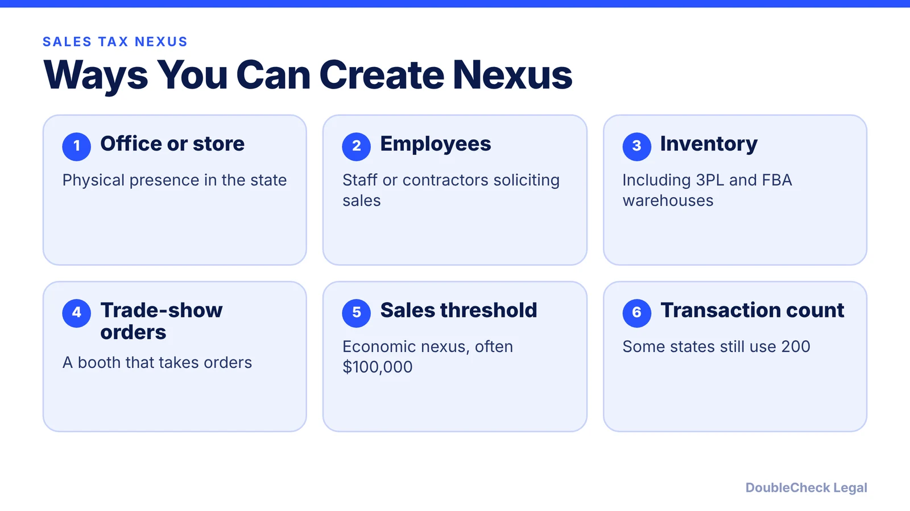
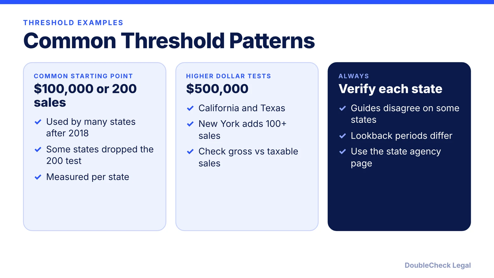

*Sales tax nexus decides where you must collect tax. Since Wayfair, selling into a state can be enough.*

**Key takeaways:**

- Nexus can come from physical presence (office, employee, inventory) or from economic activity.
- South Dakota v. Wayfair (2018) removed the physical presence requirement.
- Many states use $100,000 in sales, but thresholds vary: California and Texas use $500,000.
- Marketplaces collect on their own sales, not your direct-site sales; track every state separately.

## 1. The quick answer

**Quick answer:** Sales tax nexus is a connection to a state that obligates you to collect and remit its sales tax. You can create it with a physical presence (an office, employee, or inventory) or, since the 2018 Supreme Court decision in *South Dakota v. Wayfair*, with economic activity alone. Many states use a threshold of $100,000 in sales into the state, sometimes with a 200-transaction alternative, but thresholds vary by state: California and Texas use $500,000, for example. Check each state separately.

## 2. Physical nexus vs. economic nexus

**Physical nexus** comes from having something in a state. Per a 2026 Beancount guide, examples include an office, employee, inventory, or store, a third-party warehouse (including Amazon FBA), a contractor soliciting sales, or a trade-show booth that takes orders. It applies immediately, with no dollar test.

**Economic nexus** comes from sales activity. Before 2018 a seller generally needed a physical presence. In *South Dakota v. Wayfair* (2018), the Supreme Court reversed that physical presence standard, so states can require out-of-state sellers to collect tax based on economic activity. Avalara notes the South Dakota law at issue set the threshold at $100,000 in sales or 200 transactions. TaxCloud reports that all 45 states with a statewide sales tax now enforce economic nexus rules.

Physical and economic nexus are separate paths. Crossing a state's sales threshold does not replace physical nexus, and a warehouse or employee can create nexus at any sales level.

If you are an Amazon seller, see [how to form an LLC for Amazon and e-commerce](/blog/how-to-form-llc-amazon-seller-ecommerce/) for entity basics.

## 3. Thresholds vary by state

The $100,000 / 200-transaction figure is a common starting point, not a universal rule. Examples reported by the sources below:

- **California and Texas:** $500,000 in sales (TaxCloud; Kintsugi).
- **New York:** $500,000 and more than 100 sales (TaxCloud; Kintsugi).
- **Others:** Sources disagree on some states. Beancount's own guide warns that state-level figures can be inconsistent, so confirm with the state agency.
- **Transaction tests:** Many states have dropped the 200-transaction leg. Kintsugi lists Illinois (2026), Kentucky (August 1, 2026), Utah (2025), and North Carolina and Wyoming (2024) among them.
- **What counts:** California, Illinois, and Wisconsin count all revenue, while Arkansas, Florida, and Oklahoma count only taxable sales (TaxCloud).
- **Lookback period:** Some states use the calendar year, others a rolling 12 months or the preceding quarters.

Each state is measured separately, not against your combined national sales. Add up every channel, including your own store and marketplaces, because marketplace sales count toward your threshold in several states, per Kintsugi.

## 4. Marketplace facilitators and registration

A marketplace facilitator law makes platforms such as Amazon, Etsy, eBay, and Walmart collect and remit tax on sales they facilitate. Kintsugi reports that 45 states and DC require this. Two limits matter for small sellers:

- The platform does not cover your **direct website, phone, or show orders**, or nexus created by inventory in a state, per Beancount.
- Some states still want you registered or reporting even when the marketplace collects, and some only relieve you with a certificate or written statement from the marketplace (Kintsugi cites forms from Connecticut, Massachusetts, New York, and Colorado).

**Typical steps once you have nexus** (Beancount and TaxCloud):

1. Track sales by ship-to state against each threshold and lookback period; many sellers flag states near 80% of the limit.
2. Register for a sales tax permit with the state revenue department (or the Streamlined Sales Tax Registration System in participating states).
3. Collect at the destination rate and keep valid exemption certificates.
4. File on the state's schedule, including zero returns, which can draw penalties if missed.
5. If you find old, unregistered exposure, speak with a tax advisor. TaxCloud notes a Voluntary Disclosure Agreement can often limit the lookback and penalties if you approach the state first.

Also review [business license requirements](/blog/business-license-requirements-small-business/) and your [EIN](/blog/how-to-get-an-ein-for-your-business-free/), which you will need to register.

## Where DoubleCheck fits

[DoubleCheck](https://www.contactdoublecheck.com) helps businesses and founders start legal work with AI, verify it, and, when professional advice is warranted, connect with an independent attorney, including for immigration questions. Attorney availability and practice areas vary. Attorneys on DoubleCheck are independent professionals; an attorney-client relationship forms only if an attorney accepts your engagement.

**Sources:** [TaxCloud: Economic nexus](https://taxcloud.com/blog/economic-nexus-and-your-business); [Avalara: Economic nexus and the changing sales tax landscape](https://www.avalara.com/us/en/blog/2018/09/economic-nexus-and-the-changing-sales-tax-landscape.html); [Kintsugi: Marketplace facilitator laws by state](https://trykintsugi.com/blog/marketplace-facilitator-laws-by-state); [Beancount: Sales tax nexus 2026](https://beancount.io/blog/2026/07/22/sales-tax-nexus-2026-economic-nexus-thresholds-100k-200-transaction-trap-wayfair-guide).

## FAQ

**What is sales tax nexus?**

It is a sufficient connection to a state that requires you to collect and remit its sales tax. Physical presence, such as an office, employee, or inventory, creates it, and since 2018 so can sales volume, per Beancount and Avalara.

**What did Wayfair change?**

In South Dakota v. Wayfair (2018) the Supreme Court reversed its physical presence standard, so states can require out-of-state sellers to collect tax based on economic activity, per Avalara.

**Is the threshold always $100,000?**

No. Many states use $100,000, but TaxCloud and Kintsugi report $500,000 for California and Texas, and New York uses $500,000 plus more than 100 sales. Verify with each state.

**If Amazon collects tax for me, am I done?**

Not necessarily. Marketplaces cover the sales they facilitate, not your own website sales or nexus created by inventory in a state, and some states still require registration or reporting, per Beancount and Kintsugi.

---

*General information only. This article is not legal, tax, investment, or accounting advice.*
