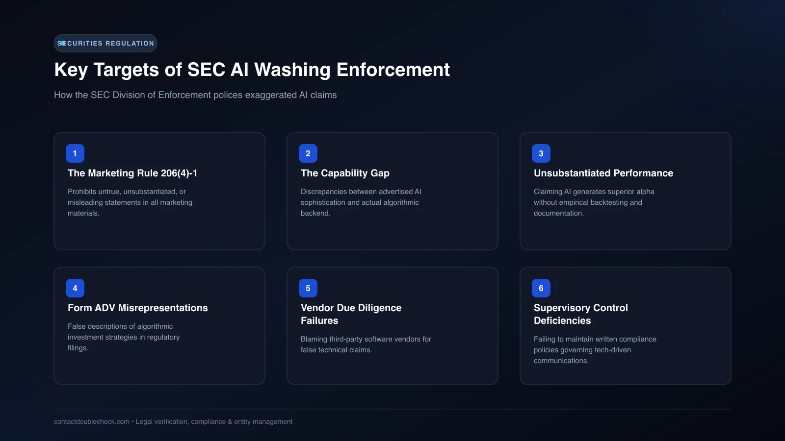
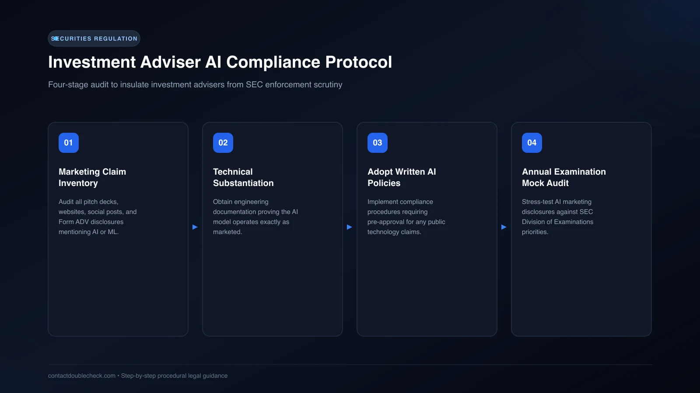

*A comprehensive compliance guide for registered investment advisers (RIAs), wealth managers, and fintech founders navigating SEC scrutiny regarding artificial intelligence marketing claims, current through November 2026. General information, not legal advice.*

**Key takeaways:**

- "AI washing"—making false, exaggerated, or misleading claims regarding AI capabilities—is an active enforcement priority for the Securities and Exchange Commission (SEC).
- The SEC does not require a novel AI statute; it relies on the Investment Advisers Act of 1940 and the Marketing Rule (Rule 206(4)-1) to penalize unsubstantiated claims.
- Public statements in investor pitch decks, marketing websites, and Form ADV disclosures must precisely mirror actual operational and algorithmic capabilities.
- Investment advisers cannot deflect liability to third-party software vendors; fiduciary obligations require independent technical due diligence.
- Non-compliance carries severe civil money penalties, public administrative censures, and mandatory remediation of marketing collateral.

## 1. The quick answer

**Quick answer:** Under the SEC Marketing Rule (Rule 206(4)-1 under the Investment Advisers Act of 1940), registered investment advisers are strictly prohibited from disseminating any advertisement that includes any untrue statement of a material fact, or that is otherwise false or misleading. The SEC’s Division of Enforcement has made clear that claiming a platform uses artificial intelligence to generate investment strategies or predict market performance—when the technology does not exist or operates merely as a simple statistical algorithm—constitutes actionable fraud.

In landmark actions against firms like Delphia (USA) Inc. and Global Predictions Inc., the SEC imposed substantial financial fines and censures for misleading marketing statements regarding AI. Wealth management firms and fintech startups must maintain contemporaneous, verifiable technical proof supporting every public claim made about their automated tools.

For fintech founders and entities managing regulatory filings, review our guides on [corporate transparency compliance](/blog/corporate-transparency-act-finsea-compliance-startups-2026/) and [managing regulatory risk in startup agreements](/blog/how-to-write-a-freelance-contract/).

## 2. The regulatory framework under the Advisers Act

The SEC polices AI washing through core fiduciary principles and established administrative regulations:

- **Section 206 of the Advisers Act:** Establishes a federal fiduciary duty of loyalty and care for all registered investment advisers. Misleading prospective or current clients regarding the mechanics, data sources, or analytical tools driving investment portfolios violates Section 206(1) and 206(2).
- **The Marketing Rule (Rule 206(4)-1):** Barring unsubstantiated statements of material fact. If an adviser advertises that its models ingest collective client spending data to generate machine learning forecasts, the adviser must possess verifiable documentation proving that this process is active and operational at the time of publication.
- **Rule 204-2 (Books and Records):** Mandates that investment advisers maintain written documentation supporting any factual assertions made in marketing communications.

## 3. Landmark SEC enforcement actions: Delphia and Global Predictions

The SEC demonstrated its enforcement posture through landmark settled administrative proceedings:

1. **Delphia (USA) Inc. ($225,000 Penalty):** From 2019 to 2023, Delphia made false and misleading statements in its Form ADV brochures, client communications, and social media channels. The firm claimed it used artificial intelligence and machine learning to analyze consumer spending data to predict company performance and make investment selections. The SEC found that Delphia had not developed or deployed these capabilities, resulting in formal censure and substantial fines.
2. **Global Predictions Inc. ($175,000 Penalty):** The SEC penalized Global Predictions for falsely advertising itself as the "first regulated AI financial advisor" and claiming its technology offered 32% lower risk and market-beating returns without maintaining the required substantiating documentation.
3. **The Clear Agency Warning:** SEC leadership explicitly warned market participants: "If you claim to use AI, you must actually use AI; and if you claim your AI delivers specific outcomes, you must be able to prove it."

## 4. Division of Examinations priorities and focus areas

The SEC’s Division of Examinations consistently identifies emerging financial technologies as a primary inspection priority. During an examination, staff routinely request:

- **The Technical Specification Package:** Technical documentation, architectural diagrams, and algorithmic descriptions verifying that advertised AI tools actually exist.
- **Model Validation and Testing:** Records of backtesting, model drift monitoring, validation studies, and historical performance attribution.
- **Marketing Review Workflows:** Compliance approvals and sign-offs for all website pages, podcasts, pitch decks, and investor emails that reference AI, machine learning, or automated algorithms.
- **Vendor Contracts and Due Diligence:** Documentation showing how the firm vetted third-party AI software before marketing its capabilities to clients.

## 5. Technical substantiation and evidence standards

Under the Marketing Rule, advisers cannot substantiate a claim after receiving an SEC subpoena; the substantiation must exist prior to publishing the claim:

### What Constitutes Acceptable Substantiation?
- **Data Pipeline Verification:** Evidence showing the volume, origin, and flow of real-time data into the machine learning model.
- **Algorithmic Source Code:** Maintained version-control logs demonstrating that the proprietary algorithms advertised were compiled and deployed in production.
- **Performance Attribution Logs:** Empirical records separating returns generated by automated algorithms from standard market movements or human discretionary trades.

### What Fails Substantiation?
- High-level marketing whitepapers produced by outside public relations firms.
- Relying on consumer-tier off-the-shelf chatbots and claiming the firm built proprietary predictive financial intelligence.
- Marketing planned or roadmapped features as current, live capabilities.

## 6. RIA compliance audit checklist for AI claims

Compliance officers should conduct an immediate internal review to eliminate AI washing risks:

1. **Scour All Public Communications:** Audit websites, social media accounts, investor presentations, and Form ADV Part 2A brochures for terms like "AI," "machine learning," "deep learning," and "algorithmic optimization."
2. **Interview Engineering Teams:** Meet directly with data science and engineering staff to verify whether public claims accurately reflect actual code in production.
3. **Establish a Substantiation File:** Create a centralized compliance binder containing technical whitepapers, code commits, and model verification reports for every public assertion.
4. **Enact Written AI Marketing Policies:** Require that no technology-related marketing material be released without prior written sign-off from the Chief Compliance Officer (CCO).
5. **Review Third-Party Disclosures:** If using vendor-provided AI models, disclose clearly to clients that third-party technology is utilized rather than implying proprietary development.

## Where DoubleCheck fits

[DoubleCheck](https://www.contactdoublecheck.com) provides businesses, general counsel, and enterprise teams with automated contract review, AI-assisted verification, and legal workflow assurance. DoubleCheck helps teams verify citations, audit regulatory compliance across California, Colorado, New York, and federal agencies, and connect with experienced attorneys to ensure compliance with emerging AI standards.

**Related reading:**
- [FTC Operation AI Comply: Enforcement & Rules](/blog/ftc-operation-ai-comply-deceptive-ai-claims-enforcement/)
- [FINRA Notice 24-09 on Generative AI for Broker-Dealers](/blog/finra-regulatory-notice-24-09-generative-ai-broker-dealers/)
- [Corporate Transparency Act BOI Compliance for Startups](/blog/corporate-transparency-act-finsea-compliance-startups-2026/)
- [Safe Harbor 409A Valuation for Startup Stock Options](/blog/safe-harbor-409a-valuation-startup-stock-options-irs-rules/)
- [Section 83(b) Election Proof and IRS Filing Guide](/blog/section-83b-election-certified-mail-proof-irs-filing/)
- [Delaware Franchise Tax Assumed Par Value Method](/blog/delaware-franchise-tax-assumed-par-value-method-calculation/)

**Sources:** [U.S. Securities and Exchange Commission, Investment Advisers Act Marketing Rule (17 CFR § 275.206(4)-1)](https://www.sec.gov/rules/final/2020/ia-5653.pdf); [U.S. Securities and Exchange Commission, SEC Charges Two Investment Advisers with Making False and Misleading Statements Regarding AI Use](https://www.sec.gov/news/press-release/2024-36); [U.S. Securities and Exchange Commission Division of Examinations, Examination Priorities](https://www.sec.gov/exams); [Cornell Legal Information Institute, 15 U.S.C. § 80b-6 (Prohibited Transactions by Investment Advisers)](https://www.law.cornell.edu/uscode/text/15/80b-6).

## FAQ

**What is AI washing under SEC enforcement standards?**

AI washing refers to the practice of exaggerating, fabricating, or misleadingly marketing artificial intelligence capabilities, machine learning models, or automated trading algorithms to attract investors or justify client advisory fees.

**Did the SEC create a new rule specifically for AI washing?**

No. The SEC polices AI washing using existing statutory frameworks, primarily the Investment Advisers Act of 1940 and the Marketing Rule (Rule 206(4)-1), which prohibits unsubstantiated or false advertising.

**What penalties have investment advisers faced for AI washing?**

Firms have paid hundreds of thousands of dollars in civil penalties (e.g., Delphia paid $225,000 and Global Predictions paid $175,000), agreed to censures, and been forced to remediate public disclosures.

**Can an investment adviser claim its AI predicts stock trends without proof?**

No. Under Rule 206(4)-1, any performance or capability claim must be fully substantiated by contemporaneous empirical evidence before the advertisement is disseminated.

**Does the SEC examine third-party AI tools used by registered advisers?**

Yes. Advisers cannot escape liability by claiming a third-party vendor misrepresented their software. The adviser retains an independent fiduciary duty to verify tech claims before promoting them to clients.

---

*General information only. This article is not legal, tax, investment, or accounting advice.*
