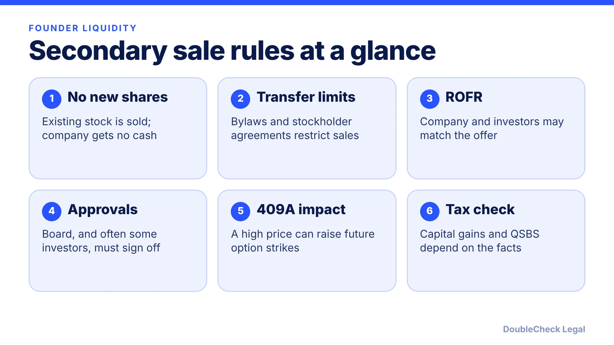
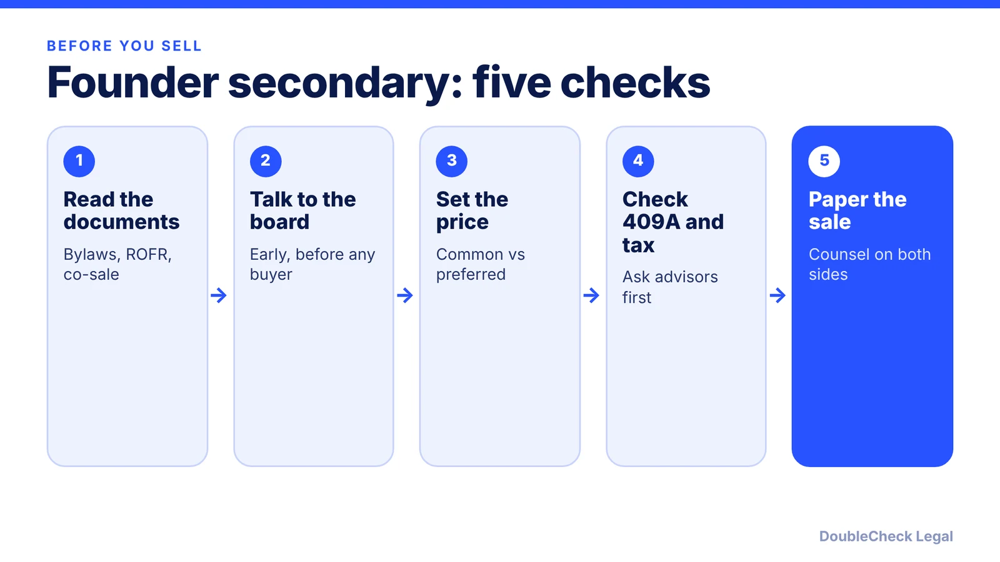

*A secondary sale lets a founder cash out some shares without new stock being issued. Here are the rules and checks that matter first, as of November 2026.*

**Key takeaways:**

- A secondary sells existing shares; the company gets no cash and no new stock is issued.
- Transfer restrictions, ROFR, board and investor consent usually come before any buyer.
- A high secondary price can lift your next 409A and option strike prices.
- Tax and QSBS results depend on structure, so check with advisors before you sign.

## 1. The quick answer

**Quick answer:** A secondary sale lets a founder sell some existing shares to an outside buyer for cash, without the company issuing new stock. The company gets no money. Because the shares are usually restricted, you typically need the board and often some investors to approve, and the company and investors may have a right of first refusal to buy the shares first. These are the startup secondary sale and founder liquidity rules to check before you talk to a buyer: transfer restrictions, who must consent, what price makes sense for common stock, how it affects your 409A valuation, whether securities-law tender offer rules apply, and the tax result. Details vary by company documents and by state.

## 2. What a secondary sale is, and how it differs from a raise

A secondary is the sale of existing shares to an outside buyer. No new shares are issued and the company receives no cash. A primary round is the opposite: the company issues shares and receives the money.

Secondary sales are non-dilutive, but board approval is often required, and the sale is usually governed by the company's bylaws and shareholder agreements ([Cooley GO](https://cooleygo.com/secondary-sales-of-private-company-stock)). Some founders pair a secondary with a priced equity round, when diligence and valuation work overlap; ask counsel whether that fits your situation.

Common structures:

- **In-round sale:** a small slice sold alongside a new financing, under the same rules as other sellers.
- **Tender offer:** a company-run sale at one price open to a group of sellers.
- **Direct or SPV sale:** a sale to a buyer, sometimes through a special purpose vehicle.

For the primary side of the story, see [startup funding stages from pre-seed to Series B](/blog/startup-funding-stages-pre-seed-to-series-b/) and [term sheet key terms explained](/blog/term-sheet-key-terms-explained/).

## 3. Who has to approve: ROFR, board and investor consent

Founder stock is rarely freely tradable. Per Cooley GO, bylaws, stockholder agreements and a right of first refusal commonly restrict transfers, and bylaws increasingly require board approval of any transfer. Financing documents may also require investor consent. Mintz (National Law Review, December 2019) lays out the common gates:

- **Board approval,** and lender consent if the company has debt and the company is the buyer.
- **Right of first refusal:** the company generally gets the first chance to buy. If it declines, existing investors may have a secondary right to buy pro rata before the founder sells to third parties.
- **Consent to the buyer:** the company or investors may need to approve both the transfer and who the buyer is.
- **Co-sale (tag-along) rights:** investors may sell alongside the founder, which can reduce the number of shares the founder can sell.
- **State corporate law:** statutes may bar repurchases unless conditions are met. Mintz notes that under Delaware law a corporation may not repurchase shares unless its net assets exceed its capital.

Cooley GO notes that sales are often capped at a small share of holdings (for employee sales, such as 10%), a market pattern rather than a legal rule. Mintz suggests founders seek carve-outs in the financing documents for sales below a set percentage, and engage the board and key investors early. See [pro rata rights explained](/blog/pro-rata-rights-explained-startups/), [side letters startup investors ask for](/blog/side-letters-startup-investors-what-they-grant/) and [founder equity split](/blog/founder-equity-split-how-to-divide/). If your cap table has loose ends, [clean it up before Series A](/blog/cap-table-cleanup-before-series-a-common-problems/).

## 4. Price, common vs preferred and the 409A effect

Founders typically hold common stock, while investors hold preferred stock with a liquidation preference. Preferred holders get their money back first, so common can be worth less than the headline valuation, which is one reason a common-stock secondary may be priced at a discount to the preferred price. Learn how the stack works in [liquidation preference explained](/blog/liquidation-preference-explained-founders/).

The 409A valuation sets option strike prices. Law firm guidance indicates a large secondary can matter:

- Mintz: a founder sale at a price above the current 409A will likely raise the next 409A, which can raise strike prices for employee and advisor options.
- Cooley GO: valuation firms usually factor secondary transactions into the common stock valuation, with the weight depending on the deal's terms, size and how many secondaries the company has done.

Consider the timing of option grants relative to a new valuation, and ask counsel and your valuation provider how the sale will be treated. Read [stock options and 409A valuation for startups](/blog/stock-options-409a-valuation-startups/), [ISOs vs NSOs](/blog/isos-vs-nsos-employee-stock-options/) and [employee equity grants for first hires](/blog/employee-equity-grants-for-first-hires-how-to-structure/).

## 5. Securities-law flags: tender offers and buyers

A secondary is still a securities transaction. Company counsel typically asks buyers to confirm their investor status, because the sale needs a securities-law exemption. Counsel should be involved on both sides.

Counsel must determine whether the transaction is a tender offer subject to federal securities laws. Cooley GO says that, depending on the number of sellers and other factors, a secondary may need to follow SEC Regulation 14E, which can require an offer to stay open for 20 business days. In April 2026 the SEC's Division of Corporation Finance issued an exemptive order allowing certain qualifying tender offers, including some issuer offers by non-reporting companies, to stay open 10 business days instead of 20 ([King & Spalding summary](https://www.kslaw.com/news-and-insights/sec-exemptive-order-permits-10-business-day-offer-periods-for-certain-equity-tender-offers)); the conditions are specific, so ask counsel whether they apply.

Two cautions:

- None of these sources is a full securities analysis, and several skip exemptions and disclosure duties. Rules differ by facts and state, so ask counsel about the exemption relied on and what the company must tell the buyer.
- If employees or former employees also want to sell, plan a consistent process rather than one-off deals.

If you are preparing a company for new investors at the same time, [due diligence for startup fundraising](/blog/due-diligence-checklist-for-startup-fundraising/) shows what buyers ask for. Our [Form D and Rule 506 overview](/blog/form-d-rule-506-fundraising-startups/) covers the primary-offering side.

## 6. Taxes and QSBS: what to confirm first

Sellers owe capital gains tax on the gap between the sale price and their basis. Per the [IRS](https://www.irs.gov/taxtopics/tc409), gain on assets held longer than one year is generally long-term capital gain. If shares were bought in several tranches, which tranche you sell can affect the result, so ask a tax adviser.

Qualified small business stock can change the math. Per [Perkins Coie](https://perkinscoie.com/insights/update/significant-changes-one-big-beautiful-bill-act-qualified-small-business-stock), a law signed July 4, 2025 created tiers for stock acquired after that date: 50% of gain excluded at three years, 75% at four and 100% at five, while earlier stock keeps the old five-year rule. State treatment of the exclusion varies, so check yours. Confirm these points with a tax adviser.

Structure can break QSBS treatment. Cooley GO notes that company buybacks can affect other holders' QSBS status, and that shares bought by a third party in a secondary will not qualify as QSBS in the buyer's hands, so involve tax advisors early. See [QSBS and Section 1202 explained](/blog/qsbs-section-1202-explained-startup-founders/) and the [QSBS checklist before you issue stock](/blog/qsbs-checklist-before-you-issue-stock-startups/), plus the [QSBS exit checklist before you sell](/blog/qsbs-exit-checklist-what-to-verify-before-you-sell-your-stock/). If a full company sale is the alternative, compare it in [asset sale vs stock sale](/blog/asset-sale-vs-stock-sale-small-business-buyer-seller-differences/).

If you used AI to summarize your stockholder agreement, [verify the AI output](/blog/verify-ai-generated-legal-document/) against the actual clauses and have counsel confirm before you sign anything.

## Where DoubleCheck fits

[DoubleCheck](https://www.contactdoublecheck.com) helps businesses and founders start legal work with AI, verify it, and, when professional advice is warranted, connect with an independent attorney, including for immigration questions. Attorney availability and practice areas vary. Attorneys on DoubleCheck are independent professionals; an attorney-client relationship forms only if an attorney accepts your engagement.

**Sources:** [Cooley GO, Secondary Sales of Private Company Stock](https://cooleygo.com/secondary-sales-of-private-company-stock); [Mintz via National Law Review, Founder Liquidity: Key Considerations in Secondary Sales (December 2, 2019)](https://natlawreview.com/article/founder-liquidity-key-considerations-secondary-sales); [King & Spalding, SEC Exemptive Order Permits 10 Business Day Offer Periods for Certain Equity Tender Offers](https://www.kslaw.com/news-and-insights/sec-exemptive-order-permits-10-business-day-offer-periods-for-certain-equity-tender-offers); [Perkins Coie, Significant Changes by the One Big Beautiful Bill Act to QSBS](https://perkinscoie.com/insights/update/significant-changes-one-big-beautiful-bill-act-qualified-small-business-stock); [IRS, Topic no. 409, Capital gains and losses](https://www.irs.gov/taxtopics/tc409).

## FAQ

**What is a secondary sale for a startup founder?**

It is a sale of a founder's existing shares to an outside buyer. No new shares are issued and the company receives no cash.

**Do founders need approval to sell startup shares?**

Usually yes. Bylaws increasingly require board approval of transfers, per Cooley GO, and Mintz notes the company and investors may hold a right of first refusal. Financing documents may also require investor consent. Your own documents control.

**How much can a founder sell in a secondary?**

There is no legal fixed number. Financing documents and investors decide what is allowed. Some law firm guidance describes caps around 10% of holdings for employee sales, which is a market pattern rather than a legal rule.

**Does a founder secondary affect the 409A valuation?**

It can. Mintz says a sale above the current 409A will likely raise the next one, which can raise option strike prices, and Cooley GO notes valuation firms usually factor secondary sales into the common stock valuation.

**Is a founder secondary a tender offer?**

It can be. Cooley GO says that, depending on the number of sellers and other factors, it may need to follow the SEC tender offer rules (Regulation 14E). Ask counsel before you open the sale to several holders.

---

*General information only. This article is not legal, tax, investment, or accounting advice.*
