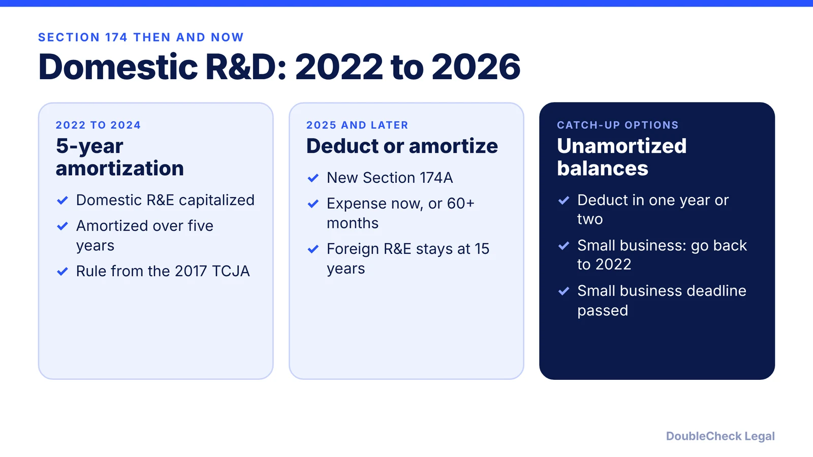
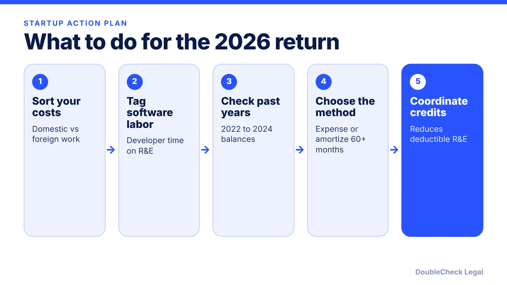

*Can startups deduct domestic R&D and software costs again? Here is what the 2025 tax law changed, as of November 2026.*

**Key takeaways:**

- Section 174A lets taxpayers deduct domestic R&E for tax years beginning after December 31, 2024.
- Foreign research is still amortized over 15 years, so where the work happens matters.
- Optional amortization over at least 60 months is available by election.
- The small-business retroactive election for 2022 to 2024 had a July 6, 2026 deadline and has passed.

## 1. The quick answer

**Quick answer:** Under the 2025 tax law (the One Big Beautiful Bill Act), new Section 174A lets taxpayers deduct domestic research and experimental (R&E) costs in the year they are paid or incurred, for tax years beginning after December 31, 2024. Foreign research is still capitalized and amortized over 15 years. Software development counts as R&E, per Instead's guide. The one-time election letting small businesses go back to 2022 had a deadline of July 6, 2026, so as of November 2026 it has passed.

## 2. What changed and who it affects

From 2022 through 2024, the 2017 tax law (TCJA) required domestic R&E costs to be capitalized and amortized over five years, per Anchin. That hit software startups hard, since developer salaries were treated as R&E. The 2025 law reversed it going forward.

Per Legalink and Anchin, for tax years beginning after December 31, 2024:

- **Domestic R&E** can be deducted currently under Section 174A.
- **Optional amortization:** you can instead capitalize and amortize over at least 60 months, by an election made by the return's due date, including extensions.
- **Foreign R&E** must still be capitalized and amortized over 15 years.
- **Credit interaction:** deductible R&E is reduced by the amount of the research credit claimed, per Anchin.

Instead's guide states that all amounts paid or incurred for software development qualify as R&E, and that location is the practical test: research done in the U.S. is domestic, research abroad is foreign. If you use overseas contractors, the contract should show where the work is performed. Treat vendor commentary as a starting point and confirm with the statute and IRS guidance.

## 3. Catch-up rules for earlier years

The law also dealt with costs you already capitalized in 2022 through 2024:

- **Larger businesses:** per Legalink, you can recognize the unamortized domestic balance entirely in the first tax year beginning after December 31, 2024, or split it equally over two years.
- **Small businesses:** with average gross receipts of $31 million or less (and not a tax shelter), you could elect to apply Section 174A retroactively to tax years beginning 2022 through 2024 by filing amended returns, per Legalink. The deadline was July 6, 2026 under Rev. Proc. 2025-28 as described by Legalink and Instead (Anchin lists July 4), and it has passed as of November 2026.
- **Deemed election:** per Instead, taxpayers who filed original returns by November 15, 2025 and had already deducted domestic R&D are treated as having made the election if they otherwise qualify.

If you missed the retroactive window, the larger-business style catch-up may still matter to you; this is a question for a tax professional, because eligibility turns on receipts and filing history. Changing to the new method may also need Form 3115, per Legalink.

## 4. Startup-specific points

A deduction helps only if you have income to use it against. A pre-revenue startup with no taxable income may not see an immediate tax benefit, and how losses carry forward depends on your entity type and facts, so ask a CPA.

Entity choice matters. In an LLC taxed as a partnership or a sole proprietorship, the deduction flows to the owners; in a C corporation it stays inside the company. See [LLC vs. C corp for startups](/blog/llc-vs-c-corp-startups/) and [how to incorporate a SaaS or AI startup as a Delaware C corp](/blog/how-to-incorporate-saas-ai-startup-delaware-c-corp/). For investor-related tax questions, read [whether your startup qualifies for QSBS](/blog/does-my-startup-qualify-for-qsbs/).

If you pay people to write code, how you classify them also matters for payroll and reporting; see [employee vs. independent contractor classification](/blog/employee-vs-independent-contractor-classification-startups/). And for owners who pay estimated tax, the [quarterly estimated taxes guide](/blog/quarterly-estimated-taxes-solo-business-owner/) shows how a lower taxable income feeds the payment schedule. Ask a CPA to confirm your method before filing.

## Where DoubleCheck fits

[DoubleCheck](https://www.contactdoublecheck.com) helps businesses and founders start legal work with AI, verify it, and, when professional advice is warranted, connect with an independent attorney, including for immigration questions. Attorney availability and practice areas vary. Attorneys on DoubleCheck are independent professionals; an attorney-client relationship forms only if an attorney accepts your engagement.

**Sources:** [Legalink on Section 174A and Rev. Proc. 2025-28](https://www.legalink.net/en/publications/newsletters/to-expense-or-amortize-rd-that-is-the-question-july-6-2026-deadline-and-planning-opportunities/7518/); [Anchin on the One Big Beautiful Bill Act and R&D](https://www.anchin.com/articles/one-big-beautiful-bill-act-catalyzes-u-s-research-and-development/); [Instead on domestic R&D](https://instead.com/resources/blog/domestic-r-d-fully-deductible-2026-2029).

## FAQ

**Can startups deduct software development costs in 2026?**

Per Instead's guide, amounts paid for software development qualify as research or experimental expenditures, and domestic R&E is deductible under Section 174A for tax years beginning after December 31, 2024. Confirm your facts with a tax professional.

**What happens to foreign R&D under the new rules?**

Per Legalink, foreign R&D must still be capitalized and amortized over 15 years under Section 174. Where the research is performed is the key test.

**Can I still elect to go back to 2022 to 2024?**

Per Legalink, businesses with $31 million or less in average gross receipts could elect retroactive treatment by July 6, 2026 (Anchin lists July 4). As of November 2026 that deadline has passed.

**Do I have to expense domestic R&D immediately?**

No. Per Legalink, you may instead capitalize and amortize domestic R&D over at least 60 months by an election made by the return's due date, including extensions.

---

*General information only. This article is not legal, tax, investment, or accounting advice.*
