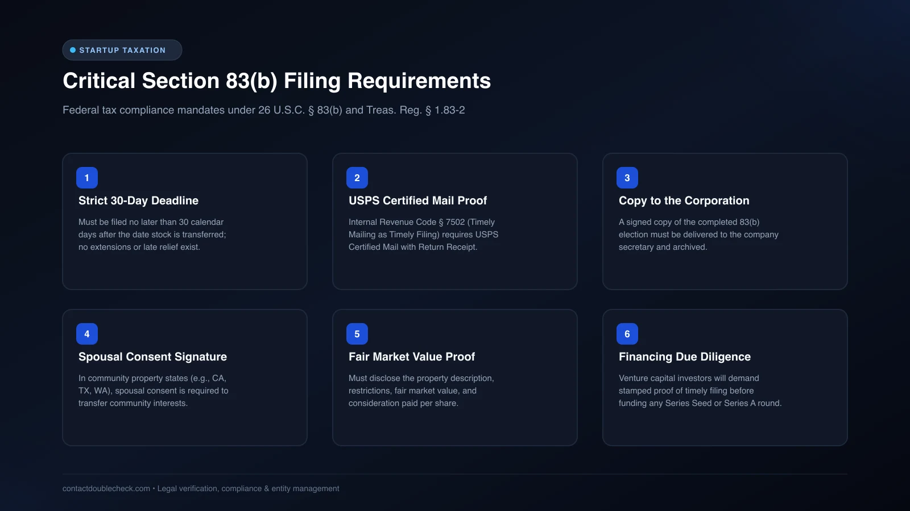
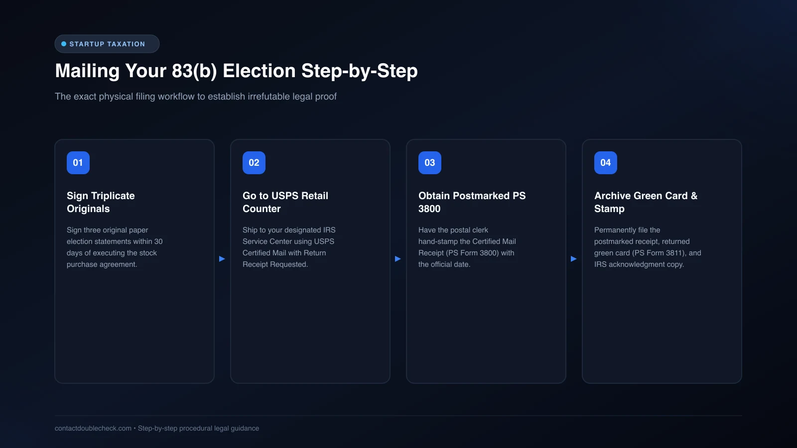

*Procedural filing checklist for startup founders and early equity recipients submitting an Internal Revenue Code Section 83(b) election, as of November 2026. General information, not legal advice.*

**Key takeaways:**

- A Section 83(b) election must be postmarked no later than 30 calendar days after stock is transferred; day 31 is legally impossible to cure.
- Filing via USPS Certified Mail with Return Receipt Requested creates statutory proof of timely filing under IRC § 7502.
- Do not drop the envelope in a mailbox; have a postal clerk hand-stamp the Certified Mail Receipt (PS Form 3800) with the date.
- Submit a copy to the corporate secretary to retain in the company’s permanent capitalization archives.
- Venture capital investors will demand physical proof of timely filing before closing Series Seed or Series A financing rounds.

## 1. The quick answer

**Quick answer:** An **Internal Revenue Code Section 83(b) election** allows a startup founder or early employee receiving restricted stock subject to vesting to elect to pay income taxes on the fair market value of the stock at the time of grant (when the value is nominal), rather than paying ordinary income tax on the value as shares vest over a 4-year schedule.

Under 26 U.S.C. § 83(b)(2) and Treas. Reg. § 1.83-2, the election **must be filed with the IRS no later than 30 calendar days** after the date the stock was transferred. **There are zero exceptions, zero extensions, and zero administrative waivers for missing this deadline.** 

To establish bulletproof legal proof that survives institutional investor due diligence, founders must physically file via **USPS Certified Mail with Return Receipt Requested**, obtain a clerk hand-stamped receipt (**PS Form 3800**), include a self-addressed stamped envelope for an IRS acknowledgment stamp, and deliver a countersigned copy to the company secretary.

For broader equity structuring, explore [founder equity splits and vesting schedules](/blog/founder-equity-split-how-to-divide/) and [83(b) election for startup founders](/blog/83b-election-startup-founders/).

## 2. The unbending 30-day statutory deadline

Under federal tax law, the default rule under IRC § 83(a) is that restricted property is taxed when it becomes "substantially vested" (when it is no longer subject to a substantial risk of forfeiture). For a founder with a 4-year monthly vesting schedule, this means paying income tax every month on whatever the startup is worth at that moment. If the startup's valuation explodes to $20,000,000, the founder faces astronomical phantom ordinary income taxes on stock they cannot sell.

Filing an 83(b) election accelerates taxation to day one. When shares are issued at $0.0001 per share at incorporation, the taxable income is essentially $0.

**The Fatal 30-Day Window:**
IRC § 83(b)(2) mandates: *"An election under paragraph (1) with respect to any transfer of property shall be made not later than 30 days after the date of such transfer."*
- Day 1 is the day *after* the stock purchase agreement is signed and consideration is paid.
- Day 30 is the final postmark deadline. If day 30 falls on a Saturday, Sunday, or legal federal holiday, IRC § 7503 extends the deadline to the next business day.
- **The IRS Cannot Forgive a Late Filing:** The U.S. Tax Court (*e.g., Alves v. Commissioner*) has repeatedly confirmed that neither the IRS Commissioner nor federal judges have equitable power to waive a late 83(b) filing, even if caused by attorney malpractice, postal delays, or medical emergencies.

## 3. Certified mail and IRC § 7502 proof of filing

Under IRC § 7502, known as the **"Timely Mailing as Timely Filing" rule**, an election delivered by mail after the 30-day window is deemed timely filed *if and only if* the postmark date falls on or before day 30.

However, if you send an 83(b) election via ordinary First-Class Mail and the IRS loses it (or fails to process it before an audit), federal evidentiary law establishes that ordinary mail creates **zero legal presumption of delivery**.

**The Gold Standard: USPS Certified Mail**
Under Treas. Reg. § 301.7502-1(e)(2), registration or certification is statutory prima facie evidence of delivery:
- **USPS Certified Mail with Return Receipt Requested (Green Card):** You must present the envelope at the post office retail counter.
- **Hand-Stamped Postmark:** Require the USPS clerk to stamp the date directly onto your white-and-green **PS Form 3800 (Certified Mail Receipt)**. A computerized or metered postage strip is not sufficient if disputed; the hand-stamp is irrefutable evidence of postmark date.
- **Approved Private Delivery Services:** If using FedEx or UPS, you *must* use specific IRS-approved services (e.g., FedEx Priority Overnight or UPS Next Day Air). Standard commercial ground shipping does *not* qualify under IRC § 7502.

## 4. What must be included in the 83(b) election statement

Under Treas. Reg. § 1.83-2(e), the election document must be signed by the taxpayer and state eight specific statutory declarations:

1. **Taxpayer Identification:** Taxpayer’s full legal name, residential address, and Social Security Number (or ITIN).
2. **Property Description:** Clear identification of the property transferred (e.g., *"5,000,000 shares of Common Stock of Acme Technologies, Inc."*).
3. **Date of Transfer:** The exact date on which the stock was transferred, and the taxable year for which the election is made.
4. **Nature of Restrictions:** A description of the substantial risk of forfeiture and vesting schedule (e.g., *"Subject to company repurchase option lapsing monthly over 48 months with a 1-year cliff"*).
5. **Fair Market Value:** The fair market value of the stock at the time of transfer (determined without regard to restrictions).
6. **Consideration Paid:** The total dollar amount paid for the stock by the taxpayer.
7. **Gross Income Amount:** The amount of taxable income recognized (Fair Market Value minus Consideration Paid, typically $0.00).
8. **Notice to Corporation:** A statement affirming that a copy of this election has been submitted to the person for whom the services were performed (the company).

## 5. Spousal consent and corporate record retention

Two critical procedural steps are routinely overlooked:

### Spousal Consent in Community Property States
If the taxpayer resides in a community property state (such as **California, Texas, Washington, Arizona, Nevada, or Idaho**), stock acquired during marriage is presumed community property. The non-employee spouse should sign a formal Spousal Consent attached to the 83(b) election, confirming agreement to the tax election and tax allocation.

### Delivery to Corporate Secretary
Under Treas. Reg. § 1.83-2(d), the taxpayer must furnish a copy of the completed 83(b) election to the company secretary. The corporation must permanently archive this signed copy alongside its cap table and board consents.

## 6. VC due diligence and disaster recovery

When an early-stage startup raises a Series Seed or Series A preferred stock financing round, institutional venture capital counsel conducts rigorous legal due diligence.

Venture investors will demand proof that every founder and early equity holder filed a valid 83(b) election. If proof is missing, investors know the company faces severe employee tax friction or potential payroll withholding tax liability.
- **The Golden Proof Folder:** Every founder should maintain a digital and physical folder containing: (1) The countersigned 83(b) election, (2) The clerk-stamped USPS Certified Mail receipt PS Form 3800, (3) The tracking delivery printout from USPS.com, and (4) The returned signed green card (PS Form 3811) or IRS-stamped acknowledgment letter.

### What if You Discovered You Missed the 30-Day Window?
If day 30 has passed, **do not forge a backdated postmark** (which constitutes federal criminal tax fraud). Consult qualified startup tax counsel immediately. Potential mitigation strategies include:
- Rescinding the unvested stock transfer if legally permissible before value appreciates;
- Restructuring unvested common stock into non-qualified stock options (NSOs) with 409A safe harbor valuations; OR
- Implementing milestone-based vesting structures.

## Where DoubleCheck fits

[DoubleCheck](https://www.contactdoublecheck.com) provides early-stage founders with automated stock issuance checklists, founder agreement templates, and verified procedural filing workflows. When navigating complex founder equity vestings, spousal consents, or tax planning questions, DoubleCheck connects you directly with independent startup tax attorneys.

**Related reading:**
- [83(b) Election for Startup Founders: Complete Guide](/blog/83b-election-startup-founders/)
- [Founder Equity Split: How to Divide Common Stock](/blog/founder-equity-split-how-to-divide/)
- [Co-Founder Vesting Cliff Explained](/blog/cofounder-vesting-cliff-explained/)
- [Cap Table Cleanup Before Series A: Common Traps](/blog/cap-table-cleanup-before-series-a-common-problems/)

**Sources:** [Internal Revenue Code, 26 U.S.C. § 83 (Property Transferred in Connection with Performance of Services)](https://www.law.cornell.edu/uscode/text/26/83); [Electronic Code of Federal Regulations, 26 CFR § 1.83-2 (Election to Include in Gross Income in Year of Transfer)](https://www.ecfr.gov/current/title-26/chapter-I/subchapter-A/part-1/section-1.83-2); [Internal Revenue Code, 26 U.S.C. § 7502 (Timely Mailing as Timely Filing)](https://www.law.cornell.edu/uscode/text/26/7502); [Internal Revenue Service, Treasury Decision 9779 (Elimination of Form 1040 83(b) Attachment Rule)](https://www.irs.gov/irb/2016-33_IRB#TD-9779); [United States Tax Court, Alves v. Commissioner, 734 F.2d 478 (9th Cir. 1984)](https://law.justia.com/cases/federal/appellate-courts/F2/734/478/131758/).

## FAQ

**Can the IRS excuse a late Section 83(b) election?**

No. The IRS and federal courts have established that the statutory 30-day deadline under IRC § 83(b)(2) is mandatory, jurisdictional, and inflexible. Neither equitable relief nor private letter rulings can cure a late filing.

**Why is USPS Certified Mail required for an 83(b) filing?**

Under Internal Revenue Code § 7502 (Timely Mailing as Timely Filing), a postmarked USPS Certified Mail receipt is statutory prima facie evidence of delivery. Ordinary first-class mail provides zero legal proof if lost by the IRS.

**Do founders still attach an 83(b) election to their Form 1040 annual return?**

No. Under IRS Treasury Decision 9779, taxpayers are no longer required to attach a copy of the 83(b) election to their personal annual income tax return, though filing with the IRS Service Center remains mandatory.

**What happens if an 83(b) election is never filed?**

As founder shares vest over time, the fair market value of the vesting shares is taxed as ordinary income upon each vesting event rather than capital gains upon ultimate liquidation, creating massive phantom tax bills.

**Is spousal consent required on an 83(b) election?**

In community property states (e.g., California, Texas, Washington), spousal consent is standard practice and often legally required to confirm community property allocation of the unvested stock.

---

*General information only. This article is not legal, tax, investment, or accounting advice.*
