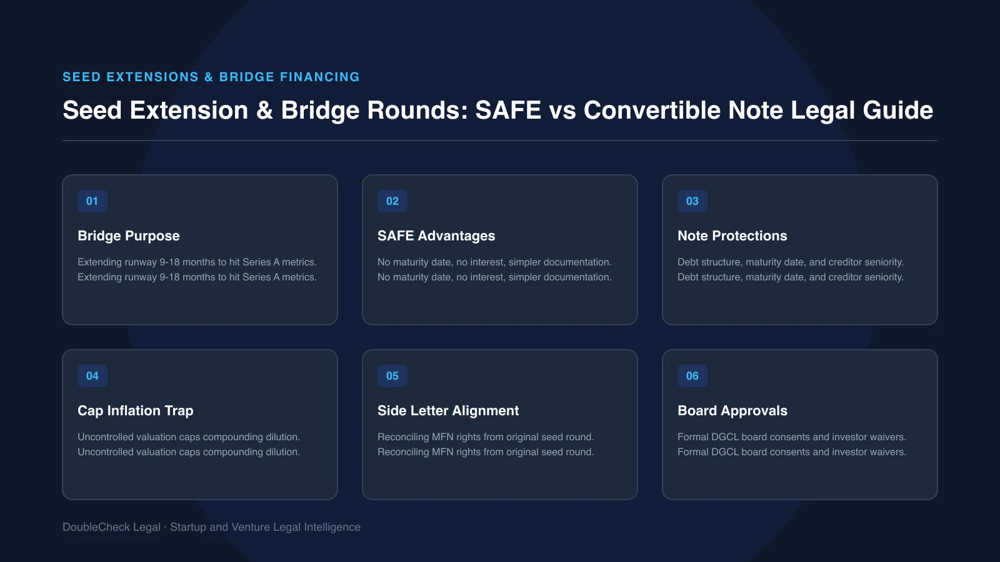
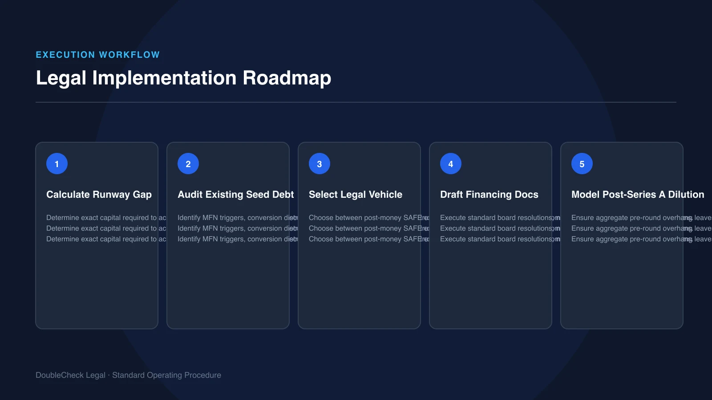

*A practical legal guide for founders and venture counsel structuring seed extension and bridge financing rounds, comparing post-money SAFEs and convertible promissory notes, evaluating dilution overhang, and avoiding governance traps.*

**Key takeaways:**
- **The Modern Seed Extension:** Rather than a sign of weakness, seed extensions are now standard tactical tools allowing startups to scale ARR from $500k to $2M+ before facing Series A valuation scrutiny.
- **Instrument Selection:** SAFEs offer speed and avoid debt maturity pressure, while Convertible Notes provide institutional funds with creditor seniority and maturity renegotiation leverage.
- **Cascading Dilution Risk:** Multiple rolling SAFEs issued between Seed and Series A can inadvertently surrender 25% to 40% of the company before the lead Series A term sheet is even negotiated.
- **MFN Compliance:** Any sweetening of bridge terms must be cross-referenced against prior seed investor side letters to avoid contractual breaches.

## 1. The quick answer: Structuring a venture seed extension

A **seed extension** (historically called a bridge round) bridges the financial gap between initial seed funding and an institutional Series A:

1. **Strategic Goal:** Extend runway by 12 to 18 months, enabling the founding team to prove unit economics, expand enterprise sales, and achieve the metrics required for a top-tier Series A.
2. **Instrument Choice:**
   - **Post-Money SAFE:** Fast, low legal cost ($2k-$5k), no interest calculations, no maturity date risk.
   - **Convertible Promissory Note:** Preferred by traditional venture funds, carries a 5%-8% coupon, 18-24 month maturity, and superior liquidation priority over common stock.
3. **Core Risk:** **Cap Table Overhang**. Uncoordinated bridge financing can heavily dilute founders, leaving them with insufficient equity to motivate long-term execution.



## 2. In-depth legal analysis: Comparing SAFEs vs Convertible Notes for extensions

When structuring an extension round, founders and investors face distinct legal and economic trade-offs:

### A. Legal and Structural Comparison Matrix

| Feature | Post-Money SAFE | Convertible Promissory Note |
|---|---|---|
| Legal Characterization | Deferred equity contract | Bona fide debt instrument |
| Maturity Date | None (converts only upon trigger) | Yes (typically 18 to 24 months) |
| Interest Rate | None | 4% to 8% simple per annum |
| Liquidation Seniority | Senior to Common, junior to debt | Creditor claim superior to all equity |
| Voting Rights | None | None (prior to conversion) |
| Legal Complexity & Cost | Minimal ($2,000 - $5,000) | Moderate ($5,000 - $15,000) |
| Insolvency Risk | Zero debt acceleration risk | Vulnerable to default upon maturity |

### B. The Post-Money SAFE Math in Bridge Rounds
In 2018, Y Combinator transitioned to the **Post-Money SAFE**, which fixes the investor’s ownership percentage immediately prior to the next priced round:

```
Investor Ownership % = Investment Amount / Post-Money Valuation Cap
```

If a founder raises a $1,000,000 seed extension on a $10,000,000 post-money cap, that investor is guaranteed exactly **10%** of the company prior to the Series A round. 

**The Founder Dilution Problem:** In a post-money SAFE regime, all subsequent SAFEs dilute the **common shareholders (founders and employees)**, while previous post-money SAFE holders maintain their fixed percentage until the Series A closes. Stacking multiple seed extensions can rapidly erode founder equity.

### C. The Convertible Note Maturity Leverage
While convertible notes protect founders against post-money compounding, they introduce the **maturity cliff**:
- If Series A markets stall and the note hits its 24-month maturity date, noteholders hold legal leverage to demand immediate cash repayment.
- Even if noteholders do not force bankruptcy, they often extract steep concessions—such as resetting the valuation cap 30% lower or demanding 20% warrant coverage—in exchange for an extension.

## 3. Step-by-step: Structuring and closing a seed extension



To execute a clean, investor-ready seed bridge round, corporate counsel and founders should adhere to the following workflow:

### Step 1: Formulate the Capitalization Model
Build a fully diluted pro forma capitalization model. Run sensitivity tables showing how the seed extension, combined with original seed instruments, will convert upon an institutional Series A at $15M, $25M, and $35M pre-money valuations.

### Step 2: Audit Prior Side Letters and MFNs
Examine every executed seed document. Confirm whether the proposed bridge valuation cap, discount, or pro-rata provisions trigger Most-Favored Nation adoption rights from earlier investors.

### Step 3: Secure Board and Shareholder Consents
Under Delaware General Corporation Law (DGCL) § 141 and § 152, the Board of Directors must adopt resolutions authorizing the creation, issuance, and maximum aggregate dollar amount of the bridge securities. If earlier investor agreements contain negative covenants restricting additional debt, secure formal written investor waivers.

### Step 4: Execute Standardized Financing Instruments
Utilize standardized, market-accepted documentation:
- For SAFEs: Standard YC Post-Money SAFE agreements with explicit valuation caps.
- For Notes: Master Note Purchase Agreement with unified Majority-in-Interest amendment clauses.

### Step 5: Deliver Post-Closing Regulatory Filings
Ensure compliance with federal and state securities laws:
- File an amended **SEC Form D** within 15 days of the first sale of securities under Regulation D Rule 506(b) or 506(c).
- Complete state Blue Sky notice filings and pay applicable filing fees in each investor’s state of residence.

## 4. Avoiding key legal pitfalls in seed bridge rounds

- **The Uncapped Trap:** Never issue uncapped SAFEs or notes without high discounts; uncapped instruments can lead to massive equity windfalls for late bridge investors at the expense of early believers.
- **Overpromising Information Rights:** Avoid signing bespoke side letters granting board observer rights to micro-angels writing $25,000 checks.
- **Neglecting Securities Exemptions:** Verify that all participating bridge investors qualify as accredited investors under SEC Rule 501.

## 5. Due diligence checklist: Seed extension legal audit

1. **Verify Corporate Good Standing:** Ensure the company maintains active corporate status in Delaware and its foreign qualification operating states.
2. **Review Cap Table Dilution Overhang:** Confirm total pre-Series A convertible overhang does not exceed 25% of fully diluted capitalization.
3. **Audit SEC Form D History:** Confirm all prior equity and convertible rounds have corresponding Form D filings on record with EDGAR.
4. **Synchronize Intellectual Property Assignments:** Verify that all team members hired during the extension period executed standard CIIAA (Confidential Information and Invention Assignment Agreements).

## Where DoubleCheck fits

[DoubleCheck](https://www.contactdoublecheck.com) provides early-stage founders and emerging growth companies with an AI-powered legal platform for financing due diligence. DoubleCheck scans and organizes complex portfolios of SAFEs and convertible notes, flags dangerous MFN and maturity covenants, models cap table dilution scenarios, and ensures startups enter Series A diligence with pristine corporate hygiene.

**Related reading:**
- [Post-Money SAFE Conversion Mechanics & Dilution](/blog/post-money-safe-conversion-mechanics-cap-table-dilution/)
- [Convertible Note vs SAFE](/blog/convertible-note-vs-safe/)
- [Cap Table Cleanup Before Series A Common Problems](/blog/cap-table-cleanup-before-series-a-common-problems/)
- [Series A Legal Due Diligence Checklist](/blog/series-a-legal-due-diligence-checklist/)

**Sources:** [Y Combinator Standard Post-Money SAFE Documents](https://www.ycombinator.com/documents); [Delaware General Corporation Law § 152 (Issuance of Stock and Options)](https://delcode.delaware.gov/title8/c001/sc05/); [Securities and Exchange Commission (SEC) Regulation D Rule 506](https://www.sec.gov/education/smallbusiness/exemptofferings/rule506b); [National Venture Capital Association (NVCA), Standard Model Legal Documents](https://nvca.org/model-legal-documents/).

## FAQ

**What is a seed extension or bridge financing round?**

A seed extension (or bridge round) is an interim financing between a seed round and a Series A round, designed to provide 9 to 18 months of additional cash runway so the company can reach product or revenue milestones required for an institutional priced round.

**Should a startup use a SAFE or a convertible note for a seed extension?**

Post-money SAFEs are generally preferred for speed and simplicity because they avoid maturity dates and interest accumulation. However, institutional seed funds often insist on convertible notes to secure creditor status, maturity leverage, and board observer covenants.

**How do existing seed MFN clauses impact a seed extension?**

If earlier seed investors hold Most-Favored Nation (MFN) side letters, offering a lower valuation cap or sweeter terms in a seed bridge round will trigger obligations to offer those same improved terms to previous seed investors.

**What is the valuation cap trap in rolling seed extensions?**

Raising multiple successive bridge rounds on layered SAFEs with escalating or declining valuation caps creates massive ownership overhang, causing severe dilution to founders and common stockholders upon Series A conversion.

**How can AI contract tools streamline bridge round due diligence?**

AI platforms ingest previous SAFE and note series, modeling combined conversion mechanics, highlighting side letter obligations, and verifying investor accreditation documentation.

---

*General information only. This article is not legal, tax, investment, or accounting advice.*
