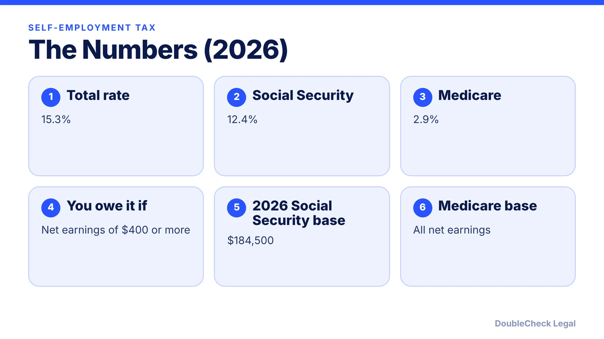
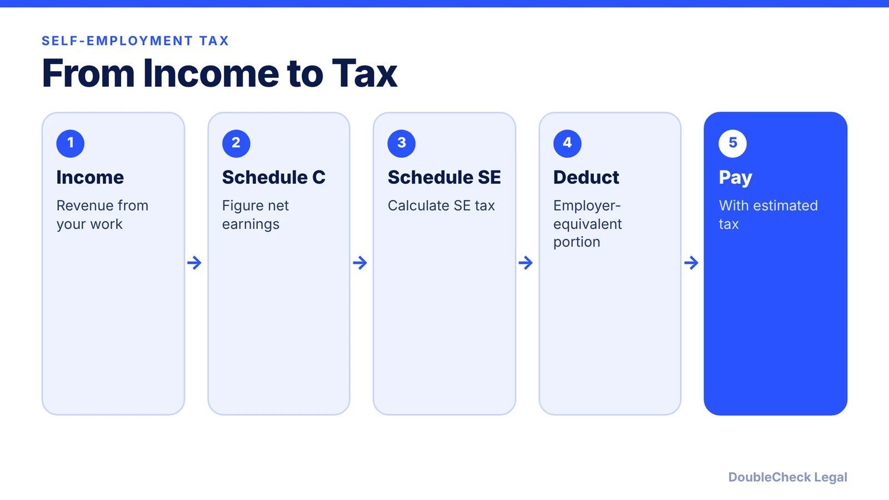
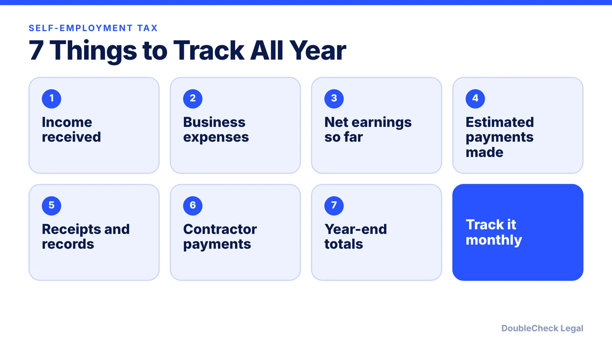

*Self-employed? Here is the 15.3% self-employment tax, the $400 threshold, and the 2026 Social Security base from the IRS.*

**Key takeaways:**

- The self-employment tax rate is 15.3%: 12.4% Social Security plus 2.9% Medicare.
- You owe it at $400 or more in net self-employment earnings.
- For 2026, the Social Security portion applies to the first $184,500.
- You can deduct the employer-equivalent portion when figuring AGI.

## 1. The quick answer

**Quick answer:** The self-employment tax rate is **15.3%**, made up of 12.4% for Social Security and 2.9% for Medicare, per the IRS. You owe it if your net earnings from self-employment were $400 or more. For 2026, the Social Security portion applies to the first **$184,500** of combined wages, tips, and net earnings; the 2.9% Medicare portion applies to all net earnings.

## 2. How you calculate it

You calculate self-employment tax on Schedule SE (Form 1040). Sole proprietors and independent contractors generally use Schedule C to figure net earnings first. You can deduct the employer-equivalent portion of your SE tax when figuring adjusted gross income; the deduction affects income tax only, not your net earnings or SE tax.

## 3. Paying it during the year

The IRS says you may need to pay estimated taxes quarterly and can use those payments to cover your SE tax. See [quarterly estimated taxes for solo business owners](/blog/quarterly-estimated-taxes-solo-business-owner/).

## 4. Does an LLC change it?

Not by default. A single-member LLC's net earnings are subject to SE tax like a sole proprietorship's; see [single-member LLC taxes](/blog/single-member-llc-taxes-disregarded-entity/). Some owners consider an S corporation election; see the [Form 2553 guide](/blog/s-corp-election-form-2553-deadline/) and ask a tax professional before deciding.

## 5. Seven things to track

## Where DoubleCheck fits

[DoubleCheck](https://www.contactdoublecheck.com) is built for businesses that start legal work with AI. Bring your question or draft, use an AI-first workflow to understand and verify it, and when professional advice is warranted, you can connect with an independent attorney. Attorneys on DoubleCheck are independent professionals; an attorney-client relationship forms only if an attorney accepts your engagement.

**Sources:** [IRS: Self-employment tax](https://www.irs.gov/businesses/small-businesses-self-employed/self-employment-tax-social-security-and-medicare-taxes).

## FAQ

**What is the self-employment tax rate?**

15.3%: 12.4% for Social Security and 2.9% for Medicare, per the IRS.

**What is the 2026 Social Security wage base?**

$184,500 of combined wages, tips, and net earnings, per the IRS.

**What is the minimum to owe it?**

Net earnings from self-employment of $400 or more.

**What form do I use?**

Schedule SE (Form 1040), after figuring net earnings, usually on Schedule C.

---

*General information only. This article is not legal, tax, investment, or accounting advice.*
