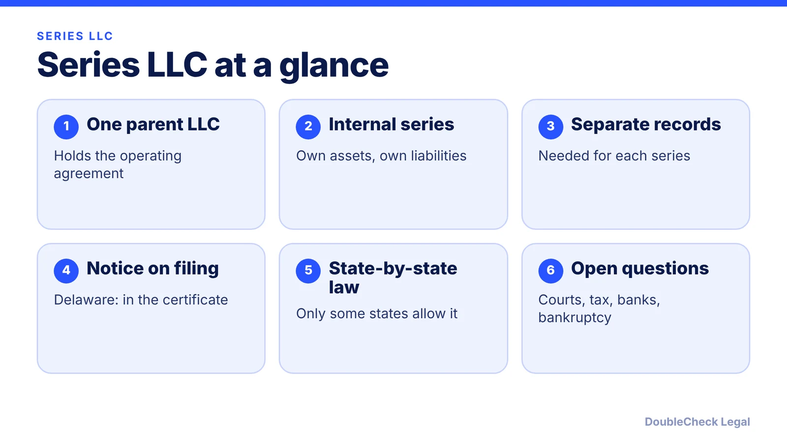
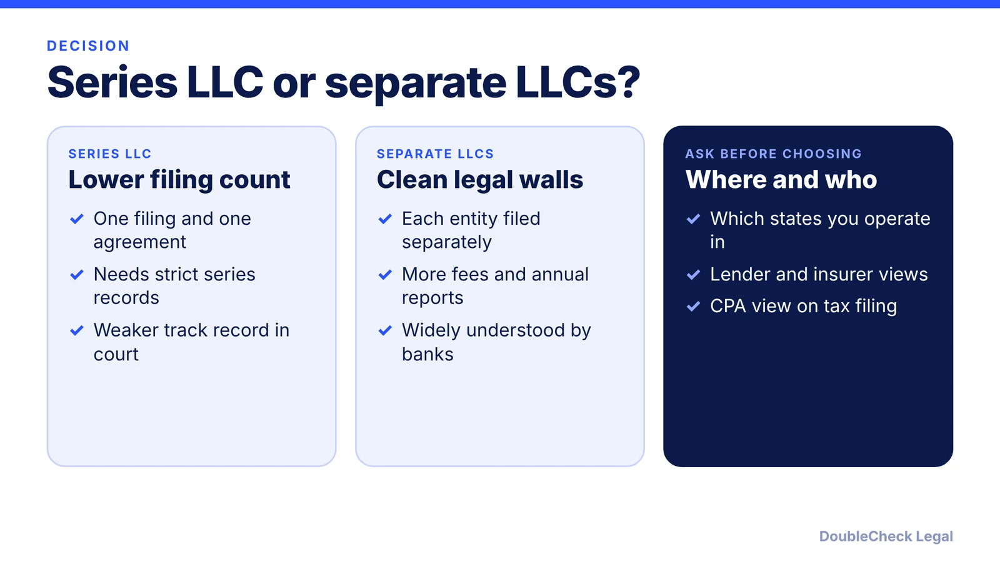

*A plain-English series LLC guide: how the structure works, which states allow it, and the risks to weigh, as of November 2026.*

**Key takeaways:**

- A series LLC is one LLC with internal series meant to hold separate assets and liabilities, but only some states allow it.
- Delaware's statute requires series records, an LLC agreement provision and notice in the certificate for the shield to apply.
- Sources flag limited court testing, cross-state recognition, tax, bankruptcy and lender concerns.
- For most small businesses, separate LLCs or a single LLC are simpler; confirm with an attorney or CPA.

## 1. The quick answer

**Quick answer:** A series LLC is one LLC whose operating agreement creates internal "series," each meant to hold its own assets and carry its own liabilities, so a problem in one series should not reach the others. Only some states have series statutes. Wolters Kluwer lists 21 jurisdictions, including Delaware, Illinois, Texas, Nevada and Wyoming. The catch, as of November 2026: the shield has been tested in few courts, other states may not respect it, and lenders and tax advisers can be wary. Whether a series LLC is worth it depends on where you operate and how disciplined your records are.

This explainer covers what a series LLC is, which states allow it and the main risks. For the plain single-entity route see [how to start an LLC](/blog/startup-llc-complete-guide-formation-taxes-operating-agreement-and-conversion/) and [how to choose a state for your LLC](/blog/best-state-to-form-an-llc-comparison/).

## 2. How a series LLC works

Think of one LLC (the "master" or parent) with sub-compartments. Each series can have its own assets, members, managers and purpose, usually set out in the parent's operating agreement. Per Wolters Kluwer, to keep the liability shield the operating agreement must state that series assets belong only to that series, and the books and records must track each series' assets separately. How series are established and taxed differs by state.

Delaware's statute is the clearest published text. Under 6 Del. C. 18-215(b), a series' debts are enforceable only against that series' assets when three conditions are met:

- The LLC agreement establishes the series and provides for the liability limitation.
- The LLC's records account for each series' assets separately from the LLC's other assets and from other series.
- The certificate of formation includes notice of the limitation.

The statute adds that records are "separate" if they reasonably identify the assets, for example by a list, category or formula. So the legal protection starts on paper, and it is kept alive by bookkeeping.

People use series LLCs for things like a portfolio of rental properties, several product lines, or a franchise-style group of small operations where owners want separate silos without filing many entities. Whether that fits you is a separate question from whether it is legal in your state. For single-property cases, see [real estate rental LLC: do you need one](/blog/real-estate-rental-llc-do-you-need-one/).

## 3. Which states allow series LLCs

As of November 2026, the best-sourced fact is that the list is not long and sources do not fully agree. Two checks:

- **Wolters Kluwer** lists 21 jurisdictions: Alabama, Arkansas, Delaware, the District of Columbia, Illinois, Indiana, Iowa, Kansas, Missouri, Montana, Nebraska, Nevada, North Dakota, Oklahoma, Puerto Rico, South Dakota, Tennessee, Texas, Utah, Virginia and Wyoming. It also notes that some "false series" states use the term for membership classes that carry no liability shield.
- **Young Conaway** (a Delaware law firm, in an older lending-focused article) lists a shorter set that includes Delaware, Illinois, Nevada and Texas, which shows how lists date as statutes are added.

Because statutes are amended, treat any list, including this one, as a starting point and confirm against the Secretary of State's website or the statute itself. Also note that California does not allow domestic series LLCs: the California Franchise Tax Board says a series LLC cannot be formed in California, but one formed in another state can operate there if it registers with the Secretary of State first. The Franchise Tax Board lists an $800 annual tax filing requirement (Form FTB 3522) for series LLCs; confirm with the Franchise Tax Board whether it applies to each series. See [California LLC annual tax and fee](/blog/california-llc-annual-tax-and-fee/) and [foreign qualification](/blog/foreign-qualification-register-llc-in-another-state/).

**Formation steps differ.** In Delaware the certificate of formation must carry notice of the limitation. Per Wolters Kluwer, states establish series in different ways: in the operating agreement with no filing, by filing a certificate with the state, or, in Delaware and Texas, through either protected series (no filing) or registered series (filing required). Use the state fee schedule for costs, as in [LLC formation cost in California, Texas, Florida and New York](/blog/llc-formation-cost-california-texas-florida-new-york/).

## 4. The main risks and open questions

The sources agree on the same handful of concerns.

- **Untested shield.** Wolters Kluwer says the series LLC "has yet to be vigorously tested in court," so the strength of its liability protection is still uncertain. It also says failing to keep series assets and records separate can void the shield.
- **Other states.** If your series owns property or does business in a state without series law, a court there may not honor the wall between series. Wolters Kluwer and Young Conaway both say this is unclear; Young Conaway discusses a 2013 Fifth Circuit case, Alphonse v. Arch Bay Holdings, in which the court suggested the internal affairs doctrine may not apply when third parties such as creditors are involved.
- **Bankruptcy.** Wolters Kluwer says federal bankruptcy law gives little guidance on whether a series LLC must file as one entity or whether each series can file separately. Young Conaway says there is no basis to conclude internal shields will be honored in bankruptcy.
- **Lenders and investors.** Young Conaway says assurances about internal shields give lenders only "some comfort," far from complete, and Wolters Kluwer says perfecting a security interest in a series' assets is unclear. Lenders may ask for more protection, such as personal guarantees. See [personal guarantee on a business loan](/blog/personal-guarantee-business-loan-what-you-are-signing/).
- **Tax.** Wolters Kluwer says the IRS and state tax departments have not clearly defined how series LLCs are taxed, and states differ. On the federal side, the IRS proposed regulations in September 2010 that would treat each domestic series as its own entity for tax classification, with comment due December 13, 2010. The Federal Register notice itself does not say whether the rule was finalized, so ask a CPA what applies to you now.
- **Operations.** Sign contracts in the name of the specific series, since a contract signed in the name of the whole LLC could bind every series; ask an attorney how your state treats this.

## 5. Series LLC vs separate LLCs: how to decide

Most small businesses are better served by one LLC, or several ordinary LLCs, than by a series. The plain version of the tradeoff:

A practical rule: if you operate in a state that does not recognize series, or you expect a bank loan, investors or a sale, separate entities are usually easier to explain. Separate entities still need discipline: keep accounts and contracts distinct, see [LLC bank account and commingling habits](/blog/llc-startup-bank-account-commingling-liability-protection-habits/) and [your LLC operating agreement](/blog/llc-operating-agreement-with-ai/).

**When to get an attorney to look at it.** Formation language, the operating agreement provisions for each series, and the multi-state question are hard to unwind later. You can use AI to draft questions and summarize the statute you found, then [verify the AI-generated document](/blog/verify-ai-generated-legal-document/) before you file, and ask an attorney to confirm the state rules. Also see [when to hire a lawyer](/blog/when-to-hire-lawyer-small-business/) and [annual report requirements by state](/blog/annual-report-requirements-by-state-llc/).

## Where DoubleCheck fits

[DoubleCheck](https://www.contactdoublecheck.com) helps businesses and founders start legal work with AI, verify it, and, when professional advice is warranted, connect with an independent attorney, including for immigration questions. Attorney availability and practice areas vary. Attorneys on DoubleCheck are independent professionals; an attorney-client relationship forms only if an attorney accepts your engagement.

**Sources:** [Wolters Kluwer, The Series LLC: An Organizational Structure That Can Help Mitigate Risk](https://wolterskluwer.com/en/expert-insights/the-series-llc-an-organizational-structure-that-can-help-mitigate-risk); [Young Conaway, Secured Lending and Series LLCs](https://www.youngconaway.com/content/uploads/2017/08/SecuredLendingSeriesLLCs.pdf); [California Franchise Tax Board, Series Limited Liability Company](https://ftb.ca.gov/file/business/types/limited-liability-company/series-limited-liability-company.html); [Justia, 6 Del. C. 18-215 (2022 version)](https://law.justia.com/codes/delaware/2022/title-6/chapter-18/subchapter-ii/section-18-215/); [Federal Register, proposed series regulations (September 14, 2010)](https://www.govinfo.gov/content/pkg/FR-2010-09-14/html/2010-22793.htm). The Delaware Code Online page for chapter 18 did not include section 18-215 and the legal500/Mondaq and ezel pages were not retrievable.

## FAQ

**What is a series LLC?**

A series LLC is a single LLC whose operating agreement creates internal series, each with its own assets and liabilities. Under Delaware law, a series is insulated from the others only if the LLC agreement, the records and the certificate meet specific conditions. Whether that holds up depends on the state and on keeping separate records.

**Which states allow series LLCs?**

Wolters Kluwer lists 21 jurisdictions, including Delaware, Illinois, Nevada, Texas and Wyoming. Other lists differ, so confirm with the Secretary of State or the state statute before relying on any list.

**Is a series LLC better than several separate LLCs?**

Not necessarily. A series can reduce filings, but Wolters Kluwer says the structure has yet to be vigorously tested in court, and Young Conaway says assurances about internal shields give lenders only some comfort. Separate LLCs are usually easier for banks and investors to understand, at the cost of more filings.

**Does a series LLC protect me in a state that does not allow series?**

Possibly not. Wolters Kluwer and Young Conaway both say it is unclear whether another state will honor the separation between series. Ask an attorney about every state where you hold property or do business.

**How does the IRS treat a series LLC?**

The IRS proposed regulations in September 2010 that would treat a domestic series as its own entity for tax classification. The Federal Register notice does not say whether they were finalized, so ask a CPA how your series is treated today.

---

*General information only. This article is not legal, tax, investment, or accounting advice.*
