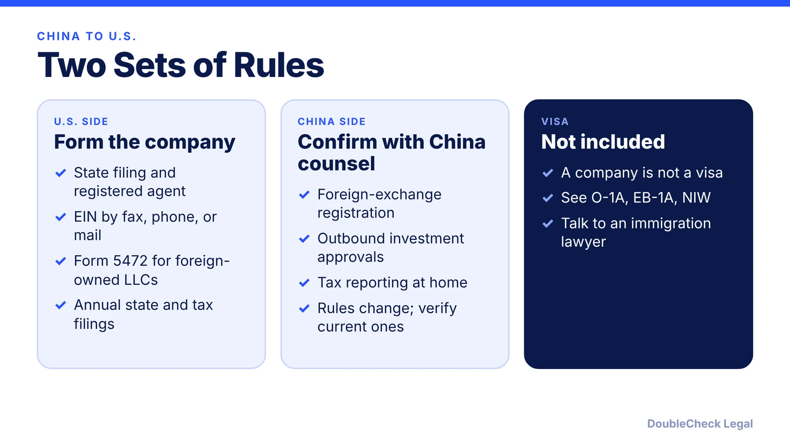
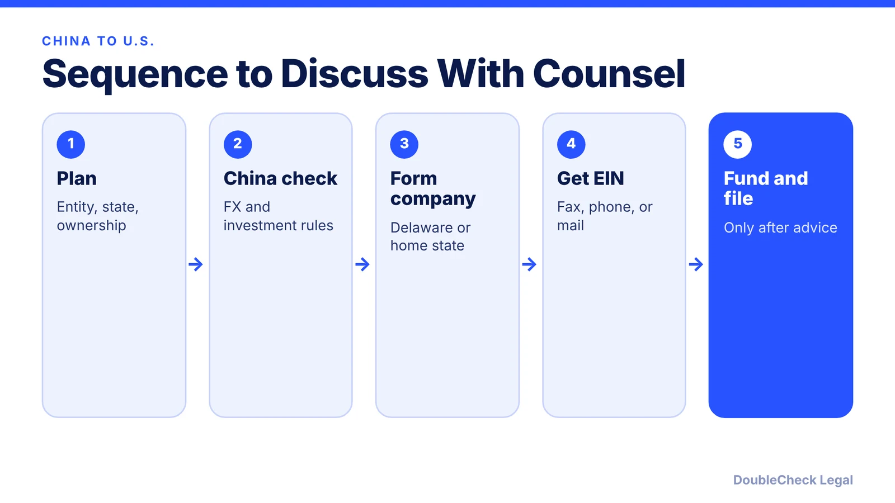

*Founder in China? Here is how to form a U.S. company, what the U.S. side requires, and the China-side rules to confirm with local counsel.*

**Key takeaways:**

- Forming a U.S. company from China is possible: state filing, registered agent, then an EIN by fax, phone, or mail.
- China has its own foreign-exchange and investment rules; confirm current ones with counsel in China.
- Per Jones Day, SAFE Circular 37 required registration before funding an offshore vehicle; makeup registration exists.
- A U.S. company does not give you a visa or work authorization.

## 1. The quick answer

**Quick answer:** A founder in China can form a U.S. company (usually a Delaware C corporation for fundraising or an LLC for a small operating business), appoint a registered agent, and apply for a U.S. EIN by fax, phone, or mail. The U.S. side is manageable. The China side, including foreign-exchange registration and outbound-investment rules, needs advice from counsel in China. 中国创始人可以在美国设立公司，但需要在中国境内另行咨询外汇和对外投资合规。

## 2. The U.S. steps

Follow the same sequence as any non-U.S. founder: choose the entity ([LLC vs. C corp](/blog/llc-vs-c-corp-startups/)), choose the state ([Delaware step by step](/blog/how-to-incorporate-in-delaware-step-by-step/)), appoint a [registered agent](/blog/delaware-registered-agent-requirements/), and apply for an EIN ([EIN without an SSN](/blog/get-ein-without-ssn-foreign-founder/)). The complete overview is in [how to start a U.S. company as a non-U.S. resident](/blog/start-us-company-as-non-us-resident/).

## 3. The China-side registration issue

Jones Day's summary of SAFE Circular 37 (effective July 14, 2014) says Chinese residents generally must register with the foreign-exchange authority before contributing assets or equity to an offshore special purpose vehicle, and that a makeup registration process exists for past investments. Rules and their interpretation change, and this article does not cover current Chinese law. Ask a lawyer licensed in China about registration, outbound-investment filings, and personal tax before sending funds or issuing shares.

## 4. Visa and next steps

Owning a U.S. company does not give you the right to live or work in the U.S. See [O-1A for founders](/blog/o-1a-visa-for-startup-founders-evidence/) and [EB-1A vs. O-1](/blog/eb-1a-vs-o-1-founder-which-path/), then [find an immigration lawyer](/blog/how-to-find-good-immigration-lawyer-startup-founder/).

## Where DoubleCheck fits

[DoubleCheck](https://www.contactdoublecheck.com) helps businesses and founders start legal work with AI, verify it, and, when professional advice is warranted, connect with an independent attorney, including for immigration questions. Attorney availability and practice areas vary. Attorneys on DoubleCheck are independent professionals; an attorney-client relationship forms only if an attorney accepts your engagement.

**Sources:** [Jones Day](https://www.jonesday.com/en/insights/2014/09/safes-new-circular-37-enhances-and-facilitates-roundtrip-investment-registration-in-prc); [IRS Form SS-4 instructions](https://www.irs.gov/instructions/iss4); [Loeb & Loeb](https://www.loeb.com/en/insights/publications/2021/03/obligations-to-file-form-5472-for-foreign-owned-disregarded-entities).

## FAQ

**Can a Chinese citizen own a U.S. company?**

Yes, U.S. law generally allows foreign ownership of an LLC or corporation, with extra U.S. filings. Chinese foreign-exchange and investment rules also apply and should be confirmed with counsel in China.

**Do I need a U.S. address to form the company?**

You need a U.S. registered agent address. A commercial registered agent can provide it.

**Is Delaware the best choice for a founder in China?**

Delaware is common for venture-backed startups. The best state depends on where you operate. See the linked Delaware guide.

**Where do I get a U.S. EIN from China?**

Apply with Form SS-4 by fax, phone, or mail. The IRS online form is not available to applicants with no U.S. presence.

---

*General information only. This article is not legal, tax, investment, or accounting advice.*
