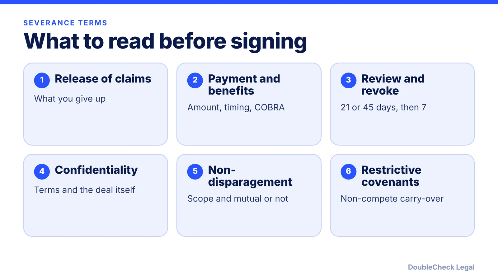
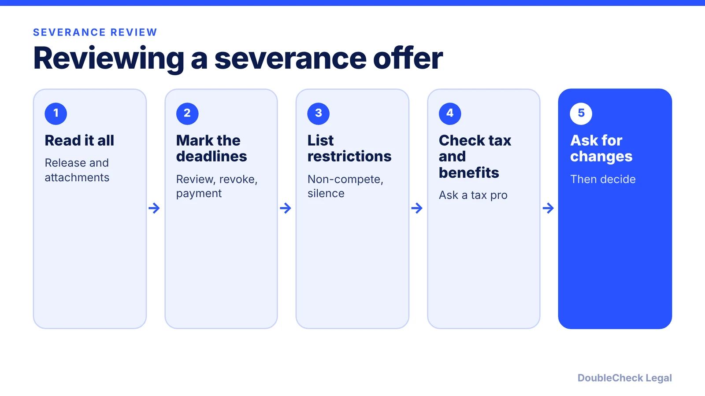

*A severance agreement is a contract that trades pay for a release of claims, so the terms and the timing matter.*

**Key takeaways:**

- For workers 40 and older, OWBPA calls for 21 days (45 for group programs) to consider and 7 days to revoke.
- A release cannot waive future claims or bar EEOC charges, per EEOC guidance summarized by Littler.
- Severance is taxable wages; check confidentiality, non-disparagement, and non-compete terms.
- Get a review when the release is broad, you are 40+, or a claim exists.

## 1. The quick answer

**Quick answer:** A severance agreement trades money or benefits for a release of claims against the employer. Before you sign (or send) one, check the release scope, any confidentiality, non-disparagement, and non-compete terms, and the timing. For employees 40 and older, the Older Workers Benefit Protection Act (OWBPA) requires, per FindLaw and Troutman, at least 21 days to consider an individual release (45 days for a group exit program) and 7 days after signing to revoke. A severance agreement is a contract, so reading it with a professional before you sign is cheap compared with what you may be giving up.

## 2. The age-40 rules and what a release cannot do

Per [Troutman Pepper](https://www.troutman.com/insights/severance-agreements-for-employees-over-40-understanding-the-older-workers-benefit-protection-act.html) and [FindLaw](https://corporate.findlaw.com/?p=36677), a valid waiver of age claims under the ADEA must:

- Be written in plain language and specifically refer to the ADEA.
- Give something of value beyond what the employee is already entitled to.
- Advise the employee in writing to consult an attorney before signing.
- Give at least 21 days to consider (45 days for an exit incentive or group termination program).
- Give 7 days after signing to revoke, which the parties cannot shorten.
- Not waive claims that arise after signing.

For group programs, employers must also disclose eligibility factors and time limits, plus the job titles and ages of those selected and not selected in the same unit. Per FindLaw, the employer bears the burden of proving the waiver was knowing and voluntary. A [KMK Law article](https://www.kmklaw.com/labor-employment/employers-still-making-owbpa-mistakes) says its author found that over half of the severance offers reviewed did not comply, so check the timing and disclosures.

Per the EEOC guidance summarized by [Littler](https://www.littler.com/publication-press/publication/eeoc-issues-new-guidance-severance-agreements), an agreement may not restrict your right to file an EEOC charge or take part in an EEOC investigation, and the EEOC treats such provisions as invalid and unenforceable. The 21 or 45 days can restart after a material change to the offer, though the parties can agree otherwise under the regulations.

## 3. Money, tax, and restrictive terms

**Tax, at a high level.** Severance is generally taxable income, and how it is withheld and reported depends on your situation. Ask a tax professional or check the IRS guidance on supplemental wages before you plan around a specific number.

**Restrictive terms to read closely:**

- **Confidentiality.** Does it cover only company information, or also the existence and amount of the deal? Does it carve out the agency rights described above?
- **Non-disparagement.** Is it mutual? Does it cover truthful statements or only false ones? Check how it is defined.
- **Non-compete and non-solicit.** Many severance agreements restate existing covenants. Compare them to your original agreement and your state's rules; see [non-compete agreements by state](/blog/non-compete-agreements-by-state-2026/) and [non-solicitation agreements](/blog/non-solicitation-agreements-explained/).
- **IP and confidentiality duties.** See [confidentiality and IP assignment agreements](/blog/confidentiality-ip-assignment-agreements-startups/).

Visa holders should also look at timing: a job loss starts clocks that severance does not stop. See the [H-1B layoff 60-day grace period](/blog/h-1b-layoff-60-day-grace-period/) and confirm how the dates are counted with an immigration attorney.

## 4. What to negotiate and when to get an attorney

Items employees often ask about: more time, a longer benefits or COBRA subsidy, a neutral reference, a mutual non-disparagement clause, narrower restrictive covenants, how equity or bonuses are treated, and the wording of the stated departure reason. Ask in writing, and do not sign before the review period ends unless you are comfortable that you understand the terms.

**Employers** should use plain, complete documents, count the consideration period correctly, deliver the required disclosures for group programs, and keep the offer consistent across similar employees. See [how to terminate an employee legally](/blog/how-to-terminate-an-employee-legally-small-business/).

You can usually read a short, standard agreement yourself. Get an attorney to look when the release is broad, you are 40 or older, you have a claim or complaint pending, equity or a restrictive covenant is involved, you hold a visa, or the amount is large. For employer drafts, see the [AI employment agreement review checklist](/blog/ai-employment-agreement-review-checklist/) and [how to tell if your lawyer is good](/blog/how-do-i-know-if-my-lawyer-is-good/).

## Where DoubleCheck fits

[DoubleCheck](https://www.contactdoublecheck.com) helps businesses and founders start legal work with AI, verify it, and, when professional advice is warranted, connect with an independent attorney, including for immigration questions. Attorney availability and practice areas vary. Attorneys on DoubleCheck are independent professionals; an attorney-client relationship forms only if an attorney accepts your engagement.

**Sources:** [Troutman Pepper, OWBPA](https://www.troutman.com/insights/severance-agreements-for-employees-over-40-understanding-the-older-workers-benefit-protection-act.html); [FindLaw, EEOC waiver regulations](https://corporate.findlaw.com/?p=36677); [Littler, EEOC severance guidance](https://www.littler.com/publication-press/publication/eeoc-issues-new-guidance-severance-agreements); [KMK Law, OWBPA mistakes](https://www.kmklaw.com/labor-employment/employers-still-making-owbpa-mistakes).

## FAQ

**How long do I have to sign a severance agreement?**

It depends on your age. For workers 40 and older, per FindLaw and Troutman, OWBPA requires at least 21 days for an individual release and 45 days for an exit incentive or group program, plus 7 days after signing to revoke. Other employees should look at the deadline stated in the agreement and may ask for more time.

**Is severance taxable?**

Generally yes. Severance is usually treated as taxable income, and how it is withheld depends on your situation, so check with a tax professional or the IRS before planning around a number.

**Can a severance agreement stop me from filing an EEOC charge?**

No. Per EEOC guidance summarized by Littler, an agreement may not restrict the right to file an EEOC charge or participate in an EEOC investigation, and such a provision is invalid and unenforceable.

**Can I negotiate a severance offer?**

Often, yes. Common requests are more pay, longer benefits, narrower restrictive covenants, a mutual non-disparagement clause, and a neutral reference. Outcomes are never guaranteed.

---

*General information only. This article is not legal, tax, investment, or accounting advice.*
