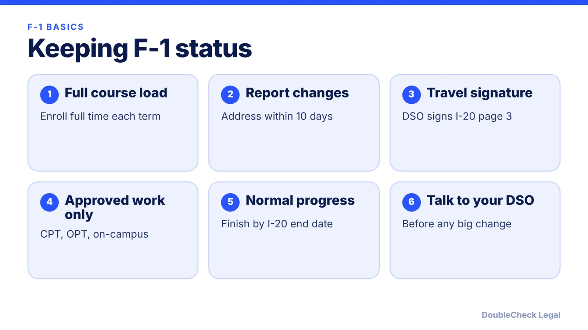
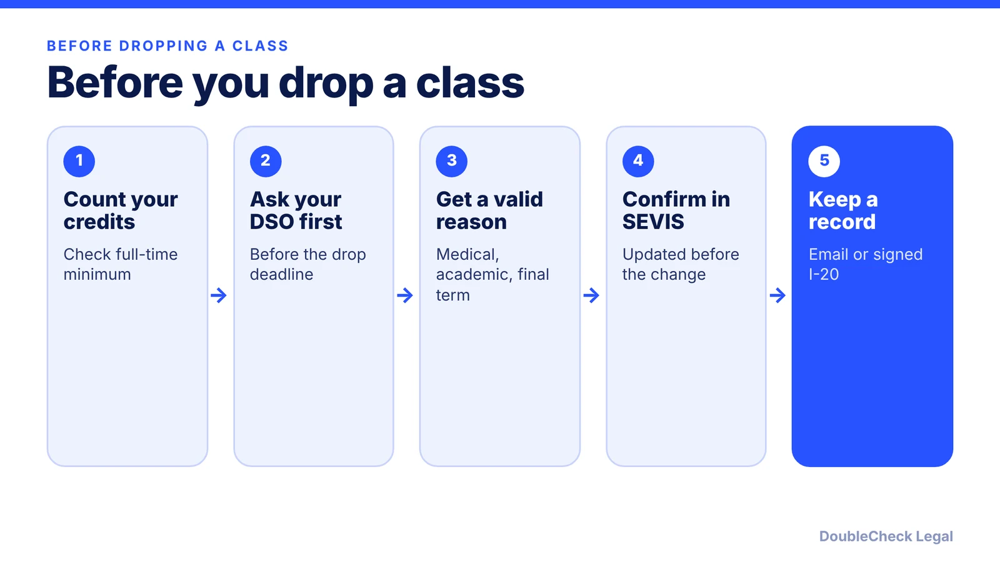

*How SEVIS and the I-20 work, what you must report, and what puts F-1 status at risk, as of November 2026.*

**Key takeaways:**

- SEVIS is the database; the I-20 is the form your DSO issues from it.
- Report address changes within 10 days and get a DSO travel signature before trips abroad.
- Never drop below full time without advance DSO approval.
- As of November 2026, the fixed-admission-period rule is blocked by a court order, so check with your DSO.

## 1. The quick answer

**Quick answer:** SEVIS is the Department of Homeland Security database that tracks F-1 students, and the Form I-20 is the document your school's designated school official (DSO) issues from it. You keep F-1 status by following the regulations: stay enrolled full time, report address changes within 10 days, get DSO approval before dropping below full time or working, and get a travel signature before trips abroad. Falling out of status, for example by dropping below a full course load without approval, generally leaves no grace period. As of November 2026, the proposed fixed admission period for students is on hold under a court order, so duration of status still applies.

## 2. What SEVIS and the I-20 are, and the travel signature

SEVIS is the system schools use to keep each student's record. Your DSO updates it and reissues the Form I-20 when something changes, such as a program extension, a transfer, or authorized employment. Per [Study in the States](https://studyinthestates.dhs.gov/schools/maintaining-accurate-sevis-records), the SEVIS transfer process lets a student move between SEVP-certified schools while keeping the same SEVIS ID.

**Travel signature.** Per the [Study in the States guidance](https://studyinthestates.dhs.gov/2013/05/f-and-m-students-when-a-dso-should-update-your-sevis-information-and-sign-your-form-i-20), before you leave you need DSO approval shown by a signature on page 3 of the I-20. For F students, the DSO must sign within one year before your return, and you must return within five months of leaving. If your plans change, check with your DSO. The same source says a student with a pending post-completion OPT application who leaves the U.S. should get DSO authorization first, and the I-20 signature should fall within six months of readmission.

Visa and port-of-entry issues are separate; see [F-1 visa interview questions](/blog/f-1-visa-interview-questions-international-students-214b/) for the visa side.

## 3. Reporting, full course load, and reduced load

The rules below come from 8 CFR 214.2(f), as presented by [NAFSA](https://www.nafsa.org/regulatory-information/8cfr2142f).

**Reporting.** You must tell the DSO within 10 days of a change of legal name or address, and the DSO enters it in SEVIS within 21 days. The address should generally be where you actually live, not a mailing address.

**Full course of study.** For undergraduates at schools using semester or quarter hours, that is at least 12 hours per term, or the equivalent SEVP determines. Per NAFSA, credit-based students may count no more than one class or three credits per term toward full time if it is online or distance based.

**Reduced course load.** A reduced load generally must be at least 6 hours or half the required clock hours, and the DSO must approve it in advance. Dropping below full time without approval puts you out of status. The DSO may authorize it for:

- **Academic difficulties** (such as English or reading difficulty or improper course placement): once per program level, and you must return to full time the next term, excluding summer.
- **Medical reasons:** documentation from a licensed MD, DO, or psychologist is required, up to 12 months total per program level, with DSO reauthorization each term.
- **Final term:** when fewer courses are needed to finish.

Update SEVIS before reducing your load, not after. Withdrawing from a class mid-term without asking is the most common way to create a problem.

## 4. Transfers and what ends F-1 status

**Transfers.** Per NAFSA's summary of the regulation, you must begin classes at the new school within five months of leaving the current school or of your program completion date, whichever is earlier. The current school updates SEVIS, and you contact the new school's DSO within 15 days of the new program start date. You must have been pursuing a full course of study at the last school.

**Termination reasons.** The [SEVIS Help Hub](https://studyinthestates.dhs.gov/sevis-help-hub/student-records/completions-and-terminations/termination-reasons) lists reasons DSOs use, including:

- unauthorized drop below full course, unauthorized withdrawal, or failure to enroll;
- unauthorized employment, where the DSO has evidence of work without permission;
- absence from the country for five months;
- expulsion or suspension;
- failure to file required validation reports during a STEM OPT extension;
- "otherwise failing to maintain status."

Per NAFSA's summary, a student who fails to maintain a full course of study without DSO approval gets no grace period, and employment authorization ends automatically when status is lost. Reinstatement is possible through a Form I-539 with a DSO recommendation, generally if you are not more than five months out of status (or can show exceptional circumstances), and the student must not have engaged in unauthorized employment. USCIS decisions on reinstatement cannot be appealed. For after-graduation limits, see [the OPT unemployment limit](/blog/opt-unemployment-limit-90-days-stem-opt/) and [the 60-day grace period](/blog/f-1-60-day-grace-period-after-opt-ends-options/).

**Rule changes.** DHS published a final rule on July 17, 2026 to replace duration of status with fixed admission periods starting September 15, 2026, per [Faegre Drinker](https://www.faegredrinker.com/en/insights/publications/2026/7/dhs-final-rule-ending-duration-of-status-effective-september-15-2026). Per [NAFSA](https://www.nafsa.org/legal-defense-DS), a federal judge in Massachusetts issued nationwide preliminary relief on September 14, 2026; the government appealed on September 30, and as of November 5, 2026 the longstanding framework remains in place. This can change quickly, so ask your DSO. Related: [CPT vs OPT](/blog/cpt-vs-opt-f1-students/), [F-2 dependents](/blog/f-2-dependents-spouse-children-of-f-1-students/), and [Form 8843 and F-1 taxes](/blog/f-1-student-taxes-form-8843-nonresident-alien/).

## Where DoubleCheck fits

[DoubleCheck](https://www.contactdoublecheck.com) helps businesses and founders start legal work with AI, verify it, and, when professional advice is warranted, connect with an independent attorney, including for immigration questions. Attorney availability and practice areas vary. Attorneys on DoubleCheck are independent professionals; an attorney-client relationship forms only if an attorney accepts your engagement.

**Sources:** [Study in the States: SEVIS records](https://studyinthestates.dhs.gov/schools/maintaining-accurate-sevis-records); [Study in the States: travel and I-20](https://studyinthestates.dhs.gov/2013/05/f-and-m-students-when-a-dso-should-update-your-sevis-information-and-sign-your-form-i-20); [SEVIS Help Hub termination reasons](https://studyinthestates.dhs.gov/sevis-help-hub/student-records/completions-and-terminations/termination-reasons); [NAFSA on 8 CFR 214.2(f)](https://www.nafsa.org/regulatory-information/8cfr2142f); [NAFSA on D/S litigation](https://www.nafsa.org/legal-defense-DS); [Faegre Drinker](https://www.faegredrinker.com/en/insights/publications/2026/7/dhs-final-rule-ending-duration-of-status-effective-september-15-2026).

## FAQ

**What is the difference between SEVIS and Form I-20?**

SEVIS is the DHS system that holds your student record. Form I-20 is the document your DSO issues from that record. DSOs update the record and reissue the I-20 when something changes.

**How often does my I-20 need a travel signature?**

Per Study in the States, for F students the DSO must sign page 3 within one year before your return, and you must return within five months of leaving. Check with your DSO before you travel.

**Can I drop below full time?**

Only with DSO approval in advance. Per NAFSA's summary of 8 CFR 214.2(f), a reduced load is allowed for academic difficulties, medical reasons, or the final term, and dropping without approval puts you out of status.

**Can I get status back after a SEVIS termination?**

Sometimes. Per NAFSA's summary of the regulation, reinstatement is requested on Form I-539 with a DSO recommendation, generally within five months of the violation, and USCIS decisions cannot be appealed. Talk to your DSO and an immigration attorney.

---

*General information only. This article is not legal, tax, investment, or accounting advice.*
