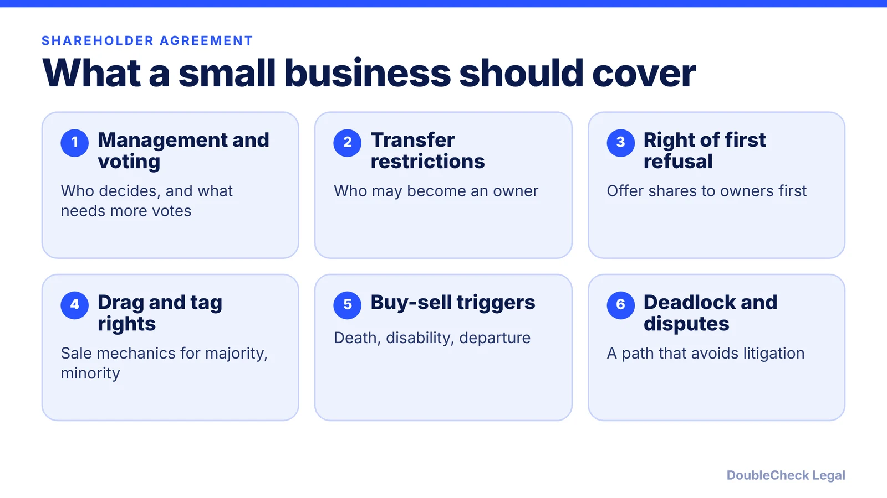
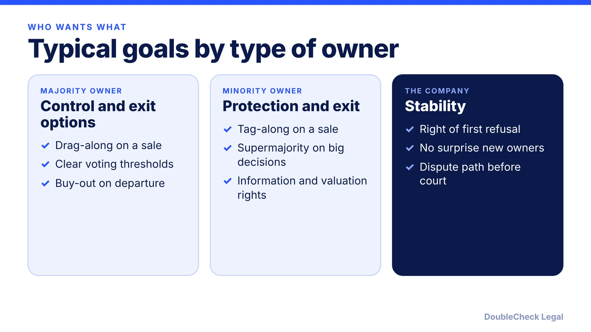

*What to include in a shareholder agreement for a small business: control, transfers, buy-sell terms, valuation and deadlock, as of November 2026.*

**Key takeaways:**

- A shareholder agreement binds the owners who sign it, while bylaws are the corporation's internal rules.
- Core terms: voting thresholds, transfer restrictions, first refusal, drag-along and tag-along, buy-sell triggers and valuation.
- Deadlock and dispute steps matter most for two-owner companies, and S corporations should check tax effects of price formulas.
- Rules vary by state, and AI drafts should be verified before signing.

## 1. The quick answer

**Quick answer:** A shareholder agreement for a small business is a contract among the owners of a corporation that sets how the company is run and what happens when someone wants out. Per Nolo, it typically covers management and control, limits on transferring stock, rights of first refusal, preemptive rights, and drag-along and tag-along rights. Add buy-sell triggers, valuation, deadlock and restrictive covenants if the owners are active in the business. It is not required for a sole shareholder, but it matters most when two or more people own stock and no one wants to guess later.

## 2. What a shareholder agreement does that bylaws do not

Bylaws are the corporation's internal rulebook. A shareholder agreement is a contract among specific people. Per Nolo, bylaws set the corporation's primary governance rules (stockholder meetings, the board, officers, stock records and how the bylaws are amended), while agreements among shareholders are customarily kept in a separate document, and it is irregular for bylaws to cover topics like share transfers, preemptive rights, drag-along and tag-along rights and buy-sell provisions. A shareholder agreement is a contract that binds its parties, so changes generally need their consent. Enforceability rules differ by state, so ask an attorney about yours.

In practice:

- **Bylaws** cover mechanics such as meetings, officers and notice. See [corporate bylaws vs operating agreement](/blog/corporate-bylaws-vs-operating-agreement-what-each-covers/).
- **A shareholder agreement** covers the deal among owners: who controls what, who can sell to whom, and what happens on a departure.
- **An LLC** uses an operating agreement for this job. See [LLC operating agreements](/blog/llc-operating-agreement-with-ai/) and [the partnership agreement guide](/blog/how-to-write-a-partnership-agreement/).

Per Nolo, you do not need one if you are the only shareholder, or a majority holder whose co-owners have little influence. Other shareholders may expect or demand one, and it can help attract investors.

## 3. What to include in a shareholder agreement for a small business

Nolo and FindLaw describe the same core terms. Attributed below.

**Voting and management.** Per Nolo, the agreement can set board size, decide which shareholders appoint directors, and set the vote thresholds for board actions. Owners can choose to require a supermajority or unanimous vote for major decisions such as borrowing or capital investments, which can protect minority holders who would otherwise be outvoted.

**Transfer restrictions.** Per Nolo, transfers are generally prohibited unless they fit a specific exception, and a common mechanism is a right of first refusal, which requires a selling shareholder to first offer shares to the corporation or other shareholders. Per FindLaw, the agreement can also address events like death, disability or termination of employment. How far transfer restrictions can go depends on state law.

**Preemptive rights.** Per Nolo, existing shareholders can buy their proportional share of new stock before outsiders, which protects against dilution. For how this works in financings, see [pro rata rights explained](/blog/pro-rata-rights-explained-startups/).

**Drag-along and tag-along.** A drag-along lets a majority require others to join a sale of the company; a tag-along lets minority holders join a majority sale on the same terms, per Nolo.

**Buy-sell terms.** See the next section.

**Restrictive covenants.** Per FindLaw, agreements can include noncompetition agreements that bar a selling stockholder from competing with the corporation after a triggering event. Confidentiality and non-solicitation terms are also common. Enforceability of non-competes varies by state; see [non-compete agreements by state](/blog/non-compete-agreements-by-state-2026/) and [non-solicitation agreements explained](/blog/non-solicitation-agreements-explained/).

## 4. Buy-sell clauses and valuation: the part owners fight about

Buy-sell terms decide what happens when an owner dies, becomes disabled, quits or is fired. Per FindLaw:

- Triggering events commonly include the death of a stockholder, disability of a stockholder, termination of employment of a stockholder and stockholder deadlock.
- Corporations and remaining stockholders are often given rights of first refusal to buy the stock, at a price set by an appraisal or another valuation mechanism.
- Pricing may differ depending on why the owner is leaving, so spell that out in advance.

A defined process with time limits for any appraisal helps keep disputes from dragging on. A "shotgun" clause lets one owner name a price, and the other must either sell at that price or buy the initiator out; it tends to work best when the owners have similar resources.

Full coverage of the mechanics is in [buy-sell agreements for small business partners](/blog/buy-sell-agreement-small-business-partners/). If a split is already happening, see [how to remove or buy out a co-founder](/blog/how-to-remove-or-buy-out-a-co-founder/). For startups, this overlaps with [co-founder agreements](/blog/co-founder-agreement-startups/) and [5050 deadlock clauses](/blog/co-founder-agreement-5050-deadlock-clauses-that-prevent-a-stalemate/).

**Tax note for S corporations.** If the company has an S election, a buy-sell price can raise a one-class-of-stock question. Per The Tax Adviser (August 1, 2019, archived), shareholder agreements are generally disregarded for one-class purposes unless a principal purpose is to circumvent the requirement and the price is significantly above or below fair market value, with book-value pricing inside a safe harbor. Ask a tax professional before choosing a price formula. See [S corp election timing](/blog/s-corp-election-form-2553-deadline/).

## 5. Deadlock and dispute resolution for a small business shareholder agreement

Two 50% owners with no tie-breaker can freeze the company. An agreement can set up a mechanism for resolving disputes or management deadlocks outside costly litigation. Common tools include:

- Escalation to a neutral advisor, mediation, then arbitration.
- A shotgun buy-sell for two-owner companies.
- A tie-break director or a casting vote on defined issues.
- A dissolution path as a last resort. See [how to dissolve a Delaware corporation](/blog/how-to-dissolve-a-delaware-corporation/).

If your company is raising money, investor documents may replace or override parts of an owner-level agreement. See [NVCA model documents explained](/blog/nvca-model-documents-priced-round-explained/) and [term sheet key terms](/blog/term-sheet-key-terms-explained/).

## 6. Drafting checklist, AI, and when to get an attorney

Before anyone signs:

1. List every owner and confirm each signs, including the company if it is a party.
2. Confirm the agreement does not conflict with the charter or bylaws.
3. Pick one valuation method and one appraisal process.
4. Define each buy-sell trigger in plain words.
5. Check state law on non-competes and on legends for stock certificates.
6. Check tax effects if the company is an S corporation.
7. Store the signed copy with your minute book. See [corporate minutes and board consents](/blog/corporate-minutes-and-board-consents-small-corporation-records/).

AI is useful for turning a term sheet between owners into a clean first draft, comparing two versions, and spotting missing triggers. It can also invent clauses or ignore your state. Use the checks in [verify AI-generated legal documents](/blog/verify-ai-generated-legal-document/) and [AI contract review: what to check before signing](/blog/ai-contract-review-what-to-check-before-signing/).

Bring an attorney in when the owners are unequal, when a family member is involved, before outside investment, or when a dispute has already started. See [how to choose a good lawyer](/blog/how-to-choose-good-lawyer/).

## Where DoubleCheck fits

[DoubleCheck](https://www.contactdoublecheck.com) helps businesses and founders start legal work with AI, verify it, and, when professional advice is warranted, connect with an independent attorney, including for immigration questions. Attorney availability and practice areas vary. Attorneys on DoubleCheck are independent professionals; an attorney-client relationship forms only if an attorney accepts your engagement.

**Sources:** [Nolo, shareholder agreement](https://www.nolo.com/legal-encyclopedia/shareholder-agreement.html); [Nolo, what to include in your corporation's bylaws](https://www.nolo.com/legal-encyclopedia/what-should-i-include-in-my-corporation-s-bylaws.html); [FindLaw, stockholder agreements for stockholders of closely held corporations](https://corporate.findlaw.com/corporate-governance/stockholder-agreements-for-stockholders-of-closely-held.html); [The Tax Adviser, S corp shareholder agreements (August 1, 2019)](https://www.thetaxadviser.com/issues/2019/aug/s-corp-shareholder-agreements-mergers-acquisitions.html).

## FAQ

**What should be in a shareholder agreement for a small business?**

Per Nolo, typical terms cover management and control, stock transfer limits, right of first refusal, preemptive rights and drag-along and tag-along rights. FindLaw adds buy-sell triggers, valuation by appraisal and noncompetition agreements, and owners often add a deadlock mechanism.

**Do I need a shareholder agreement if I am the only owner?**

Per Nolo, it is not required for a sole shareholder, or for a majority holder whose co-owners have little influence. It becomes useful once other people hold stock or investors may join.

**What is the difference between bylaws and a shareholder agreement?**

Per Nolo, bylaws set the primary governance rules for the company, while agreements among shareholders are customarily kept in a separate document. A shareholder agreement is a contract that binds its parties. Enforceability rules differ by state.

**Can a shareholder agreement stop an owner from selling shares?**

Per Nolo, stock transfers are generally prohibited unless they fit a specific exception, and agreements commonly use rights of first refusal, drag-along and tag-along rights, and buy-sell triggers to control who becomes an owner. How far a restriction can go depends on state law.

**Can I draft a shareholder agreement with AI?**

AI can produce a first draft and compare versions. Verify it against your charter, bylaws and state law, and have an attorney review before signing, especially for buy-sell pricing and S corporation tax effects.

---

*General information only. This article is not legal, tax, investment, or accounting advice.*
