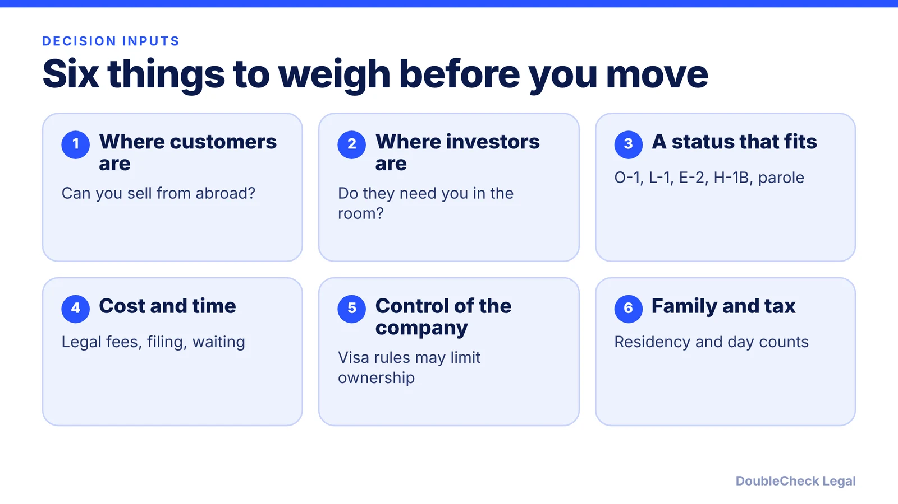
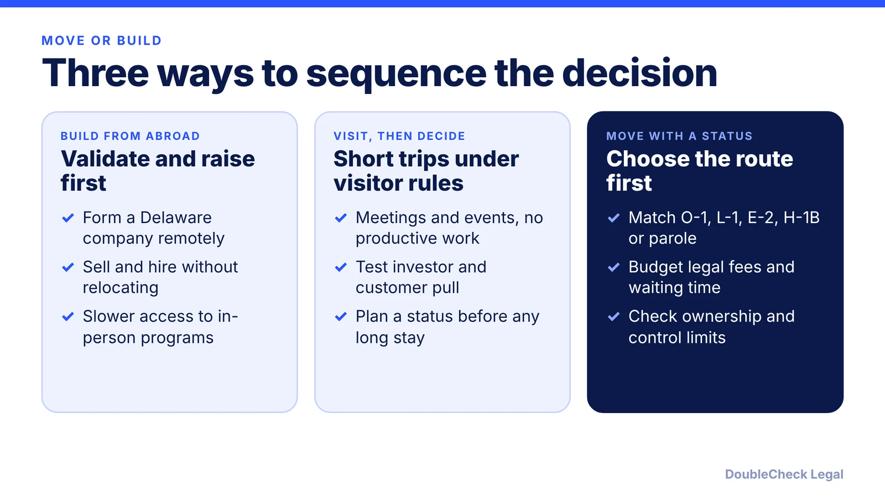

*An even-handed look at relocating versus building from abroad, with the visa limits spelled out.*

**Key takeaways:**

- Forming a U.S. company and living in the U.S. are separate steps; the second needs an immigration status.
- There is no single startup visa; O-1A, L-1A, E-2, H-1B and parole each carry conditions.
- Y Combinator says it is open to startups anywhere, but its batch is in person in San Francisco.
- Settle the status and company structure together before you move, and verify with an attorney.

## 1. The quick answer

**Quick answer:** Moving to the U.S. is a bet that being physically present is worth more than the cost, delay and legal limits that come with a visa. Forming a U.S. company and being allowed to live and work in the U.S. are two separate steps: you can form a Delaware company from abroad, but your right to work for it on U.S. soil depends on an immigration status. Building from abroad first suits founders who can still test demand, raise money and hire without being there. Moving suits founders whose customers, lead investors or program require presence and who have a realistic status. As of November 2026, there is no single "startup visa"; the main routes each carry conditions, covered below.

## 2. What a U.S. presence can buy, and what you can do from abroad

Nobody publishes a clean statistic on how much presence helps, so treat this section as a set of questions rather than facts.

- **Accelerators.** Y Combinator's FAQ says its application process is "open to any startup, anywhere in the world," that you do not need to incorporate or arrange visas before applying, and that "the batch takes place in-person in San Francisco." It adds that after the three-month program "you can go wherever you want." Other programs differ, so read each program's own terms. See our guide to [accelerators for international founders](/blog/accelerator-in-the-us-international-founders-visa-yc-techstars/).
- **Investors.** Whether your lead investor insists on proximity is something you can ask them directly. Many founders raise remotely, and short trips can cover the rest.
- **Customers.** One immigration attorney quoted by Fi (a 2019 article, so older) said "a business must go where their customers and demand are," and suggested validating the business through B-1 visits before choosing a longer-term route. The same article says meetings, conferences and accelerators are generally fine on a B-1, but the actual work should be done back home.
- **Hiring and networks.** U.S. hires can be employed through a U.S. entity without you being in the U.S. Remote hiring is a cost and compliance question, not a visa one. See [hiring international employees](/blog/hire-international-employees-remote-eor-vs-contractor-vs-sponsorship/).

A useful test: list what you would do in your first six months in the U.S. If most of it can be done on a plane trip, a visit may be enough. For what a visitor visa permits, read [B-1 for founders](/blog/b-1-b-2-visa-business-visitor-what-founders-can-do/) and [visiting the U.S. to meet investors](/blog/visiting-the-us-to-meet-investors-b-1-esta-startup-trip-what-is-allowed/). Do not do productive work on a visitor status.

## 3. What the visa routes constrain

Founders usually weigh five routes. The points below come from USCIS and law-firm sources, and conditions change, so verify before relying on them.

- **O-1A (extraordinary ability).** USCIS says a U.S. employer, U.S. agent, or a foreign employer through a U.S. agent files the petition, and the initial stay is up to three years. You must show sustained national or international acclaim. Owning a company is not enough on its own. Founders on Aspire's February 2026 post reported spending "between $12,000-13,500 per O-1 visa" (founder-reported, not an official fee). See the [O-1A evidence guide](/blog/o-1a-visa-for-startup-founders-evidence/).
- **L-1A new office.** Requires a qualifying relationship with an operating foreign company and, per the National Law Review, a continuous year of employment abroad in the prior three years. Per Gozel Law, a new-office beneficiary may receive an initial stay of only one year, and the office premises must be secured. See [L-1A for foreign founders](/blog/l-1a-visa-new-office-foreign-founders/).
- **E-2 (treaty investor).** Per Colombo & Hurd (June 2026), you must be a national of a treaty country, there is no fixed minimum investment, and owning at least 50% typically satisfies the control requirement. Cooley (June 2025) says nationals of China, India, Brazil and Russia are excluded. See the [E-2 guide](/blog/e-2-treaty-investor-visa-for-founders/).
- **H-1B.** Cooley says a founder can self-sponsor if the company shows a genuine employment relationship, and notes a lottery with odds "in the range of 1:3 to 1:4" in recent years. A board that can supervise the founder matters. Check the [$100,000 fee status](/blog/h1b-100000-fee-status-2026/) and read [H-1B for founders](/blog/h-1b-for-founders-owning-your-own-company-employer-employee-rule/).
- **International Entrepreneur Parole.** Case-by-case parole, not a visa, and not a route to a green card. Details and status are in our [IER guide](/blog/international-entrepreneur-rule-startup-parole-2026/).

Compare the routes side by side in [how to move to the U.S. as an entrepreneur](/blog/how-to-move-to-the-us-as-an-entrepreneur-options-compared/) and, by situation, in [which U.S. visa fits you](/blog/which-us-visa-is-right-for-you-by-situation-decision-guide/).

## 4. A decision framework, and when to get an attorney

Work through these in order. Stop at the first "no".

1. **Is presence required, or just convenient?** Name one concrete result (a funding round, a program, a first ten customers) that you cannot get remotely.
2. **Which status could you actually qualify for?** Match your facts (nationality, prior employment abroad, achievements, capital) to a route. Do not plan a move around a status you cannot document.
3. **Can the company structure live with that status?** E-2 ownership, H-1B board oversight and L-1 foreign-company requirements all affect how you split equity and set up governance. See the [checklist for sequencing formation and visas](/blog/foreign-founder-move-to-us-checklist-company-formation-and-visa-timing/).
4. **What is the all-in budget and timeline?** Include attorney fees ([flat fee vs hourly](/blog/immigration-lawyer-fees-flat-fee-vs-hourly/)), filing fees, and months of waiting during which you cannot work in the U.S.
5. **What happens to your taxes and family?** Day counts can make you a U.S. tax resident. Read the [substantial presence test guide](/blog/foreign-founder-us-taxes-substantial-presence-test/).

You can run the first pass yourself, including researching the routes and drafting your timeline with AI. Get an attorney to verify before you move money, change your ownership split, or file anything, because mistakes about work authorization and ownership are hard to undo. See [how to find a good immigration lawyer for founders](/blog/how-to-find-good-immigration-lawyer-startup-founder/).

## Where DoubleCheck fits

[DoubleCheck](https://www.contactdoublecheck.com) helps businesses and founders start legal work with AI, verify it, and, when professional advice is warranted, connect with an independent attorney, including for immigration questions. Attorney availability and practice areas vary. Attorneys on DoubleCheck are independent professionals; an attorney-client relationship forms only if an attorney accepts your engagement.

**Sources:** [Y Combinator FAQ](https://ycombinator.com/faq); [USCIS O-1](https://uscis.gov/o-1); [Cooley, June 2025](https://www.cooley.com/news/insight/2025/2025-06-03-what-foreign-founders-need-to-know-about-us-visas-and-corporate-structure); [Colombo & Hurd via National Law Review, June 2026](https://natlawreview.com/article/e-2-visa-requirements-2026); [National Law Review, L-1 new offices 2026](https://natlawreview.com/article/l-1-visa-new-offices-2026-practical-guide-companies-expanding-united-states); [Gozel Law](https://www.gozellaw.com/blog/new-office-l-1a-visa); [Aspire, Feb 2026](https://aspireapp.com/en-us/blog/visa-costs-for-global-founders); [Fi, 2019](https://fi.co/insight/how-to-get-an-entrepreneur-visa-to-build-a-startup-in-the-u-s). Fees and rules change; confirm on the USCIS and State Department pages.

## FAQ

**Should foreign founders move to the US?**

It depends on whether presence is needed for customers, investors or a program, and whether you can realistically hold a status that lets you work. Many founders form a U.S. company and build from abroad first, then move later if it pays off. Verify your route with an immigration attorney.

**Can I start a US company without living in the US?**

Yes. Federal law does not generally require U.S. residency to own a U.S. company, but tax and reporting rules still apply. See our guide on starting a U.S. company as a non-U.S. resident. Forming the company does not give you the right to work in the U.S.

**Is there a startup visa in the US?**

Not as a dedicated visa category. Founders use routes such as O-1A, L-1A, E-2 or H-1B, and some seek International Entrepreneur Parole, which is parole and not a visa. Each has conditions, and rules changed often in 2025 and 2026.

**Does Y Combinator require you to move to the US?**

Per the YC FAQ, the program accepts applications from startups anywhere in the world, the batch takes place in person in San Francisco, and YC says it will help accepted founders with visas and incorporation. Other accelerators have their own rules.

---

*General information only. This article is not legal, tax, investment, or accounting advice.*
