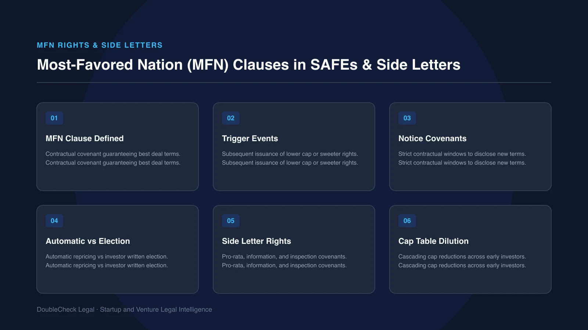
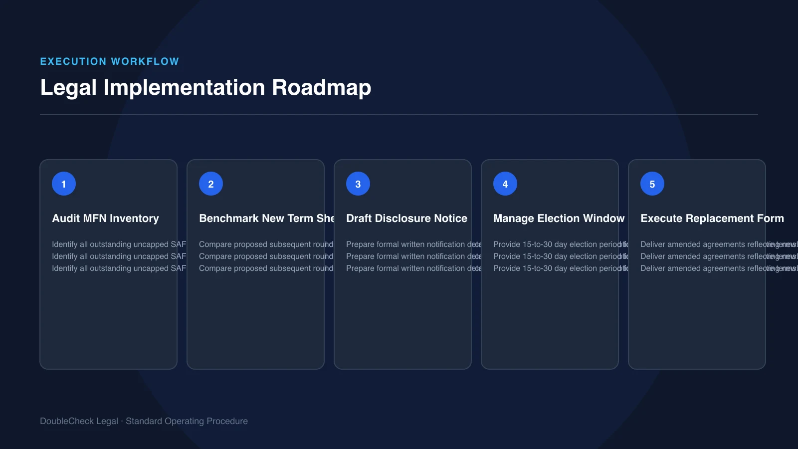

*An exhaustive examination of Most-Favored Nation (MFN) covenants in early-stage venture financings, analyzing SAFE conversion triggers, notice windows, cascading dilution risks, side letter carve-outs, and compliance workflows.*

**Key takeaways:**
- **Asymmetric Downside:** MFN clauses protect early risk-takers by granting them the benefit of any subsequent concessions granted to later investors before an equity round.
- **Strict Notice Deadlines:** Most MFN agreements impose strict 15- to 30-day disclosure requirements following the issuance of any subsequent convertible security.
- **Scope Nuances:** Founders must differentiate between "Economic MFNs" (valuation cap and discount only) and "Broad MFNs" (covering information, governance, and pro-rata rights).
- **Cascading Cap Reductions:** Lowering valuation terms to close a hesitant seed investor can retroactively reprice all preceding MFN capital, severely diluting common equity holders.

## 1. The quick answer: How MFN clauses operate in seed financings

In venture capital, a **Most-Favored Nation (MFN)** clause is a contractual guarantee that early investors will not be penalized for investing early. If the startup subsequently offers better terms to another investor before the next priced round, the MFN holder can adopt those superior terms.

Common contexts for MFN clauses include:
- **Y Combinator MFN SAFEs:** A standard uncapped SAFE containing an MFN amendment right (no fixed cap until another investor establishes one).
- **Angel Side Letters:** Covenants granted to early angel syndicates ensuring parity with subsequent venture capital seed extensions.
- **Convertible Notes:** Covenants ensuring that if subsequent noteholders receive higher interest rates or lower caps, prior noteholders receive identical adjustments.



## 2. In-depth legal analysis: The mechanics of MFN covenants

The legal enforceability and downstream consequences of an MFN clause depend heavily on its contractual drafting.

### A. The Standard YC MFN SAFE Architecture
Under Section 1(c) of the standard Y Combinator MFN SAFE form:

```
"If the Company issues any Subsequent Convertible Securities with terms more favorable than the terms of this Instrument, the Company will promptly provide the Investor with written notice thereof, together with a copy of such Subsequent Convertible Securities... and Investor may elect to amend this Instrument to adopt such terms."
```

Key contractual elements include:
1. **Subsequent Convertible Securities:** Defined broadly to include convertible notes, SAFEs, and other debt-equity hybrids issued prior to an equity financing.
2. **Promot Notice Obligation:** The company bears the affirmative duty to notify the investor. Ignorance of outstanding MFNs is not a legal defense.
3. **Investor Election:** The investor must formally elect to amend within the specified notice window.

### B. Economic MFN vs Comprehensive MFN
Founders must understand what rights are subject to MFN parity:

| Category | Economic MFN | Comprehensive MFN |
|---|---|---|
| Valuation Cap | Yes | Yes |
| Conversion Discount | Yes | Yes |
| Interest Rate (Notes) | Yes | Yes |
| Pro-Rata Rights | No | Yes |
| Information Rights | No | Yes |
| Board Observer Rights | No | Yes |
| Liquidation Preference Floor | No | Yes |

If a founder inadvertently signs a Comprehensive MFN side letter with an angel group, subsequently granting a seed fund a board seat or major information rights will require offering identical rights to the angel group, creating administrative chaos.

### C. The Cascading Dilution Trap
Consider a startup that raises $500,000 on an uncapped MFN SAFE. Six months later, needing runway, the founder raises $250,000 from a local angel on a $4,000,000 valuation cap SAFE.

- **Consequence:** The original $500,000 MFN SAFE immediately captures the $4,000,000 cap.
- **Founder Dilution:** The founder expected the $500,000 to convert at Series A pricing (e.g., $10M), but it now converts at $4M, costing the common shareholders more than double the expected equity dilution.

## 3. Step-by-step: How to navigate a subsequent financing with active MFNs



When negotiating new seed capital with existing MFN instruments outstanding, legal counsel should adhere to the following workflow:

### Step 1: Centralize All Side Letters and SAFEs
Create a single master repository of every issued instrument. Identify:
- Exact date of issuance;
- MFN scope (economic-only vs all terms);
- Contractual notice window (e.g., 10 days, 20 days, or 30 days).

### Step 2: Pre-Clear New Term Sheets
Before signing a new convertible instrument with a lower cap, calculate the aggregate dilution if all existing MFN holders exercise their election rights. If the dilution breaks the company’s capitalization model, renegotiate the new round as a priced Series Seed round instead (since priced rounds terminate SAFE MFN clauses).

### Step 3: Issue Formal Written Notice
Prepare a standardized notice package delivered via certified mail or trackable electronic communication. Attach:
- Redacted or complete copies of the newly issued subsequent convertible securities;
- Clear instructions on how the investor must exercise their election;
- The precise deadline for response (e.g., 30 calendar days).

### Step 4: Secure Formal Amendments or Waivers
For electing investors, execute an amended and restated SAFE replacing the original terms. For non-electing investors, document the expiration of their election period to bar future claims.

### Step 5: Update the Pro Forma Cap Table
Reflect the adjusted valuation caps in the company’s capitalization model to prevent valuation surprises during Series A due diligence.

## 4. Defenses, carve-outs, and common drafting disputes

Savvy startup counsel frequently insist on standard carve-outs when negotiating MFN side letters:
- **Minimum Dollar Thresholds:** The MFN only triggers if the subsequent security raises at least $250,000 or $500,000, preventing a small $10,000 strategic check from repricing the whole round.
- **Carve-Out for Strategic Partners:** Explicitly exempting instruments issued to banks, commercial partners, equipment lessors, or real estate landlords.
- **Sunset Clauses:** Specifying that the MFN right terminates 12 months after issuance or upon the first priced round of equity financing.

## 5. Due diligence checklist: MFN and side letter compliance

1. **Verify Instrument Definitions:** Ensure new instruments qualify under the defined terms of "Subsequent Convertible Securities."
2. **Track Notice Timelines:** Maintain calendar alerts for 15-day and 30-day notification obligations.
3. **Audit Information Rights:** Verify that side letters do not require disclosure of confidential trade secrets or competitive business plans.
4. **Delaware Corporate Approvals:** Ensure all SAFE issuances and side letter commitments are formally ratified by unanimous board consent under DGCL § 152.

## Where DoubleCheck fits

[DoubleCheck](https://www.contactdoublecheck.com) provides early-stage founders and corporate legal teams with AI-powered contract diligence and side letter management. DoubleCheck ingests complex SAFE portfolios, identifies nested MFN triggers, highlights cross-default and disclosure timelines, and models potential cap table dilution before new convertible notes or SAFEs are signed.

**Related reading:**
- [Post-Money SAFE Conversion Mechanics & Dilution](/blog/post-money-safe-conversion-mechanics-cap-table-dilution/)
- [Convertible Note vs SAFE](/blog/convertible-note-vs-safe/)
- [Cap Table Cleanup Before Series A Common Problems](/blog/cap-table-cleanup-before-series-a-common-problems/)
- [Series A Legal Due Diligence Checklist](/blog/series-a-legal-due-diligence-checklist/)

**Sources:** [Y Combinator Model SAFE Documents & Guidelines](https://www.ycombinator.com/documents); [Delaware General Corporation Law § 152 (Issuance of Stock & Capital Securities)](https://delcode.delaware.gov/title8/c001/sc05/); [Securities Act of 1933 § 4(a)(2) (Private Offering Exemption)](https://www.law.cornell.edu/uscode/text/15/77d); [National Venture Capital Association (NVCA), Standardized Seed & Series A Model Legal Documents](https://nvca.org/model-legal-documents/).

## FAQ

**What is a Most-Favored Nation (MFN) clause in a SAFE?**

An MFN clause in a SAFE or side letter guarantees that if the startup later issues another convertible instrument with more favorable economic or legal terms—such as a lower valuation cap or higher discount—the original investor has the right to adopt those superior terms.

**Does an MFN SAFE automatically adopt better terms or require an election?**

Under the standard Y Combinator MFN SAFE form, adoption is not fully automatic; the company must deliver written notice of the new instrument within a designated timeframe (e.g., 30 days), giving the investor the option to elect the amendment.

**Can an MFN clause trigger on side letter terms like pro-rata rights?**

Yes. If the MFN provision covers all legal rights and side letter covenants rather than strictly economic terms, granting pro-rata or information rights to a subsequent seed fund may trigger an obligation to extend those same rights to the MFN holder.

**What happens if a startup fails to notify an MFN holder of a sweeter deal?**

Failing to provide timely written notice constitutes a material breach of contract, exposing the startup to claims for breach of covenant, rescission, or damages based on the lost conversion value during an equity financing.

**How do AI legal tools prevent MFN compliance errors?**

AI legal tools track disparate SAFE instruments and side letters in real time, alerting founders to cross-instrument MFN triggers and generating compliance matrices before new financing rounds close.

---

*General information only. This article is not legal, tax, investment, or accounting advice.*
