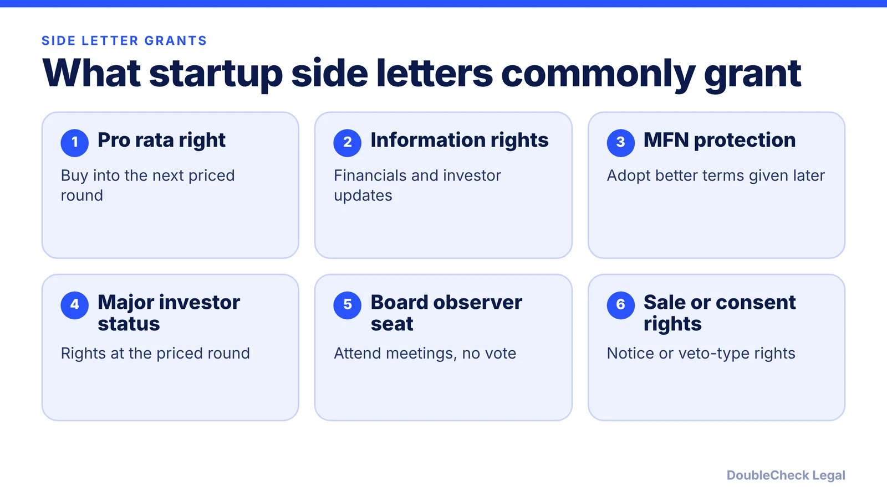
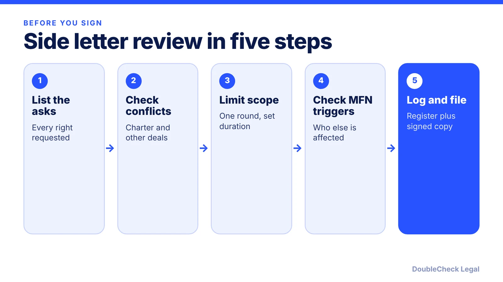

*What side letters with startup investors grant, the risks for founders, and how to track and review them, as of November 2026.*

**Key takeaways:**

- A side letter is a binding agreement that gives one investor rights the main document does not.
- Common grants are pro rata, information, MFN, major investor status and board observer rights.
- Terms can cascade through MFN clauses and show up in priced-round diligence, so keep a register.
- Limit each right by round and duration, and have a startup attorney review any MFN, consent or evergreen term.

## 1. The quick answer

**Quick answer:** A side letter is a separate, binding agreement between a startup and one investor that grants rights the main investment document does not. Side letters in startup rounds commonly cover pro rata rights, information rights, most favored nation (MFN) protection, major investor status and board observer seats. As of November 2026, the rule of thumb in the sources below is to keep the SAFE or stock purchase agreement standard and put anything negotiated in a side letter you can track, limit in scope and disclose when asked. What a side letter grants one investor can affect your next round and your other investors.

This post explains the common grants, the risks to the founder, and how to keep them organized. For the underlying instruments see [SAFE agreement for startup founders](/blog/safe-agreement-startup-founders/) and [pro rata rights explained](/blog/pro-rata-rights-explained-startups/).

## 2. What a side letter is and why investors ask for one

A side letter is a separate agreement between an investor and a startup that adds rights beyond the main investment document. It arises with SAFEs, convertible notes and priced rounds when an investor wants terms the main document lacks. In SAFE rounds the convention is that the SAFE form stays standard, and anything negotiated goes in a side letter; Y Combinator, for example, publishes its [post-money SAFE and a separate, optional pro rata side letter](https://www.ycombinator.com/documents).

Who asks? Orrick's speakers note that some institutional investors look for a side letter with additional rights. A strategic investor that is also a customer, for example, may want notice of a potential sale.

A side letter sits alongside the main agreement and binds the parties who sign it. Ask counsel how your governing law treats a side letter that conflicts with your charter or other signed documents.

Side letters are not secret by nature. Gunderson Dettmer warns that multiple side letters with different rights can be hard to track and keep confidential, and that lead investors in a priced round may require pre-seed investors' rights to be revised or revoked. So assume the lead investor in your next round will ask to see every side letter, and that new investors may react to the rights already granted. See [due diligence checklist for startup fundraising](/blog/due-diligence-checklist-for-startup-fundraising/) and [Series A legal due diligence checklist](/blog/series-a-legal-due-diligence-checklist/).

## 3. The rights side letters commonly grant

Each right below includes what the sources say and the main thing to check.

**Pro rata rights.** Gunderson Dettmer describes this as the right to participate in future financings to maintain ownership percentage; it is a right, not an obligation. Y Combinator lists its pro rata side letter as a separate, optional document alongside the post-money SAFE forms. Orrick's speakers consider pro rata generally reasonable for early-stage investors, and advise limiting it to the next financing round. Check: is it limited to one round or evergreen? See [pro rata rights explained](/blog/pro-rata-rights-explained-startups/).

**Information rights.** Gunderson Dettmer lists information rights among the major investor rights, typically access to financial information. Reporting promised to one investor can become burdensome as the company scales, so keep the scope and frequency modest and consider offering the same terms to all early investors.

**MFN.** Per Gunderson Dettmer, an MFN generally means that if the company later raises money on more favorable terms, it must give the MFN investor those terms, and the wording must be careful so the company does not promise more than it should. Cooley describes the same mechanic in fund side letters, where an MFN lets an investor elect more favorable terms granted to others, subject to limits. The main risk is that grants cascade: a startup could grant an MFN, then raise from a later investor on better terms and automatically extend those terms to the earlier investor without realizing it. Check: which terms are covered, which investors count, and whether it applies only within the same round.

**Major investor status.** Gunderson Dettmer describes major investor rights as usually associated with preferred stock, including pro rata, information, first refusal and co-sale, board observer and approval rights. Promising major investor status early can pre-negotiate part of the Series A before the lead is involved, so grant it sparingly.

**Board observer.** Orrick's speakers say observer rights are hard to rein back in once granted, and that observers are involved with the company more deeply than ordinary stockholders without the confidentiality obligations and fiduciary duties of directors. Control your boardroom and be careful about granting them.

**Blocking and sale rights.** Gunderson Dettmer lists approval or blocking rights over certain corporate actions among major investor rights usually associated with preferred stock, not a standard SAFE. Resist blocking rights at this stage, and if a sale-related right is unavoidable, limit it to notice.

## 4. Risks to the founder and the next round

Individually, many side letter terms look harmless. Together they can shape your Series A.

- **Dilution and allocation.** Exercised pro rata rights can compete with the lead's target allocation at the Series A. Pro rata that carries across every round is a continuing claim on each financing, which is why Orrick advises limiting it to the next round.
- **Cascading MFN.** Each MFN grant may seem reasonable alone, but they can compound.
- **Transferable letters.** Transferable letters can extend rights to parties the founder has never met, so check whether the letter can be assigned.
- **Waivers.** Waivers of provisions such as drag-along or right of first refusal can complicate exits, for example a drag-along waiver that could derail an acquisition expecting all shareholders to sell on the same terms.
- **Changed economics.** Guaranteed roles, fees and extra warrants change the instrument's economics, so treat them as business terms, not formalities.
- **Duration.** Try to limit how long rights last, for example by having the side letter expire when the SAFE converts so legacy obligations do not carry into future rounds.

See [term sheet key terms explained](/blog/term-sheet-key-terms-explained/) and [cap table basics for first-time founders](/blog/cap-table-basics-for-first-time-founders/). If you are raising on SAFEs, also read [safe review before you sign](/blog/safe-review-before-you-sign/).

## 5. How to track and manage side letters

A side letter problem is usually a tracking problem. Gunderson Dettmer notes that multiple side letters with different rights can be hard to track, so keep a running log: investor, SAFE terms, side letter status and granted rights, plus a list of every MFN-protected investor and the terms each has rights to, checked before granting any new term.

A simple register has these columns:

- **Investor and signing date**
- **Main instrument** (SAFE, note, stock purchase agreement)
- **Right granted** (pro rata, information, MFN, observer, other)
- **Scope** (which round, how long, whether transferable)
- **Triggers and deadlines** (reporting dates, notice periods)
- **Who approved it** and where the signed copy lives

Before you sign any side letter, ask:

1. Does this belong in the main document instead, so every investor gets the same terms?
2. Does it conflict with the charter, an existing agreement or another side letter?
3. Does it end at conversion, or does it continue?
4. Would granting it trigger an MFN for someone else?
5. Would you be comfortable showing it to the Series A lead?

Cap table cleanup problems often start here, so see [cap table cleanup before Series A](/blog/cap-table-cleanup-before-series-a-common-problems/).

## 6. When to use AI and when to bring in an attorney

AI is useful for first-pass work on a side letter: summarizing what each clause grants, flagging terms that differ from the main document, and building the register above. It can also draft questions to ask the investor. It can miss how a clause interacts with your charter, other investors and governing law, so verify the output before you rely on it. See [how to verify an AI-generated legal document](/blog/verify-ai-generated-legal-document/) and [AI contract review: what to check before signing](/blog/ai-contract-review-what-to-check-before-signing/).

Get a startup attorney to review when:

- The investor asks for MFN, evergreen pro rata, consent rights or a board seat.
- You already have several investors with different terms.
- The side letter references a document you have not seen.
- A priced round is coming within the next year.

Law firm guidance from Orrick and Gunderson Dettmer treats these as negotiated points, not formalities. For finding counsel, see [how to choose a good lawyer](/blog/how-to-choose-good-lawyer/) and [angel investor agreement: what to expect](/blog/angel-investor-agreement-what-to-expect-docs-checklist/).

## Where DoubleCheck fits

[DoubleCheck](https://www.contactdoublecheck.com) helps businesses and founders start legal work with AI, verify it, and, when professional advice is warranted, connect with an independent attorney, including for immigration questions. Attorney availability and practice areas vary. Attorneys on DoubleCheck are independent professionals; an attorney-client relationship forms only if an attorney accepts your engagement.

**Sources:** [Orrick, SAFE Financings: Navigating Investor Rights (April 2026)](https://www.orrick.com/en/Insights/2026/04/SAFE-Financings-Navigating-investor-rights); [Gunderson Dettmer, Pre-Seed Financing](https://catalyze.gunder.com/print/v2/content/22352/pre-seed-financing.pdf?lang=en); [Y Combinator, SAFE documents](https://www.ycombinator.com/documents); [Cooley, Primer: Side Letters in Private Equity and Venture Capital Funds](https://thefundlawyer.cooley.com/primer-side-letters-in-private-equity-and-venture-capital-funds/). Cooley's primer concerns fund side letters and is cited only for how MFN clauses generally work.

## FAQ

**What is a side letter in a startup investment?**

It is a separate binding contract between a startup and an investor that adds rights beyond the main investment document. It is commonly used with SAFEs, convertible notes and priced rounds.

**What do investor side letters usually grant?**

Per Orrick and Gunderson Dettmer, common grants include pro rata rights, information rights, MFN protection, major investor-style rights and board observer rights. Institutional investors are the ones most likely to ask for them.

**Do I have to disclose side letters to new investors?**

Expect to. Gunderson Dettmer notes that lead investors in a priced round may require pre-seed investors rights to be revised or revoked, and side letters are agreements you should expect new investors to ask about. Ask your attorney how disclosure obligations apply under your agreements.

**What is an MFN clause in a side letter?**

Per Gunderson Dettmer, an MFN generally means that if the company later raises money on more favorable terms, it must give the MFN investor those terms. Its risk is promising more than intended, so track which investors hold MFN rights before granting any new term.

**Should I give pro rata rights in a side letter?**

Orrick advises limiting pro rata rights to the next financing round. Rights that carry across every future round are a much bigger commitment, so have counsel review the scope.

---

*General information only. This article is not legal, tax, investment, or accounting advice.*
