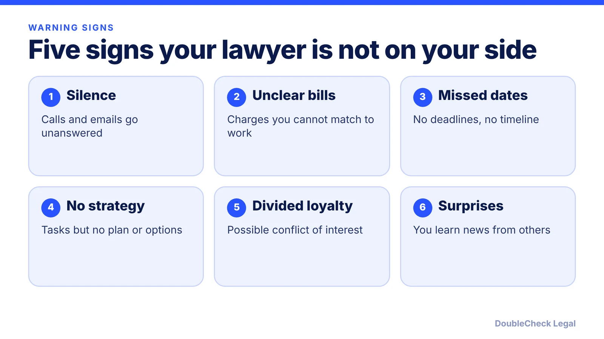
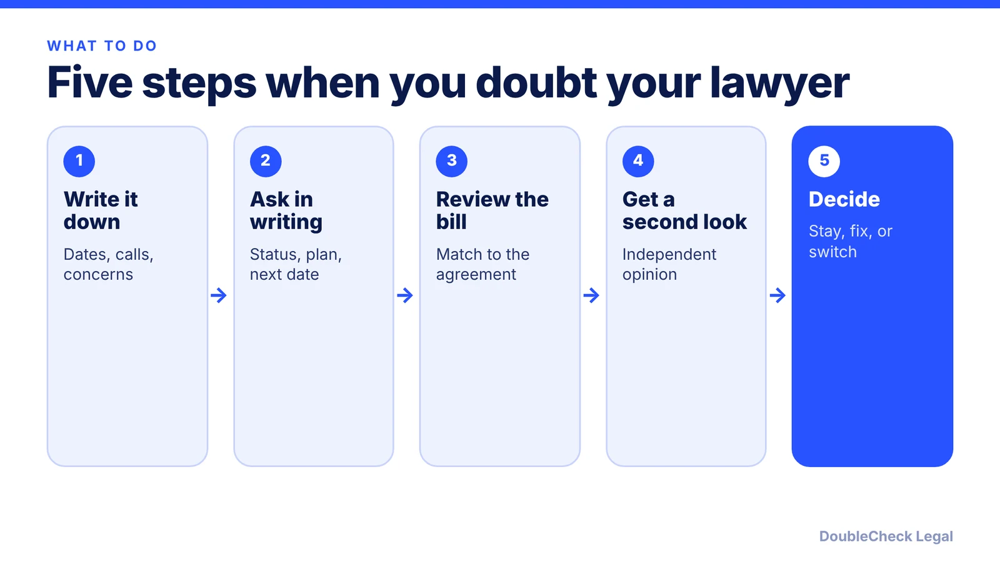

*Five warning signs, a paper trail, and a clear path to a second opinion or a new lawyer.*

**Key takeaways:**

- Warning signs: no communication, unclear bills, no deadlines or plan, and possible conflicts.
- ABA Model Rule 1.4 expects lawyers to keep you reasonably informed and respond promptly to reasonable requests.
- Raise concerns in writing, keep dated records, and ask for status, options and costs.
- You can seek a second opinion or discharge a lawyer, but you may owe for work done and should plan the handoff.

## 1. The quick answer

**Quick answer:** Your lawyer is probably not working for you if you cannot get answers, cannot understand the bills, hear nothing about deadlines or strategy, or suspect a conflict of interest. Professional rules give you a yardstick. ABA Model Rule 1.4, as published by the New Hampshire courts, says a lawyer must "keep the client reasonably informed about the status of the matter" and "promptly comply with reasonable requests for information." The first step is rarely to fire anyone: write down your concern, ask for specifics, and see how they respond. If that fails, you can get a second opinion or switch. This post is the action plan; for the positive version, see [how do I know if my lawyer is good](/blog/how-do-i-know-if-my-lawyer-is-good/).

## 2. The signs, and what each one should look like instead

Nolo's guide to what to expect from a lawyer is a useful baseline. Here is how its points map to the common warning signs.

- **Communication.** Nolo says to ask at the start how to reach the office and how fast questions get answered. A lawyer in trial may be slow, but staff should still answer simple questions and confirm the matter is moving. Under Rule 1.4(b), a lawyer must explain "the legal and practical aspects of a matter and alternative courses of action" so you can make informed decisions. Comment [4] adds: "A lawyer should promptly respond to or acknowledge client communications." Silence for weeks is a flag; a quick acknowledgment with a date is not.
- **Billing transparency.** Per Nolo, you should have the fee agreement in writing, know how often you are billed, and receive itemized statements. Common complaints it lists include bills that differ from the agreement, unitemized charges, partner rates for paralegal work, and padded time for short calls. See our guide to [what lawyers charge](/blog/how-much-does-a-startup-lawyer-cost/).
- **Deadlines and a plan.** Per Nolo, at the first consultation your lawyer should explain your options, discuss strategy and give a timeline for important events. Nolo also gives missing a filing deadline as an example of a mistake no reasonable attorney would make. Silence is not always bad news, so ask how updates will be delivered.
- **Conflicts.** Nolo says lawyers should represent clients with undivided loyalty and keep confidences, and cites representing parties with conflicting interests as a possible malpractice example. If your lawyer also acts for the other side, or a partner, investor or vendor, ask in writing how that is handled.

One caution: a slow answer or an unwelcome opinion is not the same as bad work. Honest advice can be uncomfortable.

## 3. What to ask, and how to document it

Raise it early and in writing. The State Bar of California advises contacting your attorney right away, because the problem may be a simple misunderstanding, and keeping a record of the date and time of each call. If calls are not returned, it suggests sending a letter describing your concern and what you need, keeping a copy, and proposing an in-person meeting. The Texas courts self-help page likewise says to talk to the lawyer first and "give the lawyer a chance to explain and address your points."

Questions worth asking:

- What is the current status, and what is the next step and date?
- What are my options, and what does each risk?
- What deadlines apply, and who is tracking them?
- How has the bill been calculated, and what will the next stage cost?
- Do you or your firm have any conflict with my matter?

Document everything: save the engagement agreement, invoices, emails, and your own dated notes of calls. After a call, send a short email recapping what was said. Texas also suggests asking for instructions in writing when you are unsure.

## 4. Second opinion, switching, and complaints

**Second opinion.** The State Bar of California says that if you disagree with advice and an explanation does not settle it, you can get a second opinion from another lawyer. See our guide to [choosing a good lawyer](/blog/how-to-choose-good-lawyer/) and how to [get a referral](/blog/how-to-get-lawyer-referral/).

**Switching.** The ABA comment to Rule 1.16 says a client may discharge a lawyer "at any time, with or without cause," though you may owe for services already rendered. California warns that changing lawyers may delay your case. In litigation, the Arizona State Bar says the representation continues until the court substitutes new counsel or allows withdrawal, so ask your new lawyer to handle the handoff.

**Your file.** Per the Arizona bar's guidance, the file is client property and you are generally entitled to its substantive contents, and a lawyer must not hold it hostage over an unpaid bill. Rules vary by state, so ask your state bar.

**Fee disputes and complaints.** In California, the State Bar says fee arbitration is usually faster and cheaper than court, and it describes a generally 30-day window after receiving the required notice. Each state has a disciplinary agency; Nolo says it can impose fines, order restitution, suspend or disbar, but that bars generally do not act just because a lawyer is not very good. Before filing, [verify the lawyer's license](/blog/verify-california-attorney-license-state-bar/).

**Where AI can help.** Use AI to turn your notes into a clean timeline, draft the questions above, and explain jargon in a bill or letter before you talk to your lawyer. See [using ChatGPT on a contract](/blog/lawyer-review-chatgpt-contract/) and [AI lawyer for small business](/blog/ai-lawyer-small-business/). AI can miss facts and jurisdiction details, so treat its output as prep and a second set of eyes, not a verdict. Do not paste confidential material into tools without checking their terms. If the stakes are high, have an attorney verify the key points. Also read our [first-meeting checklist](/blog/how-to-prepare-for-first-meeting-with-startup-lawyer/) before meeting a new lawyer.

**Related reading:** [How to tell if your lawyer is actually working on your matter](/blog/how-to-tell-if-your-lawyer-is-actually-working-on-your-matter/); [Lawyer not returning calls: what to do](/blog/lawyer-not-returning-calls-what-you-can-do-before-you-switch/)

## Where DoubleCheck fits

[DoubleCheck](https://www.contactdoublecheck.com) helps businesses and founders start legal work with AI, verify it, and, when professional advice is warranted, connect with an independent attorney, including for immigration questions. Attorney availability and practice areas vary. Attorneys on DoubleCheck are independent professionals; an attorney-client relationship forms only if an attorney accepts your engagement.

**Sources:** [Nolo, What You Should Expect From a Lawyer](https://www.nolo.com/legal-encyclopedia/expectations-for-lawyer-attorney-29876.html); [New Hampshire Courts, Rule 1.4 (ABA Model Rule text)](https://www.courts.nh.gov/new-hampshire-rules-professional-conduct/rule-14-client-communications); [ABA, Comment on Rule 1.16](https://americanbar.org/groups/professional_responsibility/publications/model_rules_of_professional_conduct/rule_1_16_declining_or_terminating_representation/comment_on_rule_1_16_declining_or_terminating_representation); [State Bar of California, Resolving Problems with Your Attorney](https://www.calbar.ca.gov/node/8); [State Bar of California, Fee Disputes FAQ](https://www.calbar.ca.gov/public/concerns-about-attorney/resolving-fee-disputes-your-attorney/frequently-asked-questions-fee-disputes); [Arizona State Bar, ER 1.16](https://www.azbar.org/for-legal-professionals/ethics/best-practices/er-1-16-declining-or-terminating-representation); [Texas Court Help, Working with your lawyer](https://texascourthelp.gov/civil/how-do-i-work-with-my-lawyer/). The ABA page for Rule 1.4 did not load, so the rule text is cited from the New Hampshire courts page.

## FAQ

**How do I know if my lawyer is working for me?**

Look for prompt communication, itemized bills, a stated plan and timeline, and loyalty to you. ABA Model Rule 1.4 expects a lawyer to keep you reasonably informed and promptly comply with reasonable requests for information.

**How often should my lawyer contact me?**

There is no universal schedule. Rule 1.4 requires reasonable updates on status, and its comment says a lawyer should promptly respond to or acknowledge client communications. Ask at the start how updates will be delivered.

**Can I fire my lawyer?**

Generally yes. The ABA comment to Rule 1.16 says a client may discharge a lawyer at any time, with or without cause, but may owe for services already rendered. In litigation, the court may need to approve a change.

**Do I get my file if I switch lawyers?**

Generally yes. The Arizona State Bar says the file is client property and a lawyer must not hold it hostage over an unpaid bill, though a lawyer may bill reasonable transition costs. Rules vary by state.

---

*General information only. This article is not legal, tax, investment, or accounting advice.*
