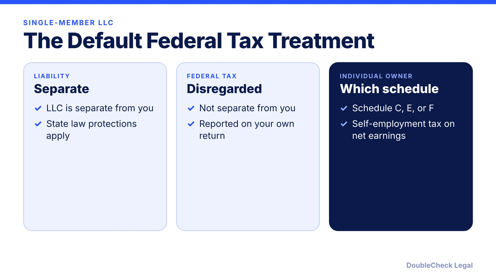
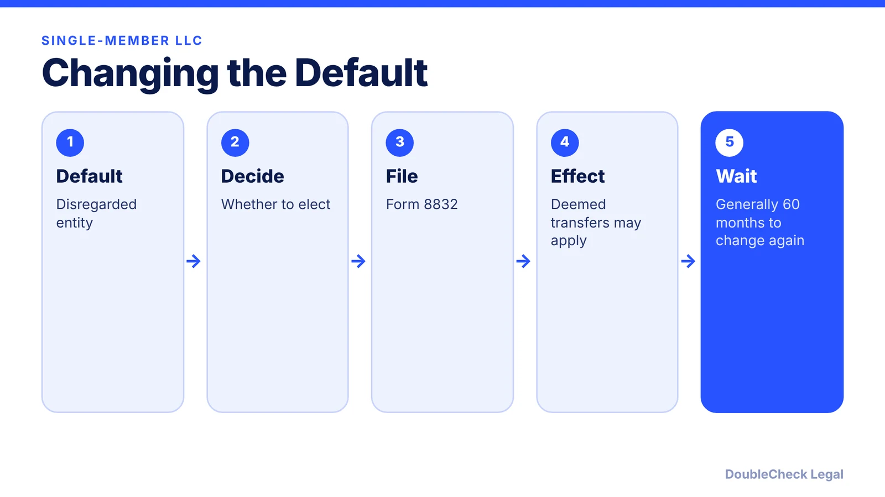
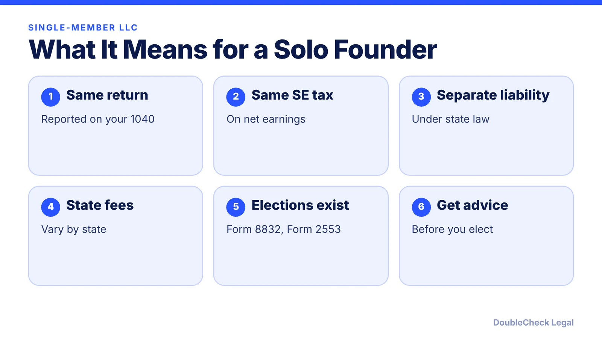

*A single-member LLC is taxed like you personally, unless you elect otherwise. Here is what the IRS says.*

**Key takeaways:**

- The IRS treats a single-member LLC as a disregarded entity by default.
- Individual owners report on Schedule C, E, or F and pay self-employment tax on net earnings.
- Form 8832 elects a different classification, with a general 60-month limit on changing again.
- At-risk and passive loss rules may limit deductions.

## 1. The quick answer

**Quick answer:** A single-member LLC is a "disregarded entity" for federal tax by default. The IRS says the LLC is treated as separate from its owner only for liability purposes, not for federal tax. If you are an individual, you report on Schedule C, Schedule E, or Schedule F depending on the business, and your net earnings are subject to self-employment tax like a sole proprietor.

## 2. Changing the default: Form 8832

A single-member LLC can elect a different classification with Form 8832. The IRS notes that after an election takes effect, the LLC generally cannot change again for 60 months, with an exception for a newly formed LLC whose election is effective on its formation date. It also describes deemed asset transfers: for example, a disregarded entity electing corporate status is treated as the owner contributing assets to a corporation for stock.

An S corporation election is a separate path; see [S corp election deadline (Form 2553)](/blog/s-corp-election-form-2553-deadline/).

## 3. Loss limits

The IRS also notes that at-risk rules and passive activity loss limits may restrict deductible losses; see IRS Publication 925. Ask your accountant how they apply to you.

## 4. What this means for a solo founder

See [sole proprietor vs. LLC](/blog/sole-proprietor-vs-llc-solo-founder/) and [quarterly estimated taxes](/blog/quarterly-estimated-taxes-solo-business-owner/).

## Where DoubleCheck fits

[DoubleCheck](https://www.contactdoublecheck.com) is built for businesses that start legal work with AI. Bring your question or draft, use an AI-first workflow to understand and verify it, and when professional advice is warranted, you can connect with an independent attorney. Attorneys on DoubleCheck are independent professionals; an attorney-client relationship forms only if an attorney accepts your engagement.

**Sources:** [IRS: Limited liability company](https://www.irs.gov/node/7774).

## FAQ

**How is a single-member LLC taxed?**

By default as a disregarded entity: the LLC is separate for liability but not for federal tax, and an individual owner reports on Schedule C, E, or F.

**Does a single-member LLC pay self-employment tax?**

For an individual owner, net earnings are subject to self-employment tax, as with a sole proprietorship, per the IRS.

**What is Form 8832?**

The form used to elect a different tax classification for an LLC.

**How often can I change my election?**

After an election takes effect, the LLC generally cannot change again for 60 months, with an exception for newly formed LLCs.

---

*General information only. This article is not legal, tax, investment, or accounting advice.*
