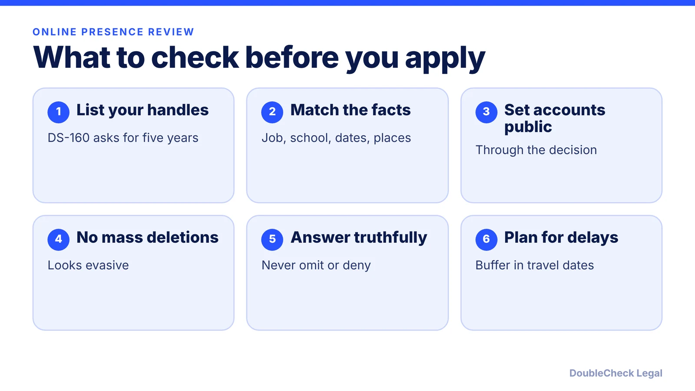
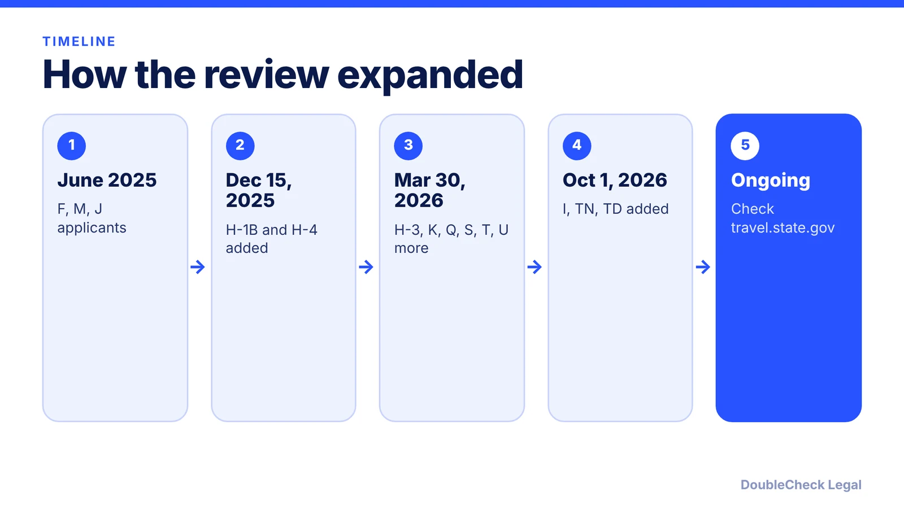

*What changed in 2025-2026, what officers can see, how to prepare honestly, and what to do if your visa is delayed.*

**Key takeaways:**

- The online presence review began for F, M, J applicants in June 2025 and expanded to H-1B and H-4 on December 15, 2025, with more categories added in 2026.
- Per law-firm summaries, applicants are asked to keep accounts public, and the DS-160 asks for handles from the past five years.
- Make your profiles accurate and consistent with your application. Never delete to deceive and never lie or omit.
- A delay is often a 221(g) refusal. Respond to what is requested and plan travel with buffer time.

## 1. The quick answer

**Quick answer:** Since June 2025, the State Department has directed consular officers to review the online presence of student and exchange visa applicants (F, M, J), and that review has been extended to H-1B and H-4 applicants (December 15, 2025) and to more categories since. Per law-firm summaries, applicants are asked to set social media accounts to public, and the DS-160 asks for handles used in the previous five years. As of November 2026, the safest approach is simple: keep your profiles accurate and consistent with your application, do not delete content to mislead, and never omit or lie. If your visa is held up, it is often a Section 221(g) refusal that can take time to resolve.

## 2. What was announced in 2025-2026

This is how law firms and employers' groups describe the timeline. Sources are listed at the end, and the State Department's [visa news page](https://travel.state.gov/content/travel/en/News/visas-news.html) is the place to confirm the current rules.

- **June 18, 2025:** Per [Duane Morris](https://www.duanemorris.com/alerts/state_department_expands_social_media_screening_h1b_h4_applicants_1225.html), screening applied to F, M, and J applicants starting that date.
- **December 15, 2025:** Per Duane Morris and [SHRM](https://www.shrm.org/topics-tools/news/state-dept-adds-social-media-review-h1b-visa-applicants), the review expanded to all H-1B applicants and H-4 dependents at U.S. consulates abroad. Many December 2025 appointments in India were reportedly moved to March 2026.
- **March 30, 2026:** Per [Phillips Lytle](https://phillipslytle.com/u-s-department-of-state-announces-expanded-screening-and-vetting-for-additional-visa-categories/clientalert-immigration-vetting-2026-03-27-desktop/), more categories were added, including H-3, K, Q, R dependents, S, T, U, A-3, C-3 (domestic workers), and G-5.
- **October 1, 2026:** Per [BizLegal Services](https://bizlegalservices.com/2026/09/23/state-department-expands-social-media-vetting-to-i-tn-and-td-visas/), the State Department announced on September 18, 2026 an expansion to I (foreign media) visas and TN and TD visas.

The same BizLegal article notes the State Department has not published its review criteria, so nobody outside the agency can say exactly how accounts are weighed.

## 3. What officers can review and how to prepare truthfully

**What officers review.** Per SHRM, the review covers publicly available social media information, prior employment history, and other parts of an applicant's online footprint, for example on Facebook, Instagram, LinkedIn, X, TikTok, and YouTube. SHRM reports officers look for potentially derogatory information and for biographical inconsistencies, and the stated purpose is to determine whether an applicant is inadmissible, including as a national security or public safety risk. It also notes a spouse's or child's public content may prompt a closer look at the whole family.

**What to do.**

- **List every account on the DS-160.** Per Phillips Lytle, the form asks for platform and handle for accounts used in the previous five years, including inactive ones. Per BizLegal, omitting an account might be treated as misrepresentation.
- **Set accounts to public through the decision.** Per Phillips Lytle, the public-setting advice rests on the June 2025 cable rather than a published rule, and it warns that limiting visibility could look like hiding something. Decide with an attorney if you have a specific concern, such as a safety risk to you.
- **Check consistency.** Per Duane Morris, make sure job titles, employers, locations, education, and dates match your petition, DS-160, and documents, and that usernames do not suggest undisclosed accounts. For H-1B holders, SHRM quotes an attorney warning that any mismatch between your online profile and the petition may cause delays.
- **Keep a record.** Duane Morris suggests keeping copies of your current public profiles and timelines.

**What not to do.**

- **Do not delete content to deceive.** Duane Morris advises avoiding sudden mass deletions, which can look evasive. Fix genuine errors accurately and be ready to explain them.
- **Do not lie, omit accounts, or create a clean alias.** Misrepresentation to a consular officer can create much bigger problems than any post.
- **Do not post claims that conflict with your visa category**, such as unauthorized work or a misstated work location.

The goal is not to scrub your life, it is to make sure what an officer sees is true and matches what you submitted. For the H-1B side of this process, see [H-1B visa stamping and travel](/blog/h-1b-visa-stamping-travel-abroad-tech-workers/) and, for student applicants, [F-1 visa interview questions](/blog/f-1-visa-interview-questions-international-students-214b/).

## 4. If your visa is delayed or refused under 221(g)

Duane Morris reports that applications that cannot be approved right away are temporarily denied until the review is complete, which generally makes the applicant ineligible for future ESTA applications even if the H visa is later approved. Other sources say enhanced screening may mean longer processing, more document requests, and limited appointment availability.

A temporary refusal is typically issued under Section 221(g). Our guide to [221(g) administrative processing](/blog/visa-221g-administrative-processing/) covers what it means and how to respond. In short:

1. **Read the refusal sheet.** It says whether the officer wants documents or is running further checks.
2. **Send exactly what is requested**, through the channel the embassy gives, and keep proof.
3. **Do not re-apply or re-book** while your case is pending unless the consulate tells you to.
4. **Tell your employer or school** so they can plan around the delay. Do not book non-refundable travel before approval.
5. **Ask an immigration attorney** if the case has sat for a long time or the reason is unclear.

**Handle yourself or get an attorney?** If your accounts are accurate, your DS-160 is complete, and your travel dates are flexible, many applicants prepare on their own with their employer's or school's guidance. Talk to an attorney if you have old accounts you cannot recall, content that could be misread, a prior refusal, a very short travel window, or a delay with no explanation. See [how to find a good immigration lawyer](/blog/how-to-find-good-immigration-lawyer-startup-founder/) and [immigration lawyer fees](/blog/immigration-lawyer-fees-flat-fee-vs-hourly/). Employers sponsoring staff can also read [H-1B employer requirements](/blog/startup-sponsor-h1b-employee-requirements/).

## Where DoubleCheck fits

[DoubleCheck](https://www.contactdoublecheck.com) helps businesses and founders start legal work with AI, verify it, and, when professional advice is warranted, connect with an independent attorney, including for immigration questions. Attorney availability and practice areas vary. Attorneys on DoubleCheck are independent professionals; an attorney-client relationship forms only if an attorney accepts your engagement.

**Sources:** [SHRM](https://www.shrm.org/topics-tools/news/state-dept-adds-social-media-review-h1b-visa-applicants); [Duane Morris](https://www.duanemorris.com/alerts/state_department_expands_social_media_screening_h1b_h4_applicants_1225.html); [Phillips Lytle, March 2026](https://phillipslytle.com/u-s-department-of-state-announces-expanded-screening-and-vetting-for-additional-visa-categories/clientalert-immigration-vetting-2026-03-27-desktop/); [BizLegal Services, September 2026](https://bizlegalservices.com/2026/09/23/state-department-expands-social-media-vetting-to-i-tn-and-td-visas/); [State Department visa news](https://travel.state.gov/content/travel/en/News/visas-news.html). The State Department page itself was not fetched, so confirm current rules there.

## FAQ

**Do I have to make my social media public for a visa?**

Per law-firm summaries of the June 2025 State Department cable, F, M, J, and later H-1B and H-4 applicants are directed or advised to set accounts to public. Phillips Lytle notes the public-setting advice is not a published rule and warns limiting visibility may look like hiding information. Check travel.state.gov for current instructions.

**Does the DS-160 ask for my social media accounts?**

Per Phillips Lytle, the DS-160 asks for the platform and handle of accounts used in the previous five years, including inactive ones. BizLegal Services warns that omitting an account might be seen as misrepresentation.

**Should I delete old posts before my visa interview?**

Not to mislead. Duane Morris advises avoiding sudden mass deletions or edits, which could look evasive. Correct genuine errors accurately, keep a record, and be prepared to explain anything ambiguous. If you are worried about specific content, ask an immigration attorney.

**What if my H-1B visa is delayed after the social media review?**

Per Duane Morris, applications that cannot be approved immediately are temporarily denied until review is complete, which can affect ESTA eligibility. Read the refusal sheet, send what is requested, and see our 221(g) guide. Avoid non-refundable travel until approved.

---

*General information only. This article is not legal, tax, investment, or accounting advice.*
