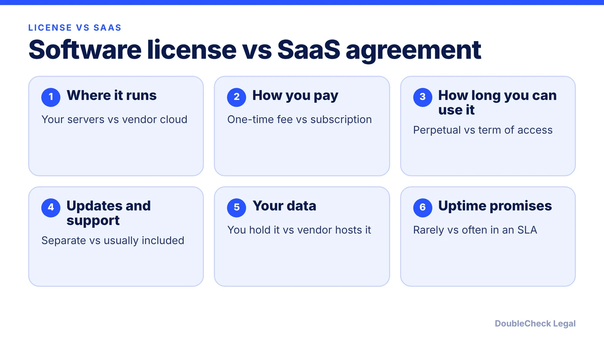
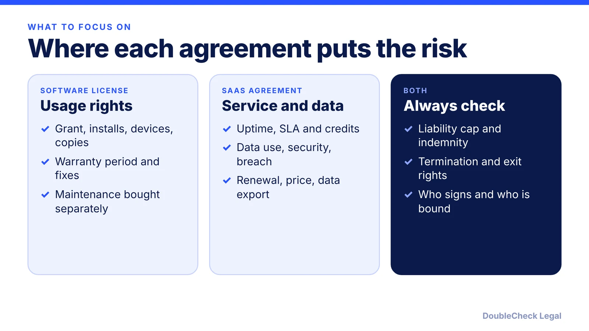

*A plain-English comparison of a software license agreement and a SaaS agreement, with what to check in each, as of November 2026.*

**Key takeaways:**

- A traditional license usually means you install and run the software; SaaS means the vendor hosts it and you subscribe.
- License deals center on usage rights, restrictions, maintenance and warranty; SaaS deals center on uptime, data, security, renewal and exit.
- Many products mix both, so read the grant clause and exhibits rather than the product label.
- Use AI for a first-pass comparison, then verify against the text and ask an attorney about high-stakes terms.

## 1. The quick answer

**Quick answer:** The main differences between a software license agreement and a SaaS agreement come down to who runs the software and how long you can use it. With a traditional license, you typically install the software on your own systems, often for a one-time fee with separate maintenance. With SaaS, the vendor hosts it and you pay a recurring subscription for access, usually with support and updates included. Because of that, a license agreement focuses on usage rights, installation limits, warranties and maintenance, while a SaaS agreement focuses on uptime, data handling, security, renewal and what happens to your data when you leave. Law-firm sources describe this split consistently, as of November 2026.

If you are comparing the two before you sign, this post gives you a side-by-side view and a short list of questions for each. For red flags in any vendor contract, see [contract red flags for small business](/blog/contract-red-flags-small-business/).

## 2. Software license vs SaaS: the side-by-side comparison

Two Morgan Lewis posts give a clear picture. The April 2024 post describes a traditional software license as a one-time purchase of the perpetual right to use software installed on customer-controlled or customer-provided infrastructure, where the vendor generally does not host or store customer data. It describes SaaS as subscription or term-based access to software the vendor hosts, with updates included and ongoing monthly or annual payments.

An earlier Morgan Lewis blog post (2020) on SaaS versus on-premise agreements adds more detail:

- **License grant:** In SaaS, the customer gets a limited right to access and use the functionality, and vendors typically avoid the word license. On-premise software may come with a perpetual license that continues beyond the agreement term.
- **Term:** SaaS access lasts only for the agreement term. A perpetual license can be used after the term, though warranties run for a limited period.
- **Fees:** SaaS is a recurring subscription, often per user, tiered or usage-based, and usually includes maintenance and upgrades. On-premise is typically a one-time fee plus a separate recurring fee for maintenance.
- **SLA:** SaaS vendors typically commit to an availability level. On-premise vendors generally cannot, because the customer runs the software.
- **Security:** SaaS vendors maintain security commitments through the term. On-premise vendors often refuse them because they cannot control how you run the software.

In practice many deals mix both. A vendor may sell a SaaS subscription with a downloadable agent or desktop component, or an on-premise product with a hosted add-on. Read the grant clause and the definitions to see what you actually get. See also [master services agreement and SOW basics](/blog/master-services-agreement-and-sow-small-business/) when software comes bundled with implementation work.

## 3. What to look for in a SaaS agreement

Because the vendor holds your data and controls the service, the risk shifts from installation to availability, security and exit. Thomson Reuters (October 2020) lists SaaS risks such as limited control over performance, availability, support, data privacy, security and server locations; possible commingling of your data with other customers' data; the effect of the provider's insolvency on service availability; the cost of moving data and operations in or out; one-sided provider contracts; and provider collection of customer data for commercial use. It also notes that provider forms often disclaim responsibility for data loss, service interruption and breaches, and may limit remedies. Vendr lists the core terms: subscription (price, billing frequency, user counts), SLA, data ownership, termination and renewal pricing, and liability limits.

Questions to ask:

1. **Subscription scope:** How many users, what usage limits, and what happens if you exceed them?
2. **Uptime and credits:** Is there an SLA, and are the remedies meaningful or just service credits?
3. **Data ownership and use:** Who owns your data, and can the vendor use it for analytics or product improvement?
4. **Security and breach:** What are the security commitments and notice duties? See [data breach notification laws for small business](/blog/data-breach-notification-laws-small-business/).
5. **Renewal and price changes:** Does it auto-renew, and can the price rise? See [auto-renewal clauses](/blog/auto-renewal-clauses-business-contracts/) and the [FTC click-to-cancel rules for SaaS](/blog/ftc-click-to-cancel-subscription-rules-saas/) if you sell subscriptions yourself.
6. **Exit:** Can you export your data in a usable format, and for how long after termination? See [terminating a contract early](/blog/how-to-terminate-a-contract-early-termination-clause/).
7. **Liability and indemnity:** Read [limitation of liability](/blog/limitation-of-liability-clause-explained/) and [indemnification](/blog/indemnification-clause-explained-small-business/) closely, since provider forms commonly cap what they owe.

## 4. What to look for in a software license agreement

A traditional license shifts the burden to you, since you run the software. Morgan Lewis (2024) notes that with a traditional license the vendor generally does not host or store your data, so you carry more of the operational burden yourself.

Check these points:

- **The grant:** Is the license perpetual or time-limited, exclusive or non-exclusive, and limited by seats, devices, sites or CPU cores? What counts as a permitted user, such as employees, contractors or affiliates?
- **Restrictions:** Can you modify, copy, back up, host with a third party or move the software to new hardware? Vendors often limit these.
- **Maintenance:** Updates may be sold separately from the license, so ask what the maintenance fee covers, what happens if you skip it, and whether the vendor will support older versions.
- **Warranty:** Morgan Lewis notes warranties on on-premise software run for a limited period. Read what the vendor will fix and what remedies you get.
- **Audit rights:** Many licenses let the vendor audit your usage. Understand the notice and cost terms.
- **Source code and continuity:** If the software is critical, ask whether source code escrow or another continuity arrangement is available. We did not find a verified source with figures on how common this is, so treat it as a question to ask.
- **Open source components:** If the product bundles third-party code, see [open source license compliance for startups](/blog/open-source-license-compliance-startups-mit-gpl-apache-what-to-check/).

If you are the one licensing your own software to customers, you also need terms for your site and product. See [website terms of service for SaaS startups](/blog/website-terms-of-service-saas-startups/).

## 5. Which one are you actually signing?

Marketing language can mislead. A product called a license may be SaaS in practice, and a SaaS order form may include a license to a downloadable component. Use this short routine:

1. Find the grant clause and note whether it says license, right to access, or both.
2. Ask where the software and your data live: your systems or the vendor's.
3. Check the term and fee structure: one-time plus maintenance, or recurring subscription.
4. Look for the SLA, security and data processing terms, usually in an attached exhibit, a data processing addendum or a URL referenced in the order form.
5. Note any terms incorporated by link that the vendor can update, and ask whether changes bind you mid-term.

Order forms, terms of service and policies can conflict, so find the order of precedence clause. If AI is part of the product, see [AI vendor contract checklist](/blog/ai-vendor-contract-checklist/) and [DPA for AI vendors](/blog/data-processing-agreement-dpa-ai-vendors-small-business/).

## 6. When to use AI and when to get an attorney

AI is useful for a first pass: summarize the agreement, build a table of the terms above, and draft questions for the vendor. Redact sensitive details first (see [what to redact before pasting a contract into AI](/blog/what-to-redact-before-pasting-a-contract-into-ai/)), then verify the output against the actual text ([how to verify an AI-generated legal document](/blog/verify-ai-generated-legal-document/)).

Consider an attorney when the software is core to your operations, when you will store regulated or confidential data in a SaaS product, when the liability cap is far below your exposure, when a license includes audit or source-code terms, or when you are negotiating something unusual. See [when to hire a lawyer for a small business](/blog/when-to-hire-lawyer-small-business/).

## Where DoubleCheck fits

[DoubleCheck](https://www.contactdoublecheck.com) helps businesses and founders start legal work with AI, verify it, and, when professional advice is warranted, connect with an independent attorney, including for immigration questions. Attorney availability and practice areas vary. Attorneys on DoubleCheck are independent professionals; an attorney-client relationship forms only if an attorney accepts your engagement.

**Sources:** [Morgan Lewis, Transitioning from traditional software licensing to SaaS models (Apr. 2024)](https://www.morganlewis.com/blogs/sourcingatmorganlewis/2024/04/transitioning-from-traditional-software-licensing-to-saas-models-key-considerations-in-contracts-and-business-operations); [Morgan Lewis, Contract Corner: key differences between SaaS and on-premise software agreements](https://morganlewis.com/blogs/sourcingatmorganlewis/2020/03/contract-corner-key-differences-between-saas-and-on-premise-software-agreements); [Thomson Reuters, SaaS arrangements: characteristics, benefits, risks (Oct. 7, 2020)](https://legal.thomsonreuters.com/en/insights/articles/saas-arrangements-characteristics-benefits-risks); The Mondaq and Legal 500 pages could not be loaded.

## FAQ

**What is the difference between a software license agreement and a SaaS agreement?**

Per Morgan Lewis (April 2024), a traditional license is a one-time purchase of the perpetual right to use software installed on customer-controlled infrastructure, while SaaS is hosted by the provider and paid for by subscription with updates included. SaaS terms also focus on uptime and data handling.

**Is a SaaS agreement a license?**

Often not in the traditional sense. Per a Morgan Lewis blog post, SaaS vendors typically avoid the word license and grant a limited right to access and use the functionality for the agreement term. Read the grant clause, since some deals combine access with a license to a downloadable component.

**Who is responsible for data in SaaS vs a licensed product?**

In SaaS, your data sits on the provider servers, so Morgan Lewis notes the contract should address security programs, breach procedures and notification and remediation. With on-premise software the vendor generally does not host or store your data.

**What should I check first before signing a SaaS agreement?**

Start with the subscription scope, SLA, data ownership and use, security and breach terms, renewal and price changes, exit and data export, and the liability cap. Thomson Reuters notes provider forms often disclaim responsibility for data loss and limit remedies.

**Can AI tell me which type of agreement I have?**

AI can summarize the grant, term and fee clauses and flag differences, but it can miss exhibits and linked terms. Verify its answer against the full document, and ask an attorney if the software is critical to your business.

---

*General information only. This article is not legal, tax, investment, or accounting advice.*
