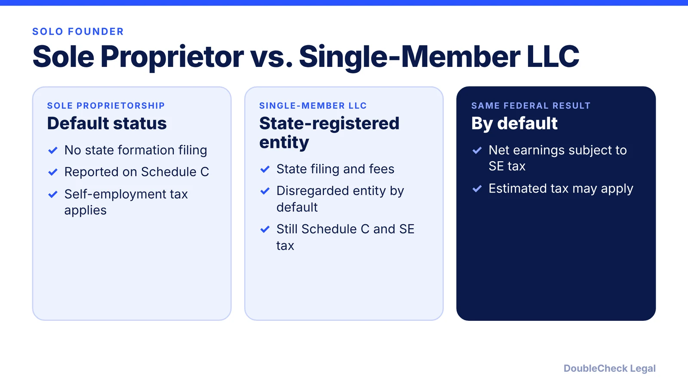
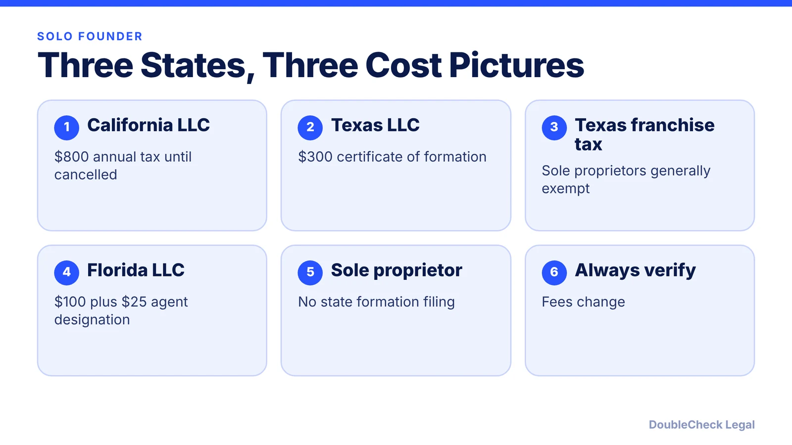
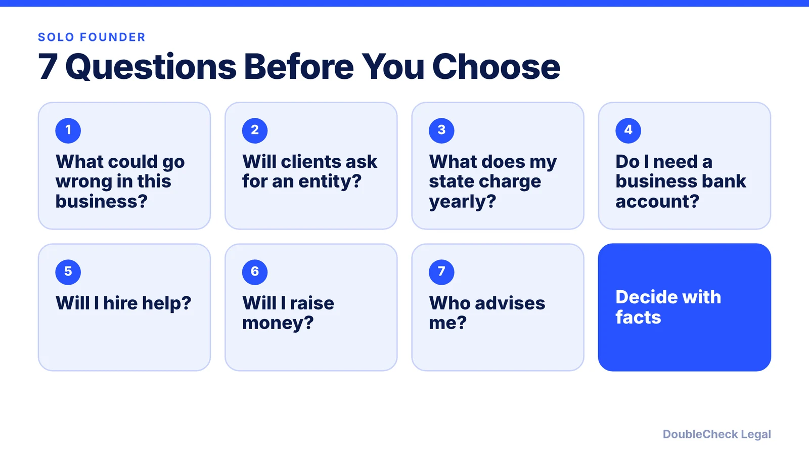

*Solo founder deciding between a sole proprietorship and an LLC? Here is what changes and what does not, with California, Texas, and Florida costs.*

**Key takeaways:**

- By default, a single-member LLC is taxed like a sole proprietorship: Schedule C and self-employment tax.
- The LLC adds a liability separation but also state filings and fees.
- California charges LLCs an $800 annual tax; Texas charges $300 to form; Florida $100 plus $25.
- Texas franchise tax generally does not apply to sole proprietorships, with a single-member LLC exception.

## 1. The quick answer

**Quick answer:** A sole proprietorship is the default if you work for yourself and file nothing with the state; an LLC is a state-registered entity that creates a legal separation between you and the business. For federal tax, a single-member LLC is by default treated as a "disregarded entity," so you still report on Schedule C and still pay self-employment tax, per the IRS. The decision is mostly about liability, state costs, and how you want to look to clients and banks, not about a lower federal tax bill.

## 2. What the IRS says

The IRS says a single-member LLC is a disregarded entity unless it files Form 8832 to elect otherwise, separate from its owner for liability purposes but not for federal tax. An individual owner reports activity on Schedule C (or Schedule E or F depending on the business), and net earnings are subject to self-employment tax, as with a sole proprietorship. Read more in [single-member LLC taxes](/blog/single-member-llc-taxes-disregarded-entity/) and [self-employment tax](/blog/self-employment-tax-solo-business-owner-2026/).

## 3. State costs: California, Texas, Florida

State rules are where the choice gets real.

- **California:** every LLC doing business in California or organized there owes the $800 annual tax until it cancels, per the Franchise Tax Board ([details](/blog/california-llc-annual-tax-and-fee/)).
- **Texas:** a certificate of formation is $300 ([details](/blog/texas-certificate-of-formation-fees-forms/)). On franchise tax, a CPA Practice Advisor summary says sole proprietorships are generally exempt (with an exception for single-member LLCs); see [Texas franchise tax](/blog/texas-franchise-tax-llc-corporation/).
- **Florida:** Articles of Organization are $100 and registered agent designation is $25, per the Division of Corporations.

## 4. Seven questions to settle it

If you may raise outside money later, read [LLC vs. C corp for startups](/blog/llc-vs-c-corp-startups/). If you use AI to draft your own operating agreement, see [LLC operating agreement with AI](/blog/llc-operating-agreement-with-ai/) and verify it.

## Where DoubleCheck fits

[DoubleCheck](https://www.contactdoublecheck.com) is built for businesses that start legal work with AI. Bring your question or draft, use an AI-first workflow to understand and verify it, and when professional advice is warranted, you can connect with an independent attorney. Attorneys on DoubleCheck are independent professionals; an attorney-client relationship forms only if an attorney accepts your engagement.

**Sources:** [IRS: Limited liability company](https://www.irs.gov/node/7774); [FTB](https://www.ftb.ca.gov/file/business/types/limited-liability-company); [Texas SOS fee schedule](https://direct.sos.state.tx.us/help/help-corp.asp?pg=fee); [CPA Practice Advisor](https://www.cpapracticeadvisor.com/2025/04/02/what-to-know-about-texas-franchise-tax/158228/); [Florida Division of Corporations](https://dos.fl.gov/sunbiz/start-business/efile/fl-llc/instructions/).

## FAQ

**Is an LLC taxed differently from a sole proprietorship?**

By default, no. The IRS treats a single-member LLC as a disregarded entity, reported on Schedule C with self-employment tax, unless it elects otherwise on Form 8832.

**Do I need an LLC to be a freelancer?**

No. A sole proprietorship needs no state formation filing. Whether to form an LLC depends on liability, state costs, and client expectations.

**How much does an LLC cost in California?**

FTB says every LLC owes an $800 annual tax until it cancels, plus an LLC fee above certain income levels.

**How much does an LLC cost in Florida?**

The Division of Corporations lists $100 for Articles of Organization and $25 for registered agent designation.

---

*General information only. This article is not legal, tax, investment, or accounting advice.*
