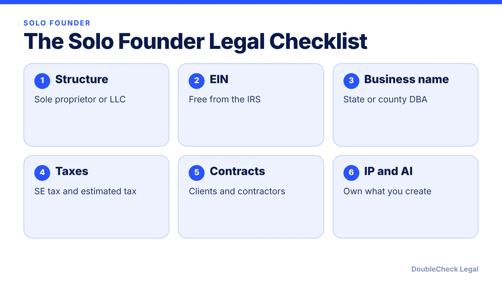
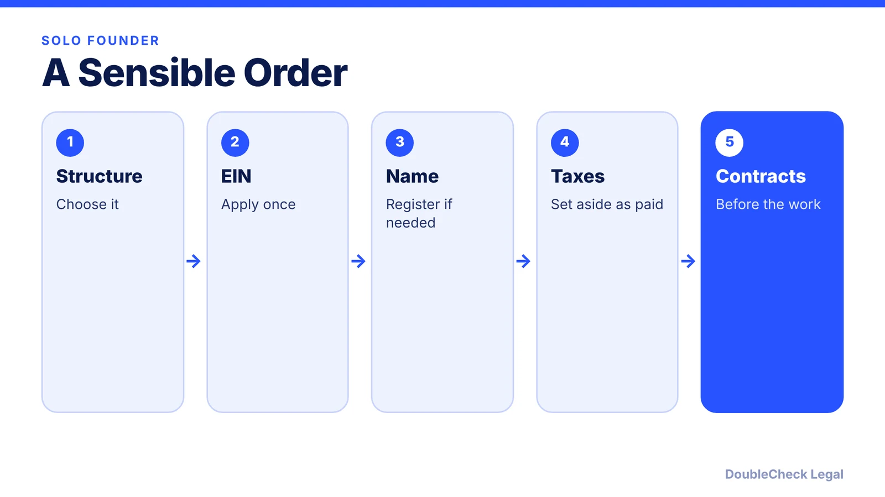
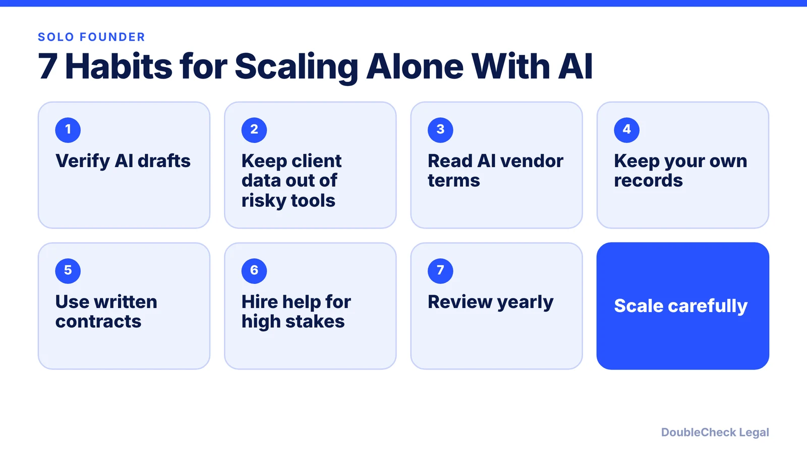

*Scaling a one-person business with AI? Here is the legal setup checklist, with links to the verified guides for each step.*

**Key takeaways:**

- Pick a structure: sole proprietorship or LLC, and know your state's costs.
- Get a free EIN from the IRS and register a DBA if you use a business name.
- Plan for self-employment tax and quarterly estimated taxes.
- Use written contracts and verify anything AI drafts, including who owns AI output.

## 1. The quick answer

**Quick answer:** A one-person business using AI to scale still has the same legal basics as any business: pick a structure, get an EIN, register a business name if you use one, handle taxes, paper your contracts, and protect what you create. AI can help you understand and draft each step, but verify the results. This checklist links to our verified guides for each item.

## 2. Structure and ID

Start with [sole proprietor vs. LLC](/blog/sole-proprietor-vs-llc-solo-founder/) and [single-member LLC taxes](/blog/single-member-llc-taxes-disregarded-entity/). Then [get your EIN for free](/blog/how-to-get-an-ein-for-your-business-free/): the IRS says you never have to pay a fee, and for an LLC you should form it with your state first.

## 3. Your business name

If you operate under a name other than your legal name, you may need a DBA: see [California](/blog/california-fictitious-business-name-dba/), [Texas](/blog/texas-assumed-name-dba-sole-proprietor/), and [Florida](/blog/florida-fictitious-name-registration-dba/). Check conflicts first with [trademark and business name checks](/blog/trademark-business-name-check/).

## 4. Taxes

Plan for [self-employment tax](/blog/self-employment-tax-solo-business-owner-2026/) (15.3%) and [quarterly estimated taxes](/blog/quarterly-estimated-taxes-solo-business-owner/). If you pay freelancers, see the [1099-NEC threshold for 2026](/blog/1099-nec-2000-threshold-hiring-freelancers/).

## 5. Contracts and AI

Use written contracts: [freelance contracts](/blog/how-to-write-a-freelance-contract/), [NDAs](/blog/how-to-write-an-nda-startups/), and [contract red flags](/blog/contract-red-flags-small-business/). If AI drafted them, [verify them](/blog/verify-ai-generated-legal-document/). Know the limits of AI output ownership: [can you copyright AI-generated content](/blog/ai-generated-content-copyright-solo-business/).

See [AI vendor contract checklist](/blog/ai-vendor-contract-checklist/), [when to hire a lawyer](/blog/when-to-hire-lawyer-small-business/), and [using AI for legal work safely](/blog/small-business-ai-legal-work-safely/).

## Where DoubleCheck fits

[DoubleCheck](https://www.contactdoublecheck.com) is built for businesses that start legal work with AI. Bring your question or draft, use an AI-first workflow to understand and verify it, and when professional advice is warranted, you can connect with an independent attorney. Attorneys on DoubleCheck are independent professionals; an attorney-client relationship forms only if an attorney accepts your engagement.

**Sources:** [IRS: Apply for an EIN online](https://www.irs.gov/businesses/small-businesses-self-employed/apply-for-an-employer-identification-number-ein-online); [IRS: Estimated taxes](https://www.irs.gov/businesses/small-businesses-self-employed/estimated-taxes); [IRS: Self-employment tax](https://www.irs.gov/businesses/small-businesses-self-employed/self-employment-tax-social-security-and-medicare-taxes); [Copyright Alliance](https://copyrightalliance.org/ai-report-part-2-copyrightability/).

## FAQ

**What legal steps does a solo founder need?**

Choose a structure, get an EIN, register a business name if needed, handle taxes, use written contracts, and protect your IP.

**Do I need an LLC as a solo founder?**

Not necessarily. A single-member LLC is taxed like a sole proprietorship by default; the choice is about liability, state costs, and client expectations.

**Can AI handle my legal setup?**

AI can help you understand and draft, but verify results and consider professional review for high-stakes items.

**Who owns what AI creates for my business?**

The Copyright Office says AI-only output cannot be registered; human selection, arrangement, and modification can be protected.

---

*General information only. This article is not legal, tax, investment, or accounting advice.*
