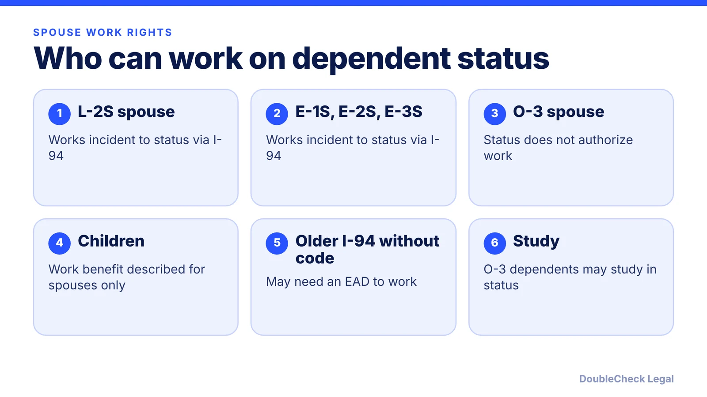
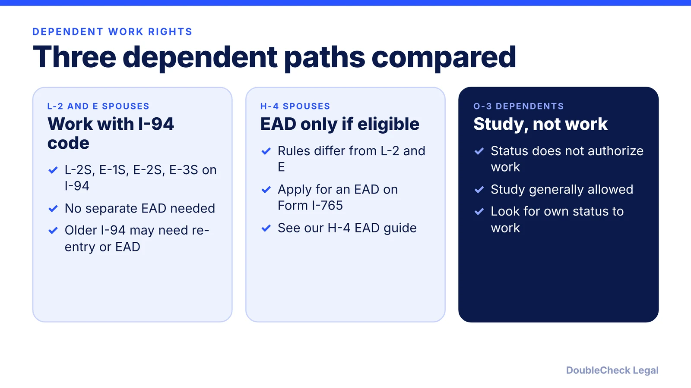

*Can your spouse work on an L-2, E-visa or O-3 dependent status? Here is who needs an EAD, who does not, and who cannot work at all.*

**Key takeaways:**

- L-2 and E-1/E-2/E-3 spouses are work authorized incident to status with an S-coded I-94, per Mintz.
- An I-94 without the spousal designation is not enough for Form I-9; an EAD is needed.
- O-3 status does not authorize employment, per Messersmith Law; dependents may study.
- Children are not described as work authorized on dependent status.

## 1. The quick answer

**Quick answer:** Spouses of L-1 and E-1, E-2 and E-3 workers are employment authorized incident to status when their I-94 carries a spousal designation (L-2S, E-1S, E-2S or E-3S), so they can work without a separate EAD. O-3 dependents of O-1 and O-2 workers cannot work on O-3 status, per Messersmith Law, though they may study. Mintz describes no work authorization for children.

## 2. L-2 and E spouses: work without an EAD

Per Mintz, starting January 31, 2022, CBP began issuing I-94 forms with new designations for dependents. The spousal ones are L-2S, E-1S, E-2S and E-3S, and they serve as evidence of employment authorization incident to status. The change followed a November 10, 2021 settlement of a class action brought by H-4 and L-2 spouses over EAD processing delays.

Key points from the Mintz summary:

- Spouses who entered on or after January 31, 2022 with the S designation can work without a separate EAD.
- Spouses who entered earlier and are still in the U.S. had to travel abroad and re-enter to receive a new I-94 with the designation.
- An I-94 without the spousal designation is not sufficient for Form I-9, so a valid EAD is needed to keep working.
- Children carry Y designations (such as L-2Y or E-2Y). Mintz does not describe work authorization for them.

Ogletree adds that spouses holding an EAD under categories (a)(17) (E) or (a)(18) (L) lost the automatic extension for renewals filed on or after October 30, 2025, but may keep working without an EAD if their I-94 shows E-1S, E-2S, E-3S or L-2S. See our [EAD validity guide](/blog/i-765-ead-validity-and-auto-extension-rules/). To learn about the principal's status, see [L-1A for foreign founders](/blog/l-1a-visa-new-office-foreign-founders/), [E-2 for founders](/blog/e-2-treaty-investor-visa-for-founders/) and [E-3 for Australians](/blog/e-3-visa-australians/).

## 3. O-3 dependents: study yes, work no

O-3 status covers the spouse and unmarried children under 21 of O-1 or O-2 workers. Messersmith Law states that O-3 status "does not authorize employment," including freelance paid activity, and that O-3 dependents generally may study while in status. Its page does not describe an EAD available to O-3 dependents. It suggests families evaluate whether the spouse independently qualifies for an employment-authorized classification.

Dependents can join the principal later, and Form I-539 may be used for extensions or changes, coordinated with the principal's petition, per the same page. Child eligibility is generally limited to unmarried children under 21, so plan an independent status before the age limit.

What to avoid: do not assume that unpaid or informal work is safe, and do not start a role before checking. For a founder's spouse, a common alternative is to check whether the spouse can qualify on their own. See [US visa options for founders](/blog/us-visa-options-for-startup-founders-compared/), the [O-1A evidence guide](/blog/o-1a-visa-for-startup-founders-evidence/) and [O-1 costs](/blog/o-1-visa-cost-filing-and-attorney-fees/).

## 4. Practical checks before the spouse starts a job

A short checklist before accepting an offer:

1. **Read the I-94.** Look for the S designation. If it is missing, the Mintz summary says an EAD is needed for the I-9.
2. **Confirm the principal's status is valid.** Dependent status depends on the principal's status and validity dates.
3. **Check the category if holding an EAD.** Per Ogletree, E and L spouse EAD renewals filed on or after October 30, 2025 get no automatic extension.
4. **Compare to H-4.** The H-4 route has different eligibility; see [H-4 EAD for spouses of H-1B workers](/blog/h-4-ead-spouses-of-h-1b/).
5. **Plan for a green card.** If the family is heading to permanent residence, the [I-485 guide](/blog/i-485-adjustment-of-status-guide/) and the [advance parole and EAD guide](/blog/advance-parole-and-ead-while-i-485-pending/) explain the next work permit.

If the situation is unusual, such as a prior unauthorized job, a lapsed I-94, or an O-3 spouse who wants to start a business, talk to [an immigration lawyer](/blog/how-to-find-good-immigration-lawyer-startup-founder/) before acting.

## Where DoubleCheck fits

[DoubleCheck](https://www.contactdoublecheck.com) helps businesses and founders start legal work with AI, verify it, and, when professional advice is warranted, connect with an independent attorney, including for immigration questions. Attorney availability and practice areas vary. Attorneys on DoubleCheck are independent professionals; an attorney-client relationship forms only if an attorney accepts your engagement.

**Sources:** [Mintz on L-2 and E I-94 designations](https://www.mintz.com/insights-center/viewpoints/2806/2022-02-17-cbp-begins-issuing-new-i-94-designations-l-2-and-e); [Ogletree](https://ogletree.com/insights-resources/blog-posts/uscis-ends-automatic-extension-of-employment-authorization-with-interim-final-rule/); [Messersmith Law on O-3](https://messersmithlaw.com/o3-visa/).

## FAQ

**Can an L-2 spouse work in the US without an EAD?**

Yes, if their I-94 carries the L-2S designation. Mintz reports these designations serve as evidence of employment authorization incident to status for entries from January 31, 2022.

**Can an E-2 or E-3 spouse work?**

Yes, with an E-2S or E-3S I-94 (E-1S for E-1), per Mintz. Spouses who entered earlier had to re-enter to receive the designation or use an EAD.

**Can an O-3 spouse work?**

No. Messersmith Law states O-3 status does not authorize employment, including freelance paid work. O-3 dependents generally may study, and the spouse should check whether they qualify for their own work-authorized status.

**Can L-2 or E children work?**

Mintz describes the Y designations for children but no work authorization for them, and the work benefit appears to apply to spouses. Confirm with USCIS or counsel before a child takes a job.

---

*General information only. This article is not legal, tax, investment, or accounting advice.*
