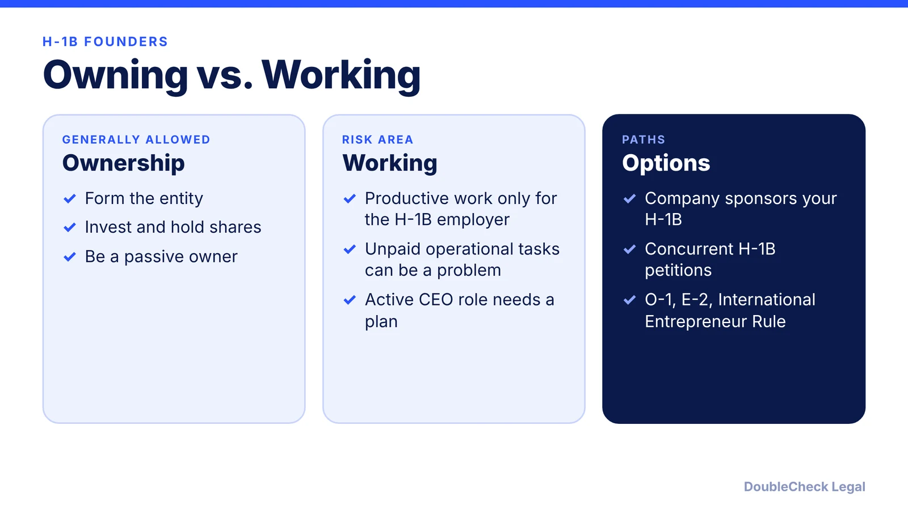
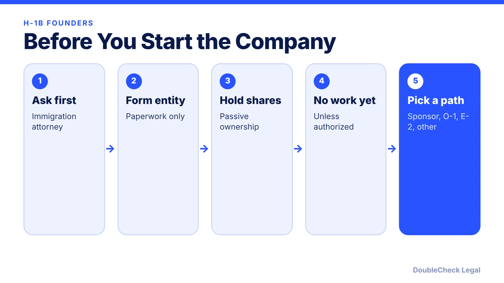

*Can you start a company while on an H-1B? Owning is usually fine; working is the risk. Here is the line and the alternatives founders use.*

**Key takeaways:**

- Per Ellis, an H-1B holder can form and own a company and be a passive owner.
- Productive work, even unpaid, may be limited to the employer named in the H-1B petition.
- To be an active CEO, the company generally must sponsor the H-1B and others must have control over you.
- Alternatives include O-1, E-2, and the International Entrepreneur Rule.

## 1. The quick answer

**Quick answer:** Generally yes, you can form and own a company while on H-1B status. The risk is working for it. According to Ellis, an H-1B holder can form and own a company, invest, and be a passive owner, but may perform productive work only for the employer named in the H-1B petition. Even unpaid operational tasks can create a status problem. Talk to an immigration attorney before you do anything beyond filing paperwork.

## 2. Passive ownership vs. active work

Ellis describes the line this way: forming the company and owning shares is one thing; running it day to day is another. To be an active CEO, the company would generally need to sponsor your H-1B, and independent board members or investors would need real control over you, such as the right to fire you. Concurrent part-time H-1B petitions are also possible, per the same source. Rules are fact-specific, so confirm with counsel.

## 3. Alternatives founders use

Ellis lists alternatives such as O-1, the International Entrepreneur Rule, and E-2. See [O-1A for founders](/blog/o-1a-visa-for-startup-founders-evidence/), [EB-1A vs. O-1](/blog/eb-1a-vs-o-1-founder-which-path/), and the [national interest waiver](/blog/niw-eb-2-national-interest-waiver-founders/). H-1B costs and timing are also changing: see [the $100,000 H-1B fee status](/blog/h1b-100000-fee-status-2026/).

## 4. Forming the company

The entity steps are the same as for any founder: [how to incorporate a company in the U.S.](/blog/how-to-incorporate-a-company-in-the-us/) and [LLC vs. C corp](/blog/llc-vs-c-corp-startups/). Choose an immigration lawyer first ([how to find one](/blog/how-to-find-good-immigration-lawyer-startup-founder/)), and use [AI to check your paperwork](/blog/check-immigration-documents-with-ai-before-filing/) before you file anything.

## Where DoubleCheck fits

[DoubleCheck](https://www.contactdoublecheck.com) helps businesses and founders start legal work with AI, verify it, and, when professional advice is warranted, connect with an independent attorney, including for immigration questions. Attorney availability and practice areas vary. Attorneys on DoubleCheck are independent professionals; an attorney-client relationship forms only if an attorney accepts your engagement.

**Sources:** [Ellis](https://www.ellis.com/resources/can-h1b-start-a-business).

## FAQ

**Can I be CEO of my own company on an H-1B?**

Per Ellis, only in limited structures, such as when your company sponsors the H-1B and independent board members or investors have the right to control you. Get legal advice first.

**Can I own shares of a startup while on H-1B?**

Per Ellis, owning and investing is generally allowed, but doing productive work for the company may not be.

**Does unpaid work count?**

Per Ellis, operational tasks, even unpaid, can violate status. Ask an attorney.

**What visa should a founder use instead?**

Founders often look at O-1A, EB-1A, E-2, or the International Entrepreneur Rule. The right one depends on your facts.

---

*General information only. This article is not legal, tax, investment, or accounting advice.*
