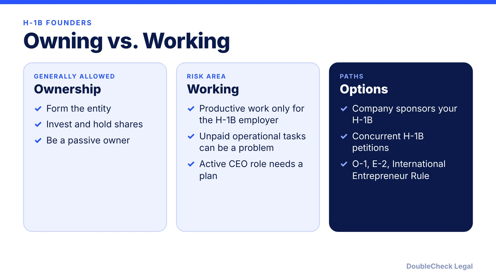
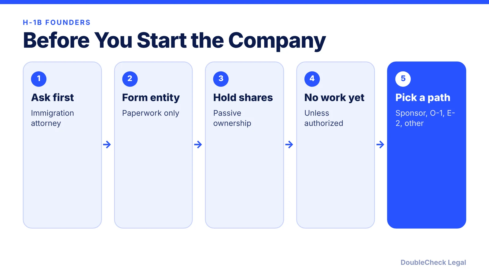

*Can you start a company while on an H-1B? Owning is usually fine; working is the risk. Here is the line and the alternatives founders use.*

**Key takeaways:**

- An H-1B holder can generally form and own a company and be a passive owner, but confirm with counsel.
- Productive work, even unpaid, may be limited to the employer or employers named in H-1B petitions.
- To be an active CEO, the company would generally need to sponsor the H-1B and others would need real control over your employment.
- Alternatives include O-1, E-2, and the International Entrepreneur Rule.

## 1. The quick answer

**Quick answer:** Generally yes, you can form and own a company while on H-1B status. The risk is working for it. An H-1B holder can generally form and own a company, invest, and be a passive owner, but may perform productive work only for the employer or employers that have filed H-1B petitions for them. Even unpaid operational tasks can create a status problem. Talk to an immigration attorney before you do anything beyond filing paperwork.

## 2. Passive ownership vs. active work

Forming the company and owning shares is one thing; running it day to day is another. To be an active CEO, the company would generally need to sponsor your H-1B, and USCIS guidance on the employer-employee relationship has stressed that the employer must have the right to control the worker, so you would need someone else with real control over your employment. Concurrent part-time H-1B petitions with more than one employer are also possible, according to [Nolo](https://www.nolo.com/legal-encyclopedia/part-time-work-multiple-employers-h-1b-workers.html). Rules are fact-specific, so confirm with counsel.

## 3. Alternatives founders use

Founders often look at alternatives such as O-1, the International Entrepreneur Rule, and E-2. See [O-1A for founders](/blog/o-1a-visa-for-startup-founders-evidence/), [EB-1A vs. O-1](/blog/eb-1a-vs-o-1-founder-which-path/), and the [national interest waiver](/blog/niw-eb-2-national-interest-waiver-founders/). H-1B costs and timing are also changing: see [the $100,000 H-1B fee status](/blog/h1b-100000-fee-status-2026/).

## 4. Forming the company

The entity steps are the same as for any founder: [how to incorporate a company in the U.S.](/blog/how-to-incorporate-a-company-in-the-us/) and [LLC vs. C corp](/blog/llc-vs-c-corp-startups/). Choose an immigration lawyer first ([how to find one](/blog/how-to-find-good-immigration-lawyer-startup-founder/)), and use [AI to check your paperwork](/blog/check-immigration-documents-with-ai-before-filing/) before you file anything.

## Where DoubleCheck fits

[DoubleCheck](https://www.contactdoublecheck.com) helps businesses and founders start legal work with AI, verify it, and, when professional advice is warranted, connect with an independent attorney, including for immigration questions. Attorney availability and practice areas vary. Attorneys on DoubleCheck are independent professionals; an attorney-client relationship forms only if an attorney accepts your engagement.

**Sources:** [Nolo, part-time and concurrent H-1B employment](https://www.nolo.com/legal-encyclopedia/part-time-work-multiple-employers-h-1b-workers.html); [USCIS, executive summary of the H-1B employer-employee memo (2010)](https://www.uscis.gov/USCIS/Outreach/Public%20Engagement/National%20Event%20Pages/2010%20Events/February%202010/ExecSumm%20H-1B%20Employer-Employee%20Memo%20FINAL.pdf); [Fisher Phillips, International Entrepreneur Rule (2022)](https://www.fisherphillips.com/en/news-insights/international-entrepreneurs-us-entry-work-authorization.html).

## FAQ

**Can I be CEO of my own company on an H-1B?**

Only in limited structures, if at all. USCIS has focused on whether someone other than you has the right to control your employment, so get legal advice first.

**Can I own shares of a startup while on H-1B?**

Owning and investing is generally treated differently from working, and doing productive work for a company that is not your H-1B employer may not be allowed. Confirm with an attorney.

**Does unpaid work count?**

It can. Operational tasks, even unpaid, may raise a status problem. Ask an attorney.

**What visa should a founder use instead?**

Founders often look at O-1A, EB-1A, E-2, or the International Entrepreneur Rule. The right one depends on your facts.

---

*General information only. This article is not legal, tax, investment, or accounting advice.*
