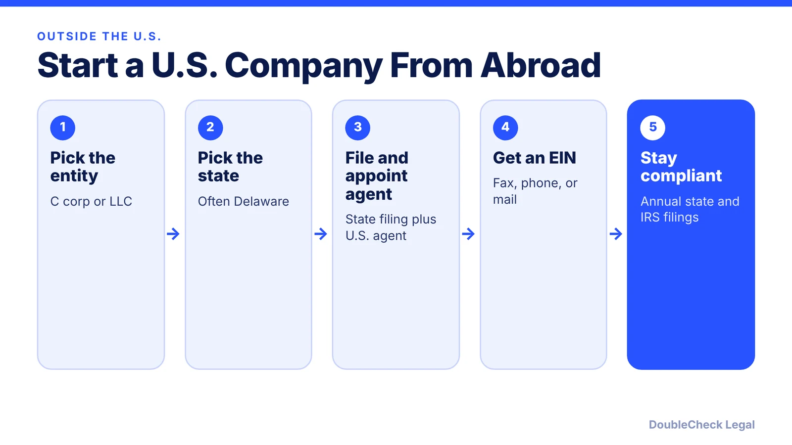
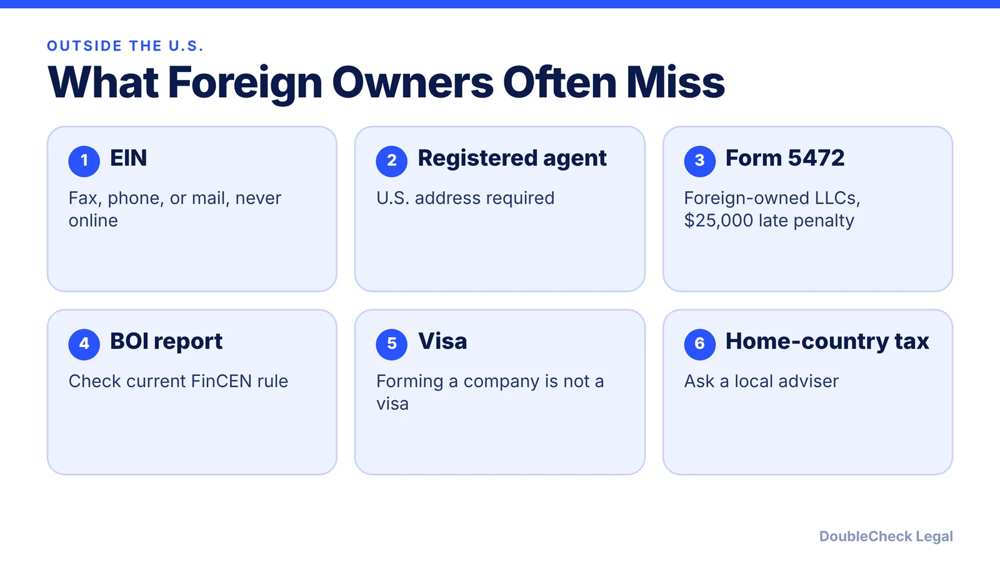

*Living outside the U.S. and want a U.S. company? Here is the process, the extra filings for foreign owners, and what incorporation does not do.*

**Key takeaways:**

- You can form a U.S. company without living in the U.S.; you need a state filing, a registered agent, and an EIN.
- Foreign applicants get the EIN by fax, phone, or mail, not online, per the IRS.
- A wholly foreign-owned single-member LLC generally must file Form 5472; late filing can cost $25,000.
- Forming a company does not give you a visa or work authorization.

## 1. The quick answer

**Quick answer:** You do not need to live in the U.S. to form a U.S. company. A non-U.S. resident can form a corporation or LLC in a state such as Delaware, appoint a registered agent, and get an EIN through the IRS by fax, phone, or mail. What forming a company does not do is give you a visa or the right to work in the U.S., and a foreign-owned company has extra filings.

## 2. Choose the entity and the state

Venture-backed startups usually use a Delaware C corporation, while smaller operating businesses often use an LLC. The tradeoffs are covered in [LLC vs. C corp for startups](/blog/llc-vs-c-corp-startups/) and the full process in [how to incorporate in Delaware step by step](/blog/how-to-incorporate-in-delaware-step-by-step/). Every state requires a registered agent with a U.S. address, which is why founders abroad use a commercial agent ([registered agent requirements](/blog/delaware-registered-agent-requirements/)).

If you will actually operate in a state, such as California, the company may also have to register there. See [Delaware corporation doing business in California](/blog/delaware-corporation-doing-business-in-california/).

## 3. Get the EIN without a U.S. presence

Per the IRS instructions for Form SS-4, the online EIN application is not available to applicants with no U.S. presence. Foreign applicants can apply by fax, phone, or mail instead. Read the details in [how to get an EIN without an SSN](/blog/get-ein-without-ssn-foreign-founder/). Never pay a stranger who "guarantees" an EIN, because the IRS number itself is free.

## 4. Filings that catch foreign owners

- **Form 5472:** Loeb & Loeb reports that a single-member U.S. LLC wholly owned by a foreign person generally must file Form 5472 with a pro forma Form 1120 for years with reportable transactions with its owner, and that the penalty for a late or substantially incomplete filing is $25,000.
- **Beneficial ownership (BOI):** the rule changed in 2025 and 2026, so check [the current FinCEN BOI status](/blog/beneficial-ownership-report-boi-2026/) before assuming you must or need not file.
- **Your home country:** you may owe tax or reporting at home on a company you own abroad. Ask a tax professional in your country.

## 5. The visa question

Owning a U.S. company does not by itself let you live or work here. Founders usually look at options such as [O-1A](/blog/o-1a-visa-for-startup-founders-evidence/), [EB-1A](/blog/eb-1a-vs-o-1-founder-which-path/), or the [national interest waiver](/blog/niw-eb-2-national-interest-waiver-founders/) with an immigration lawyer ([how to find one](/blog/how-to-find-good-immigration-lawyer-startup-founder/)). If you already hold H-1B status, read [can you start a company on an H-1B](/blog/start-company-on-h1b-visa-ownership-vs-work/).

## Where DoubleCheck fits

[DoubleCheck](https://www.contactdoublecheck.com) helps businesses and founders start legal work with AI, verify it, and, when professional advice is warranted, connect with an independent attorney, including for immigration questions. Attorney availability and practice areas vary. Attorneys on DoubleCheck are independent professionals; an attorney-client relationship forms only if an attorney accepts your engagement.

**Sources:** [IRS Form SS-4 instructions](https://www.irs.gov/instructions/iss4); [Loeb & Loeb](https://www.loeb.com/en/insights/publications/2021/03/obligations-to-file-form-5472-for-foreign-owned-disregarded-entities).

## FAQ

**Can a foreigner own 100% of a U.S. company?**

Yes. Federal law does not generally require U.S. residency to own a U.S. LLC or corporation, but tax, reporting, and industry rules still apply. Confirm your situation with a U.S. tax professional.

**Which state is best for a foreign founder?**

Many founders choose Delaware, especially for venture funding, but you may also need to register in the state where you operate. See the linked Delaware and California guides.

**Do I need a U.S. address?**

You need a U.S. registered agent address for the state filing. A commercial registered agent usually provides it.

**Does forming a U.S. company get me a visa?**

No. Incorporation and immigration status are separate. Talk to an immigration attorney about options such as O-1A, EB-1A, or a national interest waiver.

---

*General information only. This article is not legal, tax, investment, or accounting advice.*
