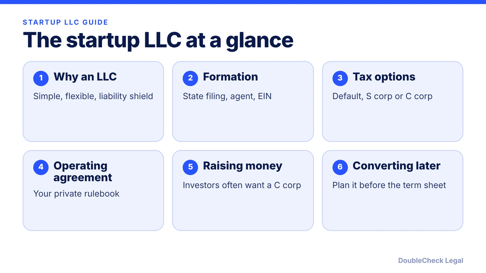
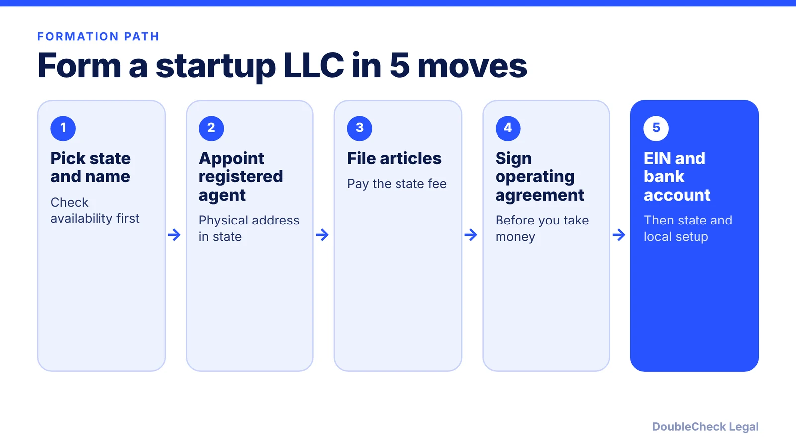

*A start-to-finish guide to the startup LLC: form it, choose a tax status, write the operating agreement, raise money and convert to a C corp when the time comes.*

**Key takeaways:**

- An LLC is a state-law entity; federally a one-owner LLC is disregarded and a multi-owner LLC is a partnership unless it elects otherwise (IRS, August 2026).
- Form with a state filing, registered agent, EIN, operating agreement and a business bank account.
- S corp status has strict ownership limits; venture investors and QSBS are tied to C corporations.
- Plan conversion before a term sheet and check your operating agreement for the vote it needs.

## 1. The quick answer

**Quick answer:** A startup LLC is a state-law company that separates you from the business and is simple to form. By default a one-owner LLC is taxed as a "disregarded entity" and a multi-owner LLC as a partnership, per the IRS (page last reviewed August 22, 2026). You form it by filing with your state, getting an EIN and signing an operating agreement. The catch for venture-style startups: preferred stock and the QSBS tax break are tied to C corporations, so many founders convert later. As of November 2026, domestic US companies no longer file federal beneficial ownership (BOI) reports, per a Troutman Pepper Locke summary of FinCEN's August 11, 2026 final rule.

This guide covers why founders pick an LLC, formation, tax options, the operating agreement, and raising money and converting. Already formed? Jump to the [first 30 days checklist](/blog/startup-llc-first-30-days-checklist-after-you-form/).

## 2. Why founders pick an LLC (and where it stops working)

Founders pick an LLC because it is quick to set up, has fewer formalities than a corporation and can protect personal assets from business debts. Inc Authority (May 13, 2026) describes it as a structure under state law that legally separates you from the business.

**Where the protection has limits,** per Inc Authority:

- **Personal guarantees:** if you guarantee a loan, the lender can pursue you.
- **Veil piercing:** courts may disregard the LLC if you mix personal and business money, skip required filings or use it for fraud. See [LLC bank account and commingling habits](/blog/llc-startup-bank-account-commingling-liability-protection-habits/).
- **Licensed professions:** many need a PLLC; see [PLLC vs LLC](/blog/pllc-vs-llc-doctors-lawyers-accountants/).

**Rule of thumb:** an LLC fits a bootstrapped company or one funded from revenue. If you expect a priced venture round, many employee options or QSBS, read section 6 before you pick. Compare options in [sole proprietor vs LLC](/blog/sole-proprietor-vs-llc-solo-founder/) and [LLC vs C corp for startups](/blog/llc-vs-c-corp-startups/).

## 3. How to form a startup LLC, step by step

Fees and rules differ by state, so use your Secretary of State page for current numbers. The common sequence, per Inc Authority (May 13, 2026):

1. **Check the name.** It must include "LLC" or "Limited Liability Company" and be distinguishable from names on file.
2. **Name a registered agent** with a physical address in the state. You can act as your own agent, but your address becomes public.
3. **File the articles of organization** (also called a certificate of formation or organization) and pay the fee.
4. **Sign an operating agreement** (section 5).
5. **Get an EIN.** The IRS charges no fee; apply after the state accepts your filing.
6. **Open a business bank account** and keep money separate.
7. **Handle state taxes and licenses** for your industry and location.

**Which state?** Most founders form where they live and work; see [best state to form an LLC](/blog/best-state-to-form-an-llc-comparison/) and guides for [Texas](/blog/how-to-start-an-llc-in-texas/), [California](/blog/how-to-start-an-llc-in-california-step-by-step/) and [New York](/blog/how-to-start-an-llc-in-new-york/). Operating elsewhere may require [foreign qualification](/blog/foreign-qualification-register-llc-in-another-state/), and ongoing paperwork is in [annual report requirements](/blog/annual-report-requirements-by-state-llc/).

**BOI reports.** Per Troutman Pepper Locke's summary of the FinCEN rule (effective August 14, 2026), domestic companies no longer file; foreign entities registered in a US state still must, and some states have their own rules. The alert notes the statute could still change, so check FinCEN. Non-US owners should also read about [Form 5472](/blog/form-5472-foreign-owned-single-member-llc/).

## 4. Startup LLC tax treatment: your options

An LLC is a state-law label, not a federal tax category. Per the IRS (reviewed August 22, 2026), a one-member LLC is a disregarded entity, an LLC with more than one member is a partnership, and the LLC can elect a different classification with Form 8832.

- **Default, one owner:** income goes on the owner's return, and the owner pays self-employment tax like a sole proprietor, per the IRS. See [single-member LLC taxes](/blog/single-member-llc-taxes-disregarded-entity/) and [self-employment tax](/blog/self-employment-tax-solo-business-owner-2026/).
- **Default, several owners:** a partnership return, with each member taxed on their share. See [how to add a member](/blog/how-to-add-a-member-to-an-llc/).
- **S corporation election:** per the IRS S corporation page (reviewed June 11, 2026), income passes through to shareholders. Eligibility includes a domestic corporation, no more than 100 shareholders, one class of stock, and no partnership, corporation or nonresident alien shareholders. That makes it a poor fit for most venture rounds. See [Form 2553 deadline](/blog/s-corp-election-form-2553-deadline/) and [S corp vs C corp for venture-backed startups](/blog/s-corp-vs-c-corp-venture-backed-startup/).
- **C corporation (Form 8832 or conversion):** the company pays corporate income tax. Founders usually convert to a real corporation instead of electing (section 6).

**The 60-month rule.** After a classification change, the LLC generally cannot change again for 60 months; electing at formation does not count, per the IRS. The IRS also notes a change can have tax consequences because it is treated as deemed asset transactions.

Do not pick a tax status from a blog post. A CPA can model your numbers, and a short review now costs less than fixing it later.

## 5. The operating agreement: what a startup LLC needs

The operating agreement is the company's internal rulebook. Even a one-person LLC benefits from one because it documents that the LLC is separate from you. With several founders it is the most important document you will sign, since state default rules fill every gap. See [LLC operating agreement with AI](/blog/llc-operating-agreement-with-ai/) and the clause-by-clause [startup LLC operating agreement clauses](/blog/startup-llc-operating-agreement-clauses-investors-vesting-and-conversion/).

**Clauses to include from day one**

- **Members and capital:** who owns what and what each person contributed.
- **Management and voting:** who can sign contracts, which decisions need a majority or everyone, and a tie plan. See [co-founder agreement basics](/blog/co-founder-agreement-startups/).
- **Vesting and departure:** what happens to a founder's units if they leave early; see [vesting cliffs](/blog/cofounder-vesting-cliff-explained/).
- **Transfers and distributions:** limits on selling units, and when and how profits and tax distributions are paid.
- **IP and confidentiality:** the company, not individual founders, should own the product.
- **Conversion and sale:** what vote approves converting or selling. Terms.law (November 14, 2025) advises checking your agreement for the vote required to approve a conversion.
- **Exit:** buy-sell terms and dissolution; see [how to dissolve an LLC](/blog/how-to-dissolve-an-llc-step-by-step/).

A template can work for a single owner with no outside money. With two or more founders, investors or a conversion plan, have an attorney review it first; see [do I need a lawyer to start an LLC](/blog/do-i-need-a-lawyer-to-start-an-llc-diy-ai-or-attorney/).

## 6. Raising money with an LLC and converting to a C corp later

Venture investors typically buy preferred stock, which only corporations issue, and standard employee option plans are built for corporations, per Rho's 2026 conversion guide. QSBS under Section 1202 applies only to C corporation stock, and the holding period generally starts at conversion, not LLC formation, per Rho and The Startup Law Blog (October 9, 2025). See [QSBS explained](/blog/qsbs-section-1202-explained-startup-founders/) and the [QSBS checklist](/blog/qsbs-checklist-before-you-issue-stock-startups/).

**You can raise early money as an LLC.** SAFEs and convertible notes are common, but read them carefully first: [SAFE agreement for founders](/blog/safe-agreement-startup-founders/) and [convertible note vs SAFE](/blog/convertible-note-vs-safe/).

**Conversion methods** (per Rho, Terms.law and Harvard Business Services):

- **Statutory conversion:** in Delaware, usually the simplest route. The entity continues, so contracts and bank accounts stay with it. Delaware requires a certificate of conversion and a certificate of incorporation (Harvard Business Services, March 17, 2026).
- **Statutory merger:** form a new corporation and merge the LLC into it.
- **Section 351 exchange or assets-over:** members contribute LLC interests or assets for stock. Terms.law says this can be tax-free if transferors hold at least 80% afterward and receive only stock, and flags traps such as liabilities above basis.

**Check before you convert:** the vote your operating agreement requires, debts versus asset basis, and tax effects with a CPA. Rho says converting earlier, when the company is worth less, is generally better for QSBS; Terms.law advises converting before fundraising talks begin. See [convert LLC to C corp before fundraising](/blog/convert-llc-to-c-corp-before-fundraising/) and the [fundraising due diligence checklist](/blog/due-diligence-checklist-for-startup-fundraising/).

Delaware fee and franchise tax figures differ across sources, so confirm them with the Division of Corporations; see [Delaware franchise tax](/blog/delaware-franchise-tax-startups/) and [how to incorporate in the US](/blog/how-to-incorporate-a-company-in-the-us/). Bring in an attorney when you have two or more founders, outside investors, debt, valuable assets in the LLC or non-US owners.

## Where DoubleCheck fits

[DoubleCheck](https://www.contactdoublecheck.com) helps businesses and founders start legal work with AI, verify it, and, when professional advice is warranted, connect with an independent attorney, including for immigration questions. Attorney availability and practice areas vary. Attorneys on DoubleCheck are independent professionals; an attorney-client relationship forms only if an attorney accepts your engagement.

**Sources:** [IRS, Limited liability company: possible repercussions (reviewed Aug. 22, 2026)](https://www.irs.gov/node/7774); [IRS, S corporations (reviewed June 11, 2026)](https://www.irs.gov/businesses/small-businesses-self-employed/s-corporations); [Rho, How to Convert an LLC to a C Corp in 2026](https://www.rho.co/blog/convert-llc-to-c-corp); [The Startup Law Blog, Only C corps can issue QSBS (Oct. 9, 2025)](https://thestartuplawblog.com/only-c-corps-can-issue-qsbs-1202-tax-break/); [Terms.law, LLC to C-Corp Conversion Guide (Nov. 14, 2025)](https://terms.law/2025/11/14/llc-to-c-corp-conversion-guide/); [Harvard Business Services, How to Convert Your LLC to a Corporation (Mar. 17, 2026)](https://www.delawareinc.com/blog/how-to-convert-your-llc-to-a-corporation/); [Inc Authority, What Is an LLC (May 13, 2026)](https://www.incauthority.com/blog/how-to-start-an-llc-the-complete-2026-guide); [Troutman Pepper Locke, FinCEN ends BOI reporting for US companies](https://www.troutman.com/insights/relief-is-real-but-not-universal-fincen-permanently-ends-boi-reporting-for-us-companies/).

## FAQ

**Is an LLC a good choice for a startup?**

It can be, especially for a bootstrapped company or one funded from revenue. If you expect a priced venture round, many employee stock options or QSBS, plan for a C corporation, since Rho (2026) and The Startup Law Blog (October 2025) tie preferred stock and QSBS to corporations.

**How is a startup LLC taxed?**

By default a one-member LLC is a disregarded entity and an LLC with more than one member is a partnership, per the IRS (August 2026). The LLC can elect different treatment with Form 8832, and an S corporation election has ownership limits, per the IRS.

**Do I need an operating agreement for a startup LLC?**

Inc Authority (May 2026) recommends one for every LLC and notes some states require it. With two or more founders or any outside money, have an attorney review it before anyone invests.

**Can an LLC be converted to a C corp later?**

Yes. Common methods are a statutory conversion, a statutory merger or a Section 351 exchange, per Rho and Terms.law. Check the operating agreement vote required, the tax effects and QSBS timing with a CPA and attorney.

**Do LLCs still have to file BOI reports in 2026?**

As of November 2026, domestic US companies do not, per Troutman Pepper Locke summarizing FinCEN final rule of August 11, 2026. Foreign entities registered in a US state still may, and some states have their own rules.

---

*General information only. This article is not legal, tax, investment, or accounting advice.*
