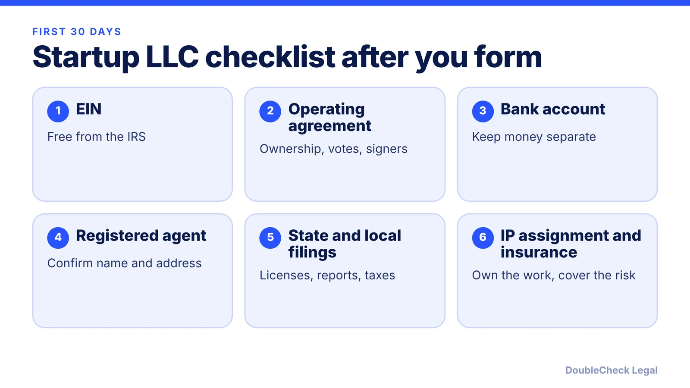
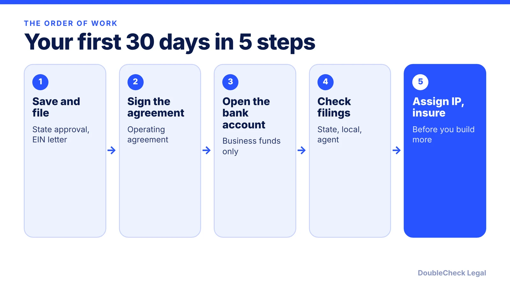

*Formation is day one. This checklist covers the next 30 days, what changed on BOI reporting as of November 2026, and when to bring in an attorney.*

**Key takeaways:**

- Get an EIN (free from the IRS), sign an operating agreement and open a business bank account first.
- Confirm your registered agent and check state and local filings; fees and deadlines vary by state.
- As of November 2026, FinCEN has exempted US-formed companies from BOI reporting; foreign-formed entities registered in the US still report.
- Assign IP to the LLC in writing and decide on insurance before you build further.

## 1. The quick answer

**Quick answer:** In the first 30 days after you form a startup LLC, save your state approval documents, get an EIN, sign an operating agreement, open a business bank account, confirm your registered agent, check state and local filings and licenses, assign your IP to the company, and decide on insurance. The 30-day window is a practical order of work, not a legal deadline; your state sets its own dates. As of November 2026, domestic US-formed LLCs do not have to file federal beneficial ownership (BOI) reports, per FinCEN's August 2026 final rule as summarized by law firms.

Use this as a working checklist. It assumes the LLC is already formed; if you are still choosing a state or deciding whether to use a lawyer, start with [how to incorporate a company in the US](/blog/how-to-incorporate-a-company-in-the-us/) and [do I need a lawyer to start an LLC](/blog/do-i-need-a-lawyer-to-start-an-llc-diy-ai-or-attorney/).

## 2. Days 1 to 10: EIN, operating agreement, bank account

**Save the paperwork.** Keep the state-approved formation document and any stamped copy, digital and printed. A 2026 post-formation guide from MyCorporation (April 26, 2026) lists this as the first step.

**Get an EIN.** The IRS says you never have to pay a fee for an EIN, and its online tool issues the number immediately if the application is approved (IRS page, last reviewed October 16, 2026). Points from that page:

- Form the LLC with your state first, or the application may be delayed.
- The online tool requires the responsible party's SSN or ITIN, and applicants with a principal place of business outside the US must apply by phone, fax or mail instead.
- The limit is one EIN per responsible party per day, and the session cannot be saved.
- You receive a confirmation letter you can print. Keep it.

If you have no SSN, see [getting an EIN without an SSN as a foreign founder](/blog/get-ein-without-ssn-foreign-founder/) and [how to get an EIN for free](/blog/how-to-get-an-ein-for-your-business-free/).

**Sign an operating agreement.** MyCorporation describes it as the internal rulebook covering ownership, decision-making, profit sharing and who can sign contracts. Even a single-member LLC benefits from one. Update it when ownership or roles change. See [LLC operating agreement with AI](/blog/llc-operating-agreement-with-ai/).

**Open a business bank account.** The same guide lists the usual requirements: formation document, EIN confirmation, operating agreement, owner photo ID and proof of business address. Pay business costs from this account only; see [LLC bank account and commingling habits](/blog/llc-startup-bank-account-commingling-liability-protection-habits/).

## 3. Days 10 to 20: registered agent, state and local filings, ownership reporting

**Confirm your registered agent.** Per MyCorporation (January 2026), every US LLC must appoint one, the agent receives lawsuits, court orders and government mail and forwards them, and the agent needs a physical street address in the state because many states do not accept P.O. boxes. It also says a lapse can lead to default judgments, loss of good standing or administrative dissolution. Check that the name and address on file match your records. See [Delaware registered agent requirements](/blog/delaware-registered-agent-requirements/) for one state's rules.

**Check state and local filings.** Annual or biennial reports, franchise taxes, fees and licenses are set by each state and sometimes by your city or county. A July 2026 compliance guide from Stable notes that missing a filing with one agency will not be flagged by the others, and recommends reminders 30 to 60 days before each deadline. We do not quote fees here because they differ by state and change; confirm them with your state filing office. See [annual report requirements by state](/blog/annual-report-requirements-by-state-llc/), [business license requirements](/blog/business-license-requirements-small-business/) and [register for state payroll taxes as a new employer](/blog/register-for-state-payroll-taxes-new-employer/) if you will hire.

**Ownership (BOI) reporting, as of November 2026.** Two law-firm summaries agree on the current picture:

- Per Morrison Foerster, FinCEN announced a final rule on August 11, 2026 that permanently exempts domestic reporting companies, and US persons do not have to give their information.
- Per Stradley Ronon, entities formed under US state or tribal law are not reporting companies and have no BOI filing obligation under the rule.
- Both say foreign entities formed under non-US law and registered to do business in a US state still report, for their non-US beneficial owners.

So a US-formed LLC generally does not file a BOI report now. State rules are separate, so check your state filing office; see [BOI report status](/blog/beneficial-ownership-report-boi-2026/) and [New York LLC Transparency Act](/blog/new-york-llc-transparency-act-beneficial-ownership/). If you have foreign owners, tax reporting such as [Form 5472](/blog/form-5472-foreign-owned-single-member-llc/) is a different question.

## 4. Days 20 to 30: IP assignment, insurance, and when to call an attorney

**Assign IP to the LLC.** Per Promise Legal (July 5, 2026), copyright vests automatically in the human author, so a founder's code, documents and designs stay with the founder unless assigned in writing. The same article advises that assignments reach back to the date the first line was written, that investors look for signed assignments from every founder and early contributor, and that gaps should be fixed before a data room link goes out. Do the same for contractors and early hires; see [confidentiality and IP assignment agreements](/blog/confidentiality-ip-assignment-agreements-startups/) and [issuing a founder stock purchase agreement](/blog/issue-founder-stock-purchase-agreement/).

**Decide on insurance.** The SBA's business insurance page (last updated April 8, 2024) lists general liability, product liability, professional liability, commercial property, home-based business and business owner's policies, and says the federal government requires every business with employees to have workers' compensation, unemployment and disability insurance; it adds that some states require more. That wording is the SBA's, and rules differ by state, so check yours. See [business insurance types](/blog/business-insurance-types-small-business/) and [workers' compensation requirements for startups](/blog/workers-compensation-insurance-requirements-startups/).

**Handle it yourself vs. get an attorney.** A solo founder with a simple service business can often do the EIN, bank account and basic recordkeeping alone and use AI to draft a first operating agreement, then verify it. Ask an attorney to look when you have more than one owner, outside investors or equity promises, foreign owners, employees or contractors who will build your IP, or a regulated business. A short review of the operating agreement and IP assignment before you build further is usually easier to fix than a dispute later; see [when to hire a lawyer for a small business](/blog/when-to-hire-lawyer-small-business/).

**Related reading:** [Startup LLC: the complete guide](/blog/startup-llc-complete-guide-formation-taxes-operating-agreement-and-conversion/); [Startup LLC operating agreement clauses](/blog/startup-llc-operating-agreement-clauses-investors-vesting-and-conversion/)

## Where DoubleCheck fits

[DoubleCheck](https://www.contactdoublecheck.com) helps businesses and founders start legal work with AI, verify it, and, when professional advice is warranted, connect with an independent attorney, including for immigration questions. Attorney availability and practice areas vary. Attorneys on DoubleCheck are independent professionals; an attorney-client relationship forms only if an attorney accepts your engagement.

**Sources:** [IRS, Get an employer identification number (reviewed Oct. 16, 2026)](https://www.irs.gov/businesses/small-businesses-self-employed/apply-for-an-employer-identification-number-ein-online); [Morrison Foerster, FinCEN Ends Beneficial Ownership Reporting Requirements for U.S. Companies (Aug. 2026)](https://www.mofo.com/resources/insights/260820-fincen-ends-beneficial-ownership-reporting); [Stradley Ronon, FinCEN final rule ends BOI reporting for U.S. entities](https://www.stradley.com/publications/fincen-final-rule-ends-beneficial-ownership-reporting-requirements-for-u-s-entities-permanently); [MyCorporation, What to do after forming an LLC (Apr. 26, 2026)](https://www.blog.mycorporation.com/2026/04/what-to-do-after-forming-an-llc/); [MyCorporation, What is a registered agent for an LLC (Jan. 2026)](https://blog.mycorporation.com/2026/01/what-is-a-registered-agent-for-an-llc/); [Stable, Annual LLC compliance requirements (July 2026)](https://www.usestable.com/blog/annual-llc-compliance-requirements); [Promise Legal, Founder IP assignment (July 5, 2026)](https://blog.promise.legal/startup-central/founder-ip-assignment-startup/); [SBA, Get business insurance (updated Apr. 8, 2024)](https://legacy.sba.gov/business-guide/launch-your-business/get-business-insurance).

## FAQ

**What should I do first after forming an LLC?**

Save your approved formation documents, then get an EIN from the IRS, sign an operating agreement and open a business bank account. A 2026 MyCorporation guide lists these early steps, and the IRS says an EIN is free.

**Do I still need to file a BOI report for my LLC in 2026?**

Generally no for a US-formed LLC. Law-firm summaries of FinCEN August 2026 final rule say domestic reporting companies are exempt, while foreign entities registered to do business in the US still report non-US owners. Check FinCEN for current status.

**Is a startup LLC first 30 days checklist a legal deadline?**

No. The 30 days is a practical order of work. Legal deadlines come from your state, the IRS and other agencies, so confirm them with your state filing office.

**Do I need an IP assignment if I am the only founder?**

It is wise. Per Promise Legal (July 2026), copyright vests in the human author, so work you created stays yours unless you assign it to the company in writing, and investors look for signed assignments.

---

*General information only. This article is not legal, tax, investment, or accounting advice.*
