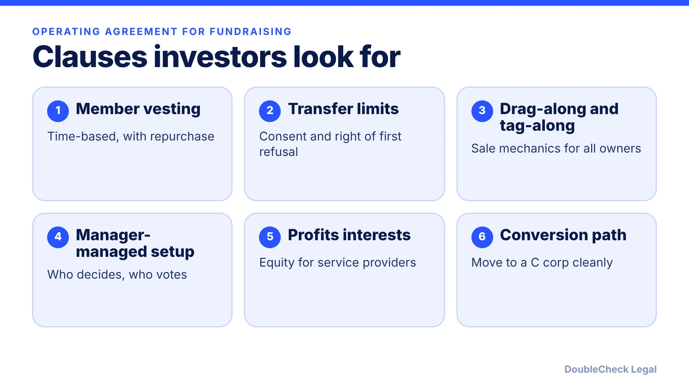
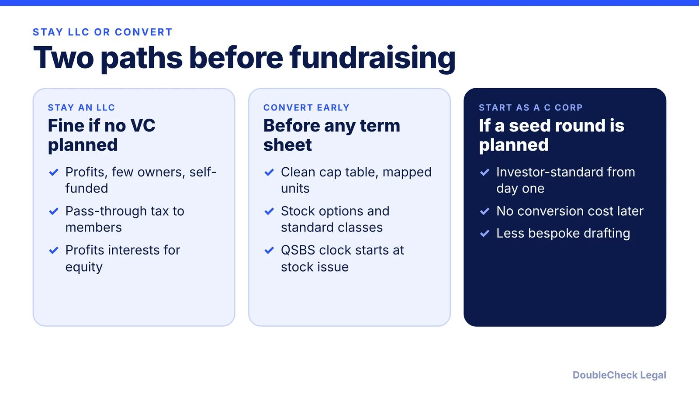

*Planning to raise money? These are the operating agreement clauses to add now, what the sources say about vesting, profits interests and conversion, and when to get an attorney.*

**Key takeaways:**

- Investors generally prefer C corps, so an LLC operating agreement should either bridge to a conversion or be replaced by a C corp.
- Add member vesting with a repurchase right, transfer limits with consent and a right of first refusal, and drag-along and tag-along terms.
- Profits interests give LLC employees equity but add tax complexity; 83(b) timing is 30 days.
- Convert before a term sheet, map units to stock, and document SAFEs and IP assignments before investors ask.

## 1. The quick answer

**Quick answer:** If your startup LLC may raise money, your operating agreement should cover member vesting with a repurchase right, transfer limits (consent and a right of first refusal), drag-along and tag-along, who manages the company, how equity for employees works (profits interests), and a clean path to convert to a C corporation. Wilson Sonsini says an LLC is generally a poor fit for startups expecting venture capital, and Traverse Legal (September 2025) says institutional investors generally will not invest in LLCs. So treat these clauses as either a bridge to a conversion or a reason to start as a C corp.

This guide is about the clauses, not the basics. For a general overview of using AI on the agreement, see [LLC operating agreement with AI](/blog/llc-operating-agreement-with-ai/); for the entity choice itself, see [LLC vs C corp for startups](/blog/llc-vs-c-corp-startups/).

## 2. Member vesting and transfer limits

**Member vesting.** Vesting means a founder earns ownership over time instead of owning it all on day one. Mintz (March 2022) describes the customary schedule for founder stock as four years with a one-year cliff: the first 25% vests at the first anniversary and the rest vests monthly or quarterly over the next three years. Under a repurchase right, if you stop providing services the company can buy back unvested shares, typically at the price paid. The same logic is used for LLC units, written into the operating agreement or a separate restricted unit agreement. Mintz adds that investors will likely require vesting at the first financing if founders do not already have it. See [co-founder vesting and cliffs explained](/blog/cofounder-vesting-cliff-explained/).

Acceleration is the follow-up question. Mintz describes single-trigger (vests on a change in control) and double-trigger (vests if there is a change in control and the person is terminated without cause or resigns for good reason within a set period). 

**Taxes on vesting.** In stock, an 83(b) election must be filed within 30 days of purchase, a deadline Mintz calls hard with no extensions. For LLC profits interests, RSM (April 2024) says the 83(b) election must also be made within 30 days of grant and advisors generally recommend a protective election, especially with vesting. See [83(b) election for startup founders](/blog/83b-election-startup-founders/) and have a tax professional confirm.

**Transfer limits.** Kilpatrick Townsend (July 2025) says equity transfers generally need consent from the managers and/or a majority in interest of the members, with common exceptions for affiliates, estate planning, family on death and other members. Thomson Reuters (page dated January 2026) adds a typical right of first refusal: a member with a bona fide third-party offer must first offer the interest to the other members, sometimes the LLC, on matching terms. Thomson Reuters also says transfers that would cause a partnership-taxed LLC to be treated as an S corporation are generally prohibited. See [how to remove or buy out a co-founder](/blog/how-to-remove-or-buy-out-a-co-founder/) and [buy-sell agreements for partners](/blog/buy-sell-agreement-small-business-partners/).

## 3. Drag-along, tag-along and manager vs member-managed

**Drag-along and tag-along.** Kilpatrick Townsend describes drag-along as a right of members holding a set percentage, usually a majority, to require the others to sell in a sale of the company, structured as an equity sale, asset sale or merger. Tag-along is the reciprocal protection: if the majority sells, minority members can join on the same terms. Thomson Reuters notes drag-alongs are usually not included in 50/50 joint ventures, so an evenly split startup should think about deadlock; see [co-founder agreement 50/50 deadlock clauses](/blog/co-founder-agreement-5050-deadlock-clauses-that-prevent-a-stalemate/).

**Manager-managed vs member-managed.** In a member-managed LLC the owners run the business directly. Per Rho, founders should decide between member-managed and manager-managed and define how day-to-day decisions differ from major changes. In a manager-managed LLC, Kilpatrick Townsend says managers handle operations while members usually vote only on major decisions and on electing, removing and replacing managers, often by written consent. Rho also notes default rules vary: in California, ordinary matters pass by majority and actions outside the ordinary course need unanimous consent unless the agreement says otherwise.

**Major decisions.** Kilpatrick Townsend lists items that typically need member consent, including equity issuances, redemptions and capital calls.

**Also include:** capital contributions and how new members are admitted (Rho), a buy-sell trigger for death, incapacity and unresolved deadlock (Thomson Reuters), and a dispute-resolution process. For adding someone later, see [how to add a member to an LLC](/blog/how-to-add-a-member-to-an-llc/).

## 4. Profits interests: equity for employees in an LLC

An LLC cannot grant stock options the way a corporation does. Per Wilson Sonsini, LLCs issue profits interests instead, which it describes as more complex and less well understood by founders and employees.

What the sources say:

- **Definition.** RSM (April 2024) describes a profits interest as an actual ownership interest issued for services, with no right to cash if the company liquidated on the grant date. Fox Rothschild (June 2024) says it gives a share of future profits and growth without a buy-in.
- **Threshold.** The threshold is typically the company's value at grant. Carta (May 2023) gives an example: a 1% grant at a $1 million value pays out only on sale proceeds above $1 million.
- **IRS safe harbor.** RSM lists conditions in Rev. Proc. 93-27, clarified by Rev. Proc. 2001-43, including no disposition within two years of receipt, and says an 83(b) election does not guarantee safe harbor status.
- **Holders are partners.** Fox Rothschild says holders cannot be W-2 employees; they receive K-1s and guaranteed payments generally subject to self-employment tax.

The takeaway for a fundraising LLC: profits interests work, but they add complexity, and Carta suggests that if conversion is imminent, a plan set up shortly before may not have earned value above its threshold, so it may be better to wait and grant options after conversion. For corporate options, see [409A valuations and stock options](/blog/stock-options-409a-valuation-startups/).

## 5. Conversion to a C corp and what investors check

**Why convert.** Wilson Sonsini says many VC firms cannot invest in LLCs because their tax-exempt limited partners cannot receive active business income without risking that exemption, and that most investors do not want the added tax complexity. Traverse Legal (September 2025) says conversion should happen before any term sheet is signed, because a late conversion can make investors back away if it interferes with closing or raises tax concerns. See [convert an LLC to a C corp before fundraising](/blog/convert-llc-to-c-corp-before-fundraising/).

**How it is done.** SPZ Legal (undated) describes a statutory conversion: the LLC adopts a plan of conversion setting how membership interests become shares, files a statement of conversion in its home state and in Delaware, and files a Delaware certificate of incorporation. It says assets and obligations transfer by operation of law, though contracts with assignment or change-of-control clauses may still need consent. Traverse Legal says a conversion can be handled via a tax-free reorganization under IRC section 351.

**Clauses that make conversion easier:**

- A mapping of units and percentages to stock classes (Traverse Legal).
- A clear approval mechanism for conversion. We did not find a source on the vote needed, so check your agreement and state statute.
- Governance terms such as special allocations or management rights that will not carry into bylaws; Traverse Legal says these can conflict with a board.

**Tax cautions.** SPZ Legal warns that debt can create tax issues, non-US members may face home-country tax treatment, and QSBS holding periods start when the corporation issues stock, not during the LLC period. Traverse Legal notes the five-year holding for full exclusion. See [QSBS Section 1202 explained](/blog/qsbs-section-1202-explained-startup-founders/).

**What investors check.** No source we found provides an official checklist, but together these sources imply that investors look for:

- A Delaware C corp with a clean cap table.
- Signed vesting and repurchase terms for founders (Mintz).
- Properly documented SAFEs or notes (SPZ Legal says those issued into an LLC often are not). See [SAFE agreement for startup founders](/blog/safe-agreement-startup-founders/).
- Clear ownership and records, which also supports [due diligence for startup fundraising](/blog/due-diligence-checklist-for-startup-fundraising/).

If you already know you are raising, [how to incorporate a SaaS or AI startup as a Delaware C corp](/blog/how-to-incorporate-saas-ai-startup-delaware-c-corp/) may save the conversion step.

## 6. When to use a template and when to get an attorney

AI and templates can produce a first draft and explain each clause, but they tend to fall short on state law and tax interactions. You can often handle a simple two-founder, self-funded agreement yourself with careful review. Get an independent attorney to look at it when:

- You plan to raise outside money within the next year.
- You are granting profits interests or vesting to anyone besides yourself.
- You have non-US members or any SAFEs or notes outstanding.
- Someone is leaving, or you are converting to a C corp.

Next steps: [founder stock purchase agreements](/blog/issue-founder-stock-purchase-agreement/) and [term sheet key terms](/blog/term-sheet-key-terms-explained/).

**Related reading:** [Multi-Member LLC Taxes: Partnership Return and K-1 Explained](/blog/multi-member-llc-taxes-partnership-return-k-1-explained/); [Corporate Bylaws vs Operating Agreement: What Each Covers](/blog/corporate-bylaws-vs-operating-agreement-what-each-covers/); [Change LLC Name or Business Name: Steps and Filings (2026)](/blog/change-llc-name-or-business-name-steps-and-filings/)

## Where DoubleCheck fits

[DoubleCheck](https://www.contactdoublecheck.com) helps businesses and founders start legal work with AI, verify it, and, when professional advice is warranted, connect with an independent attorney, including for immigration questions. Attorney availability and practice areas vary. Attorneys on DoubleCheck are independent professionals; an attorney-client relationship forms only if an attorney accepts your engagement.

**Sources:** [Wilson Sonsini, Is an LLC an appropriate structure for my company?](https://ecvc.wsgr.com/faq/formation/how-to-start/i-know-that-many-businesses-are-structured-as-limited-liability-companies-llcs-is-an-llc-an-appropriate-structure-for-my-company); [Traverse Legal, LLC to C-Corp Conversion (Sept. 4, 2025)](https://www.traverselegal.com/blog/llc-to-c-corp-conversion-founder-control/); [SPZ Legal, Converting an LLC to a Corporation (undated)](https://spzlegal.com/blog/converting-llc-to-corporation-startup-guide); [Kilpatrick Townsend, 8 Key Takeaways: Navigating Operating Agreements (July 8, 2025)](https://ktslaw.com/insights/perspectives/2025/7/8-key-takeaways-navigating-operating-agreements); [Thomson Reuters, Transfer Provisions in LLC Agreements (Jan. 2026)](https://legal.thomsonreuters.com/en/insights/articles/transfer-provisions-in-llc-agreements); [Mintz, Stock Vesting for Startup Companies (Mar. 15, 2022)](https://mintz.com/insights-center/viewpoints/2022-03-15-stock-vesting-startup-companies); [RSM, FAQs about profits interests (Apr. 2, 2024)](https://www.rsmus.com/insights/services/business-tax/frequently-asked-questions-about-profits-interests); [Fox Rothschild, Equity Compensation in LLC Startups (June 20, 2024)](https://www.foxrothschild.com/publications/equity-compensation-in-llc-startups-a-guide-to-profits-interests); [Carta, Equity blueprint for PIU conversion (May 9, 2023)](https://carta.com/blog/equity-blueprint-piu-conversion-heilbut/); [Rho, Operating agreement](https://www.rho.co/blog/operating-agreement).

## FAQ

**What clauses should a startup LLC operating agreement include before raising money?**

Include member vesting with repurchase rights, transfer restrictions, drag-along and tag-along, management structure, a major decisions list, profits interest terms and a conversion path. Per Traverse Legal (2025), investors expect clean records and mapped equity.

**Do investors invest in LLCs?**

Generally not. Wilson Sonsini says an LLC is probably not the right type of entity for a startup expecting outside money, and Traverse Legal (2025) says institutional investors generally will not invest in LLCs because of pass-through taxation.

**What is a profits interest in an LLC?**

Per RSM (2024), it is an ownership interest issued for services with no right to cash if the company liquidated on the grant date. It shares only in value above a threshold set at grant, and tax advisors should confirm the 83(b) and safe harbor steps.

**When should I convert my LLC to a C corp?**

Traverse Legal says before any term sheet is signed. SPZ Legal says a statutory conversion can transfer assets by operation of law, but contracts may need consent and tax issues such as debt apply, so get tax advice first.

**Is a drag-along clause needed in a two-founder LLC?**

Not always. Thomson Reuters says drag-alongs are usually absent in 50/50 joint ventures. If ownership is split evenly, plan for deadlock instead, and add a drag-along if one founder will hold a majority.

---

*General information only. This article is not legal, tax, investment, or accounting advice.*
