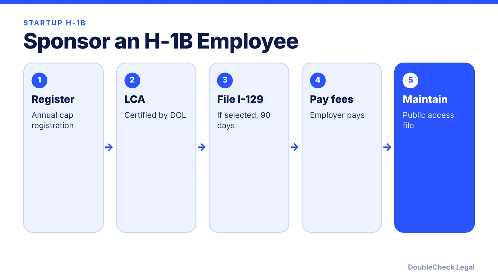
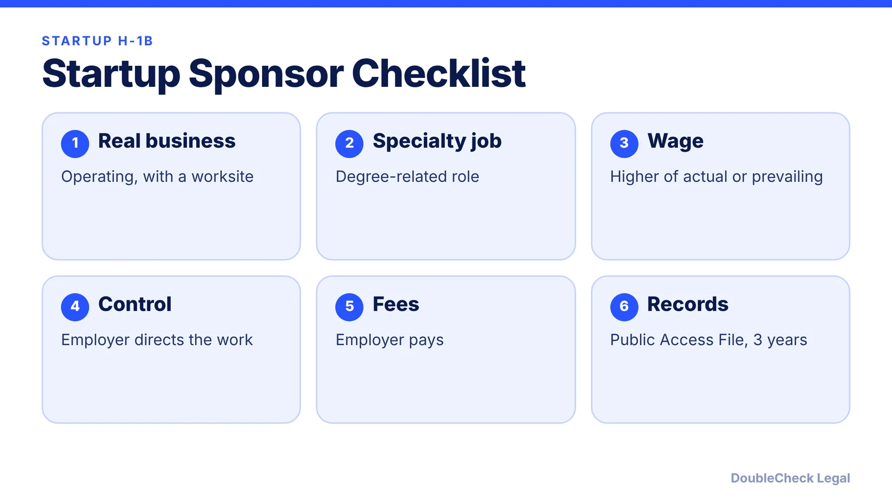

*Can a startup sponsor an H-1B? Yes, if it meets the employer rules. Here is the process, the fees, and the founder-owned twist.*

**Key takeaways:**

- A startup must be a real operating business with a genuine employer-employee relationship.
- The LCA requires paying the higher of the actual or prevailing wage.
- FY2027 registration was $215 per registrant, with wage-weighted selection.
- The employer pays all USCIS fees; the employee cannot be required to.

## 1. The quick answer

**Quick answer:** A startup can sponsor an H-1B worker if it is a real operating business that meets the employer requirements: a specialty occupation, a certified labor condition application (LCA), a genuine employer-employee relationship, and payment of at least the higher of the actual or prevailing wage. For cap cases the startup must also register and be selected. FY2027 registration was $215 per registrant and used a wage-weighted selection.

## 2. Employer requirements

Per Alma's guide: the sponsoring company must control when, where, and how the worker works, the employer pays all USCIS fees and cannot require the employee to pay, the LCA notice is posted for 10 consecutive days, and the employer keeps a Public Access File and payroll records for three years. DOL says the LCA (Form ETA-9035) is filed via FLAG, the employer attests to pay the higher of actual or prevailing wage, DOL reviews within seven working days, and the LCA cannot be submitted more than six months before employment starts. Initial approval is up to three years, with one extension up to three more for a six-year maximum.

## 3. Cap season, fees, and the weighted lottery

USCIS says the regular cap is 65,000 plus 20,000 for U.S. master's or higher, and cap petitions can be filed only with a selected registration, with a 90-day filing window. Hodgson Russ says FY2027 registration cost $215, and a rule effective February 27, 2026 weights selection by wage level ([how the weighted lottery works](/blog/h1b-weighted-lottery-wage-levels-explained/)). USCIS lists ACWIA at $750 (1 to 25 full-time employees) or $1,500, plus a $500 fraud fee and a $4,000 fee for employers with more than 50% H-1B or L-1 staff. Alma says small employers pay a $300 Asylum Program fee and hit H-1B-dependent status at eight H-1B workers. The I-129 base fee varies across sources, so check USCIS's fee schedule.

## 4. Founders and the $100,000 payment

Hooyou says in a founder-owned startup a controlling interest is more than 50% of shares or majority voting rights, and a beneficiary-owner's initial approval can be up to 18 months with a first extension up to 18 months, provided there is a genuine employer-employee relationship and a legitimate operating business. Immihelp and Yale report a federal court vacated the $100,000 payment in June 2026 and USCIS stopped collecting while an appeal is pending; see [the current status](/blog/h1b-100000-fee-status-2026/). Already on an H-1B? Read [ownership vs. work](/blog/start-company-on-h1b-visa-ownership-vs-work/) and [H-1B transfers](/blog/h-1b-transfer-change-of-employer-portability/). Incorporate first: [how to incorporate a SaaS or AI startup](/blog/how-to-incorporate-saas-ai-startup-delaware-c-corp/).

## Where DoubleCheck fits

[DoubleCheck](https://www.contactdoublecheck.com) helps businesses and founders start legal work with AI, verify it, and, when professional advice is warranted, connect with an independent attorney, including for immigration questions. Attorney availability and practice areas vary. Attorneys on DoubleCheck are independent professionals; an attorney-client relationship forms only if an attorney accepts your engagement.

**Sources:** [USCIS H-1B cap season](https://www.uscis.gov/working-in-the-united-states/temporary-workers/h-1b-specialty-occupations-and-fashion-models/h-1b-cap-season); [DOL FLAG: LCA](https://flag.dol.gov/programs/lca); [Alma](https://www.tryalma.com/learn/sponsor-h1b-visa-employees); [Hodgson Russ](https://www.hodgsonruss.com/immigration-insights/fy27-h-1b-registration-what-employers-need-to-know); [Hooyou](https://hooyou.com/news/news2025/news022025h1b.html); [Immihelp](https://www.immihelp.com/h1b-100000-fee-first-circuit-ruling-2026/); [Yale OISS](https://oiss.yale.edu/news/update-federal-appeals-court-upholds-decision-vacating-100000-h-1b-fee).

## FAQ

**Can a startup sponsor an H-1B visa?**

Yes, if it meets the employer requirements and wins a cap selection unless cap-exempt. Confirm with an immigration attorney.

**Who pays the H-1B fees?**

Per Alma, the employer pays all USCIS fees and employees cannot be required to pay.

**How long can someone stay in H-1B status?**

Alma says up to three years initially plus one extension up to three years, for six years total.

**Can a founder be sponsored by their own startup?**

Hooyou describes a path with controlling-interest rules and shorter approval periods, with a genuine employer-employee relationship required. Get legal advice.

---

*General information only. This article is not legal, tax, investment, or accounting advice.*
