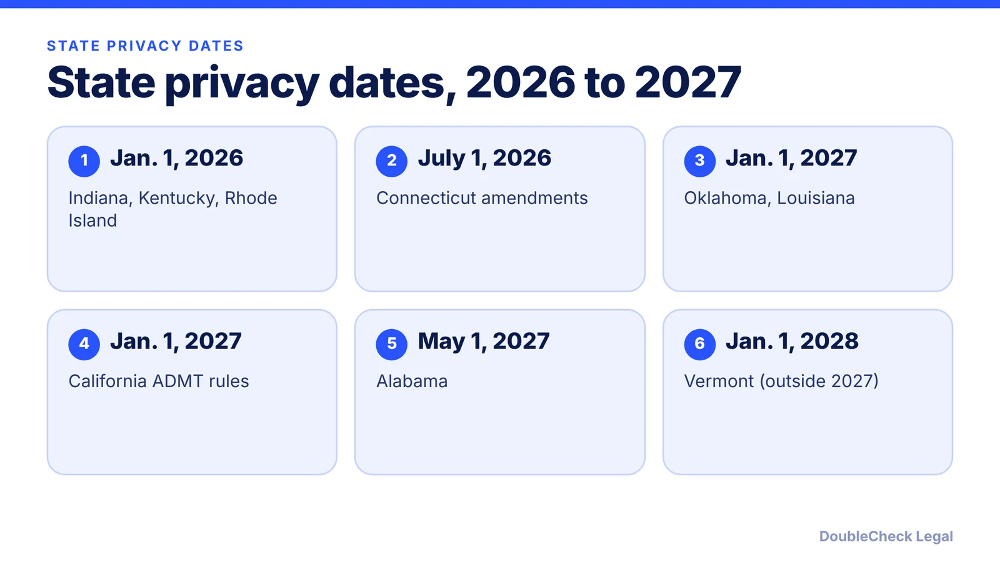
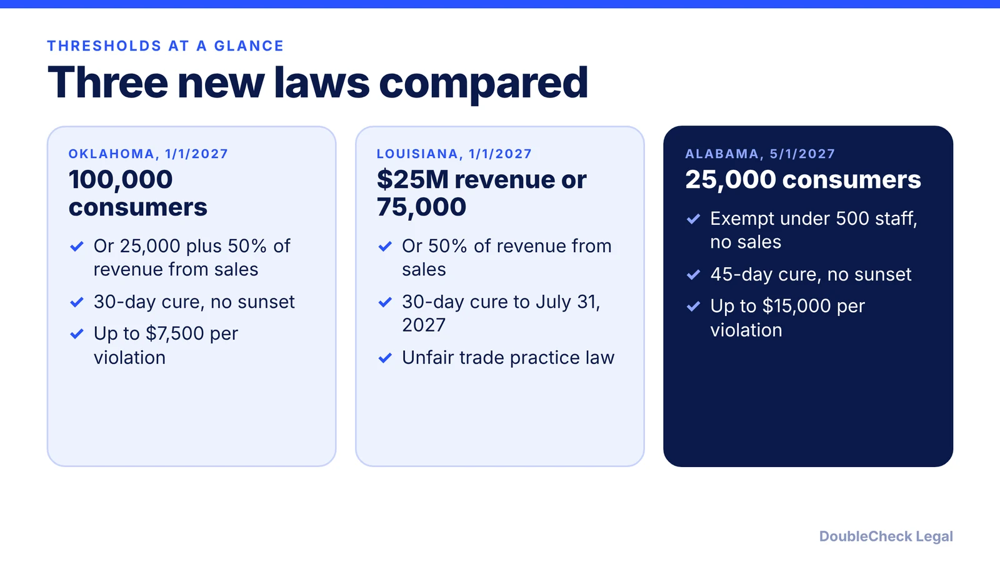

*Which state privacy laws take effect by 2027, their thresholds, and a practical checklist for small businesses, as of November 2026.*

**Key takeaways:**

- Oklahoma and Louisiana take effect January 1, 2027; Alabama on May 1, 2027.
- California ADMT rules apply from January 1, 2027, per Kelley Drye.
- Indiana, Kentucky and Rhode Island took effect January 1, 2026.
- Thresholds and cure periods differ, so count your consumers and revenue by state.

## 1. The quick answer

**Quick answer:** For 2026 and 2027, the dates to know are: Indiana, Kentucky and Rhode Island comprehensive laws (January 1, 2026); Connecticut amendments (July 1, 2026); California's automated decision-making (ADMT) rules (January 1, 2027); Oklahoma and Louisiana (January 1, 2027); Alabama (May 1, 2027); and a Kentucky amendment (July 1, 2027). Vermont's law takes effect in 2028. Most of these apply only above a size or data-volume threshold, so many small businesses are exempt from some, but not all.

## 2. Laws that took effect in 2026

Per Kelley Drye's compliance calendar, Indiana, Kentucky and Rhode Island comprehensive privacy laws took effect January 1, 2026, Connecticut's amendments took effect July 1, 2026 (expanding applicability to businesses that process sensitive data or offer personal data for sale in trade or commerce), and Oregon's amendments took effect January 1, 2026, including a ban on selling precise location data. Per a JD Supra summary, Virginia's amendment effective July 1, 2026 prohibits selling precise geolocation data with no consent exception.

California's CCPA regulations added obligations effective January 1, 2026, and, per Kelley Drye, its automated decision-making rules apply January 1, 2027 to "significant decisions." The same source lists risk assessment deadlines of December 31, 2027 for ongoing pre-2026 processing, and cybersecurity audit submissions starting April 1, 2028.

If you sell to California consumers, start with [CCPA and CPRA compliance for small businesses](/blog/ccpa-cpra-compliance-small-business/).

## 3. New in 2027: Oklahoma, Louisiana, Alabama

Per Ecorpit's roundup of the enacted laws:

- **Oklahoma (SB 546), January 1, 2027:** applies at 100,000 or more consumers in a year, or 25,000 or more if over 50% of gross revenue comes from selling personal data. 30-day cure period; penalties up to $7,500 per violation.
- **Louisiana, January 1, 2027:** applies if any one test is met: annual gross revenue above $25 million; handling data of 75,000 or more consumers, households, or devices; or 50% or more of revenue from selling personal data. 30-day cure period until July 31, 2027.
- **Alabama, May 1, 2027:** applies above 25,000 consumers (excluding payment-only data) or over 25% of revenue from sales of personal data; businesses with fewer than 500 employees are exempt if they do not sell personal data. 45-day cure period; penalties up to $15,000 per violation. Per JD Supra, opt-out preference signals must be honored by January 1, 2028.
- **Kentucky amendment, July 1, 2027:** per JD Supra, adds automated content recognition data to sensitive data and requires opt-in consent before collection.

Per Ecorpit, Vermont's Act 145 takes effect January 1, 2028, although some roundups list 2027. These summaries are secondary sources, so read each statute or ask an attorney before relying on a threshold.

## 4. A small-business checklist

You do not need a separate program for every state. Most laws share a core, so build once and adjust.

- **Know your numbers.** Count consumers whose data you handle per state, your revenue, and whether you sell personal data. Thresholds differ.
- **Update your privacy policy.** List categories collected, purposes, rights, and how to submit requests. See [writing a privacy policy with AI](/blog/ai-write-privacy-policy/) and the [privacy policy generator guide](/blog/privacy-policy-generator-small-business/).
- **Build a requests process.** Access, deletion, correction, and opt-out need an intake and a deadline tracker.
- **Treat sensitive data carefully.** Precise location, and in some states other categories, may need consent or be restricted.
- **Map vendors.** Contracts with processors should limit how they use data.
- **Mind the cure periods.** Several have sunset dates, so the chance to fix a problem after notice may shrink.

If you have EU users too, compare [GDPR for U.S. startups](/blog/gdpr-for-us-startups/). Subscription products also face renewal rules, covered in [FTC click-to-cancel and state rules for SaaS](/blog/ftc-click-to-cancel-subscription-rules-saas/). For whether a threshold applies to you, a privacy attorney can answer in an hour.

## Where DoubleCheck fits

[DoubleCheck](https://www.contactdoublecheck.com) helps businesses and founders start legal work with AI, verify it, and, when professional advice is warranted, connect with an independent attorney, including for immigration questions. Attorney availability and practice areas vary. Attorneys on DoubleCheck are independent professionals; an attorney-client relationship forms only if an attorney accepts your engagement.

**Sources:** [Kelley Drye compliance calendar](https://s3.amazonaws.com/cdn.kelleydrye.com/content/uploads/pdf-snapshots/mark-your-calendars-upcoming-compliance-dates-in-state-privacy-laws-20260526155811.pdf); [Ecorpit on 2027 state laws](https://ecorpit.com/us-state-privacy-laws-2027-oklahoma-louisiana-vermont-alabama/); [JD Supra on Oklahoma, Alabama, Kentucky and Virginia](https://www.jdsupra.com/legalnews/privacy-in-bloom-four-states-reshape-4302715/).

## FAQ

**Which state privacy laws take effect in 2027?**

Per Ecorpit, Oklahoma and Louisiana on January 1, 2027, and Alabama on May 1, 2027. Per Kelley Drye, California's ADMT rules apply January 1, 2027. Per JD Supra, a Kentucky amendment takes effect July 1, 2027.

**Do state privacy laws apply to small businesses?**

Often only above thresholds. Oklahoma uses 100,000 consumers, for example, and Alabama exempts businesses under 500 employees that do not sell personal data, per Ecorpit. Check each state's test.

**When does Vermont's privacy law take effect?**

Per Ecorpit, January 1, 2028, although some roundups list 2027. The enacted text sets 2028.

**What should I do first to prepare?**

Count consumers and revenue by state, check whether you sell personal data, update your privacy policy, and set up a rights-request process. Confirm applicability with a privacy attorney.

---

*General information only. This article is not legal, tax, investment, or accounting advice.*
