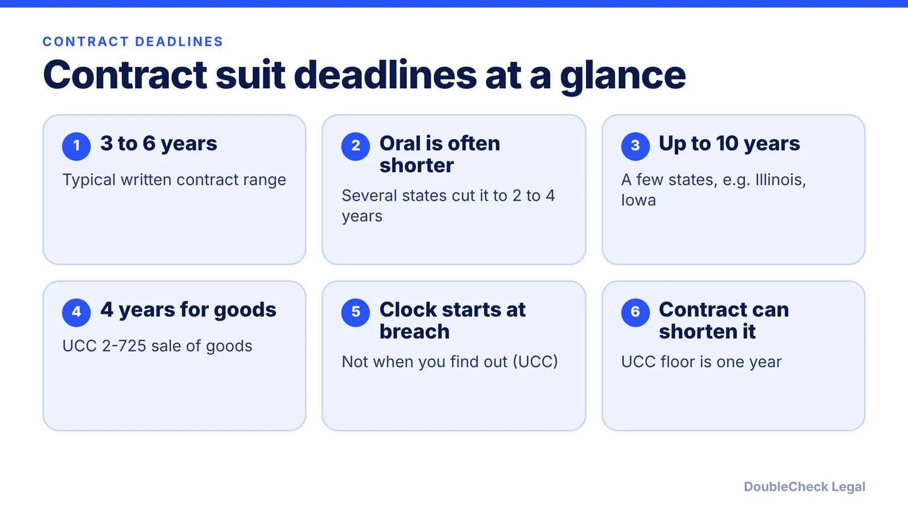
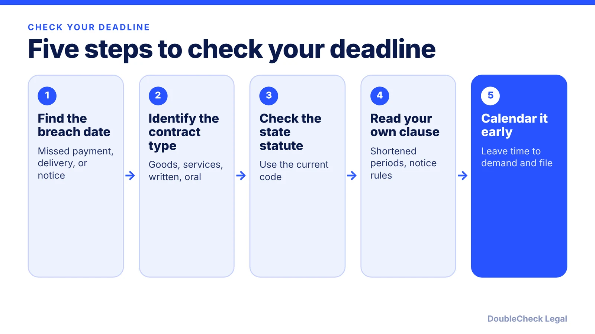

*Breach of contract statute of limitations by state, for small businesses: grouped written and oral periods, accrual, contractual shortening and next steps, as of November 2026.*

**Key takeaways:**

- Written contract deadlines mostly run 3 to 6 years, a few states allow up to 10, and oral contracts often get less.
- Two charts we checked disagree on a handful of states, so verify against your state statute.
- For goods, UCC 2-725 sets four years from breach, and the contract may shorten it to as little as one year.
- A demand letter does not stop the clock; calendar the filing date early.

## 1. The quick answer

**Quick answer:** The statute of limitations for breach of contract is the deadline for filing a lawsuit, and it varies by state. For written contracts, most states fall between 3 and 6 years, a few allow up to 10, and oral contracts often get a shorter period. As of November 2026, the charts we checked (Nolo, updated June 2023, and a Vaquill chart modified October 2026) agree on most states but differ on a handful, so confirm your state statute before you rely on any number.

The clock usually starts when the breach happens, not when you notice it. For sales of goods, the Uniform Commercial Code sets four years from the breach, and the parties may shorten that to as little as one year in the contract.

## 2. Breach of contract statute of limitations by state

Below is a grouped list of written and oral contract periods, shown as written/oral in years. We kept only states where Nolo's chart (updated June 23, 2023) and the Vaquill chart (modified October 6, 2026) agree. States where they differ, or where a split applies, are listed separately.

- **3/3:** Alaska, Delaware, Maryland, Mississippi, New Hampshire, North Carolina, South Carolina.
- **4/4:** Pennsylvania, Texas.
- **6/6:** Alabama, Hawaii, Maine, Massachusetts, Michigan, Minnesota, New Jersey, New York, North Dakota, Oregon, South Dakota, Tennessee, Vermont, Wisconsin.
- **10/10:** Louisiana, Rhode Island.
- **6/3:** Arizona, Connecticut, Washington.
- **6/4:** Georgia, Nevada, New Mexico, Utah.
- **5/4:** Florida, Idaho, Nebraska.
- **5/3:** Arkansas, Kansas, Oklahoma.
- **4/2:** California.
- **10/5:** Illinois, Iowa, West Virginia.
- **10/8:** Wyoming.

**Check the statute for these:**

- **Colorado:** both charts show 3 years generally and 6 for certain debts, with details that differ.
- **Indiana, Kentucky, Missouri:** both charts show 10 years for many written contracts, with exceptions by type of contract or signing date.
- **Montana:** the charts disagree on the written period (8 years in Nolo, 6 in Vaquill, which cites actions filed on or after October 1, 2025). We could not confirm the change from a primary source, so verify it.
- **Ohio and Virginia:** the charts differ on the oral or unsigned-writing period.
- **District of Columbia:** Nolo lists 3 years; the Vaquill chart does not list it.

A chart is a starting point. Statutes change, and some states have different periods for specific claims such as sales of goods, payment of money, or contracts under seal. Read the current state code, or have an attorney confirm, before a deadline decision. If your contract has a governing-law clause, the chosen state may matter; see [force majeure clause explained](/blog/force-majeure-clause-explained/) for another clause that interacts with performance deadlines, and [verbal contracts and enforceability](/blog/verbal-contract-enforceable-small-business/) for the oral side.

## 3. When the clock starts and what can change it

Two questions decide most deadline disputes: when did the claim accrue, and did anything change the length?

**Accrual.** For sales of goods, UCC 2-725 says the cause of action accrues when the breach occurs, regardless of the aggrieved party lack of knowledge of the breach, per the Cornell Legal Information Institute text. In practice, for a missed payment that is often the due date. For a contract with several installments, a separate breach may start its own clock, but that varies, so do not assume it.

**Shortening by contract.** Under UCC 2-725(1), the parties may reduce the period to not less than one year but may not extend it. A New York appellate decision from March 2015, *State of Narrow Fabric v. UNIFI*, enforced a one-year term that appeared in invoices, according to a Schlam Stone summary. That is one decision, and courts can refuse to enforce a term that is unreasonably short or the product of overreaching. For services contracts, non-UCC rules apply and some states restrict contractual shortening, so read your clause rather than assuming.

**Extending or pausing.** Some states allow tolling (a pause) in specific situations, and some let parties restart a clock by acknowledging a debt in writing. Rules differ by state, so treat any standstill or tolling agreement as something to have an attorney draft. Related: [breach of contract remedies](/blog/breach-of-contract-remedies-what-you-can-recover-small-business/).

**Other deadlines can be shorter.** A notice-of-claim clause, a cure period, or an arbitration demand deadline in the contract can arrive long before the statute runs out. See [arbitration clauses explained](/blog/arbitration-clause-explained-small-business-contracts-pros-cons/) and [how to terminate a contract early](/blog/how-to-terminate-a-contract-early-termination-clause/).

## 4. What to do before the deadline gets close

Do not wait until the last month. Preparing a claim takes time, and the other side may respond to a demand letter by negotiating, which is helpful but can also run out your clock if nothing is signed to pause it.

A practical sequence for a small business:

1. **Gather the paper trail.** The signed contract or the emails and texts that show an oral deal, invoices, delivery proof, and every message about the problem.
2. **Pin down the breach date.** Write the date each obligation was due and the date it was missed.
3. **Send a demand letter.** See [how to write a demand letter](/blog/how-to-write-a-demand-letter-small-business/). A letter alone does not stop the statute from running.
4. **Pick the forum.** Small claims has dollar limits that vary by state; see [how to collect unpaid invoices in small claims](/blog/how-to-collect-unpaid-invoices-small-claims/). If the contract requires arbitration, follow that process instead.
5. **File on time.** A claim filed after the deadline can be dismissed even if the breach is clear.

If you are the one being sued, the statute of limitations is usually a defense that must be raised, not something a court applies on its own. That is a reason to answer a complaint promptly and to talk to an attorney.

AI can help you build the timeline, summarize emails and draft a demand letter. It can also state a deadline confidently and be wrong, because periods differ by state, contract type and recent amendments. Check any AI-provided number against the statute, as in [how to verify an AI-generated legal document](/blog/verify-ai-generated-legal-document/). Related contract-risk reading: [contract red flags for small businesses](/blog/contract-red-flags-small-business/), [what makes a contract legally binding](/blog/what-makes-a-contract-legally-binding/).

## 5. When to get an attorney to check the date

You can usually handle a small, clear invoice dispute yourself within the deadline. Get an attorney to look at the dates when:

- The amount is large relative to your business.
- The contract is oral, partly written, or has been amended. See [contract amendments vs new contracts](/blog/contract-amendment-vs-new-contract-how-to-change-a-signed-agreement/).
- The contract shortens the period, or requires notice, mediation or arbitration first.
- You and the other party are in different states, or the governing-law clause names another state.
- You are close to the deadline, or it may already have passed.

Ask the attorney one concrete question: which statute applies to this claim, and what is the last safe date to file? For help choosing counsel, see [when to hire a lawyer for your small business](/blog/when-to-hire-lawyer-small-business/) and [how to choose a good lawyer](/blog/how-to-choose-good-lawyer/).

## Where DoubleCheck fits

[DoubleCheck](https://www.contactdoublecheck.com) helps businesses and founders start legal work with AI, verify it, and, when professional advice is warranted, connect with an independent attorney, including for immigration questions. Attorney availability and practice areas vary. Attorneys on DoubleCheck are independent professionals; an attorney-client relationship forms only if an attorney accepts your engagement.

**Sources:** [Nolo, statute of limitations state laws chart (updated June 23, 2023)](https://nolo.com/legal-encyclopedia/statute-of-limitations-state-laws-chart-29941.html); [Vaquill, statute of limitations by state (modified October 6, 2026)](https://www.vaquill.ai/blog/statute-of-limitations-by-state-pi-contract); [Cornell LII, UCC 2-725](https://www.law.cornell.edu/ucc/2/2-725); [Schlam Stone, Second Department enforces contract term shortening statute of limitations (2015)](https://www.schlamstone.com/blogs/commercial/2015-03-23-second-department-enforces-contract-term-shortening-statute-of-limitations). Primary state statutes were not individually fetched.

## FAQ

**What is the statute of limitations for breach of contract by state?**

It varies. In the Nolo chart updated June 23, 2023 and the Vaquill chart modified October 6, 2026, many states give 3 to 6 years for written contracts and often less for oral ones, with a few at 10 years. Confirm your state statute before relying on a chart.

**When does the statute of limitations on a contract start?**

Usually when the breach occurs. For sales of goods, UCC 2-725 says the claim accrues when the breach occurs regardless of the injured party knowledge, per Cornell LII. Other claims depend on state law.

**Can a contract shorten the time to sue?**

Sometimes. For sales of goods, UCC 2-725(1) allows the parties to reduce the period to not less than one year but not to extend it. Courts may refuse unreasonable terms, and non-goods contracts follow state rules.

**Is the deadline shorter for oral contracts?**

In many states, yes. For example, both charts list California at 4 years written and 2 years oral. Some states, such as New York and Texas, use the same period for both. Check your state.

**Does a demand letter stop the statute of limitations?**

Generally no. A demand letter does not by itself pause the deadline in most situations, so keep the filing date on your calendar unless both sides sign a written agreement an attorney has reviewed.

---

*General information only. This article is not legal, tax, investment, or accounting advice.*
