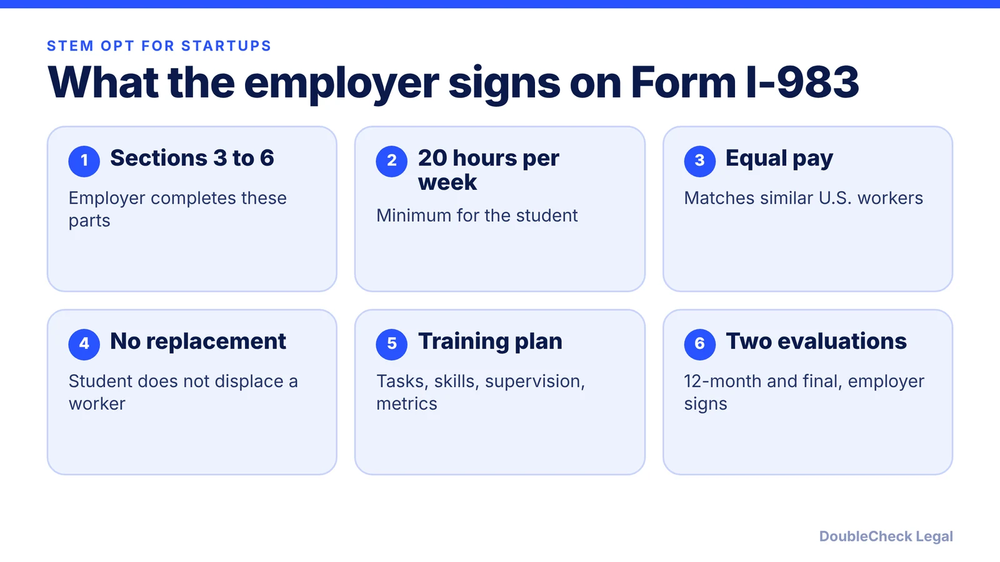
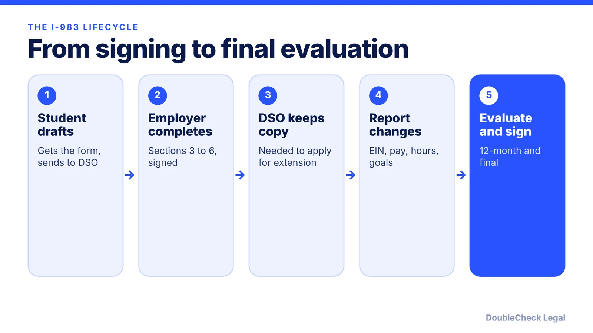

*What does a startup have to complete and sign on Form I-983? Here are the employer sections, the evaluations, and the changes that must be reported.*

**Key takeaways:**

- Employers complete Sections 3 to 6 of Form I-983, and the signatory certifies under penalty of perjury.
- The student must work at least 20 hours per week at pay commensurate with similarly situated U.S. workers.
- Sign the 12-month and final evaluations; both are due within 10 days after the reporting period ends.
- Report material changes such as a new EIN, a pay cut, or hours below 20 to the DSO.

## 1. The quick answer

**Quick answer:** Form I-983 is the training plan that an F-1 student and the employer sign before the student applies for the STEM OPT extension. Per DHS Study in the States, the employer completes Sections 3 through 6: company details, a certification that the student will not replace a U.S. worker, the training plan itself, and a signature under penalty of perjury. The student must work at least 20 hours per week, pay must match similarly situated U.S. workers, and the employer signs the student's evaluations at 12 months and at the end.

## 2. What a startup must put in the training plan

DHS Study in the States lists what each employer section asks for. A startup with no HR team can still complete it, but the details must be accurate.

- **Section 3 (employer information):** company name, address and website, EIN and NAICS code, number of full-time U.S. employees, start date, weekly training hours, and compensation with pay frequency.
- **Section 4 (certification):** an official with signatory authority certifies that the student will not replace a full-time or part-time U.S. worker and that terms match those of similarly situated U.S. workers. This person should know the student's goals and performance, so at a small startup it is often the founder or a senior manager.
- **Section 5 (training plan):** the student's name exactly as on the Form I-20 and in SEVIS, the site name (including any location other than headquarters), the STEM field using DHS's code list, the evaluator's contact details, the tasks and how they relate to the degree, the skills to be gained, how the employer will supervise, and measures showing the student is gaining new knowledge.
- **Section 6:** a signatory affirms under penalty of perjury that the information is true and correct.

Vague plans such as "work on the product" are a weak fit. Describe specific projects, the mentor, and how progress is assessed. Why this matters: the plan is about training, not only a job. For the broader picture of running a startup on OPT, see [F-1 OPT and STEM OPT for starting your own startup](/blog/f1-opt-stem-opt-start-your-own-startup/).

## 3. Evaluations, changes, and deadlines

Per DHS, the student submits two self-evaluations, and the employer must review and sign each one:

- a 12-month evaluation, submitted within 12 months of the STEM OPT start date;
- a final evaluation covering the full training period.

Both are due within 10 days after the reporting period ends. If the opportunity ends early, the final evaluation is due within 10 days of the end date. DHS warns that failing to submit a final evaluation may violate the form's terms and jeopardize the student's nonimmigrant status. Employers may attach their own evaluation as an option.

The student and employer must also report material changes to the DSO. DHS gives these examples:

- a change in the EIN from an ownership or structure change;
- a pay cut not tied to reduced hours;
- a significant drop in weekly hours, or hours below 20 per week;
- changes to the commitments or learning objectives in the plan.

Startups change fast, so this is the common trap: a pivot, a new entity, or a reduced schedule can trigger a plan update. The DSO keeps the signed form and the signed evaluations in the student's record.

## 4. What this page does not settle

The DHS pages we reviewed do not address employer site visits, E-Verify, or the timeline for reporting a student's termination. Those are part of the STEM OPT employer obligations, so check the current Form I-983 instructions and speak with the student's DSO before relying on this summary. Rules and forms change, so confirm as of November 2026 on the official STEM OPT Hub.

Also keep in mind that OPT status has its own limits, such as the unemployment allowance covered in [OPT unemployment limits and STEM OPT](/blog/opt-unemployment-limit-90-days-stem-opt/). If the student wants to move from F-1 to a work visa, read [CPT vs. OPT](/blog/cpt-vs-opt-f1-students/), the [H-1B weighted lottery explainer](/blog/h1b-weighted-lottery-wage-levels-explained/), and the [cap-gap guide](/blog/f-1-cap-gap-change-of-status-to-h-1b/). A founder employing their own company's student should also get an [immigration lawyer's view](/blog/how-to-find-good-immigration-lawyer-startup-founder/), since an owner-employee setup raises extra questions.

## Where DoubleCheck fits

[DoubleCheck](https://www.contactdoublecheck.com) helps businesses and founders start legal work with AI, verify it, and, when professional advice is warranted, connect with an independent attorney, including for immigration questions. Attorney availability and practice areas vary. Attorneys on DoubleCheck are independent professionals; an attorney-client relationship forms only if an attorney accepts your engagement.

**Sources:** [DHS Study in the States: Employers and Form I-983](https://studyinthestates.dhs.gov/stem-opt-hub/for-employers/employers-and-the-form-i-983); [DHS Study in the States: Form I-983 overview](https://studyinthestates.dhs.gov/form-i-983-overview).

## FAQ

**Who completes Form I-983, the student or the employer?**

Both. Per DHS Study in the States, the student gets the form and returns it to the DSO, while the employer completes Sections 3 through 6 and signs the student's self-evaluations.

**How many hours per week must a STEM OPT student work?**

At least 20 hours per week, per DHS Study in the States. Hours falling below 20 per week is a material change that requires updating the plan.

**When are the I-983 evaluations due?**

The 12-month evaluation is due within 12 months of the start date and the final evaluation covers the full period. Per DHS, both are due within 10 days after the reporting period ends.

**What changes must be reported on Form I-983?**

DHS lists a change in EIN from an ownership or structure change, a pay cut not tied to reduced hours, a significant drop in weekly hours, and changes to learning objectives. Report them to the DSO.

---

*General information only. This article is not legal, tax, investment, or accounting advice.*
