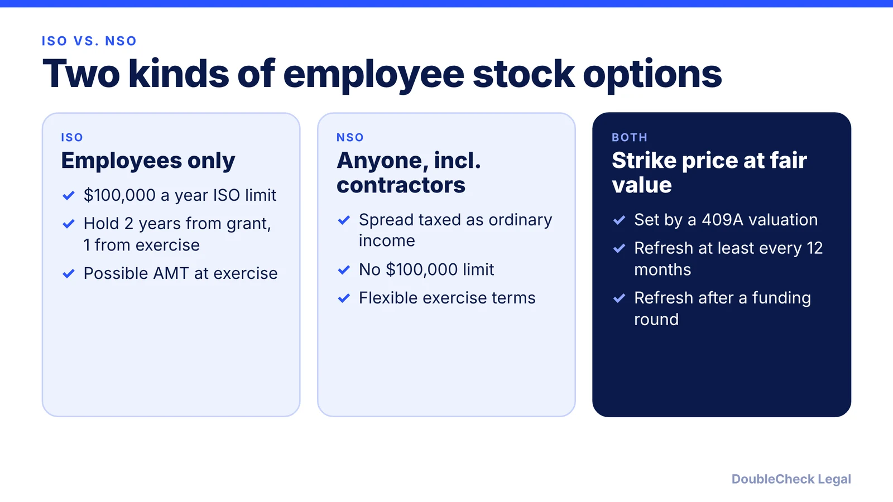
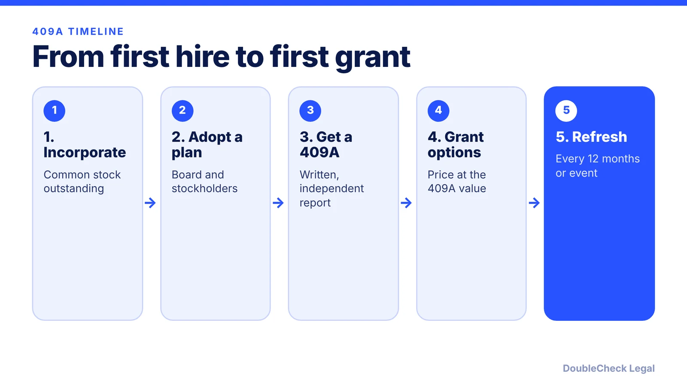

*Your option's strike price comes from a 409A valuation, and its tax treatment comes from whether it is an ISO or an NSO.*

**Key takeaways:**

- ISOs are for employees and have a $100,000-per-year limit; NSOs are taxed as ordinary income on the spread.
- A 409A valuation sets the strike price; a previous valuation cannot be reused after 12 months or after a later corporate event (Hanson Bridgett).
- Discounted options can carry adverse federal tax consequences under Section 409A.
- Check the post-termination exercise window before you accept: 90 days is common and can be negotiable.

## 1. The quick answer

**Quick answer:** Startups usually grant employees ISOs (incentive stock options) or NSOs (nonqualified stock options) with an exercise price set at the fair market value of common stock. A 409A valuation is the independent appraisal that sets that value. Per Hanson Bridgett, the valuation must be made reasonably and in good faith, and a previous value cannot be reused after 12 months or if it does not reflect a later corporate event. Grant below fair market value and the option can be treated as discounted, which can bring adverse federal tax consequences under Section 409A.

## 2. ISOs vs. NSOs and the taxes, in brief

Facts below are per the IRS and Foley, based on Internal Revenue Code section 422 for the ISO rules.

- **$100,000 limit.** Under section 422(d), the grant-date fair market value of stock that first becomes exercisable as an ISO in a calendar year is capped at $100,000 per employee. Anything over becomes an NSO. Example (ours): options first exercisable in one year with a grant-date value of $150,000 are $100,000 of ISOs and $50,000 of NSOs.
- **Holding periods.** Capital-gain treatment applies only if shares are held at least two years from grant and one year from exercise. A sale sooner is a disqualifying disposition, generally creating ordinary income on the exercise spread.
- **At exercise.** ISOs generally create no regular federal income tax on the spread, but the spread can count toward the alternative minimum tax (AMT). NSOs generally produce ordinary compensation income equal to the exercise-date value minus the exercise price.
- **Who can get them.** ISOs go only to employees; non-employee service providers are not eligible for ISOs (Foley).

Worked example (ours): you exercise 10,000 options at a $1.00 exercise price when fair market value is $4.00. The spread is 10,000 x $3.00 = $30,000. With NSOs that is ordinary income at exercise; with ISOs there is no regular tax on it at exercise, but it can enter the AMT calculation. Both vary by person, so confirm with a tax professional.

## 3. 409A valuation: purpose and safe harbor

Section 409A of the Internal Revenue Code is why strike prices cannot be picked freely. A 409A valuation is an independent appraisal of a private company's common stock fair market value, used to set the strike price. Options granted below fair market value can be treated as discounted options.

**Safe harbor.** Per Hanson Bridgett, the valuation must be made reasonably and in good faith, evidenced by a written report, and performed by a qualified person (it describes significant experience as generally at least five years of relevant experience). A previous value cannot be reused after 12 months or if it does not reflect a later corporate event.

**When to refresh.** Not later than 12 months after the last valuation, and sooner if a later corporate event, such as closing a funding round, means the old value no longer reflects the company (Hanson Bridgett).

**Penalties.** If options are discounted, the recipient can face adverse tax consequences under Section 409A, so confirm exposure with a tax professional. Provider costs vary; get quotes.

## 4. Exercise windows and what to ask

The post-termination window is where employees most often lose value. Per Foley, the ISO tax rule requires exercise no later than three months after termination, not necessarily 90 days, and disability extends the period to one year; the plan and option agreement set the actual expiration, which may be shorter or longer. A short window can leave employees unable to afford exercising, so ask whether a longer window is negotiable.

**Questions to ask:**

- Is this an ISO or NSO, and what is the strike price against the latest 409A?
- What is the exercise window after I leave?
- Does the plan allow early exercise, and should I consider an 83(b) election within 30 days of the grant?
- What is the vesting schedule ([vesting explained](/blog/cofounder-vesting-cliff-explained/))?

For founders, see [founder equity splits](/blog/founder-equity-split-how-to-divide/) and [how options show up on the cap table](/blog/cap-table-basics-for-first-time-founders/).

**Related reading:** [Corporate Minutes and Board Consents: Small Corporation Records Guide](/blog/corporate-minutes-and-board-consents-small-corporation-records/); [Offer Letter vs Employment Contract: Differences for a Startup](/blog/offer-letter-vs-employment-contract-differences-startup/); [Employee Equity Grants for First Hires: How to Structure Them](/blog/employee-equity-grants-for-first-hires-how-to-structure/); [Option Pool Size and Dilution in a First Round Explained for Founders](/blog/option-pool-size-and-dilution-first-round-explained/); [Cap Table Cleanup Before Series A: Common Problems and How to Fix Them](/blog/cap-table-cleanup-before-series-a-common-problems/); [Secondary Sales for Founders: Startup Liquidity Rules to Know](/blog/secondary-sales-founder-liquidity-startup-rules/)

## Where DoubleCheck fits

[DoubleCheck](https://www.contactdoublecheck.com) helps businesses and founders start legal work with AI, verify it, and, when professional advice is warranted, connect with an independent attorney, including for immigration questions. Attorney availability and practice areas vary. Attorneys on DoubleCheck are independent professionals; an attorney-client relationship forms only if an attorney accepts your engagement.

**Sources:** [Hanson Bridgett, Granting Stock Options at Fair Market Value](https://www.hansonbridgett.com/Publications/articles/2016-07-technology-stock-options-value); [Foley, Overview of Incentive Stock Options](https://www.foley.com/insights/publications/2024/08/equity-based-incentive-compensation-stock-options-iso/); [IRS, Topic no. 427, Stock options](https://www.irs.gov/taxtopics/tc427).

## FAQ

**What is a 409A valuation?**

It is an independent appraisal of a private company's common stock fair market value, used to set the strike price for employee options (Hanson Bridgett). Options granted below fair market value can be treated as discounted options.

**How often does a startup need a new 409A?**

Hanson Bridgett says a previous valuation cannot be reused after 12 months or if it does not reflect a later corporate event, such as a funding round.

**What is the difference between ISOs and NSOs?**

Per the IRS and Foley, ISOs generally create no regular federal income tax on the spread at exercise (though AMT can apply) and have a $100,000-per-year limit, while NSOs produce ordinary income on the spread. Per Foley, ISOs go only to employees.

**How long do I have to exercise options after leaving?**

It depends on your plan and option agreement. Per Foley, the ISO tax rule requires exercise no later than three months after termination (one year for disability). Check your own documents.

---

*General information only. This article is not legal, tax, investment, or accounting advice.*
