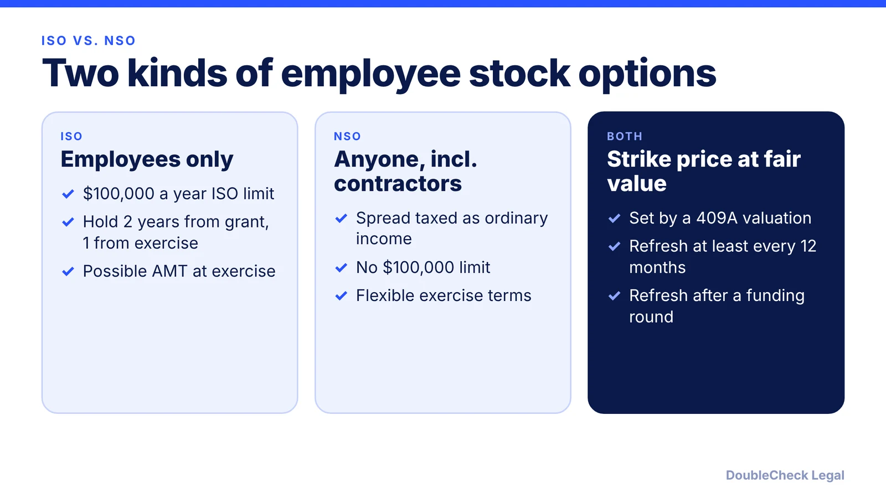
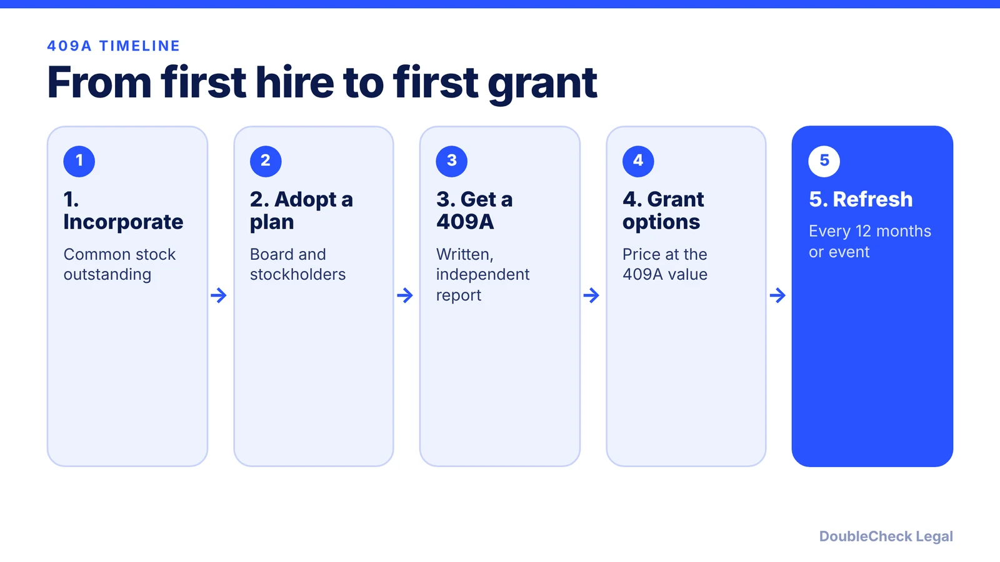

*Your option's strike price comes from a 409A valuation, and its tax treatment comes from whether it is an ISO or an NSO.*

**Key takeaways:**

- ISOs are for employees and have a $100,000-per-year limit; NSOs can go to anyone and are taxed as ordinary income on the spread.
- A 409A valuation sets the strike price; a valuation within 12 months and with no material event is presumed reasonable.
- Discounted options can mean ordinary income at vesting plus a 20% additional federal tax and interest.
- Check the post-termination exercise window before you accept: 90 days is common and can be negotiable.

## 1. The quick answer

**Quick answer:** Startups usually grant employees ISOs (incentive stock options) or NSOs (nonqualified stock options) with an exercise price set at the fair market value of common stock. A 409A valuation is the independent appraisal that sets that value. Per Terms.law, a valuation done within 12 months of the grant, with no material event since, is presumed reasonable unless the IRS can prove it was grossly unreasonable. Grant below fair market value and the option holder can face ordinary income tax at vesting plus a 20% additional federal tax.

## 2. ISOs vs. NSOs and the taxes, in brief

Facts below are per Joe Wallin (The Startup Law Blog, April 9, 2026) and Terms.law, who cite Internal Revenue Code section 422 for the ISO rules.

- **$100,000 limit.** Under section 422(d), the grant-date fair market value of stock that first becomes exercisable as an ISO in a calendar year is capped at $100,000 per employee. Anything over becomes an NSO. Example (ours): options first exercisable in one year with a grant-date value of $150,000 are $100,000 of ISOs and $50,000 of NSOs.
- **Holding periods.** Capital-gain treatment applies only if shares are held at least two years from grant and one year from exercise. A sale sooner is a disqualifying disposition, generally creating ordinary income on the exercise spread.
- **At exercise.** ISOs generally create no regular federal income tax on the spread, but the spread can count toward the alternative minimum tax (AMT), and the credit for AMT paid is not guaranteed (Wallin). NSOs generally produce ordinary compensation income equal to the exercise-date value minus the exercise price.
- **Who can get them.** ISOs go to employees; NSOs can go to contractors and advisors too (Terms.law).

Worked example (ours): you exercise 10,000 options at a $1.00 exercise price when fair market value is $4.00. The spread is 10,000 x $3.00 = $30,000. With NSOs that is ordinary income at exercise; with ISOs there is no regular tax on it at exercise, but it can enter the AMT calculation. Both vary by person, so confirm with a tax professional.

## 3. 409A valuation: purpose and safe harbor

Section 409A of the Internal Revenue Code is why strike prices cannot be picked freely. Per Terms.law, a 409A valuation is an independent appraisal of a private company's common stock fair market value, used to set the strike price. Options granted below fair market value are treated as discounted options.

**Safe harbor.** Terms.law says the valuation is presumed reasonable unless the IRS can prove it was grossly unreasonable. Hanson Bridgett adds that the valuation must be made reasonably and in good faith, evidenced by a written report, and performed by a qualified person (it describes significant experience as generally at least five years of relevant experience). A previous value cannot be reused after 12 months or if it does not reflect a later corporate event.

**When to refresh.** At least every 12 months, and after material events such as closing a funding round or acquisition talks. Terms.law notes many companies get a new 409A right after a priced round, and that common stock is often valued well below the preferred price (its illustration shows 25%).

**Cost and penalties.** Terms.law puts early-stage valuations from specialized providers at about $1,000 to $5,000. If options are discounted, the recipient can owe ordinary income tax at vesting, a 20% additional federal tax, and interest, with California adding another 20%.

## 4. Exercise windows and what to ask

The post-termination window is where employees most often lose value. Wallin says the ISO tax rule uses three calendar months after leaving, not necessarily 90 days, and that disability extends the period to one year; the plan and option agreement set the actual expiration, which may be shorter or longer. Terms.law says 90 days is the standard for NSOs too, but negotiable, and recommends asking about longer windows such as 7 to 10 years. It also warns that a 90-day window can leave employees unable to afford exercising. Wallin adds that an ISO plan must grant within 10 years of adoption, and 10% owners face a five-year term and a 110% exercise price.

**Questions to ask:**

- Is this an ISO or NSO, and what is the strike price against the latest 409A?
- What is the exercise window after I leave?
- Does the plan allow early exercise, and should I consider an 83(b) election within 30 days (Terms.law)?
- What is the vesting schedule ([vesting explained](/blog/cofounder-vesting-cliff-explained/))?

For founders, see [founder equity splits](/blog/founder-equity-split-how-to-divide/) and [how options show up on the cap table](/blog/cap-table-basics-for-first-time-founders/).

## Where DoubleCheck fits

[DoubleCheck](https://www.contactdoublecheck.com) helps businesses and founders start legal work with AI, verify it, and, when professional advice is warranted, connect with an independent attorney, including for immigration questions. Attorney availability and practice areas vary. Attorneys on DoubleCheck are independent professionals; an attorney-client relationship forms only if an attorney accepts your engagement.

**Sources:** [Joe Wallin, ISO vs. NSO: The Complete Guide](https://www.thestartuplawblog.com/iso-vs-nso-stock-options-complete-guide/); [Terms.law, Stock Option Plans for Startups](https://terms.law/2025/11/22/stock-option-plans-for-startups/); [Terms.law, 409A Valuation FAQ](https://terms.law/FAQ/business-disputes/409a-valuation-faq.html); [Hanson Bridgett, Granting Stock Options at Fair Market Value](https://www.hansonbridgett.com/Publications/articles/2016-07-technology-stock-options-value).

## FAQ

**What is a 409A valuation?**

Per Terms.law, it is an independent appraisal of a private company's common stock fair market value, used to set the strike price for employee options. Options granted below that value are treated as discounted options.

**How often does a startup need a new 409A?**

Per Terms.law, at least every 12 months and after a material event such as closing a funding round. Hanson Bridgett similarly says a previous valuation cannot be reused after 12 months or if it does not reflect a later corporate event.

**What is the difference between ISOs and NSOs?**

Per Joe Wallin, ISOs generally create no regular federal income tax on the spread at exercise (though AMT can apply) and have a $100,000-per-year cap, while NSOs produce ordinary income on the spread. Terms.law adds that ISOs go to employees and NSOs can go to contractors too.

**How long do I have to exercise options after leaving?**

It depends on your plan and option agreement. Wallin says the ISO tax rule uses three calendar months after employment ends, and Terms.law says 90 days is standard but negotiable. Check your own documents.

---

*General information only. This article is not legal, tax, investment, or accounting advice.*
