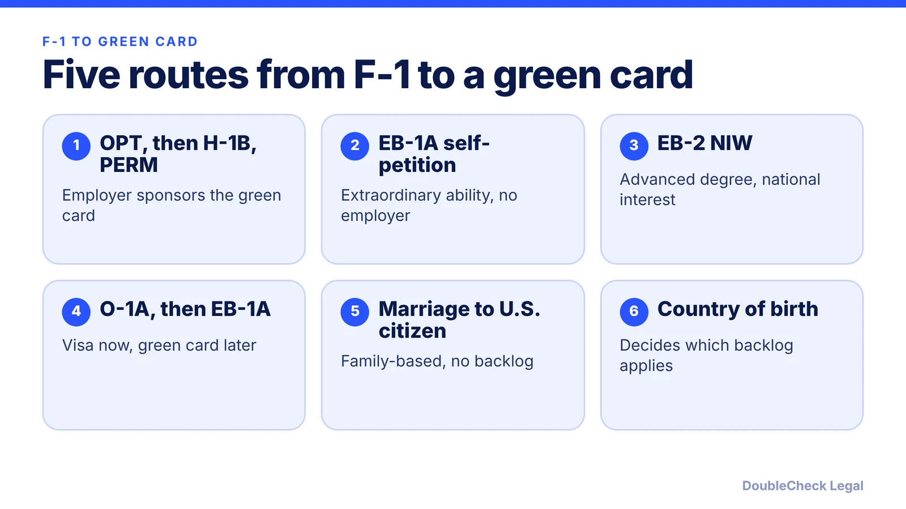
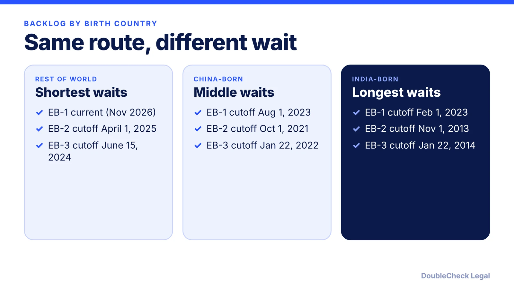

*A research-based comparison of routes from F-1 student to permanent residence, with Visa Bulletin cutoffs as of November 2026.*

**Key takeaways:**

- Realistic routes: OPT then H-1B and PERM, EB-1A, EB-2 NIW, O-1A then EB-1A, and marriage to a U.S. citizen.
- Self-petition routes (EB-1A, NIW) do not need an H-1B lottery win, but each needs strong evidence.
- Country of birth decides which employment backlog applies; the November 2026 cutoffs differ widely.
- Stated timelines are law-firm estimates, not USCIS data; keep status clean and get an attorney to review your plan.

## 1. The quick answer

**Quick answer:** There is no single path from F-1 student to permanent residence. Per Headman Law Group (April 2026), the realistic routes are OPT or STEM OPT, then H-1B, then employer-sponsored PERM; EB-1A as a self-petition; EB-2 NIW as a self-petition; O-1A as a bridge to EB-1A; and marriage to a U.S. citizen. Which one fits depends on your degree, your evidence, your employer, and your country of birth, because that last factor decides which visa backlog applies to you. As of November 2026, the self-petition routes do not need an H-1B lottery win, but each has its own evidence bar.

## 2. The routes side by side

Timelines below are Headman Law Group's own estimates from April 2026 and Lighthouse's published ranges. They are not USCIS data, and they differ between sources, so treat them as rough.

**Route 1: OPT, then H-1B, then PERM.** Per Headman, OPT lasts 12 months, or up to 36 months with a STEM extension. Lighthouse also gives 12 months plus a 24-month STEM extension. The employer then registers you for the H-1B lottery; Headman describes selection rates of about 20-30% in recent years, a firm characterization rather than an official figure. After that comes PERM, an I-140 petition (EB-2 or EB-3), and an I-485. Employer sponsorship is not guaranteed. See [how to apply for OPT](/blog/how-to-apply-for-opt-step-by-step-i-765-timeline/), [the H-1B lottery and its alternatives](/blog/h-1b-lottery-lost-alternatives-international-students/), [PERM](/blog/perm-labor-certification-green-card-process/) and [H-1B to green card timelines](/blog/h-1b-to-green-card-timeline-tech-workers/).

**Route 2: EB-1A self-petition.** Per Headman, it needs no employer and no PERM, and requires three of ten criteria plus a final merits review. Headman estimates 12-18 months through to the green card; Lighthouse says 12-20 months. See [EB-1A for software engineers](/blog/eb-1a-for-software-engineers-and-tech-employees/).

**Route 3: EB-2 NIW self-petition.** Per Headman, it requires an advanced degree and a national-interest showing, with a lower bar than EB-1A, and is subject to the EB-2 backlog for India and China. See [NIW for software engineers and researchers](/blog/niw-for-software-engineers-and-researchers/) and [EB-1A vs NIW](/blog/eb-1a-vs-niw-which-is-better-for-founders/).

**Route 4: O-1A, then EB-1A.** Per Headman, O-1A requires three of eight criteria, has no annual cap and no lottery, and is used as a bridge while the record strengthens. See [O-1 for recent graduates](/blog/o-1-visa-recent-graduates-international-students/) and [the O-1 to green card path](/blog/o-1-to-green-card-eb-1a-niw-path-after-o-1/).

**Route 5: marriage to a U.S. citizen.** Headman says immediate relatives face no numerical limits or per-country backlogs, with a concurrent I-130 and I-485 often taking 12-15 months, and that USCIS scrutinizes marriage timing and evidence closely. Lighthouse gives 10-14 months. See [marriage-based green card timelines](/blog/marriage-based-green-card-process-timeline/). A marriage should be real; it is not a workaround.

## 3. Where backlogs decide your timeline

For employment-based routes, the wait often depends less on your skills than on your country of birth. Per Headman, country of birth, not citizenship, determines which backlog applies.

Here are the November 2026 Visa Bulletin final action dates, as reported by [Wolfsdorf Immigration Law](https://wolfsdorf.com/november-2026-visa-bulletin-selected-employment-categories-make-gains-family-categories-advance/) and matching [Newsweek](https://www.newsweek.com/green-card-update-visa-bulletin-november-2026-progress-applicants-12609565) (the State Department PDF itself would not load for us):

- **EB-1:** India February 1, 2023; China August 1, 2023; rest of world current.
- **EB-2:** India November 1, 2013; China October 1, 2021; rest of world April 1, 2025.
- **EB-3:** India January 22, 2014; China January 22, 2022; rest of world June 15, 2024 (Wolfsdorf).

A final action date is the cutoff: your priority date must be earlier to receive a green card. Wolfsdorf also says USCIS is allowing the Dates for Filing chart (Chart B) for adjustment-of-status filings, which lets you file earlier but not be approved earlier. Priority dates come from PERM filing for EB-2/EB-3 or I-140 receipt for EB-1 and NIW (per Lighthouse). Bulletins change monthly, so read [the Visa Bulletin explained](/blog/visa-bulletin-explained-priority-dates-eb-categories/) and [retrogression for India and China](/blog/priority-date-retrogression-india-china-backlog/).

**What this means in practice.** Headman estimates 4-6 years for the OPT, H-1B and employer route for non-India/China natives, and 10+ years for India and China. Because the EB-1 India date is far ahead of the EB-2 India date in the table above, some Indian-born applicants look at EB-1A, but only if their evidence genuinely supports it.

## 4. Typical sequencing, risks, and when to get an attorney

Common sequences, not guarantees:

- **Employer path:** F-1, then OPT, then STEM OPT if eligible, then H-1B through the lottery, then PERM, I-140 and I-485. Cap-exempt employers such as universities can file H-1B petitions year-round, per Headman. See [H-1B cap-exempt employers](/blog/h-1b-cap-exempt-employers/).
- **Self-petition path:** build evidence during OPT, then file an EB-1A or NIW petition. Per Headman, self-petitions should be filed while OPT or STEM OPT is still valid to avoid a status gap.
- **Bridge path:** O-1A while you build evidence, then EB-1A later.

**Risk to know.** Per Headman, pursuing a green card on F-1 can create risk at consular visa renewals and at the border, because F-1 requires nonimmigrant intent (see [F-1 interview questions and 214(b)](/blog/f-1-visa-interview-questions-international-students-214b/)). Do not travel on a pending green card filing without advice. Also keep status clean: see [the F-1 60-day grace period](/blog/f-1-60-day-grace-period-after-opt-ends-options/) and [unemployment limits on STEM OPT](/blog/opt-unemployment-limit-90-days-stem-opt/).

**When you can handle it yourself.** Learning the routes, tracking Visa Bulletin dates, and gathering evidence of your work are reasonable first steps, with your DSO as the contact for OPT questions.

**When to get an attorney to look at it:**

- You are choosing between EB-1A, NIW, and O-1A and need an honest evidence assessment.
- You are a founder; see [F-1 founder routes](/blog/f-1-to-o-1-change-of-status-founders/) and [the NIW for founders](/blog/niw-eb-2-national-interest-waiver-founders/).
- Your employer is starting PERM, or you have a status gap, a denial, or an RFE.

For cost and fit, see [immigration lawyer fees](/blog/immigration-lawyer-fees-flat-fee-vs-hourly/) and [how to find a good immigration lawyer](/blog/how-to-find-good-immigration-lawyer-startup-founder/). For other visa options, see [visa types explained](/blog/us-visa-types-explained-immigrant-vs-nonimmigrant-categories/) and [which visa is right for you](/blog/which-us-visa-is-right-for-you-by-situation-decision-guide/).

## Where DoubleCheck fits

[DoubleCheck](https://www.contactdoublecheck.com) helps businesses and founders start legal work with AI, verify it, and, when professional advice is warranted, connect with an independent attorney, including for immigration questions. Attorney availability and practice areas vary. Attorneys on DoubleCheck are independent professionals; an attorney-client relationship forms only if an attorney accepts your engagement.

**Sources:** [Headman Law Group, F-1 to Green Card (April 2026)](https://headmanlaw.com/insights/f1-to-green-card-pathway/); [Lighthouse, F-1 to green card](https://www.lighthousehq.com/blog/f1-visa-to-green-card); [Wolfsdorf Immigration Law, November 2026 Visa Bulletin](https://wolfsdorf.com/november-2026-visa-bulletin-selected-employment-categories-make-gains-family-categories-advance/); [Newsweek, November 2026 Visa Bulletin](https://www.newsweek.com/green-card-update-visa-bulletin-november-2026-progress-applicants-12609565). The State Department Visa Bulletin PDF did not load; bulletin dates are attributed to the secondary sources.

## FAQ

**What is the fastest way to get a green card from F-1 status?**

There is no single fastest route. Per Headman Law Group, EB-1A self-petitions can take roughly 12-18 months, and marriage to a U.S. citizen often 12-15 months, but each has strict requirements. Employer-sponsored routes are typically longer.

**Do I need an H-1B to get a green card after OPT?**

No. Per Headman Law Group, EB-1A, EB-2 NIW and O-1A to EB-1A routes do not require H-1B selection. The employer route (PERM) is the one most tied to H-1B status, though an employer can also sponsor on other bases.

**Does my country of birth change how long I wait?**

Yes. Per Headman Law Group, country of birth, not citizenship, determines which backlog applies. In the November 2026 Visa Bulletin, as reported by Wolfsdorf, EB-2 final action dates were April 1, 2025 for most countries, October 1, 2021 for China and November 1, 2013 for India.

**Can I apply for a green card while still on F-1 or OPT?**

Filing an immigrant petition is possible, but per Headman Law Group, pursuing a green card on F-1 can create risk at consular visa renewals and at the border. Speak with your DSO and an immigration attorney before filing or traveling.

---

*General information only. This article is not legal, tax, investment, or accounting advice.*
