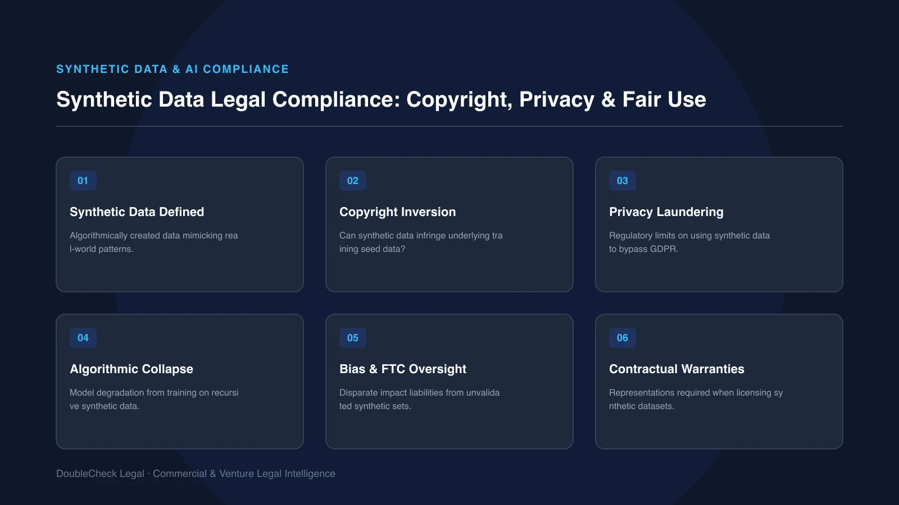
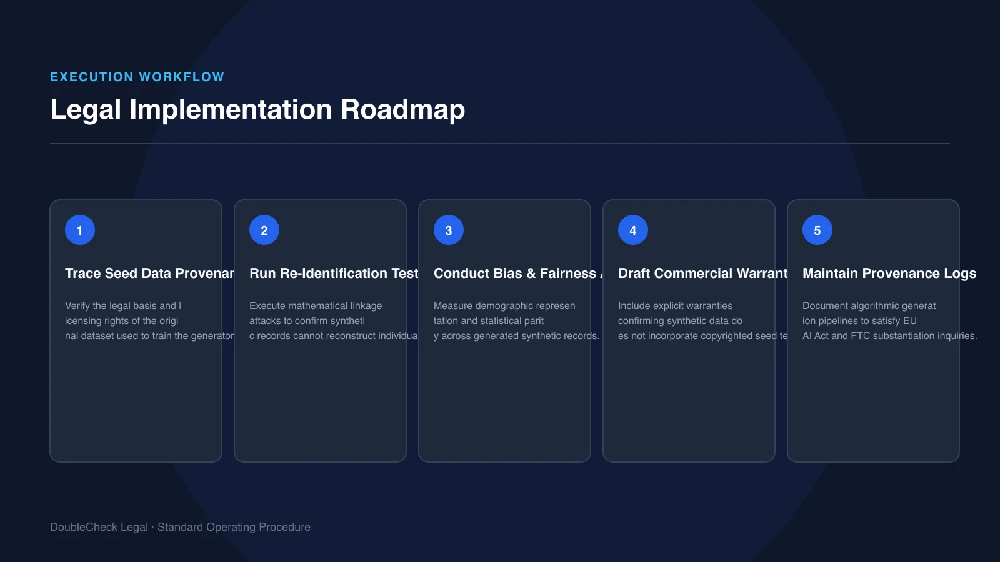

*A definitive legal and regulatory guide to synthetic data compliance, analyzing copyright infringement risks, privacy laundering under GDPR and CCPA, algorithmic bias oversight, and commercial data warranties.*

**Key takeaways:**
- **The "Clean Data" Illusion:** While synthetic data eliminates direct personal identifiers, it does not provide automatic immunity against copyright infringement or regulatory scrutiny.
- **The Derivative Work Hazard:** If synthetic data replicates the expressive structure or proprietary cadence of copyrighted seed content, courts may classify it as an infringing derivative work under 17 U.S.C. § 106.
- **Privacy Laundering Scrutiny:** European and US privacy regulators reject the claim that synthetic data is inherently anonymous, enforcing against datasets vulnerable to statistical inference or linkage attacks.
- **Statutory Bias Liability:** Training AI hiring, credit, or healthcare models on flawed synthetic data creates immediate disparate impact liability under EEOC Title VII and CFPB regulations.

## 1. The quick answer: The legal realities of synthetic data

As web data becomes exhausted and copyright litigation escalates, AI companies are increasingly turning to **synthetic data**—data generated by algorithms to train subsequent machine learning models:

1. **The Promise:** Infinite training scale, reduced collection costs, and the elimination of human privacy liabilities.
2. **The Legal Reality:** If the generative model was trained on infringing seed data, or if the synthetic output memorizes copyrighted expressions, the synthetic data **carries derivative copyright liability**.
3. **Core Compliance Mandate:** Companies licensing or producing synthetic data must document clean seed provenance, verify mathematical differential privacy, and conduct rigorous demographic bias audits.

## 2. In-depth legal analysis: Copyright, privacy laundering, and regulatory oversight

The legal status of synthetic data sits at the intersection of intellectual property law, statistical privacy, and civil rights regulations.

### A. Copyright and the Derivative Work Doctrine
Under Section 106(2) of the Copyright Act (17 U.S.C. § 106), copyright owners hold the exclusive right to prepare **derivative works** based upon their copyrighted materials.
- **The Legal Risk:** If an enterprise uses an LLM trained on copyrighted books to generate "synthetic dialogues," and those dialogues retain the expressive style, unique characters, or plot sequences of the original authors, the synthetic dataset is an infringing derivative work.
- **Fair Use Limits:** Relying on fair use (*17 U.S.C. § 107*) is hazardous when synthetic datasets are packaged and sold commercially as direct market substitutes for human-authored training corpora.

### B. "Privacy Laundering" and Differential Privacy
Under the EU General Data Protection Regulation (GDPR) and California Consumer Privacy Act (CCPA):
- **Anonymity Standard:** Data is only exempt from privacy laws if it is **irreversibly anonymous**—meaning the individual is no longer identifiable by any means reasonably likely to be used.
- **Linkage & Membership Inference Attacks:** Academic researchers have demonstrated that synthetic health and financial datasets can be queried to confirm whether a specific individual’s real records were included in the original training set.
- **The Standard:** To withstand regulatory scrutiny, synthetic data generators must implement provable **Differential Privacy ($epsilon$-differential privacy)**, mathematically bounding the privacy leak risk.

### C. Regulatory Comparison Matrix

| Regulatory Body | Key Statute / Guidance | Primary Legal Focus on Synthetic Data | Enforcement Remedy |
|---|---|---|---|
| U.S. Copyright Office | AI Registration Guidance | Lack of human authorship; derivative work status | Denial of copyright registration; statutory damages |
| Federal Trade Commission (FTC) | Section 5 (FTC Act) | Deceptive privacy claims; algorithmic disgorgement | Mandatory deletion of models and datasets |
| European Data Protection Board (EDPB) | GDPR Recital 26 / Article 4 | Re-identification vulnerability; unlawful processing | Fines up to €20M or 4% of global annual turnover |
| EEOC & CFPB | Title VII / Equal Credit Opportunity Act | Algorithmic bias and synthetic disparate impact | Civil rights enforcement; class action litigation |

## 3. Step-by-step: How to implement a legally compliant synthetic data pipeline

AI developers and enterprise compliance officers should follow a structured five-stage framework:

### Step 1: Seed Data Chain-of-Title Verification
Never generate synthetic data from unverified public web scrapes. Document affirmative commercial licenses or valid public domain status for all underlying seed data.

### Step 2: Implement Algorithmic Filtering and Memorization Checks
Deploy automated string-matching and semantic similarity filters that scan generated synthetic text against the seed corpus, automatically deleting any synthetic records that duplicate more than a minimal threshold of consecutive words.

### Step 3: Statistical Differential Privacy Certification
Subject synthetic datasets to independent mathematical verification, ensuring privacy loss parameters ($epsilon$ and $delta$) satisfy national standards established by NIST.

### Step 4: Disparate Impact and Bias Testing
If synthetic data is used for high-stakes decision models (employment, lending, housing), run statistical parity tests to ensure synthetic demographics do not amplify historical biases or create discriminatory outcomes.

### Step 5: Draft Commercial Synthetic Data Warranties
When selling or licensing synthetic datasets, draft precise commercial contracts warranting provenance while establishing reasonable liability caps for third-party algorithmic claims.

## 4. Contractual clauses: Drafting synthetic data licensing terms

Commercial agreements licensing synthetic datasets should contain specialized provisions:
- **Seed Provenance Representation:** Vendor represents that all seed data was lawfully acquired without violating third-party terms of service or copyright laws.
- **No-Human-PII Warranty:** Vendor warrants that the synthetic records contain no actual personal data or biometric information of any living individual.
- **Disclaimer of Model Collapse:** Vendor disclaims liability for downstream algorithmic degradation or model collapse resulting from recursive multi-generation training.

## 5. Due diligence checklist: Synthetic data compliance audit

1. **Verify Differential Privacy Bounds:** Confirm mathematical proof that individual seed records cannot be extracted via membership inference attacks.
2. **Audit Seed Licenses:** Confirm that underlying data licenses explicitly authorize the creation and commercial distribution of derivative synthetic datasets.
3. **Review European AI Act Obligations:** For high-risk AI models under the EU AI Act, ensure training datasets satisfy the Article 10 data governance and bias metrics.
4. **Maintain Generation Logs:** Retain metadata logs recording generation timestamps, model architectures, and validation scores for regulatory audit readiness.

## Where DoubleCheck fits

[DoubleCheck](https://www.contactdoublecheck.com) provides AI engineering teams, data brokers, and corporate legal departments with automated contract review and data provenance intelligence. DoubleCheck evaluates commercial data licenses, audits synthetic data warranties, flags re-identification liabilities, and ensures enterprise training pipelines comply with emerging copyright and privacy enforcement standards.

**Related reading:**
- [AI Regulation Startups EU AI Act Colorado](/blog/ai-regulation-startups-eu-ai-act-colorado/)
- [Who Owns AI-Generated Code? IP Checklist for Founders](/blog/ai-generated-code-ip-startup-founders/)
- [US Copyright Office AI Registration Guidance](/blog/us-copyright-office-ai-registration-guidance-human-authorship/)
- [AI Vendor Data Retention and Training Opt-Outs](/blog/ai-vendor-data-retention-and-training-opt-outs-what-to-check-in-settings/)

**Sources:** [U.S. Copyright Act, 17 U.S.C. § 106 (Exclusive Rights in Copyrighted Works)](https://www.law.cornell.edu/uscode/text/17/106); [European Data Protection Board (EDPB), Guidelines on Anonymisation Techniques](https://edpb.europa.eu/); [National Institute of Standards and Technology (NIST), Special Publication on Differential Privacy](https://csrc.nist.gov/); [Federal Trade Commission (FTC), Aiming for Truth, Fairness, and Equity in Your Company's Use of AI](https://www.ftc.gov/).

## FAQ

**What is synthetic data in artificial intelligence?**

Synthetic data is information generated algorithmically by machine learning models rather than collected from direct real-world measurement, designed to replicate the statistical properties of real data without containing real individuals’ actual records.

**Can synthetic data infringe copyright?**

Yes. If a generative model used to create synthetic data memorizes and reproduces substantial expressive elements of copyrighted seed data, the resulting synthetic dataset may constitute an unauthorized derivative work under Section 106 of the Copyright Act.

**Does using synthetic data bypass GDPR and CCPA privacy laws?**

Not automatically. Regulators view "privacy laundering"—using generative models to obscure personal data without true mathematical anonymity—as subject to privacy laws if individuals can still be re-identified through linkage attacks.

**What is model collapse in synthetic data training?**

Model collapse is a degenerative learning phenomenon where foundational models trained recursively on synthetic data generated by previous AI models suffer severe degradation in quality, diversity, and factual accuracy.

**How can AI contract software assist in licensing synthetic data?**

AI software audits synthetic data license agreements, verifying provenance representations, checking intellectual property warranties, and ensuring liability allocations protect enterprise model builders.

---

*General information only. This article is not legal, tax, investment, or accounting advice.*
