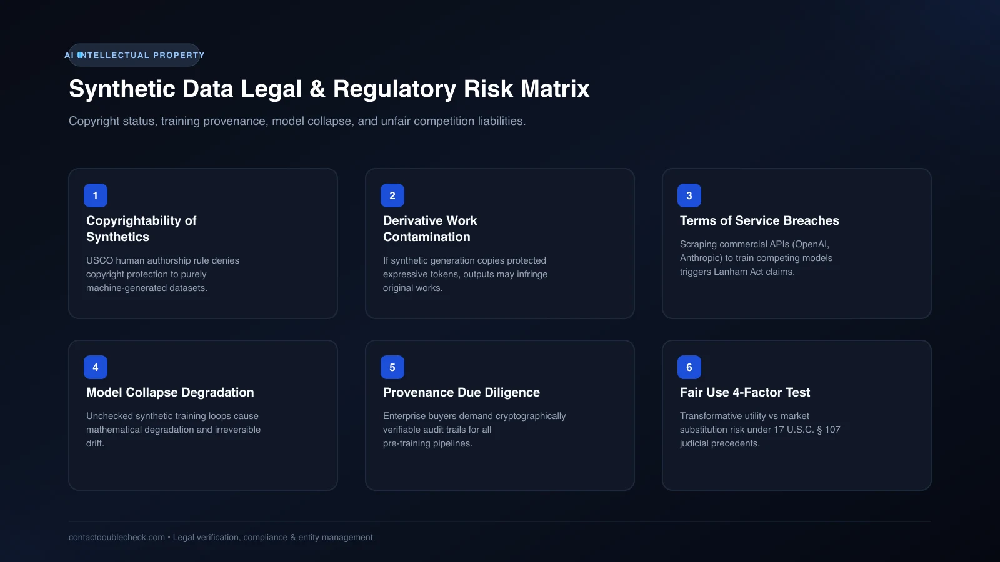
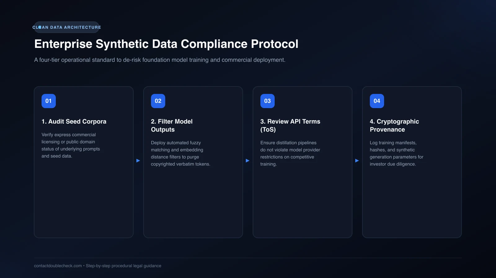

<div class="article-hero-banner mb-8">
  
</div>

## Can Purely Synthetic Data Generated by an AI Model Be Copyrighted?

The legal answer under prevailing United States jurisprudence and administrative doctrine is an absolute **no**. Under the **United States Copyright Office (USCO) Human Authorship Requirement** and the landmark D.C. District Court decision in **_Thaler v. Perlmutter_ (2023)**, copyright protection in the United States requires **human creative expression**.

Machine-generated text, synthetic audio, diffusion-generated imagery, and synthetic relational tables created autonomously by generative models lack human authorship. Consequently, purely synthetic datasets **cannot be registered for copyright** and reside immediately in the **public domain**.

```
Copyright Authorship Spectrum in AI Workflows

┌───────────────────────────────────────────────┬───────────────────────────────────────────────┐
│ Autonomous Synthetic Generation               │ Human-Directed Creative Selection             │
├───────────────────────────────────────────────┼───────────────────────────────────────────────┤
│ • Prompts submitted to teacher LLM            │ • Human curation, structural compilation      │
│ • Unedited raw synthetic output               │ • Creative arrangement of non-copyrightable d │
│ • ZERO COPYRIGHT PROTECTION                   │ • COMPILATION COPYRIGHT ONLY (§ 103)          │
│ • Competitors can freely copy raw data        │ • Protects structure, NOT underlying facts    │
└───────────────────────────────────────────────┴───────────────────────────────────────────────┘
```

However, while raw synthetic tokens cannot be copyrighted by the startup that generates them, utilizing synthetic data creates complex **downstream intellectual property liabilities** that can contaminate foundation models and invite enterprise litigation.

---

## The Derivative Contamination Risk: The "Poisoned Teacher" Problem

Many AI engineering teams turn to synthetic data generation under the assumption that it creates a clean legal buffer between web scraping liabilities and model pre-training. This assumption is legally flawed due to the **Doctrine of Derivative Contamination**.

```
The Synthetic Contamination Chain

┌───────────────────────────┐         Pre-Training Scrape       ┌───────────────────────────┐
│ Protected Original Works  ├──────────────────────────────────►│  Teacher Foundation Model │
│ (Books, Code, Artworks)   │         (Potential Infringement)  │  (e.g., Llama / GPT-4)    │
└───────────────────────────┘                                   └─────────────┬─────────────┘
                                                                              │
                                               Synthetic Data Distillation    │
                                                                              ▼
┌───────────────────────────┐         Fine-Tuning Run           ┌───────────────────────────┐
│ Student AI Startup Model  │◄──────────────────────────────────┤ Synthetic Training Corpus │
│ (Inherits Legal Contamin) │                                   │ (Infringing Derivative?)  │
└───────────────────────────┘                                   └───────────────────────────┘
```

If a large "teacher" model was pre-trained on copyrighted source material without authorization, and that teacher model generates synthetic data that memorizes and regurgitates expressive portions of that underlying corpus:
1. The synthetic dataset may constitute an **unauthorized derivative work** under **17 U.S.C. § 106(2)**;
2. Training a "student" model on that synthetic dataset transfers copyright contamination into the neural weights of the student model;
3. In judicial discovery, plaintiffs in copyright infringement actions (such as the class actions against OpenAI, Anthropic, and GitHub Copilot) can subpoena training manifests to prove that synthetic distillation pipelines ingested infringing tokens.

---

## Contractual Breaches vs. Fair Use: The Commercial API Distillation Trap

To generate high-quality synthetic instruction-tuning sets, startups frequently construct automated distillation loops querying commercial frontier model APIs. While the legal doctrine of **Fair Use (17 U.S.C. § 107)** provides strong defenses against statutory copyright claims for transformative model training, fair use **does not override contractual breach of contract claims**.

```
Commercial Model Provider Terms of Service Restrictions

┌───────────────────────────────┬─────────────────────────────────────────────────────────┐
│ Model Provider                │ Standard Contractual Distillation Prohibition           │
├───────────────────────────────┼─────────────────────────────────────────────────────────┤
│ OpenAI Commercial Terms       │ "You may not use output from the Services to develop    │
│ (Section 2(c))                │ models that compete with OpenAI."                       │
├───────────────────────────────┼─────────────────────────────────────────────────────────┤
│ Anthropic Commercial Terms    │ "Customer will not use Outputs to train, fine-tune, or   │
│ (Usage Policy)                │ improve any competing artificial intelligence model."   │
├───────────────────────────────┼─────────────────────────────────────────────────────────┤
│ Google Gemini API Terms       │ Prohibits using generated content to train competing     │
│ (Section 4)                   │ machine learning models or commercial services.         │
└───────────────────────────────┴─────────────────────────────────────────────────────────┘
```

### The Legal Ramifications of Terms of Service (ToS) Breaches

When an AI startup violates these restrictions:
- **Contractual Breach:** The provider can immediately terminate API access, revoke enterprise licenses, and seek actual damages or unjust enrichment.
- **Computer Fraud and Abuse Act (CFAA) & Lanham Act Claims:** In aggressive enforcement actions, providers can allege unauthorized computer access and unfair competition under federal trademark and trade regulation statutes.
- **Due Diligence Red Flags:** Enterprise procurement officers and Series A investors routinely audit training data provenance. A startup that built its proprietary model via breach-of-terms distillation carries an uninsurable liability profile.

---

## Fair Use Analysis for Synthetic Model Training: The 4-Factor Test

When evaluating whether synthetic data generation and training withstands judicial scrutiny, courts apply the statutory **Four-Factor Fair Use Test** under **17 U.S.C. § 107**:

```
Four-Factor Fair Use Assessment for Synthetic Training

┌─────┬───────────────────────────────┬───────────────────────────────────────────────────────────┐
│ No. │ Statutory Fair Use Factor     │ Synthetic AI Training Application                         │
├─────┼───────────────────────────────┼───────────────────────────────────────────────────────────┤
│ 01  │ Purpose and Character of Use  │ Transformative utility: creating analytical model weights │
│     │                               │ heavily favors fair use; commerciality cuts against it.   │
├─────┼───────────────────────────────┼───────────────────────────────────────────────────────────┤
│ 02  │ Nature of Copyrighted Work    │ Factual, statistical, and code data receives weaker       │
│     │                               │ protection than highly creative expressive fiction/art.   │
├─────┼───────────────────────────────┼───────────────────────────────────────────────────────────┤
│ 03  │ Amount & Substantiality Used  │ Extracting semantic concepts favors fair use; verbatim    │
│     │                               │ token memorization severely harms defense.                │
├─────┼───────────────────────────────┼───────────────────────────────────────────────────────────┤
│ 04  │ Effect on Market Value        │ If synthetic model directly substitutes for the original  │
│     │                               │ market, fair use defense routinely collapses.             │
└─────┴───────────────────────────────┴───────────────────────────────────────────────────────────┘
```

---

## Technical Governance: The Enterprise Synthetic Provenance Standard

To insulate proprietary foundation models from copyright infringement and commercial contract litigation, engineering teams must deploy a four-tier **Synthetic Data Governance Standard**:

```
Enterprise Synthetic Data Verification Standard

┌───────────────────────────────┬─────────────────────────────────────────────────────────┐
│ Governance Phase              │ Operational Engineering Protocol                        │
├───────────────────────────────┼─────────────────────────────────────────────────────────┤
│ Tier 1: Seed Data Clearance   │ Verify open-source commercial permissive licensing      │
│                               │ (MIT, Apache 2.0) or public domain provenance.          │
├───────────────────────────────┼─────────────────────────────────────────────────────────┤
│ Tier 2: De-Duplication Filter │ Deploy MinHash and Jaccard similarity algorithms to     │
│                               │ detect and purge verbatim regurgitation of seed text.   │
├───────────────────────────────┼─────────────────────────────────────────────────────────┤
│ Tier 3: ToS Audit Pipeline    │ Ensure teacher models operate under open permissive     │
│                               │ weights (Llama 3.1 Community License, Mistral Apache).  │
├───────────────────────────────┼─────────────────────────────────────────────────────────┤
│ Tier 4: Immutable Provenance  │ Log cryptographic SHA-256 hashes of all training runs,  │
│                               │ synthetic prompts, and filtering manifests.             │
└───────────────────────────────┴─────────────────────────────────────────────────────────┘
```

---

## Statutory Authorities and Benchmark References

- **United States Copyright Act (17 U.S.C. §§ 101, 102, 107):** Subject matter of copyright, human authorship, and fair use defense.
- **_Thaler v. Perlmutter_, 687 F. Supp. 3d 140 (D.D.C. 2023):** Affirmation of the human authorship requirement for copyright registration.
- **_Authors Guild v. Google, Inc._, 804 F.3d 202 (2d Cir. 2015):** Foundational precedent establishing transformative non-expressive use in text mining.
- **US Copyright Office Policy Statement (March 2023):** Copyright Registration Guidance: Works Containing Material Generated by Artificial Intelligence.
- **Lanham Act (15 U.S.C. § 1125(a)):** Federal unfair competition and false designation of origin standards.

<div class="article-steps-banner my-10">
  
</div>
