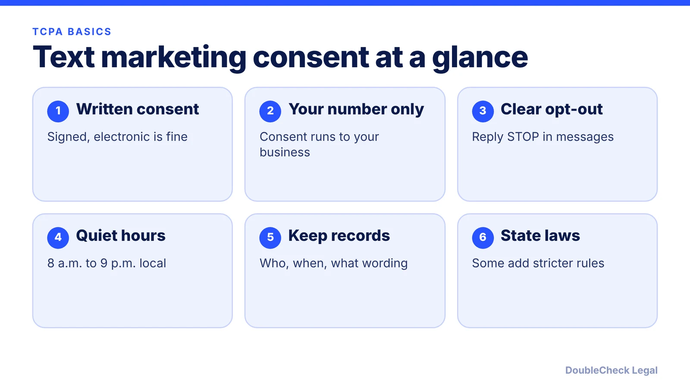
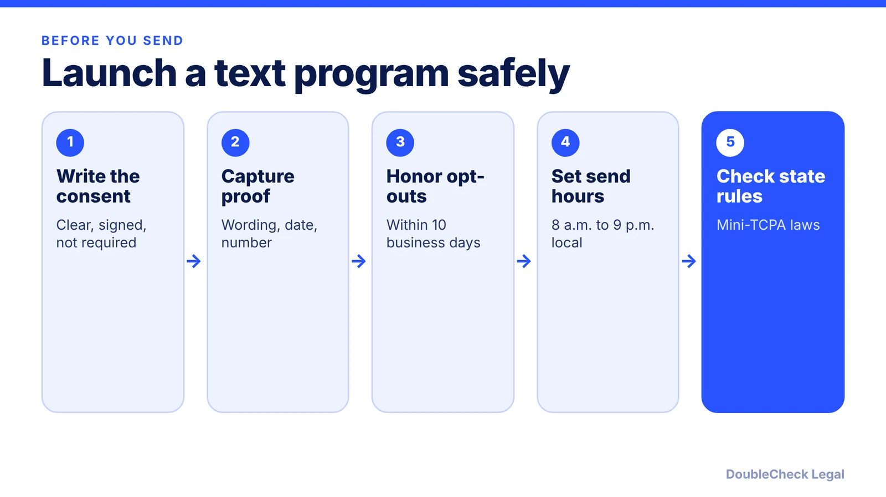

*A plain-English guide to TCPA text message marketing consent for small businesses, as of November 2026.*

**Key takeaways:**

- Promotional texts generally need prior express written consent, not just a phone number in your CRM.
- The FCC revocation rules took effect April 11, 2025: honor opt-outs within 10 business days; the revoke-all piece is delayed to January 31, 2027.
- Federal quiet hours are 8 a.m. to 9 p.m. recipient time, and some states are stricter.
- Keep consent records; using an SMS vendor does not move the responsibility off you.

## 1. The quick answer

**Quick answer:** For TCPA text message marketing consent, a small business generally needs prior express written consent before sending promotional texts: a signed (electronic is fine) agreement that includes the phone number, is not a condition of buying anything, and is given to your business. You also need an easy way to opt out, you should text only between 8 a.m. and 9 p.m. in the recipient's time zone, and you should keep consent records. Statutory damages can reach $500 to $1,500 per message, so the paper trail matters. Rules changed in 2025 and 2026, so this guide is dated as of November 2026.

## 2. What counts as consent for marketing texts

The Telephone Consumer Protection Act (TCPA) and FCC rules treat a text message as a call. A footnote in the federal banking regulators' examination manual says the term "call" includes a text message, including SMS (per the FDIC consumer compliance manual).

For autodialed or prerecorded telemarketing to a cell phone, the same manual says the consumer generally must give prior express written consent. That agreement should:

- bear the person's signature (an electronic signature can qualify where the law recognizes it);
- list the phone number that may be texted;
- clearly say that signing is not required to buy any product or service.

Practical points to add: the consent should be clear and conspicuous, not pre-checked, and specific about who is sending and what kind of messages to expect.

Informational texts, like an appointment reminder, can fall under a less strict "prior express consent" standard, but the safest habit is to document those too.

One 2025 development: the FCC adopted a "one-to-one" rule that would have limited each consent to a single seller. The U.S. Court of Appeals for the 11th Circuit struck it down on January 24, 2025, before it took effect (per Reed Smith). Businesses can keep using consent that otherwise complies with the TCPA, but carriers may still apply their own expectations when you register a texting campaign.

If you are building the legal pages around this, pair it with a clear [privacy policy](/blog/privacy-policy-generator-small-business/) and [website terms](/blog/website-terms-of-service-saas-startups/) that describe your texting program.

## 3. Opt-outs, quiet hours and recordkeeping

**Opt-outs.** The FCC's revocation rules took effect April 11, 2025. Per Carlton Fields, businesses now have 10 business days to honor a robocall or text opt-out, and consumers can revoke consent by any reasonable means. Replies such as "stop," "quit," "end," "revoke," "opt out," "cancel" and "unsubscribe" are treated as per se reasonable. That means a keyword-only system is risky: if a customer texts "please stop messaging me," treat it as a revocation.

**The "revoke-all" piece is delayed.** The part of the rule that would make an opt-out from one type of message apply to all robocalls and robotexts was pushed to January 31, 2027 by a January 6, 2026 FCC order, per Burr & Forman. The FCC said it wants to review its rulemaking record first. Check the FCC page for current status before relying on that date.

**Quiet hours.** The federal rule restricts telephone solicitations to between 8 a.m. and 9 p.m. in the called party's local time (per the FDIC manual). Some states are narrower: Florida's amended telemarketing law, for example, shortens the permitted calling period to 8 a.m. to 8 p.m. (per Jones Day). Confirm how each state where you text treats text messages.

**Records to keep:**

1. The consent language the person saw, and the date and form version.
2. The number, the time stamp and how they signed or clicked.
3. Every opt-out and when you honored it.
4. The list source if you bought or imported contacts. Old lead lists are a common problem.

The related rules for email are different, so see [CAN-SPAM rules for email marketing](/blog/can-spam-act-email-marketing-small-business-rules/) separately. Subscription businesses should also read the [FTC click-to-cancel rules](/blog/ftc-click-to-cancel-subscription-rules-saas/).

## 4. Risk: damages, state laws and vendors

**Damages.** Per Burr & Forman, private litigants can recover $500 for each violation (or actual damages, if greater), and courts can treble that to $1,500 for willful and knowing violations. Class actions can reach very large sums. Because every text can be a separate violation, a list of a few thousand numbers can create exposure quickly.

**State laws add more.** Some states have their own "mini-TCPA" laws. Florida's amended telemarketing law lets consumers sue for actual damages or $500, whichever is greater, with up to triple that for willful or knowing violations (per Jones Day). Texas SB 140, effective September 1, 2025, extends the state telephone solicitation law to marketing texts, adds an expanded private right of action, and requires registration with the Texas Secretary of State for covered businesses (per Morgan Lewis). Treat these summaries as a prompt to read the actual statute for the states where your customers live.

**Vendors do not move the risk.** A business can stay responsible for messages sent in its name, even when a third-party SMS platform sends them. Ask your platform how it stores consent, handles STOP and HELP, and exports records.

**Carrier registration is separate from the law.** U.S. carriers set their own registration requirements for business texting (for example, registering your brand and campaign with The Campaign Registry), so check your texting platform's current requirements. Registration helps delivery; it does not substitute for consent.

Other consumer-facing rules sit nearby: [CCPA/CPRA](/blog/ccpa-cpra-compliance-small-business/) for California data, the [state privacy law checklist](/blog/state-privacy-laws-2027-small-business-checklist/), and [FTC endorsement disclosures](/blog/ftc-endorsement-disclosure-rules-small-business/) if you promote through influencers.

## 5. Self-handle or ask an attorney, and where AI helps

**You can usually handle yourself:** drafting a first version of consent language, building the opt-in form, writing STOP and HELP replies, and setting up a consent log with your texting platform.

**Get an attorney to look when:**

- you are texting in several states, especially Florida or Texas;
- you bought, inherited or merged a contact list and cannot show where the numbers came from;
- you received a demand letter or complaint alleging unwanted texts;
- you sell through partners or lead generators who collect consent for you.

**Where AI helps.** An AI tool can draft consent wording, turn the rules into a checklist, and summarize your platform settings. It can also get dates and state details wrong. Verify the output against the sources below and the statute before you launch. See [using AI for legal work safely](/blog/small-business-ai-legal-work-safely/), [verifying AI-generated legal documents](/blog/verify-ai-generated-legal-document/), and [when to hire a lawyer](/blog/when-to-hire-lawyer-small-business/). Do not paste customer lists into a consumer chatbot; see [uploading contracts to ChatGPT and confidentiality](/blog/uploading-contracts-to-chatgpt-confidentiality/) for the same concern. If a vendor sends your texts, review the contract with the [AI vendor checklist](/blog/ai-vendor-contract-checklist/) and the [DPA guide](/blog/data-processing-agreement-dpa-ai-vendors-small-business/).

## Where DoubleCheck fits

[DoubleCheck](https://www.contactdoublecheck.com) helps businesses and founders start legal work with AI, verify it, and, when professional advice is warranted, connect with an independent attorney, including for immigration questions. Attorney availability and practice areas vary. Attorneys on DoubleCheck are independent professionals; an attorney-client relationship forms only if an attorney accepts your engagement.

**Sources:** [FDIC consumer compliance manual, Telephone Consumer Protection Act](https://www.fdic.gov/consumer-compliance-examination-manual/viii-5-telephone-consumer-protection-act); [Reed Smith, Eleventh Circuit vacates FCC one-to-one consent rule](https://www.reedsmith.com/our-insights/blogs/technology-law-dispatch/102k2uj/eleventh-circuit-vacates-fcc-one-to-one-consent-rule/); [Burr & Forman, TCPA recoverable damages](https://www.burr.com/telephone-consumer-protection-act/the-tcpa-recoverable-damages); [Jones Day, Florida changes to telemarketing laws](https://www.jonesday.com/en/insights/2021/07/florida-makes-significant-changes-to-telemarketing-laws); [Morgan Lewis, Texas telephone solicitation law now covers text messages](https://www.morganlewis.com/pubs/2025/09/texas-telephone-solicitation-law-now-covers-text-messages); [Carlton Fields, TCPA opt-out regulations](https://www.carltonfields.com/insights/publications/2025/mastering-the-new-tcpa-opt-out-regulations); [Burr & Forman, FCC delays revoke-all rule (Jan. 7, 2026)](https://www.burr.com/telephone-consumer-protection-act/the-fcc-delays-effective-date-of-tcpa-revoke-all-rule-until-january-31-2027). Not fetched: eCFR 47 CFR 64.1200 (failed to load).

## FAQ

**Do I need written consent to text customers for marketing?**

Generally yes. Per the FDIC consumer compliance manual, autodialed or prerecorded telemarketing to a cell phone generally requires prior express written consent that is signed, lists the number and says signing is not required to buy anything. Texts count as calls.

**How fast must I honor a STOP text?**

Per Carlton Fields, the FCC rules effective April 11, 2025 give businesses 10 business days to honor a robocall or text opt-out. Stopping sooner is the safer habit, and any reasonable revocation counts, not only the word STOP.

**What is the revoke-all rule and is it in effect?**

It would make an opt-out for one type of message apply to all robocalls and robotexts. Per Burr and Forman, a January 6, 2026 FCC order delayed it to January 31, 2027. Check the FCC for current status.

**What are the penalties for violating the TCPA?**

Per Burr and Forman, private litigants can recover $500 per violation, which a court may treble to $1,500 for willful or knowing violations, and class actions can reach very large sums. Some states add their own private rights of action, so check the states where you text.

**Can I text a purchased contact list?**

Not safely unless each person gave consent that covers your business and you can document it. Texting old lead lists without confirming consent is a common misstep. Ask an attorney before using a purchased or inherited list.

---

*General information only. This article is not legal, tax, investment, or accounting advice.*
