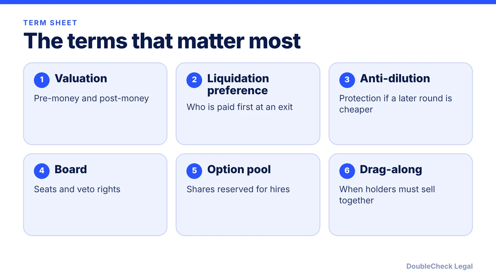
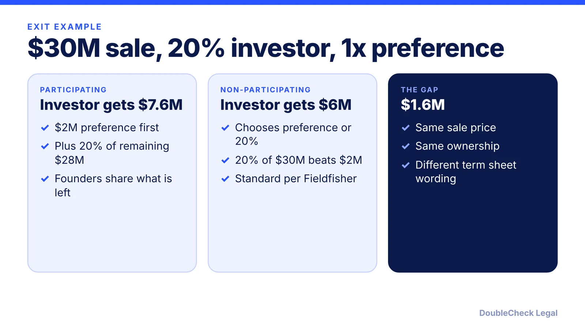

*A term sheet is mostly non-binding, but the economics and control terms in it usually carry through to the final documents.*

**Key takeaways:**

- Term sheets are largely non-binding, but no-shop and confidentiality clauses typically bind you.
- Liquidation preference wording can change founder proceeds in a sale: in our $30M example, $7.6M vs. $6M to the investor.
- Anti-dilution type (weighted average vs. full ratchet) and drag-along thresholds are negotiable.
- The option pool is in the fully diluted pre-money, so it shifts dilution to existing holders.

## 1. The quick answer

**Quick answer:** A term sheet is a short, largely non-binding summary of the main terms of an investment, signed before the lawyers draft the final documents. The terms that move the most money and control are valuation, liquidation preference, anti-dilution, board composition, and the option pool. The binding parts are usually narrow: exclusivity ("no-shop"), confidentiality, and sometimes costs. Read those as seriously as a final contract.

## 2. Economics: valuation, preference, and pool

- **Valuation.** Per McCarthy Tetrault, pre-money valuation is the company's value before the investment and post-money includes the investment amount; you need both to compute the investor's percentage. Example: $2M invested at an $8M pre-money valuation is $10M post-money, so the investor owns 20%.
- **Liquidation preference.** Fieldfisher calls a 1x non-participating preference "standard market practice." Per the Strictly Business guide, a participating investor takes its preference and then also shares the remaining proceeds as if converted; a non-participating investor takes the greater of its preference or its as-converted share.
- **Option pool.** The unissued employee pool counts in the fully diluted post-money capitalization, and if the pool is enlarged before the investment, dilution falls on existing holders. Attorney Joe Wallin calls this the "pool shuffle." [Cap table basics](/blog/cap-table-basics-for-first-time-founders/) shows the math.

**Worked example (our arithmetic on the Strictly Business guide's figures).** A $30M sale; an investor put in $2M for 20% with a 1x preference. Participating: $2M + 20% of the remaining $28M = $7.6M. Non-participating: the greater of $2M or 20% of $30M = $6M. The same company and exit, $1.6M apart, from one word in the term sheet.

## 3. Control and protection: anti-dilution, board, drag-along

- **Anti-dilution.** Protects investors if a later round prices lower. Fieldfisher says the weighted-average mechanism is common and full ratchet is far more investor-friendly. Per the Strictly Business guide, with a $1.00 Series A followed by a $0.50 round, broad-based weighted average adjusts the conversion price to about $0.8333 (about 1.2 common shares per preferred share), while full ratchet would give 2.
- **Board and control rights.** Fieldfisher notes investors may gain board seats or veto rights over capital measures, budgets, or exits. Seemingly minor wording can shift corporate control.
- **Drag-along.** Governs when holders can be forced to join a sale. The guide says the NVCA model uses 51% of preferred on an as-converted basis, and founders may push for a higher threshold, board approval, a price floor, and several (not joint) liability.
- **Pro rata.** The right to buy additional stock in a later round, as Haynes Boone defines it; it is also how SAFE investors ask for side letters (see [SAFE note explained](/blog/safe-note-explained-for-founders/)).

Related: [NVCA model documents](/blog/nvca-model-documents-priced-round-explained/) show how these terms become the final documents.

## 4. Binding vs. non-binding, and what to do before signing

Per the Strictly Business guide, the NVCA model term sheet makes clear it does not create a legal commitment by the VC firm, but the no-shop and confidentiality provisions are binding, and the no-shop applies even if the financing never closes. Under a typical no-shop the company must work in good faith toward closing and promptly report third-party inquiries. Fieldfisher adds that binding clauses usually cover exclusivity, confidentiality, and cost allocation. The McCarthy Tetrault article says closing is conditioned on due diligence and board and shareholder approvals.

Before you sign:

- Ask how long exclusivity lasts and what happens if the deal slips.
- Model your ownership under the pool and the preference, not only the headline valuation (Fieldfisher lists focusing on valuation alone as a pitfall).
- Have counsel review the term sheet, and prepare for diligence: [fundraising due diligence checklist](/blog/due-diligence-checklist-for-startup-fundraising/), [Series A diligence](/blog/series-a-legal-due-diligence-checklist/).

## Where DoubleCheck fits

[DoubleCheck](https://www.contactdoublecheck.com) helps businesses and founders start legal work with AI, verify it, and, when professional advice is warranted, connect with an independent attorney, including for immigration questions. Attorney availability and practice areas vary. Attorneys on DoubleCheck are independent professionals; an attorney-client relationship forms only if an attorney accepts your engagement.

**Sources:** [Strictly Business, Guide to Negotiating a Venture Capital Round](https://www.strictlybusinesslawblog.com/wp-content/uploads/2017/09/Guide-to-Negotiating-a-Venture-Capital-Round-2017.09.04.pdf); [Fieldfisher, Understanding term sheets](https://www.fieldfisher.com/en/locations/germany/insights/understanding-term-sheets-key-terms-and-pitfalls); [McCarthy Tetrault, Understanding the Term Sheet](https://www.mccarthy.ca/en/insights/blogs/mtventures/understanding-funding-and-finance-through-cvca-part-2-understanding-term-sheet); [Haynes Boone, SAFEs and Convertible Notes](https://www.haynesboone.com/news/publications/safes-and-convertible-notes); [Joe Wallin, The Startup Law Blog, Cap Table Management](https://www.thestartuplawblog.com/cap-table-management-founders-guide/).

## FAQ

**Is a term sheet legally binding?**

Mostly not. Per the Strictly Business guide, the NVCA model term sheet does not create a legal commitment by the VC firm, but its no-shop and confidentiality provisions are binding, and the no-shop applies even if the financing never closes.

**What is a standard liquidation preference?**

Fieldfisher calls a 1x non-participating preference standard market practice. Participating preferences let the investor take its preference and also share the remaining proceeds, which costs common holders more.

**What is the difference between weighted-average and full-ratchet anti-dilution?**

Per the Strictly Business guide's example, a $1.00 round followed by a $0.50 round adjusts the conversion price to about $0.8333 under broad-based weighted average, but to $0.50 under full ratchet. Full ratchet is far more investor-friendly (Fieldfisher).

**What is a no-shop clause?**

A binding provision that stops the company from soliciting other investment or acquisition offers for a set period and requires it to report inquiries. Per the Strictly Business guide, it applies even if the financing never closes.

---

*General information only. This article is not legal, tax, investment, or accounting advice.*
