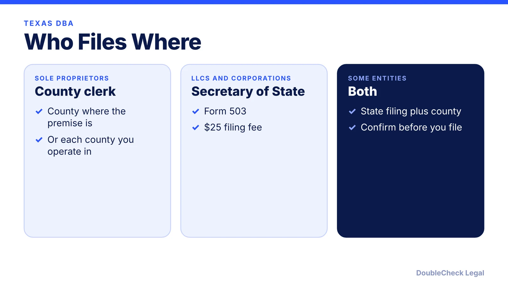
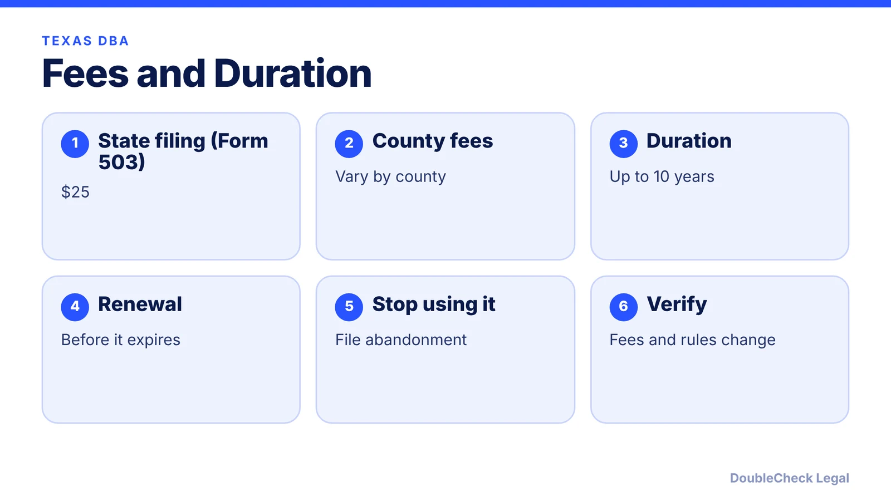
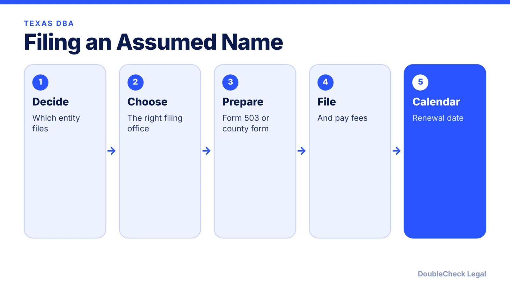

*In Texas a DBA is an assumed name certificate, and where you file depends on your entity type.*

**Key takeaways:**

- Sole proprietors and general partnerships file with the county clerk.
- LLCs and corporations generally file Form 503 with the Secretary of State, listed at $25.
- A filing can be effective for up to 10 years, per Zenind.
- Confirm whether you need both a state and a county filing.

## 1. The quick answer

**Quick answer:** In Texas a DBA is an **assumed name certificate**. According to a Zenind guide, sole proprietors and general partnerships file with the county clerk in the county where the business premise is maintained, while LLCs, corporations, and similar entities generally file with the Texas Secretary of State on **Form 503**, and some must also file with the county clerk. The Secretary of State's fee schedule lists the assumed name certificate at **$25**, and a filing can be effective for up to 10 years.

## 2. Fees and duration

The Texas Secretary of State fee schedule lists the assumed name certificate (Form 503) at $25. County fees vary by county. A filing can be effective for up to 10 years from the filing date, per Zenind. If you still use the name, renew before it expires; if you stop using the name, file an abandonment or cancellation.

## 3. Steps

If you are forming an LLC, see [Texas certificate of formation fees and forms](/blog/texas-certificate-of-formation-fees-forms/) and [Texas franchise tax](/blog/texas-franchise-tax-llc-corporation/).

## 4. Why a DBA does not protect the name

A DBA lets you operate under a name; it does not by itself give you ownership of the name or stop others from using it. Run a name check first; see [trademark and business name checks](/blog/trademark-business-name-check/).

## Where DoubleCheck fits

[DoubleCheck](https://www.contactdoublecheck.com) is built for businesses that start legal work with AI. Bring your question or draft, use an AI-first workflow to understand and verify it, and when professional advice is warranted, you can connect with an independent attorney. Attorneys on DoubleCheck are independent professionals; an attorney-client relationship forms only if an attorney accepts your engagement.

**Sources:** [Texas SOS fee schedule](https://direct.sos.state.tx.us/help/help-corp.asp?pg=fee); [Zenind: Texas assumed name](https://www.zenind.com/help/post/how-to-get-a-dba-name-in-texas-filing-an-assumed-name-certificate).

## FAQ

**What is a DBA in Texas?**

An assumed name certificate for doing business under a name other than your legal name.

**Where does a sole proprietor file?**

With the county clerk in the county where the business premise is maintained, per Zenind.

**How much is the Texas assumed name certificate?**

The Secretary of State's fee schedule lists $25 for Form 503; county fees vary.

**How long does it last?**

Up to 10 years from the filing date, per Zenind.

---

*General information only. This article is not legal, tax, investment, or accounting advice.*
