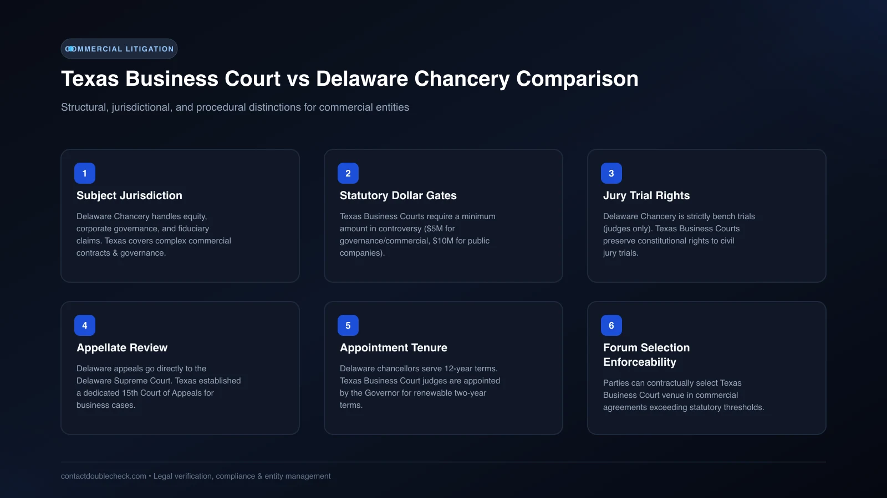
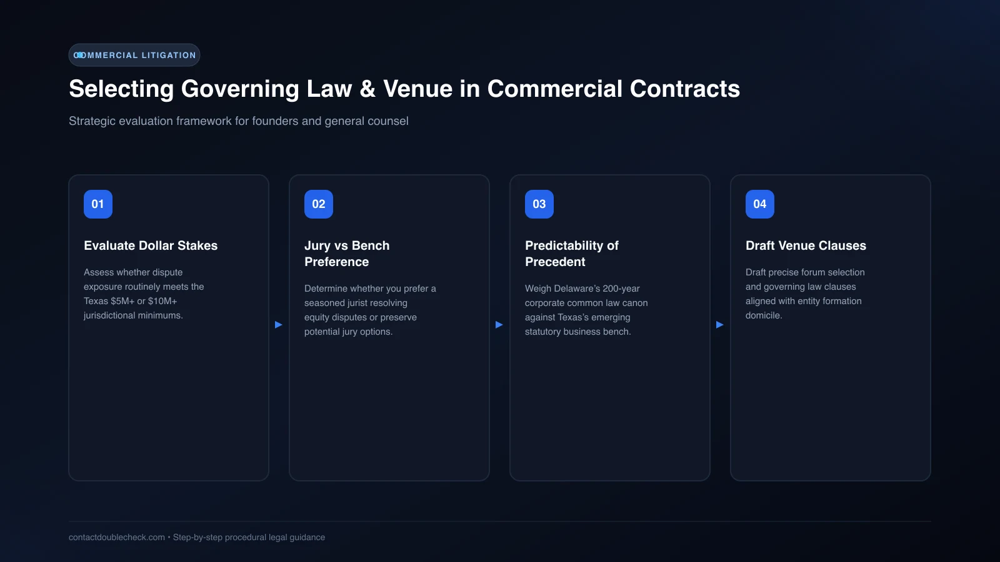

*Comparative legal analysis of the Texas Business Court system and the Delaware Court of Chancery for commercial agreements and entity governance, as of November 2026. General information, not legal advice.*

**Key takeaways:**

- The Texas Business Court launched in September 2024 under HB 19 to provide a dedicated, specialized commercial docket rivaling Delaware.
- Monetary jurisdiction requires $5,000,000+ for internal governance and fiduciary litigation, or $10,000,000+ for commercial contract disputes.
- Unlike Delaware Chancery’s non-jury equity bench, Texas Business Courts preserve constitutional rights to civil jury trials upon demand.
- Appeals from Texas Business Courts go directly to the newly created statewide Fifteenth Court of Appeals.
- Venture capital-backed startups overwhelmingly favor Delaware governing law, while Texas operating companies benefit from local business court venue clauses.

## 1. The quick answer

**Quick answer:** For over a century, the **Delaware Court of Chancery** has been the gold standard for corporate dispute resolution due to its specialized non-jury bench, extensive body of corporate governance precedent, and predictable application of the Delaware General Corporation Law (DGCL). However, on September 1, 2024, Texas entered the arena by officially launching the **Texas Business Court system** under Texas House Bill 19 (Tex. Gov't Code Chapter 25A).

The Texas Business Court provides dedicated judges with at least 10 years of complex commercial litigation experience, strict monetary entry gates (**$5 million** for governance/derivative actions, **$10 million** for commercial contracts), and an exclusive intermediate appeals pipeline through the newly formed **Fifteenth Court of Appeals**. While Delaware remains the default choice for venture-backed founders raising institutional equity, growing Texas companies and private enterprises now have an agile, sophisticated domestic alternative that avoids Delaware legal costs and allows jury trials when desired.

For state-by-state formation comparisons, see [incorporate in Texas vs Delaware for a Texas-based startup](/blog/incorporate-in-texas-vs-delaware-for-a-texas-based-startup/) and [best state to form an LLC comparison](/blog/best-state-to-form-an-llc-comparison/).

## 2. Structure and launch of the Texas Business Court system

Modeled after successful specialized business dockets in New York and North Carolina, Texas designed its Business Court to resolve high-dollar commercial disputes quickly, shielding corporate litigants from overloaded general district court dockets.

The system is organized into geographic divisions across Texas’s major commercial hubs:
- **First Division:** Dallas, Collin, and surrounding counties.
- **Third Division:** Austin and the Central Texas tech corridor.
- **Fourth Division:** San Antonio and South Texas.
- **Eighth Division:** Fort Worth and West Texas.
- **Eleventh Division:** Houston and the Gulf Coast industrial center.

Judges are appointed by the Governor of Texas for renewable two-year terms with Senate confirmation, required to have at least 10 years of specialized business litigation or judicial experience.

## 3. Jurisdictional thresholds: $5M and $10M gates

Under Tex. Gov't Code § 25A.004, the Texas Business Court does not handle consumer matters, personal injury, family law, or small claims. Access is guarded by strict statutory monetary thresholds:

### The $5 Million Gate: Governance and Fiduciary Actions
Claims exceeding **$5,000,000** in controversy qualify if they involve:
- Derivative proceedings on behalf of an organization.
- Internal affairs, governance, or bylaws of an entity.
- Breach of fiduciary duty or duties owed by an officer, director, manager, or controlling member.
- State or federal securities laws enforcement against an organization or its governing persons.

### The $10 Million Gate: Commercial Transactions & IP
Claims exceeding **$10,000,000** in controversy qualify if they involve:
- Action arising out of a qualified commercial contract or commercial transaction where parties agreed to venue in the business court.
- Violations of the Texas Finance Code or Business & Commerce Code involving commercial loans or transactions.
- Complex intellectual property, patent, or trade secret litigation between commercial entities.

## 4. Comparing Texas Business Court with Delaware Chancery

Understanding the strategic divergence between both forums is vital when drafting dispute resolution clauses:

| Feature | Delaware Court of Chancery | Texas Business Court |
| :--- | :--- | :--- |
| **Established** | 1792 (230+ years of precedent) | 2024 (Under HB 19) |
| **Monetary Gate** | None (Court of equity) | $5M (Governance) / $10M (Commercial) |
| **Trial Format** | Bench trials exclusively (No juries) | Juries permitted upon party demand |
| **Judicial Terms** | 12-year constitutional terms | 2-year gubernatorial appointments |
| **Appellate Path** | Direct to Delaware Supreme Court | Exclusive to Texas 15th Court of Appeals |
| **Body of Law** | DGCL & extensive common-law canon | Texas Business Organizations Code (BOC) |

A monumental distinction is **trial by jury**. Under the Delaware Constitution, Chancery Court proceedings are exclusively bench trials decided by the Chancellor and Vice-Chancellors. In contrast, Article I, Section 15 of the Texas Constitution guarantees the right to trial by jury in civil cases, meaning litigants in Texas Business Court can demand a jury for legal claims.

## 5. Appeals: The Fifteenth Court of Appeals' role

To prevent conflicting interpretations across Texas’s existing 14 intermediate appellate courts, the legislature simultaneously created the **Fifteenth Court of Appeals** (Tex. Gov't Code § 22.201(p)).

Holding exclusive statewide jurisdiction over appeals from the Texas Business Courts and major administrative agency challenges, the 15th Court of Appeals provides a streamlined, centralized appellate body. This structure mirrors the predictability of the Delaware Supreme Court, ensuring uniform interpretation of the Texas Business Organizations Code across all state judicial divisions.

## 6. Drafting choice of law and venue clauses

When drafting commercial agreements, co-founder agreements, or master service contracts, founders must strategically evaluate dispute clauses:

- **Venture-Backed Tech Startups:** If raising funding from institutional angel investors or venture funds, maintain **Delaware governing law and Delaware Chancery Court venue**. Investors value the predictability of DGCL case law above all else.
- **Texas Operating Businesses:** For businesses headquartered in Texas, real estate syndicates, or commercial supply agreements involving large transactions ($10M+), selecting **Texas law and Texas Business Court venue** avoids retaining out-of-state Delaware counsel and grounds litigation in an efficient local commercial forum.

Review our clause guides on [arbitration clauses for small business contracts](/blog/arbitration-clause-explained-small-business-contracts-pros-cons/) and [entire agreement merger clauses](/blog/entire-agreement-merger-clause-explained-what-it-wipes-out/).

## Where DoubleCheck fits

[DoubleCheck](https://www.contactdoublecheck.com) helps founders and executive teams analyze contract risks, review commercial agreements, and select appropriate governing law clauses with AI precision. When high-value commercial disputes or entity restructuring questions arise, DoubleCheck connects you with licensed corporate and litigation counsel in Texas and Delaware.

**Related reading:**
- [Incorporate in Texas vs Delaware for a Texas-Based Startup](/blog/incorporate-in-texas-vs-delaware-for-a-texas-based-startup/)
- [Texas Certificate of Formation: Fees and Forms Guide](/blog/texas-certificate-of-formation-fees-forms/)
- [Arbitration Clause Explained: Small Business Contracts Pros and Cons](/blog/arbitration-clause-explained-small-business-contracts-pros-cons/)
- [Co-Founder Deadlock Clauses: Preventing a 50/50 Stalemate](/blog/co-founder-agreement-5050-deadlock-clauses-that-prevent-a-stalemate/)

**Sources:** [Texas Legislature Online, House Bill 19 Text (Texas Business Court Act)](https://capitol.texas.gov/BillLookup/History.aspx?LegSess=88R&Bill=HB19); [Texas Judicial Branch, Texas Business Court System](https://www.txcourts.gov/businesscourts/); [Texas Judicial Branch, Fifteenth Court of Appeals](https://www.txcourts.gov/15thcoa/); [Delaware Courts, Delaware Court of Chancery Overview](https://courts.delaware.gov/chancery/); [Texas Business Organizations Code (BOC), Chapter 101 & 21](https://statutes.capitol.texas.gov/Docs/BO/htm/BO.101.htm).

## FAQ

**When did the Texas Business Court begin operations?**

Created by Texas House Bill 19 (HB 19), the Texas Business Court system officially commenced operations on September 1, 2024, handling major commercial and corporate governance actions filed thereafter.

**What is the minimum monetary threshold for Texas Business Courts?**

Jurisdiction requires an amount in controversy exceeding $5,000,000 for internal corporate governance and derivative suits, or exceeding $10,000,000 for qualified commercial contracts and transactions.

**Can you have a jury trial in the Texas Business Court?**

Yes. Unlike the Delaware Court of Chancery where matters are heard exclusively by judges, the Texas Constitution guarantees a right to trial by jury upon party demand.

**What is the Texas 15th Court of Appeals?**

Texas created the Fifteenth Court of Appeals as a specialized statewide intermediate appellate court holding exclusive jurisdiction over appeals from the Texas Business Courts.

**Should a startup change its domicile from Delaware to Texas for business courts?**

Most venture-backed startups remain Delaware C-Corps due to investor consensus and two centuries of predictable DGCL case law. However, Texas-based operating businesses increasingly elect Texas law and venue.

---

*General information only. This article is not legal, tax, investment, or accounting advice.*
