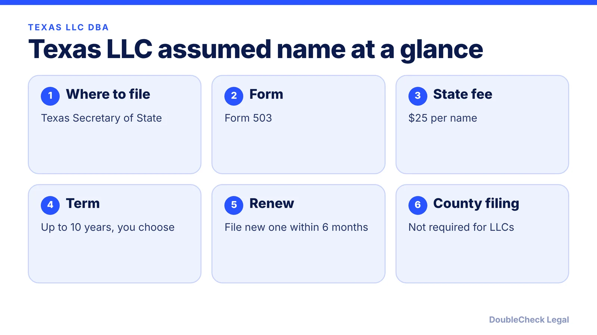
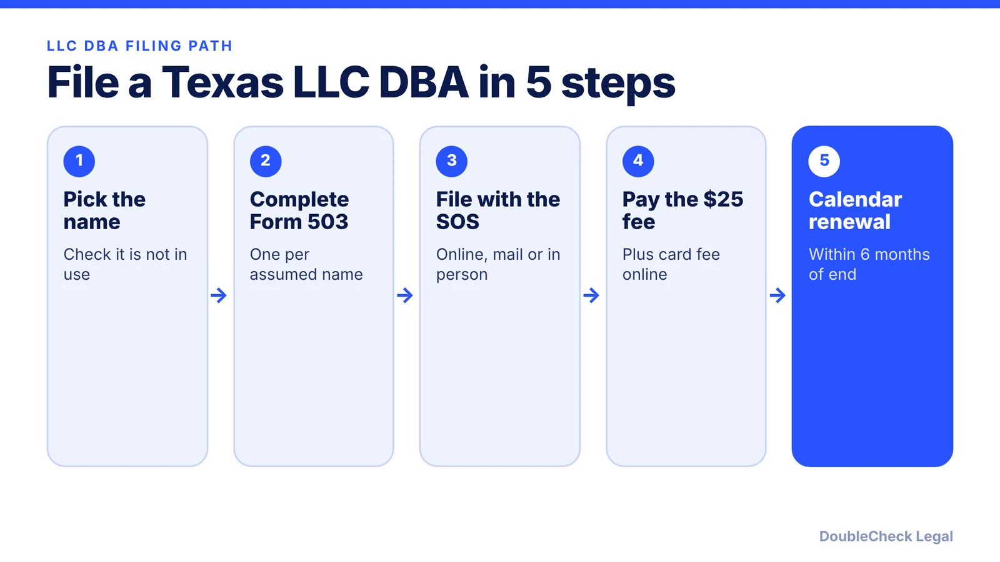

*Texas LLCs file DBAs with the state, not the county. Here is the form, fee, term, renewal and bank question.*

**Key takeaways:**

- Texas LLCs file Form 503 with the Secretary of State; county filing was eliminated for registered entities effective September 1, 2019.
- The Secretary of State lists a $25 fee and a term of up to 10 years you choose.
- Renew by filing a new certificate within six months before expiration.
- Ask your bank what it wants before opening an account under a DBA.

## 1. The quick answer

**Quick answer:** A Texas LLC that does business under a name other than its legal name files an Assumed Name Certificate (Form 503) with the Texas Secretary of State, not the county. Per the Secretary of State, the fee is $25, the certificate lasts up to ten years (you choose the term), and you renew by filing a new certificate within six months before it expires. County filing for registered entities was eliminated by HB 3609, effective September 1, 2019. Sole proprietors and general partnerships still file with the county clerk, which is the case covered in our [sole proprietor DBA post](/blog/texas-assumed-name-dba-sole-proprietor/).

This guide covers the LLC version: where to file, cost, duration, renewal, what banks tend to ask for, and common mistakes, as of November 2026. Fees and forms can change, so confirm on the Secretary of State site before filing.

## 2. State or county: where an LLC files

Under Texas Business and Commerce Code section 71.103, a corporation, limited partnership, LLP, limited liability company, registered series of an LLC or foreign filing entity that must file an assumed name certificate files it in the office of the secretary of state. The Secretary of State FAQ lists LLCs, including professional LLCs, among the entities that file with the state and says they are not required to file with the county clerk. It lists sole proprietorships, general partnerships and joint ventures among those that file with the county clerk.

Before 2019 the rule was different. A Cogency Global article from August 2019 says that, before the change, filing was required at both state and county levels, and that county-level filing was eliminated effective September 1, 2019. If you read an older guide that tells an LLC to also file with the county, check its date.

The trigger is using a name other than the one on your Certificate of Formation. The Secretary of State instructions say an entity using multiple assumed names must file a separate certificate for each. Your legal name is the one in your [certificate of formation](/blog/texas-certificate-of-formation-fees-forms/); see [how to start an LLC in Texas](/blog/how-to-start-an-llc-in-texas/) for that step.

## 3. Cost, duration and renewal

Per the Texas Secretary of State (Form 503 instructions and name filings FAQ):

- **Fee:** $25 per assumed name certificate. Online filing through SOSPortal carries a credit card convenience fee of $0.25 plus 2.25% of total fees, per the instructions; mail and in-person filings use a check or money order.
- **Term:** a period you choose, not exceeding ten years from the filing date. You can pick the maximum, a shorter term or a specific end date.
- **Renewal:** file a new certificate within six months of the expiration of the original. The FAQ says it must be filed before the current one expires.
- **Ending early:** Form 504 abandons a certificate; the FAQ lists the fee as $10.

Calendar the renewal. Choosing a ten-year term means the deadline is easy to forget, and the name needs to stay on file if you are still using it. Separately, a DBA does not replace the formation filing, the [franchise tax reports](/blog/texas-franchise-tax-llc-corporation/), or any local licenses. See [business license requirements](/blog/business-license-requirements-small-business/) and our overview of [LLC formation costs by state](/blog/llc-formation-cost-california-texas-florida-new-york/).

## 4. Bank requirements and common mistakes

Banks set their own rules, and published guidance varies. A Texas real estate law firm (Lone Star Land Law, undated) says banks and title companies mainly want an official, file-stamped certificate and that which office issued it usually does not matter, though that can vary. A Texas credit union checklist for LLC accounts, by contrast, lists the Certificate of Formation, an [operating agreement](/blog/llc-operating-agreement-with-ai/) or resolution if one exists, and the IRS EIN letter, and lists an assumed name certificate under sole proprietorships and general partnerships. It does not say what it wants for an LLC using a DBA, so ask your bank before you open an account under the trade name.

Common mistakes:

- **Filing with the county out of habit.** For an LLC, the state filing is what the law requires.
- **Letting it lapse.** Lone Star Land Law notes that failing to file does not invalidate a contract, but the violator may not maintain a suit related to the assumed name until a certificate is filed, and an intentional violation is a Class A misdemeanor.
- **Using the wrong legal name.** The certificate must name the entity exactly as formed.
- **Assuming a DBA protects the name.** It is a public record of who is behind a name, not a trademark or exclusive right.

For a one-person company comparing structures, see [sole proprietor vs LLC](/blog/sole-proprietor-vs-llc-solo-founder/). If your name could conflict with a brand, a lawyer should look before you build signage and a website. You can also use AI to prepare your form and checklist, then have an attorney verify it; see [do I need a lawyer to start an LLC](/blog/do-i-need-a-lawyer-to-start-an-llc-diy-ai-or-attorney/).

**Related reading:** [DBA in Texas: complete guide](/blog/dba-texas-complete-guide-sole-proprietor-llc-and-corporation/)

## Where DoubleCheck fits

[DoubleCheck](https://www.contactdoublecheck.com) helps businesses and founders start legal work with AI, verify it, and, when professional advice is warranted, connect with an independent attorney, including for immigration questions. Attorney availability and practice areas vary. Attorneys on DoubleCheck are independent professionals; an attorney-client relationship forms only if an attorney accepts your engagement.

**Sources:** [Texas Secretary of State, Form 503 instructions](https://www.sos.texas.gov/corp/instructions/503.shtml); [Texas Secretary of State, Name filings FAQs](https://www.sos.texas.gov/corp/namefilingsfaqs.shtml); [Texas Business and Commerce Code section 71.103 (Public.Law)](https://texas.public.law/statutes/tex._bus._&_com._code_section_71.103); [Cogency Global, county-level filing changes (Aug 2019)](https://ustest.cogencyglobal.com/blog/changes-to-county-level-assumed-name-filing-requirements-in-texas/); [Lone Star Land Law, Assumed Names in Texas (undated)](https://lonestarlandlaw.com/assumed-names-in-texas/); [TDECU, Business Account Documentation Requirements (undated)](https://www.tdecu.org/images/Compliance/Business-Account-Documentation-Requirements.pdf).

## FAQ

**Where does a Texas LLC file an assumed name certificate?**

With the Texas Secretary of State on Form 503, per the Secretary of State instructions and Business and Commerce Code section 71.103. LLCs do not also file with the county clerk.

**How much does a Texas LLC DBA cost?**

The Secretary of State lists $25 per assumed name certificate and $10 for a statement of abandonment. Online card payments add a convenience fee of $0.25 plus 2.25% of total fees.

**How long does a Texas assumed name certificate last and how do I renew?**

It lasts for a term you choose, up to ten years. To renew, file a new certificate within six months of the original expiration, per the Secretary of State.

**Does my bank need a DBA certificate for my Texas LLC?**

It depends on the bank. One Texas law firm says banks mainly want a file-stamped certificate, while a Texas credit union checklist does not list the certificate for LLCs. Ask your bank directly.

---

*General information only. This article is not legal, tax, investment, or accounting advice.*
