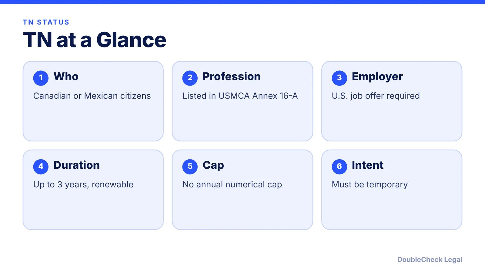
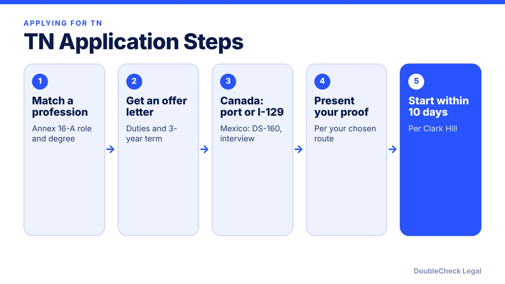

*Canadian or Mexican and working in tech? The TN can be a fast, uncapped route to U.S. work status, with one big caveat on green cards.*

**Key takeaways:**

- TN is for Canadian and Mexican citizens in USMCA Annex 16-A professions such as Computer Systems Analyst and Engineer.
- Canadians can apply at the border or through a USCIS petition; Mexicans need a visa from a U.S. consulate.
- Each grant is up to three years, renewable, with no annual cap.
- TN does not allow dual intent; plan green card steps with an attorney.

## 1. The quick answer

**Quick answer:** The TN is a work status for citizens of Canada and Mexico (not permanent residents) who have a job offer from a U.S. employer in a profession listed under the USMCA, formerly NAFTA. Software-related roles usually come in under "Computer Systems Analyst" or "Engineer." Canadians can apply at a U.S. port of entry; Mexicans need a TN visa from a U.S. consulate first. Each grant is up to three years, and there is no annual cap. TN status does not allow dual intent, so a green card plan needs care.

## 2. Who qualifies and which tech jobs fit

Per Lighthouse, applicants must be Canadian or Mexican citizens working in a profession listed in USMCA Annex 16-A, which covers about 60 occupations such as Computer Systems Analyst, Engineer, Accountant and Scientist. Each profession has its own education or licensing requirement, and your actual duties must match the profession. Clark Hill lists Computer Systems Analyst under the "General" occupations and notes that owners of the sponsoring U.S. company are not eligible. Self-employment does not qualify (Lighthouse).

For tech employees, the practical points are:

- Your duties must match the profession, so a job title alone does not decide it. Which category fits a software role is a classification question to settle with an attorney.
- You need a bona fide offer from a U.S. employer, normally for up to three years.
- TN does not require a Labor Condition Application or prevailing wage attestation (Lighthouse). Compare with [startup H-1B sponsorship](/blog/startup-sponsor-h1b-employee-requirements/).

The founder angle is limited: because the sponsoring company's owners are excluded, founders usually look at [other visa options](/blog/us-visa-options-for-startup-founders-compared/).

## 3. How to apply: border or petition

**Canadians** are visa-exempt. Per Clark Hill, they can apply at a U.S. port of entry without an appointment, or the employer can file with USCIS. Lighthouse describes the USCIS route as Form I-129, which also lets someone already in the U.S. change status, with optional premium processing. Port processing can take a few hours, and you are expected to start work within 10 days of approval (Clark Hill).

**Mexicans** must obtain a TN visa at a U.S. consulate in Mexico before travel: Form DS-160, an interview appointment and the visa fee (Lighthouse; Clark Hill).

Clark Hill warns a denial cannot be appealed, so complete the paperwork before applying. Fees change; Lighthouse lists a $510 I-129 fee and $2,965 premium processing, but confirm on uscis.gov.

## 4. Duration, dual intent, and family

**Duration.** Each grant is up to three years, and extensions in three-year increments can be repeated while the position remains temporary (Lighthouse; Clark Hill). TN has no annual numerical cap, so you can apply any time of year (Clark Hill).

**No dual intent.** You must show temporary intent. Clark Hill says to be careful if you are also pursuing a green card, since it can affect your TN status, so plan any green card route with an attorney. Read about [PERM](/blog/perm-labor-certification-green-card-process/) and compare [NIW](/blog/niw-for-software-engineers-and-researchers/) and [EB-1A](/blog/eb-1a-for-software-engineers-and-tech-employees/).

**Family.** Spouses and unmarried children under 21 can come in TD status; they can study but cannot work (Lighthouse).

**Changing jobs.** A new TN application or petition is needed for each employer (Lighthouse).

## Where DoubleCheck fits

[DoubleCheck](https://www.contactdoublecheck.com) helps businesses and founders start legal work with AI, verify it, and, when professional advice is warranted, connect with an independent attorney, including for immigration questions. Attorney availability and practice areas vary. Attorneys on DoubleCheck are independent professionals; an attorney-client relationship forms only if an attorney accepts your engagement.

**Sources:** [Lighthouse, the TN visa explained](https://www.lighthousehq.com/blog/tn-visa); [Clark Hill, TN status](https://www.clarkhill.com/services/practice/immigration-law/tn-status/).

## FAQ

**Do I need a lottery to get a TN visa?**

No. Per Clark Hill, TN applications are not subject to an annual numerical cap, so you can apply any time of year.

**Can Canadians apply for TN at the border?**

Yes. Clark Hill says Canadians can apply at a U.S. port of entry without an appointment or through USCIS. Mexicans must apply at a U.S. consulate in Mexico.

**How long does TN status last?**

Up to three years per grant, and renewals can be repeated while the position remains temporary, per Lighthouse and Clark Hill.

**Can I get a green card on TN status?**

TN does not allow dual intent, and Clark Hill says pursuing a green card can affect your status. Talk to an immigration attorney about timing before you file.

---

*General information only. This article is not legal, tax, investment, or accounting advice.*
