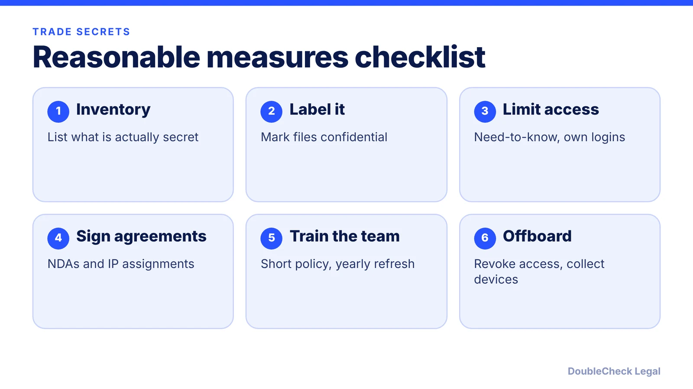
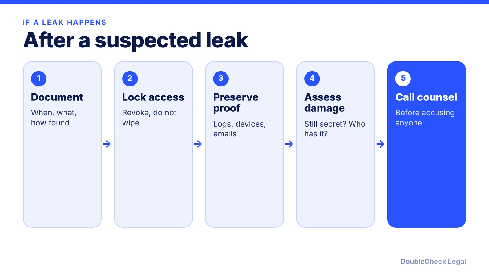

*What counts as a trade secret, which measures courts expect, the DTSA whistleblower notice, and what to do after a leak.*

**Key takeaways:**

- A trade secret needs value from secrecy and reasonable measures to keep it secret.
- The DTSA is federal; most states also have UTSA-based laws, so both can apply.
- Agreements with employees and contractors should carry the DTSA whistleblower notice to preserve fees and exemplary damages.
- After a suspected leak, preserve evidence and talk to counsel before accusing anyone.

## 1. The quick answer

**Quick answer:** A trade secret is business information that has value because it is not generally known and that its owner takes reasonable measures to keep secret. Federal law (the Defend Trade Secrets Act of 2016, or DTSA) and state laws based on the Uniform Trade Secrets Act (UTSA) let owners sue when it is misappropriated. The "reasonable measures" part is on you: courts look at what you actually did, such as NDAs, limited access, labeling and offboarding. Skip them and you may have nothing to enforce. A DTSA whistleblower notice in your employee and contractor agreements preserves the right to seek exemplary damages and attorneys' fees.

## 2. What counts as a trade secret, and what the law adds

Per [Revision Legal](https://revisionlegal.com/corporate/trade-secret-lawyer/reasonable-measures-protect-trade-secrets/), a protectable trade secret generally needs three things: information (data, a business method or similar), independent economic value from being secret, and an owner who has taken reasonable measures to keep it secret. Examples it lists include secret recipes, customer lists, monthly sales figures and source vendors. Software source code, pricing models and supplier terms are common startup examples.

**Federal and state law.** The DTSA, codified at 18 U.S.C. § 1831 and following, gives a federal civil claim. State law runs alongside it. Per [Beancount](https://beancount.io/blog/2026/09/21/trade-secrets-101-small-employers-reasonable-measures-nda-exit-procedures-guide) (September 2026), the UTSA has been adopted in every state except New York and North Carolina, where common law and a similar state statute apply. State law governs details such as filing deadlines, so check yours.

**Remedies.** Per Beancount, DTSA remedies include injunctions, compensation for actual losses and, for willful and malicious misappropriation, exemplary damages up to twice the actual loss plus attorneys' fees. Per Ward and Smith, the thief's gains may also be recoverable.

**What the law does not stop.** Per [Fox Rothschild](https://texastrial.foxrothschild.com/2018/04/trade-secret-protection-v-patent-protection/), reverse engineering and independent discovery are legal, so a secret that sits in a product you sell may not stay one.

## 3. Reasonable measures: what to put in place

Courts want documented, consistent steps. Per Revision Legal, measures need not be extensive and vary with the information and company size, but more measures make secrecy easier to prove. It describes a case dismissed because the owner only called the information "confidential" in its filing, and another where a one-person company showed reasonable measures by limiting who saw a prototype and requiring an NDA first.

A practical set for a small team:

- **Inventory and label.** Per Beancount, list real secrets (client database, pricing, supplier terms, processes) and mark them. Marking alone is not enough, but not marking suggests you did not treat them as special.
- **Limit access.** Per [Fisher Phillips](https://www.fisherphillips.com/print/v2/content/44696/6-steps-tech-employers-can-take-to-strengthen-trade-secret-protections-in-2026.pdf), restrict by job function and need, with role-based controls and multi-factor authentication. Use individual logins, not shared passwords.
- **Get it in writing.** NDAs for employees, contractors, vendors and investors before they see sensitive data. Pair them with IP assignment. See [confidentiality and IP assignment agreements](/blog/confidentiality-ip-assignment-agreements-startups/), [how to write an NDA](/blog/how-to-write-an-nda-startups/) and [reviewing an NDA you received](/blog/review-nda-you-received/).
- **Add the whistleblower notice.** Per [BCLP](https://www.bclplaw.com/2019/10/want-to-protect-your-trade-secrets-update-your-employment-agreements/), agreements entered into or revised after May 11, 2016 that govern trade secrets or confidential information with an employee need a notice of immunity for confidential disclosures to government officials or attorneys to report suspected violations, or in sealed filings. You can include it or cross-reference a policy that has it. Without it, the employer can still bring a DTSA claim but loses punitive damages and attorney fees against that employee. Beancount says the requirement extends to contractors and consultants.
- **Train and write a short policy.** Review it at hire and refresh yearly.
- **Offboard properly.** Per Beancount: revoke access the same day, collect devices, rotate shared credentials, and hold an exit interview with a written reminder that confidentiality survives departure. Have the person sign an acknowledgment. Fisher Phillips calls these exit certifications.

Restrictive covenants vary by state; see [non-compete agreements by state](/blog/non-compete-agreements-by-state-2026/) and [non-solicitation agreements](/blog/non-solicitation-agreements-explained/).

## 4. After a leak, and trade secret vs patent

**After a suspected leak.** Per [Ward and Smith](https://www.wardandsmith.com/article/what-to-do-when-someone-steals-your-trade-secrets-a-north-carolina-business-owners-action-plan), document everything, avoid confronting the suspect before consulting counsel (hasty accusations can raise defamation claims), preserve devices and logs without cleaning or reassigning them, and assess whether the information is still secret. A cease-and-desist letter may be faster and cheaper than litigation, but it warns that a letter could start limitation clocks. Per [Baker Jenner](https://bakerjenner.com/the-first-48-hours-of-a-trade-secret-theft-incident-response-for-departing-employees/), revoke access first but do not wipe the workstation, issue a litigation hold, and note that a temporary restraining order or preliminary injunction is available under federal and state law, where delay can undercut an irreparable-harm argument.

**Trade secret vs patent.** Per Fox Rothschild:

- A trade secret can last as long as secrecy holds and needs no registration. A patent lasts 20 years and requires a public application.
- A patent can bar others even if they invented the thing independently. A trade secret cannot stop reverse engineering.
- Trade secret risks include employee leaks and proving your measures were adequate. Patents require disclosure and significant cost.

Factors it lists include whether the idea can be reverse engineered, whether it stays valuable beyond 20 years, and how well you can control access. See also [trademark vs copyright vs patent](/blog/trademark-vs-copyright-vs-patent-startups/).

**Handle yourself vs get an attorney.** You can inventory secrets, tighten logins and use a vetted NDA template yourself. Get an attorney to review your employee IP agreement and whistleblower language, anything in a state with unusual restrictions, and before you accuse a departing employee or send a demand letter. If AI-generated code or documents are involved, see [AI-generated code and IP](/blog/ai-generated-code-ip-startup-founders/), and for hiring see the [first employee checklist](/blog/how-to-hire-first-employee-legal-checklist/).

## Where DoubleCheck fits

[DoubleCheck](https://www.contactdoublecheck.com) helps businesses and founders start legal work with AI, verify it, and, when professional advice is warranted, connect with an independent attorney, including for immigration questions. Attorney availability and practice areas vary. Attorneys on DoubleCheck are independent professionals; an attorney-client relationship forms only if an attorney accepts your engagement.

**Sources:** [Revision Legal](https://revisionlegal.com/corporate/trade-secret-lawyer/reasonable-measures-protect-trade-secrets/); [Beancount, Sept 2026](https://beancount.io/blog/2026/09/21/trade-secrets-101-small-employers-reasonable-measures-nda-exit-procedures-guide); [Fisher Phillips](https://www.fisherphillips.com/print/v2/content/44696/6-steps-tech-employers-can-take-to-strengthen-trade-secret-protections-in-2026.pdf); [BCLP](https://www.bclplaw.com/2019/10/want-to-protect-your-trade-secrets-update-your-employment-agreements/); [Ward and Smith](https://www.wardandsmith.com/article/what-to-do-when-someone-steals-your-trade-secrets-a-north-carolina-business-owners-action-plan); [Baker Jenner](https://bakerjenner.com/the-first-48-hours-of-a-trade-secret-theft-incident-response-for-departing-employees/); [Fox Rothschild](https://texastrial.foxrothschild.com/2018/04/trade-secret-protection-v-patent-protection/).

## FAQ

**What is a trade secret under federal law?**

Per Revision Legal, it generally requires information with independent economic value from being secret and an owner who has taken reasonable measures to keep it secret. The DTSA is codified at 18 U.S.C. § 1831 and following.

**Do I need a whistleblower notice in my NDA?**

Per BCLP, agreements with employees entered into or revised after May 11, 2016 that govern trade secrets or confidential information should include the immunity notice or cross-reference a policy that does. Without it you lose punitive damages and attorney fees against that employee but can still sue.

**Is a trade secret better than a patent?**

It depends. Per Fox Rothschild, a trade secret can last indefinitely without registration but does not stop reverse engineering. A patent lasts 20 years, requires public disclosure and can bar independent inventors.

**What should I do first if an employee took confidential files?**

Per Baker Jenner and Ward and Smith, revoke access without wiping devices, preserve logs and evidence, issue a litigation hold, and consult counsel before confronting the person or sending letters.

---

*General information only. This article is not legal, tax, investment, or accounting advice.*
