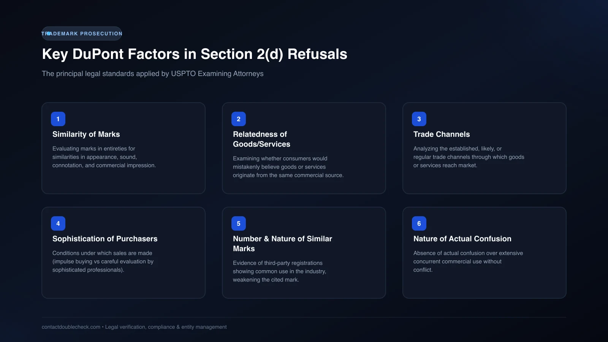
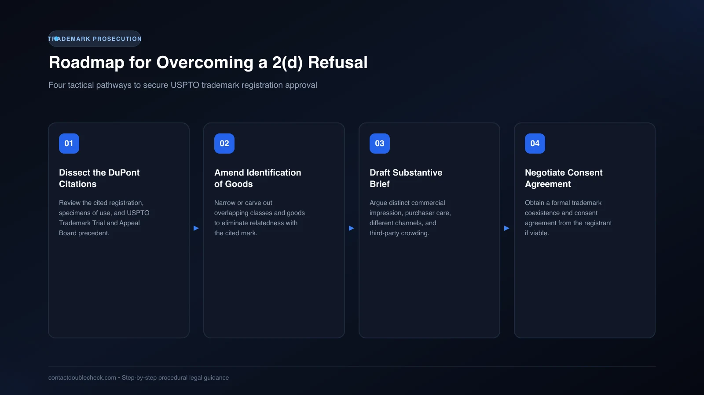

*Strategic guide for businesses, startups, and trademark applicants responding to a Section 2(d) Likelihood of Confusion refusal issued by the United States Patent and Trademark Office (USPTO), as of November 2026. General information, not legal advice.*

**Key takeaways:**

- Section 2(d) is the most common substantive refusal issued by the USPTO, but it does not mean your trademark application is dead.
- Applicants have three months to respond, with an available three-month extension to reach the six-month statutory deadline.
- Refusals are analyzed under the *DuPont* factors; similarity of marks and relatedness of goods/services carry the greatest weight.
- Successful strategies include narrowing goods/services identifications, arguing distinct commercial impressions, demonstrating sophisticated purchasers, or negotiating a coexistence consent agreement.
- Unsubstantiated arguments or missing the response deadline results in total abandonment of your application.

## 1. The quick answer

**Quick answer:** A **Section 2(d) Office Action** is an official refusal issued by a USPTO Examining Attorney under Section 2(d) of the Lanham Act (15 U.S.C. § 1052(d)). It asserts that your proposed trademark so resembles an existing registered mark (or prior-filed pending application) that consumers are likely to be confused, mistaken, or deceived regarding the commercial source of the goods or services.

Receiving a Section 2(d) refusal is **not a final rejection**. Applicants have **three months** from the mailing date to file a formal response (or request a single three-month extension). 

By analyzing the cited mark through the lens of the **DuPont factors** (*In re E. I. du Pont de Nemours & Co.*), applicants can overcome the refusal through several proven avenues:
1. Narrowing and amending the identification of goods or services to eliminate market overlap;
2. Submitting substantive legal arguments dissecting dissimilarities in appearance, sound, meaning, and trade channels;
3. Proving customer sophistication and high-consideration purchasing environments; OR
4. Securing a formal **Trademark Consent and Coexistence Agreement** from the owner of the cited mark.

For brand protection foundations, review our guides on [how to trademark a business name](/blog/how-to-trademark-a-business-name/) and [trademark business name checks](/blog/trademark-business-name-check/).

## 2. Understanding the Section 2(d) likelihood of confusion refusal

Under the Lanham Act, the USPTO’s primary mandate is to protect consumers from marketplace confusion. An Examining Attorney does not need to prove that consumers *will* be confused, or that actual confusion has occurred; they only need to establish that a **likelihood of confusion** exists.

Importantly, marks do not need to be identical to trigger Section 2(d). Refusals routinely issue when:
- The words sound phonetically identical despite different spellings (e.g., "KLEAN" vs "CLEAN").
- The marks convey the same commercial connotation (e.g., "MR. CLEAN" vs "CLEANING GENTLEMAN").
- The goods or services are not identical, but are commercially complementary (e.g., wine and beer, or enterprise software and IT consulting).

## 3. The DuPont factors that decide confusion

In the seminal 1973 case *In re E. I. du Pont de Nemours & Co.* (476 F.2d 1357), the Court of Customs and Patent Appeals established 13 evidentiary factors for evaluating confusion. In USPTO practice, two factors are overwhelmingly dispositive:

### DuPont Factor 1: The Similarity of the Marks
Marks are compared in their entireties for similarities in **appearance, sound, connotation, and commercial impression**. 
- *The Anti-Dissection Rule:* Examining attorneys cannot dissect a multi-word mark and compare isolated words; the mark must be evaluated as a unified whole.
- *Commercial Impression:* Even identical words can create different impressions when paired with distinct design elements, stylization, or contextual industry meanings.

### DuPont Factor 2: The Relatedness of the Goods or Services
The examining attorney must evaluate whether the relevant purchasing public would believe the respective goods or services emanate from a single source. 
- *Critical Reality:* The goods do not have to be identical or even competitive. If consumers routinely encounter both offerings in the same trade channels (e.g., mobile apps and cloud computing platforms), relatedness is established.

### Other Persuasive DuPont Factors:
- **Trade Channels:** Are the products sold in distinct retail environments (e.g., specialized medical clinics vs wholesale mass-market retailers)?
- **Conditions of Sale & Purchaser Sophistication:** Are the products expensive, high-stakes investments purchased after months of diligence by corporate executives, or impulse buys off a supermarket shelf?
- **Third-Party Crowding:** Does the USPTO register dozens of similar marks in the same industry? If so, the cited mark is considered conceptually "weak" and entitled to only a narrow scope of protection.

## 4. Narrowing and amending identification of goods

The fastest, most cost-effective technique to resolve a Section 2(d) refusal is **amending your identification of goods and services** in the USPTO Trademark Electronic Application System (TEAS).

Under Trademark Rule 2.71, applicants may narrow or clarify their goods, but cannot broaden them. 
- **Example:** If your application broadly claimed "computer software for business operations" in Class 009, and the cited mark is "software for managing dental clinics," you can amend your description to: *"Computer software for supply chain logistics management in the automotive manufacturing industry; none of the foregoing related to dental or healthcare administration."*
- **Express Negative Limitations:** Adding explicit exclusionary carve-outs directly eliminates the overlap that the examining attorney cited, frequently prompting immediate withdrawal of the Section 2(d) refusal.

## 5. Drafting persuasive legal arguments to overcome refusal

If amending goods is insufficient or unfeasible, the applicant must file a formal **Substantive Office Action Response Brief**. 

Effective legal arguments include:
1. **Highlighting Dissimilarities in Sight and Sound:** Dissecting the overall visual silhouette, phonetics, syllables, and cadences of both marks under Trademark Manual of Examining Procedure (TMEP) § 1207.01(b).
2. **Proving Purchaser Sophistication:** Demonstrating under *DuPont* Factor 4 that the relevant buyers are sophisticated professionals, engineers, or corporate procurement officers who exercise high degrees of care and cannot be easily confused.
3. **Submitting Third-Party Registrations (The Crowded Field Argument):** Conducting a USPTO register audit showing numerous third parties using the same root word for related goods. Under *Jack Wolfskin v. Millennium Sports*, extensive third-party registrations prove consumers have learned to distinguish marks based on minute differences.

## 6. Consent agreements and deadlines to respond

When legal arguments alone cannot bridge the gap, applicants often turn to **Trademark Consent and Coexistence Agreements**.

Under TMEP § 1207.01(d)(viii) and *In re Four Seasons Hotels Ltd.*, the USPTO gives substantial weight to formal consent agreements between commercial parties. A naked consent ("I hereby consent to registration") is routinely rejected. To be accepted by the USPTO, the agreement must:
- Explain why the parties believe confusion is unlikely;
- Enumerate concrete operational restrictions (distinct color palettes, distinct trade channels, geographic divisions, or customer disclaimers); AND
- Obligate both parties to cooperate and take corrective measures if actual confusion ever occurs.

### Strict Deadlines:
Under the Trademark Modernization Act (TMA), applicants have **three months** from the date the Office Action is issued to submit their response. If more time is needed to negotiate a consent agreement or compile evidence, a single **three-month extension of time** can be filed for a $125 USPTO government fee, extending the absolute response window to **six months**. Failing to respond within the deadline results in immediate application abandonment.

## Where DoubleCheck fits

[DoubleCheck](https://www.contactdoublecheck.com) helps startups, e-commerce founders, and businesses navigate intellectual property clearance, conduct preliminary trademark searches, and analyze USPTO Office Actions with AI precision. When responding to substantive Section 2(d) refusals or negotiating coexistence agreements, DoubleCheck connects you with licensed, independent trademark attorneys.

**Related reading:**
- [How to Trademark a Business Name: Complete Process](/blog/how-to-trademark-a-business-name/)
- [Trademark Business Name Check: Search Before Registering](/blog/trademark-business-name-check/)
- [Trademark vs Copyright vs Patent for Startups](/blog/trademark-vs-copyright-vs-patent-startups/)
- [Arbitration Clause Explained: Small Business Contracts](/blog/arbitration-clause-explained-small-business-contracts-pros-cons/)

**Sources:** [United States Patent and Trademark Office (USPTO), Trademark Manual of Examining Procedure (TMEP) § 1207 (Likelihood of Confusion)](https://tmep.uspto.gov/RDMS/TMEP/current#/current/TMEP-1200d1e5036.html); [Cornell Legal Information Institute, 15 U.S.C. § 1052(d) (Lanham Act Section 2(d))](https://www.law.cornell.edu/uscode/text/15/1052); [Court of Customs and Patent Appeals, In re E. I. du Pont de Nemours & Co., 476 F.2d 1357 (C.C.P.A. 1973)](https://law.justia.com/cases/federal/appellate-courts/f2/476/1357/16301/); [USPTO Trademark Trial and Appeal Board (TTAB), Precedential Decisions](https://www.uspto.gov/trademarks/ttab/precedential-final-decisions); [USPTO, Responding to Office Actions Guidance](https://www.uspto.gov/trademarks/maintain/responding-office-actions).

## FAQ

**What is a Section 2(d) trademark refusal?**

Under Section 2(d) of the Lanham Act (15 U.S.C. § 1052(d)), a USPTO Examining Attorney refuses registration if the proposed trademark so resembles an existing registered mark as to cause consumer confusion.

**How long do I have to respond to a USPTO Office Action?**

Applicants have three months from the issue date to respond. A single three-month extension can be purchased for an additional fee, bringing the absolute deadline to six months before abandonment occurs.

**What are the DuPont factors in trademark law?**

Established in In re E. I. du Pont de Nemours & Co. (1973), these 13 legal factors evaluate consumer confusion, with mark similarity and goods relatedness being the two most decisive elements.

**Can I overcome a Section 2(d) refusal by amending my goods and services?**

Yes. Narrowing your identification of goods or services to delete overlapping categories or clarify distinct commercial markets is one of the most effective ways to eliminate confusion.

**What is a trademark consent and coexistence agreement?**

A formal legal agreement between the applicant and the owner of the cited mark in which the registrant consents to registration and both parties agree to commercial restrictions to prevent marketplace confusion.

---

*General information only. This article is not legal, tax, investment, or accounting advice.*
