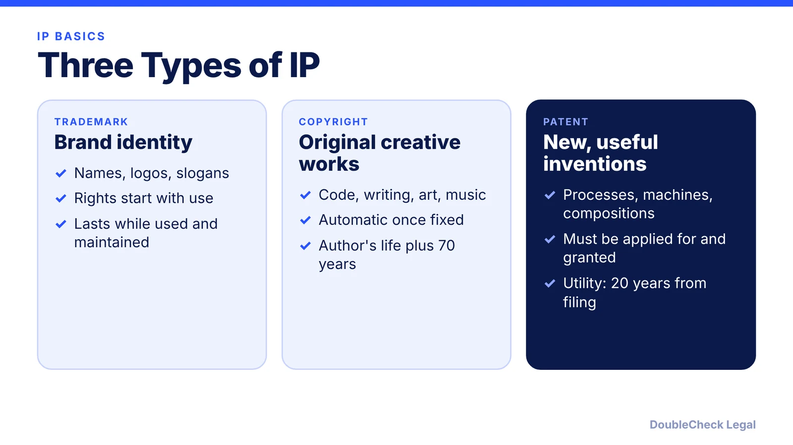
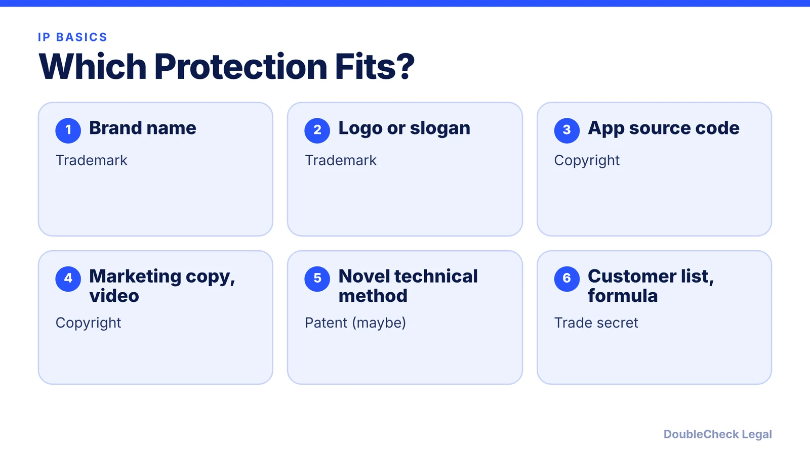

*A plain-English comparison of the three main types of intellectual property and which one fits which startup asset.*

**Key takeaways:**

- Trademarks protect brand identifiers; copyrights protect original creative works; patents protect new, useful inventions.
- Copyright is automatic; patents require a grant; trademark rights begin with use.
- Terms: life plus 70 years (individual copyright), 20 years from filing (utility patent), indefinite (trademark if maintained).
- Trade secrets need no filing but need reasonable secrecy measures.

## 1. The quick answer

**Quick answer:** Trademarks protect names, logos, and slogans that identify who makes a product. Copyrights protect original creative works, including software code, writing, art, and music. Patents protect new and useful inventions. Copyright exists automatically; patents must be applied for and granted; trademark rights start with use and can be strengthened by federal registration. Typical terms: life of the author plus 70 years for copyright, 20 years from filing for a utility patent, and indefinite for a trademark as long as it is used and maintained.

## 2. What each one protects

- **Trademark:** names, logos, symbols, designs, or slogans that identify the source of goods; service marks identify services. Your company name or product name is the classic example. See [how to trademark a business name](/blog/how-to-trademark-a-business-name/).
- **Copyright:** artistic, literary, musical, and other original works, in their tangible form. Ideas, names, titles, and slogans are not covered, per GleanMark. Software code is protected as a creative work.
- **Patent:** inventions such as processes, machines, chemical compositions, and manufactured products. They must be new and useful, and abstract ideas are not patentable, per GleanMark. A design patent covers the ornamental appearance of a manufactured product, not how it works.
- **Trade secret:** not filed at all. It protects valuable confidential information for as long as it stays secret and you take reasonable steps to protect it, per GleanMark. Your NDAs and [IP assignment agreements](/blog/confidentiality-ip-assignment-agreements-startups/) do this work.

Example from GleanMark: Coca-Cola uses a trademark for its name and bottle shape, a trade secret for the formula, and once used design patents for the bottle, which expired.

## 3. Duration and registration

- **Copyright:** automatic once the work is fixed in tangible form. Registration is not required for protection, but you generally must register a U.S. work before suing over it, per GleanMark, which lists a registration fee of $45 or $65 online and about 3.4 months for a clean claim as of October 2026. For an individual author the term is the author's life plus 70 years.
- **Patent:** required. You apply and the USPTO decides whether the invention is patentable. Utility and plant patents last 20 years from filing; design patents last 15 years from grant, per GleanMark and Copyrighted.com. Utility patents take roughly two to three years in total, and a [provisional application](/blog/provisional-patent-application-startups/) can reserve an early filing date.
- **Trademark:** rights arise from use in commerce. Federal registration is optional but recommended and takes about 10 months on average as of March 2026 (Trademark Engine). A mark can last indefinitely if you keep using it and file maintenance documents; GleanMark notes three years of nonuse is presumed abandonment.

Always confirm current fees and terms with the USPTO and the U.S. Copyright Office, which publish the authoritative schedules.

## 4. Startup mistakes to avoid

- **Assuming a company or domain registration protects the brand.** Entity filings and domains are not trademarks. Check the federal register first: [trademark name check](/blog/trademark-business-name-check/).
- **Not owning contractor work.** Contractors can keep copyright unless you have a written assignment; see the [contractor agreement guide](/blog/independent-contractor-agreement-what-to-include/).
- **Disclosing an invention publicly before filing.** Public disclosure can affect patent rights, especially abroad. Talk to a patent attorney before launch.
- **Assuming AI output is protected.** See [AI-generated content and copyright](/blog/ai-generated-content-copyright-solo-business/) and [AI-generated code and IP](/blog/ai-generated-code-ip-startup-founders/).

For most early-stage companies the priority order is simple: protect the name, secure ownership of what your team and contractors build, and decide on a patent only if you have a genuine technical invention and the budget.

## Where DoubleCheck fits

[DoubleCheck](https://www.contactdoublecheck.com) helps businesses and founders start legal work with AI, verify it, and, when professional advice is warranted, connect with an independent attorney, including for immigration questions. Attorney availability and practice areas vary. Attorneys on DoubleCheck are independent professionals; an attorney-client relationship forms only if an attorney accepts your engagement.

**Sources:** [GleanMark guide for entrepreneurs](https://gleanmark.com/insights/trademark-vs-patent-vs-copyright-a-practical-guide-for-entrepreneurs); [Copyrighted.com](https://copyrighted.com/blog/difference-copyright-patent-trademark); [Trademark Engine data](https://www.trademarkengine.com/blog/us-trademark-filings-2026-uspto-data-before-you-file/); [Nolo on contractor IP](https://nolo.com/legal-encyclopedia/how-protect-intellectual-property-rights-29913.html).

## FAQ

**Can I copyright a business name or slogan?**

No. Names, titles, and slogans are not covered by copyright, per GleanMark. A trademark is the usual tool for brand names and slogans.

**Is copyright registration required?**

No, but you generally must register a U.S. work before suing over it, per GleanMark. Fees were listed at $45 or $65 online as of October 2026; confirm with the Copyright Office.

**How long does a patent last?**

Utility patents last 20 years from the filing date if maintenance fees are paid; design patents last 15 years from grant, per GleanMark.

**Does a trademark expire?**

It can last indefinitely if you keep using the mark and file required maintenance documents. GleanMark notes three years of nonuse is presumed abandonment.

---

*General information only. This article is not legal, tax, investment, or accounting advice.*
