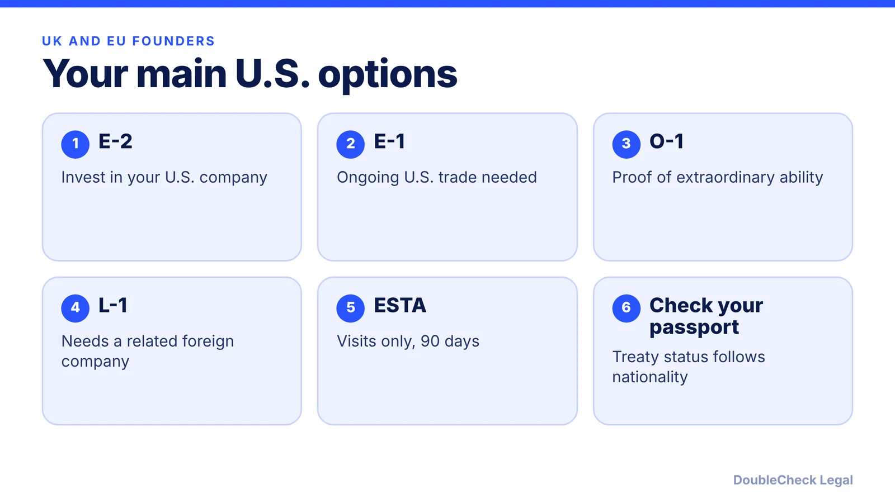
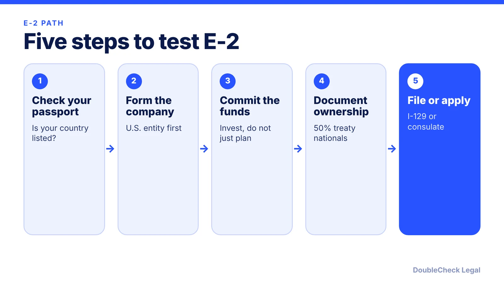

*Many European passports unlock E-2, but ESTA is for visiting, not for building your U.S. company.*

**Key takeaways:**

- Law-firm lists include the UK, Germany, France, Ireland, the Netherlands, Spain and Italy as E-2 countries; not every EU country appears, so check yours.
- E-2 needs a substantial investment and 50% ownership or control; E-1 needs documented ongoing trade, with more than half of international trade between the U.S. and the treaty country.
- O-1 and L-1 do not depend on a treaty; ESTA allows meetings but not productive work, for up to 90 days.
- Decide ownership and tax before you form the company.

## 1. The quick answer

**Quick answer:** For UK and EU founders, the E-2 treaty investor visa is often the first option to test, because many European countries are on the E-2 list. Law-firm lists include the UK, Germany, France, Ireland, the Netherlands, Spain and Italy, but not every EU country appears, so check your passport country. E-1 suits an established trading business. O-1 and L-1 work without a treaty. ESTA is for visits, not for running your U.S. startup. This guide is general information as of November 2026, not advice.

## 2. E-2 and E-1: which countries and what they require

**Treaty status follows nationality.** NNU Immigration lists Germany, France, Ireland and Italy as E-2 countries, and Alaz Law lists the UK, Germany, France, Ireland, the Netherlands, Spain and Italy. Both say to check the State Department treaty list for the current version, which did not load for me. Some EU countries do not appear on these lists, so do not assume membership in the EU is enough. Alaz Law adds that dual citizens may apply with a treaty-country passport if the other requirements are met.

**E-2 rules.** Per USCIS, summarized in our [E-2 guide](/blog/e-2-treaty-investor-visa-for-founders/): a substantial investment in a real business that is not marginal, at least 50% ownership or operational control, an initial stay up to two years with unlimited two-year extensions, and an intent to leave when status ends. Spouses in valid E-2 status are generally employment authorized incident to status. Treaty nationals must own at least 50% traced through every ownership layer (Lehigh Valley Immigration Lawyers), so a mixed cap table needs checking.

**E-1 rules.** Per Messersmith Law, E-1 requires treaty nationality (the E-1 list may differ from the E-2 list), at least 50% treaty-national ownership, substantial trade that is already occurring and documented, and more than half of the company's total international trade between the U.S. and the treaty country. A new startup with one completed transaction may not show the continuing trade E-1 needs. For most early-stage founders, E-2 is the more natural fit and E-1 fits an existing exporter.

## 3. O-1, L-1 and ESTA for European founders

**O-1.** No treaty needed. For extraordinary ability in business, sciences, arts, education or athletics, with a strong evidence record. Berardi Immigration Law says founders can use an agent-based petition as long as the terms of employment are controlled by someone other than the beneficiary alone, and notes O-1 has a route to EB-1A. See the [O-1A evidence guide](/blog/o-1a-visa-for-startup-founders-evidence/) and [EB-1A vs O-1](/blog/eb-1a-vs-o-1-founder-which-path/).

**L-1.** If you already run or work for a company in the UK or EU, L-1 can move you to a related U.S. entity. Per Berardi, it needs a genuine qualifying relationship between the entities and at least one year of qualifying employment abroad in the prior three years. See [L-1A for founders opening a U.S. office](/blog/l-1a-visa-new-office-foreign-founders/).

**ESTA.** Per NNU Immigration, ESTA allows business meetings, conferences as a delegate, contract negotiation and tourism, and does not allow employment or productive work, U.S.-source pay or ongoing remote work from inside the U.S. Each stay is up to 90 days, you cannot extend or change status from inside the U.S., and an approved ESTA lasts two years or until the passport expires. NNU says brief, incidental tasks for a foreign employer, such as checking a few emails, are generally tolerated. Running your U.S. company from a rented apartment on ESTA is a different matter. Read [investor meetings on B-1 or ESTA](/blog/visiting-the-us-to-meet-investors-b-1-esta-startup-trip-what-is-allowed/) and [what a B-1 visitor can do](/blog/b-1-b-2-visa-business-visitor-what-founders-can-do/).

## 4. Company and tax notes, and when to get an attorney

Immigration status and company structure interact. E-2 depends on who owns the U.S. company, so decide the cap table before you form it. Read [how to incorporate a company in the U.S.](/blog/how-to-incorporate-a-company-in-the-us/) and [start a U.S. company as a non-resident](/blog/start-us-company-as-non-us-resident/).

Tax is separate from visa status. Moving to the U.S. can make you a U.S. tax resident, and a foreign-owned single-member LLC has its own reporting duty. Start with [foreign founder U.S. taxes and the substantial presence test](/blog/foreign-founder-us-taxes-substantial-presence-test/) and [Form 5472 for foreign-owned LLCs](/blog/form-5472-foreign-owned-single-member-llc/). A cross-border tax adviser can tell you how your home country treats the move; this article does not cover UK or EU tax rules.

**Self-handle vs. attorney.** You can read the treaty list, sketch the ownership chain and total your planned investment yourself. Get an attorney to review before you commit funds on E-2, if your ownership is mixed across nationalities, if you have past visa refusals, or if you plan to enter the U.S. to work before approval. Never use a visitor entry to do work that needs a work status. See [how to find a good immigration lawyer](/blog/how-to-find-good-immigration-lawyer-startup-founder/), [immigration lawyer fees](/blog/immigration-lawyer-fees-flat-fee-vs-hourly/) and the [founder visa comparison](/blog/us-visa-options-for-startup-founders-compared/).

## Where DoubleCheck fits

[DoubleCheck](https://www.contactdoublecheck.com) helps businesses and founders start legal work with AI, verify it, and, when professional advice is warranted, connect with an independent attorney, including for immigration questions. Attorney availability and practice areas vary. Attorneys on DoubleCheck are independent professionals; an attorney-client relationship forms only if an attorney accepts your engagement.

**Sources:** [NNU Immigration, E-1/E-2 treaty countries](https://www.nnuimmigration.com/e-visa-treaty-countries/); [Alaz Law, E-2 countries 2026](https://www.alazlaw.com/blog/e-2-visa-countries-list-2026-treaty-investor/); [Messersmith Law, E-1 visa](https://messersmithlaw.com/e1-visa); [Lehigh Valley Immigration Lawyers, E-2 countries](https://www.lehighvalleyimmigrationlawyers.com/blog/e-2-treaty-countries-list-investment-threshold-2026); [NNU Immigration, ESTA permissible activities](https://www.nnuimmigration.com/esta-permissible-activities/); [Berardi Immigration Law](https://berardiimmigrationlaw.com/tn-vs-o-1-vs-l-1-vs-h-1b-choosing-the-right-visa-architecture-for-founders-and-executives/). The State Department treaty page and USCIS E-2 page did not load directly, so USCIS E-2 rules are attributed via our linked E-2 guide.

## FAQ

**Which European countries are on the E-2 list?**

Alaz Law lists the UK, Germany, France, Ireland, the Netherlands, Spain and Italy; NNU Immigration lists Germany, France, Ireland and Italy among others. Not every EU country appears. Check the State Department treaty list for the current version.

**What is the difference between E-1 and E-2?**

Per Messersmith Law, E-1 focuses on ongoing international trade, mainly between the U.S. and the treaty country, while E-2 focuses on a substantial investment at risk in an active enterprise. A new startup with one transaction may not meet E-1.

**Can I work on ESTA from the U.S. for my startup?**

No. NNU Immigration says ESTA does not allow employment or productive work in the U.S., U.S.-source pay or ongoing remote work. It allows business meetings, conferences and contract negotiation, for up to 90 days per stay.

**Does E-2 lead to a green card?**

No. Per USCIS, summarized in our E-2 guide, E-2 holders must intend to leave when status ends. Founders often compare O-1 and EB-1A, which Berardi says has a route from O-1.

---

*General information only. This article is not legal, tax, investment, or accounting advice.*
