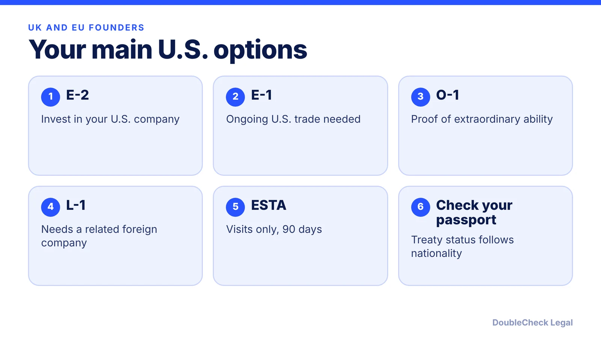
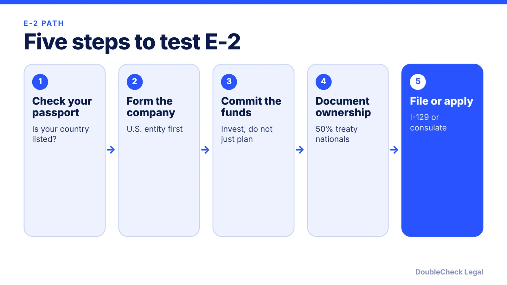

*Many European passports unlock E-2, but ESTA is for visiting, not for building your U.S. company.*

**Key takeaways:**

- The State Department treaty list includes the UK, Germany, France, Ireland, the Netherlands, Spain and Italy for E-2; check your own passport country on the list.
- E-2 needs a substantial investment and 50% ownership or control; E-1 needs documented ongoing trade, with more than half of international trade between the U.S. and the treaty country.
- O-1 and L-1 do not depend on a treaty; ESTA allows meetings but not work, for up to 90 days.
- Decide ownership and tax before you form the company.

## 1. The quick answer

**Quick answer:** For UK and EU founders, the E-2 treaty investor visa is often the first option to test, because many European countries are on the E-2 list. The State Department treaty list includes the UK, Germany, France, Ireland, the Netherlands, Spain and Italy, but check your passport country on the current list. E-1 suits an established trading business. O-1 and L-1 work without a treaty. ESTA is for visits, not for running your U.S. startup. This guide is general information as of November 2026, not advice.

## 2. E-2 and E-1: which countries and what they require

**Treaty status follows nationality.** The [State Department treaty countries list](https://travel.state.gov/content/travel/en/us-visas/visa-information-resources/fees/treaty.html) shows the UK, Germany, France, Ireland, the Netherlands, Spain and Italy under both E-1 and E-2, and notes that the lists differ by country. Check the current list for your passport country, and do not assume membership in the EU is enough.

**E-2 rules.** Per [USCIS](https://www.uscis.gov/working-in-the-united-states/temporary-workers/e-2-treaty-investors) (see also our [E-2 guide](/blog/e-2-treaty-investor-visa-for-founders/)): a substantial investment in a real, operating business that is not marginal, at least 50% ownership or operational control through a managerial role, an initial stay up to two years with extensions in two-year increments and no limit on their number, and an intent to leave when status ends. Spouses of workers in valid E-2 status are generally authorized to work. The State Department also requires the U.S. enterprise to be at least 50% owned by nationals of the treaty country, so a mixed cap table needs checking.

**E-1 rules.** Per the [State Department](https://travel.state.gov/content/travel/en/us-visas/employment/treaty-trader-investor-visa-e.html), E-1 requires treaty nationality (the E-1 list may differ from the E-2 list), at least 50% ownership by treaty-country nationals, a sizable, continuing volume of trade, and more than half of the enterprise's international trade between the U.S. and the treaty country. A brand-new startup may not be able to show the continuing trade E-1 needs. For most early-stage founders, E-2 is the more natural fit and E-1 fits an existing exporter.

## 3. O-1, L-1 and ESTA for European founders

**O-1.** No treaty needed. For extraordinary ability in business, sciences, arts, education or athletics, with a strong evidence record. Per [USCIS](https://www.uscis.gov/working-in-the-united-states/entrepreneur-employment-pathways/nonimmigrant-or-parole-pathways-for-entrepreneur-employment-in-the-united-states), O-1 beneficiaries may not self-petition, but a separate legal entity you own, such as a corporation or LLC, can file on your behalf, and a U.S. agent can also file. See the [O-1A evidence guide](/blog/o-1a-visa-for-startup-founders-evidence/) and [EB-1A vs O-1](/blog/eb-1a-vs-o-1-founder-which-path/).

**L-1.** If you already run or work for a company in the UK or EU, L-1 can move you to a related U.S. entity. Per the same USCIS page, you need at least one year of employment abroad with a qualifying organization within the three years before filing, and the U.S. entity must be a parent, affiliate, subsidiary or branch of the foreign employer. See [L-1A for founders opening a U.S. office](/blog/l-1a-visa-new-office-foreign-founders/).

**ESTA.** Per [USCIS](https://www.uscis.gov/working-in-the-united-states/temporary-visitors-for-business/wb-temporary-business-visitor-under-visa-waiver-program), Visa Waiver Program visitors (who need ESTA authorization) may consult with associates, attend conventions and negotiate contracts, for stays of up to 90 days, and may not extend their stay, change status or work in the U.S. Running your U.S. company from a rented apartment on ESTA is a different matter. Read [investor meetings on B-1 or ESTA](/blog/visiting-the-us-to-meet-investors-b-1-esta-startup-trip-what-is-allowed/) and [what a B-1 visitor can do](/blog/b-1-b-2-visa-business-visitor-what-founders-can-do/).

## 4. Company and tax notes, and when to get an attorney

Immigration status and company structure interact. E-2 depends on who owns the U.S. company, so decide the cap table before you form it. Read [how to incorporate a company in the U.S.](/blog/how-to-incorporate-a-company-in-the-us/) and [start a U.S. company as a non-resident](/blog/start-us-company-as-non-us-resident/).

Tax is separate from visa status. Moving to the U.S. can make you a U.S. tax resident, and a foreign-owned single-member LLC has its own reporting duty. Start with [foreign founder U.S. taxes and the substantial presence test](/blog/foreign-founder-us-taxes-substantial-presence-test/) and [Form 5472 for foreign-owned LLCs](/blog/form-5472-foreign-owned-single-member-llc/). A cross-border tax adviser can tell you how your home country treats the move; this article does not cover UK or EU tax rules.

**Self-handle vs. attorney.** You can read the treaty list, sketch the ownership chain and total your planned investment yourself. Get an attorney to review before you commit funds on E-2, if your ownership is mixed across nationalities, if you have past visa refusals, or if you plan to enter the U.S. to work before approval. Never use a visitor entry to do work that needs a work status. See [how to find a good immigration lawyer](/blog/how-to-find-good-immigration-lawyer-startup-founder/), [immigration lawyer fees](/blog/immigration-lawyer-fees-flat-fee-vs-hourly/) and the [founder visa comparison](/blog/us-visa-options-for-startup-founders-compared/).

## Where DoubleCheck fits

[DoubleCheck](https://www.contactdoublecheck.com) helps businesses and founders start legal work with AI, verify it, and, when professional advice is warranted, connect with an independent attorney, including for immigration questions. Attorney availability and practice areas vary. Attorneys on DoubleCheck are independent professionals; an attorney-client relationship forms only if an attorney accepts your engagement.

**Sources:** [U.S. State Department, Treaty countries](https://travel.state.gov/content/travel/en/us-visas/visa-information-resources/fees/treaty.html); [U.S. State Department, Treaty Trader and Treaty Investor visas](https://travel.state.gov/content/travel/en/us-visas/employment/treaty-trader-investor-visa-e.html); [USCIS, E-2 Treaty Investors](https://www.uscis.gov/working-in-the-united-states/temporary-workers/e-2-treaty-investors); [USCIS, Nonimmigrant or parole pathways for entrepreneur employment](https://www.uscis.gov/working-in-the-united-states/entrepreneur-employment-pathways/nonimmigrant-or-parole-pathways-for-entrepreneur-employment-in-the-united-states); [USCIS, WB temporary business visitor under the Visa Waiver Program](https://www.uscis.gov/working-in-the-united-states/temporary-visitors-for-business/wb-temporary-business-visitor-under-visa-waiver-program).

## FAQ

**Which European countries are on the E-2 list?**

The State Department treaty countries list includes the UK, Germany, France, Ireland, the Netherlands, Spain and Italy under both E-1 and E-2. Not every country appears on both lists, so check your passport country on the current list.

**What is the difference between E-1 and E-2?**

Per the State Department, E-1 requires a sizable, continuing volume of trade, with more than half of the enterprise's international trade between the U.S. and the treaty country, while E-2 requires a substantial investment in a real, operating business. A brand-new startup may struggle to show continuing trade for E-1.

**Can I work on ESTA from the U.S. for my startup?**

No. Per USCIS, visitors under the Visa Waiver Program (ESTA) may consult with associates, attend conventions and negotiate contracts, for stays of up to 90 days, but may not work in the U.S., extend their stay or change status.

**Does E-2 lead to a green card?**

No. Per USCIS, summarized in our E-2 guide, E-2 holders must intend to leave when status ends. Founders often compare O-1 and EB-1A; see our linked guide.

---

*General information only. This article is not legal, tax, investment, or accounting advice.*
