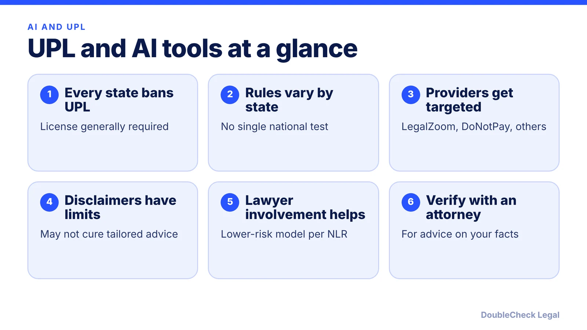
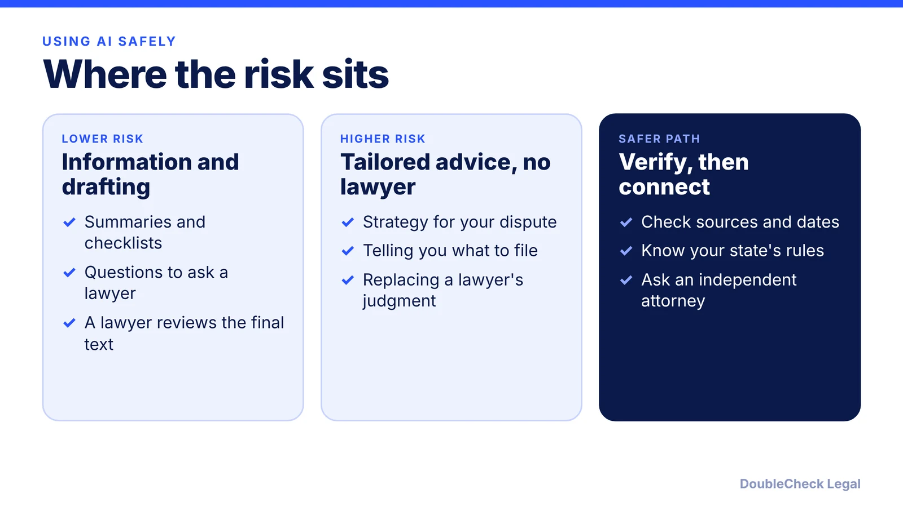

*AI legal tools sit close to a line regulators have policed for a century. Here is what UPL is, what the cases show, and how businesses can use AI responsibly.*

**Key takeaways:**

- Every U.S. jurisdiction prohibits UPL, but the rules and carve-outs vary by state, per the National Law Review.
- The cases involve providers, with LegalZoom, DoNotPay, and others; several outcomes are settlements or allegations.
- Disclaimers may not cure tailored advice, and marketing a tool as a lawyer replacement drew FTC action.
- Use AI for information and drafting, and rely on a licensed attorney for advice on your facts.

## 1. The quick answer

**Quick answer:** Every U.S. jurisdiction prohibits the unauthorized practice of law (UPL), and the rules generally require anyone providing legal services to hold an active license, per the National Law Review. In the cases below, the targets were the companies selling legal tools, not the customers using them. That said, UPL rules vary by state and no single case settles how they apply to AI. The practical takeaway for a business: use AI to understand and draft, treat its output as information rather than legal advice, and rely on a licensed attorney for advice about your specific situation.

## 2. What UPL is, and where the line between information and advice sits

UPL laws exist, per the National Law Review, to protect the public from unqualified practitioners. The core question, as Thomson Reuters frames it, is where legal information ends and legal advice begins. Courts have held that general legal information, even in a structured format, is not individualized legal advice. That line traces to the response to Norman Dacey's 1960s book *How to Avoid Probate!*.

Per the National Law Review, tools that help a licensed lawyer generally stay within UPL bounds. The harder cases arise when software talks directly to a consumer, analyzes their situation, and gives tailored guidance or documents with no lawyer involved. It also notes that chatbots often say they do not give legal advice and then produce analysis that closely resembles counsel, and regulators may treat that as UPL regardless of the disclaimer.

States differ. Texas defines the practice of law to exclude software that "clearly and conspicuously states that the products are not a substitute for the advice of an attorney" (Tex. Gov't Code § 81.101), per the National Law Review. Thomson Reuters adds that the Texas carve-out followed a State Bar suit against Nolo and Parsons Technology. A disclaimer that works in Texas may not protect a product elsewhere.

This is why DoubleCheck's own model is framed carefully: AI output is a starting point for understanding, and legal advice comes from independent attorneys.

## 3. What the cases show so far

The public record is mostly about providers, and several items are allegations or settlements, not rulings on AI:

- **LegalZoom (North Carolina):** a consent judgment let it keep operating under conditions that included oversight by a local attorney and preserved consumers' rights to seek damages, per the National Law Review. Thomson Reuters adds that South Carolina's Supreme Court found LegalZoom's practices lawful.
- **DoNotPay:** per the National Law Review, it settled UPL suits and then agreed to an FTC order barring claims that its product could replace human lawyers; the FTC complaint cited a lack of testing against human legal standards and the fact that it employed no attorneys. Per the Pro Bono Institute, a California class action (*Faridian v. DoNotPay*, filed March 2023) settled in 2024, and an Illinois firm's UPL suit was dismissed for lack of standing.
- **Upsolve v. James:** per the Pro Bono Institute, the Second Circuit reversed an injunction in September 2025, the Supreme Court declined review in March 2026, and Upsolve has said it will appeal again.
- **Nippon Life v. OpenAI:** filed March 2026 in the Northern District of Illinois. It alleges ChatGPT encouraged a claimant to challenge a settled case and helped draft filings with defective or fabricated authority; OpenAI moved to dismiss in May. These are allegations, not findings.

Some programs have explicit exceptions. Per the Pro Bono Institute, certain jurisdictions authorize community justice workers, and agencies can authorize nonlawyer representatives in matters such as Social Security and immigration (EOIR).

## 4. What businesses should do

The sources above focus on tool providers and do not say how UPL rules apply to a business owner who uses AI for its own affairs, so do not assume either answer. Practical habits reduce risk and improve results regardless:

- Treat AI output as drafting help and information. Do not present it to others as legal advice.
- Be skeptical of any tool that claims to replace a lawyer. The FTC order against DoNotPay shows regulators care about those claims.
- Check your state's rules if you plan to rely on a document for a significant decision.
- Keep a human, preferably a licensed attorney, in the loop for contracts, disputes, filings, and immigration matters.
- Do not paste confidential or privileged material into public tools without reading the terms; see [uploading contracts to ChatGPT](/blog/uploading-contracts-to-chatgpt-confidentiality/) and [are AI chats privileged?](/blog/ai-chats-not-privileged-heppner/).

ABA Formal Opinion 512 (July 29, 2024) is about lawyers' duties when they use generative AI, including independent verification of output and protecting client information, per the National Law Review. It is useful context for what a lawyer will do with your AI draft, covered in [what Opinion 512 means for clients](/blog/aba-formal-opinion-512-what-it-means-for-clients/). To choose between tools and professionals, read [AI vs. law firm vs. legal marketplace](/blog/ai-vs-law-firm-vs-legal-marketplace-which-to-use/), and for safe habits see [using AI for legal work safely](/blog/small-business-ai-legal-work-safely/) and [the 3 checks for ChatGPT and Claude legal work](/blog/chatgpt-claude-legal-work-3-checks/).

## Where DoubleCheck fits

[DoubleCheck](https://www.contactdoublecheck.com) helps businesses and founders start legal work with AI, verify it, and, when professional advice is warranted, connect with an independent attorney, including for immigration questions. Attorney availability and practice areas vary. Attorneys on DoubleCheck are independent professionals; an attorney-client relationship forms only if an attorney accepts your engagement.

**Sources:** [National Law Review, Can AI replace lawyers? The UPL challenge](https://natlawreview.com/article/can-ai-replace-lawyers-upl-challenge); [Thomson Reuters Institute, UPL in the age of AI](https://www.thomsonreuters.com/en/institute/articles/upl-in-the-age-of-ai); [Pro Bono Institute, Access to Justice, AI, and UPL (July 28, 2026)](https://www.probonoinst.org/2026/07/28/access-to-justice-ai-and-the-unauthorized-practice-of-law/); [National Law Review, ABA Formal Opinion 512](https://natlawreview.com/article/american-bar-association-issues-formal-opinion-use-generative-ai-tools).

## FAQ

**Is using ChatGPT for legal questions the unauthorized practice of law?**

The sources reviewed do not say. Per the National Law Review, UPL concerns arise mainly when software gives tailored guidance to consumers without a lawyer, and the cases target providers. Rules vary by state; ask a licensed attorney about your situation.

**Can an AI chatbot give legal advice?**

Not as a licensed lawyer. Per the National Law Review, chatbots often disclaim legal advice but produce analysis that resembles it, and regulators may treat that as UPL regardless of the disclaimer.

**What happened to DoNotPay?**

Per the National Law Review, it settled UPL suits and agreed to an FTC order barring claims that its product could replace human lawyers. Per the Pro Bono Institute, a California class action settled in 2024.

**What is Texas's software exception to UPL?**

Per the National Law Review, Tex. Gov't Code § 81.101 excludes software that clearly and conspicuously states it is not a substitute for the advice of an attorney from the definition of practicing law.

---

*General information only. This article is not legal, tax, investment, or accounting advice.*
