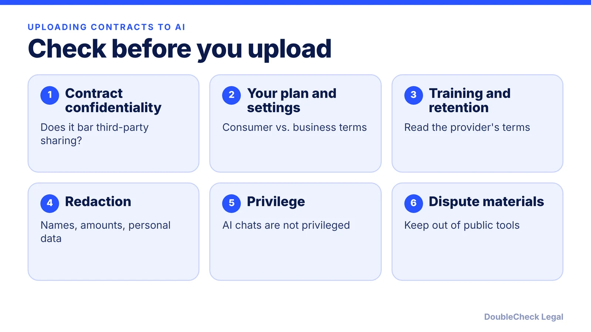
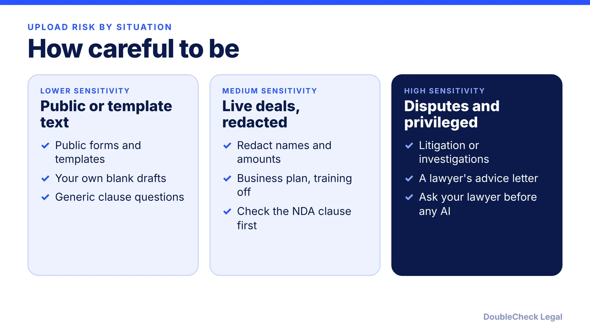

*Uploading a contract to an AI tool is a disclosure to a third party. Here is what to check on confidentiality, privilege, and retention first.*

**Key takeaways:**

- Check the contract's confidentiality clause, your plan's data terms, and how much detail the AI needs.
- OpenAI says it does not train on business data, but AI chats are not privileged, per Altman and Heppner.
- A May 2025 court order required preserving chats, including deleted ones, for many ChatGPT plans; it was later lifted.
- Redact, use business-grade accounts, and keep disputes and lawyer advice out of public tools.

## 1. The quick answer

**Quick answer:** Uploading a contract to ChatGPT is not automatically a breach of confidentiality, but it is a disclosure to a third-party service, so check three things first: the contract's own confidentiality clause, the plan and settings you are using, and how much sensitive detail the AI actually needs. OpenAI says it does not train on business data, but its own CEO has said AI conversations lack legal privilege, and a 2025 court order showed that chats can be preserved for litigation. Redact where you can, use a business-grade plan, and keep disputes out of public tools.

## 2. What the provider says, and what it does not cover

OpenAI's enterprise privacy page states: "We do not train on your business data, and our models don't learn from your usage." It also says you own your inputs and outputs (where allowed by law), that Enterprise customers control how long data is retained, that stored data is AES-256 encrypted and in-transit data uses TLS 1.2 or later, and that it has been audited for SOC 2 compliance.

Two cautions. First, those statements are about business products. I could not load OpenAI's consumer data-controls help page for this article, so check the current terms and your Data Controls settings for the plan you actually use, and do the same for any other provider. Second, "not used for training" is not the same as "private in a legal sense." Retention, access by provider staff, and legal process are separate questions.

The ABA's Formal Opinion 512 (July 29, 2024) gives lawyers a useful model. Per the National Law Review, lawyers must assess the risk of disclosure before entering client data into an AI tool, review the tool's privacy policy and terms, and recognize that data entered can be used for self-learning in ways that may disclose it. You are not bound by lawyer ethics rules, but the questions are the right ones for a business. See [what Opinion 512 means for clients](/blog/aba-formal-opinion-512-what-it-means-for-clients/).

## 3. Privilege, court orders, and your chat history

Confidentiality and privilege are different. Attorney-client privilege protects confidential communications with a lawyer. An AI chatbot is not a lawyer.

- **No privilege for the chat itself.** Sam Altman said on a podcast in 2025 that legal privilege does not yet apply to ChatGPT ("We haven't figured that out yet") and that OpenAI could be required to produce conversations in a lawsuit, per Benzinga. A federal court reached a similar result for one defendant's AI chats in *United States v. Heppner*; see [are your AI chats privileged?](/blog/ai-chats-not-privileged-heppner/).
- **Preservation orders happen.** Per VentureBeat, on May 13, 2025, Magistrate Judge Ona T. Wang ordered OpenAI to preserve output log data that would otherwise be deleted, in *New York Times v. OpenAI and Microsoft*. It covered ChatGPT Free, Plus, Pro, and Team users and API customers without zero data retention, including deleted and temporary chats. ChatGPT Enterprise, Edu, and zero-retention API users were excluded.
- **That order ended, with caveats.** Per Yahoo News, a new order on October 9 lifted it, but logs saved under the original order remain accessible to the plaintiffs, and OpenAI must keep logs for accounts the Times flagged.

The point is not that your contract was exposed. It is that deleting a chat does not guarantee the data is gone, and a dispute can reach the record.

## 4. A practical upload routine

Before you upload a contract, run this short routine:

1. **Read the contract's confidentiality clause.** If the agreement bars disclosure to third parties, ask whether an AI vendor counts. If unsure, get consent or redact.
2. **Use the right account.** Prefer a business plan with clear data terms over a personal account, and confirm the training and retention settings.
3. **Redact.** Replace names, addresses, amounts, and identifiers with placeholders. AI can usually analyze structure without them.
4. **Upload the minimum.** One clause often answers the question; the whole file may not be needed.
5. **Save outputs carefully.** Treat summaries as business records that could be requested later.
6. **Keep disputes out.** For live disputes, investigations, or anything a lawyer told you, ask your lawyer before using AI.

Companies can formalize this in an [AI policy for small businesses](/blog/ai-policy-template-small-business/). After the summary, verify it using [3 checks for ChatGPT and Claude legal work](/blog/chatgpt-claude-legal-work-3-checks/), and see [the 7 things to know about AI legal documents](/blog/ai-legal-documents-7-things-to-know/) and [AI contract review for small business](/blog/ai-contract-review-small-business/). Where a contract is high-stakes or the confidentiality question is unclear, [a lawyer's review of your AI output](/blog/lawyer-review-chatgpt-contract/) is the safer step.

## Where DoubleCheck fits

[DoubleCheck](https://www.contactdoublecheck.com) helps businesses and founders start legal work with AI, verify it, and, when professional advice is warranted, connect with an independent attorney, including for immigration questions. Attorney availability and practice areas vary. Attorneys on DoubleCheck are independent professionals; an attorney-client relationship forms only if an attorney accepts your engagement.

**Sources:** [OpenAI, Enterprise privacy](https://openai.com/enterprise-privacy/); [VentureBeat, OpenAI court order and AI privilege](https://venturebeat.com/ai/sam-altman-calls-for-ai-privilege-as-openai-clarifies-court-order-to-retain-temporary-and-deleted-chatgpt-sessions); [Yahoo News, judge lifts preservation order](https://www.yahoo.com/news/articles/judge-lifts-order-requiring-openai-151518813.html); [Benzinga, Altman on AI conversations](https://www.benzinga.com/markets/tech/25/07/46744816/sam-altman-warns-chatgpt-conversations-arent-protected-like-talking-with-your-psychologist-or-lawyer-we-could-be-required-to-produce-that-in-court); [National Law Review, ABA Formal Opinion 512](https://natlawreview.com/article/american-bar-association-issues-formal-opinion-use-generative-ai-tools).

## FAQ

**Is it safe to upload a contract to ChatGPT?**

It depends on the contract's confidentiality clause, the plan you use, and the sensitivity of the content. OpenAI says it does not train on business data, but legal privilege does not apply to AI chats. Redact and use business-grade settings.

**Does ChatGPT train on my uploaded contracts?**

Per OpenAI's enterprise privacy page, it does not train on business data. Consumer terms differ and I could not verify them for this article, so check your plan's Data Controls and the provider's current terms.

**Are my ChatGPT conversations privileged?**

No. Sam Altman has said privilege does not yet apply to ChatGPT, per Benzinga, and a federal court held one defendant's AI chats were not privileged in United States v. Heppner.

**Can deleted ChatGPT chats be retrieved?**

Sometimes. Per VentureBeat, a May 13, 2025 court order required OpenAI to preserve deleted and temporary chats for several plans. Per Yahoo News, it was lifted October 9, but previously saved logs remain accessible to the plaintiffs.

---

*General information only. This article is not legal, tax, investment, or accounting advice.*
